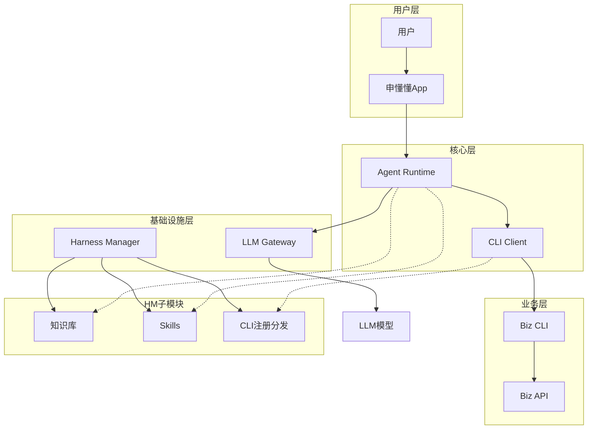
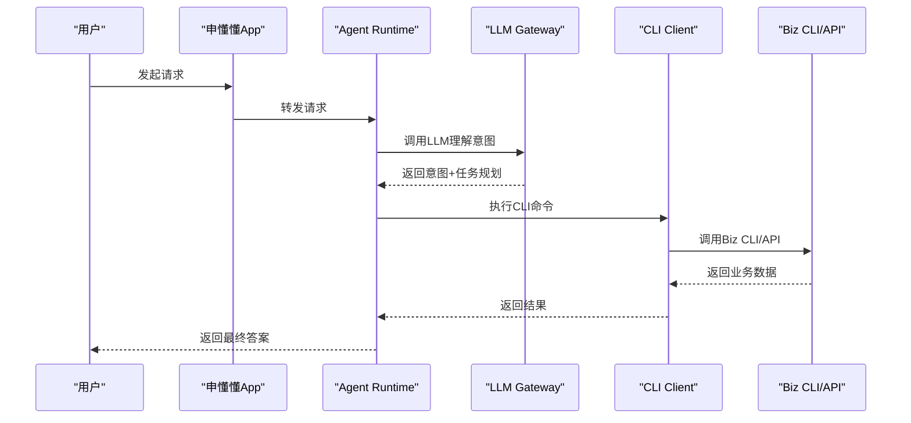
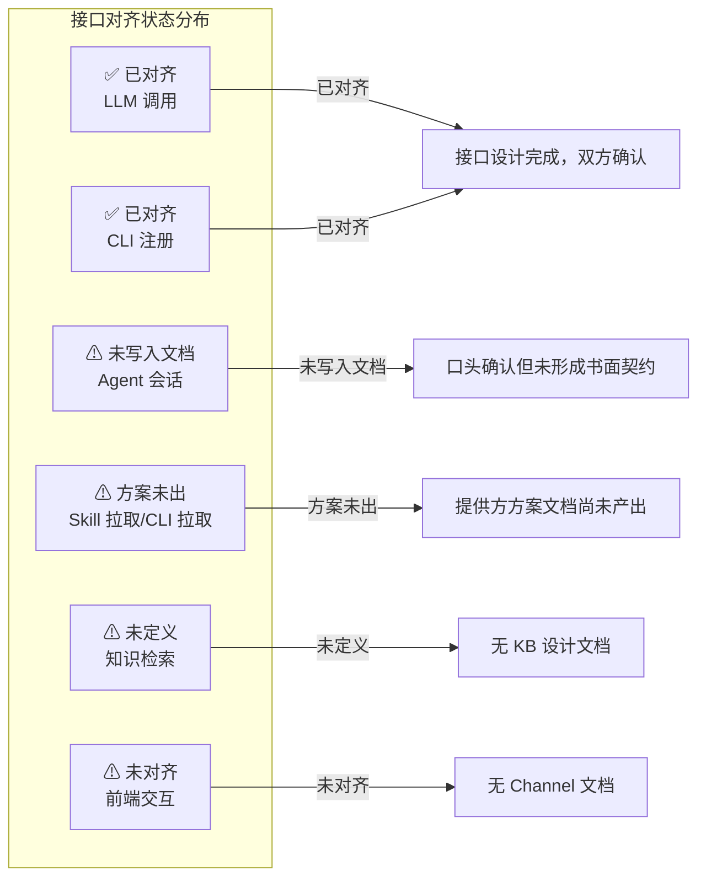
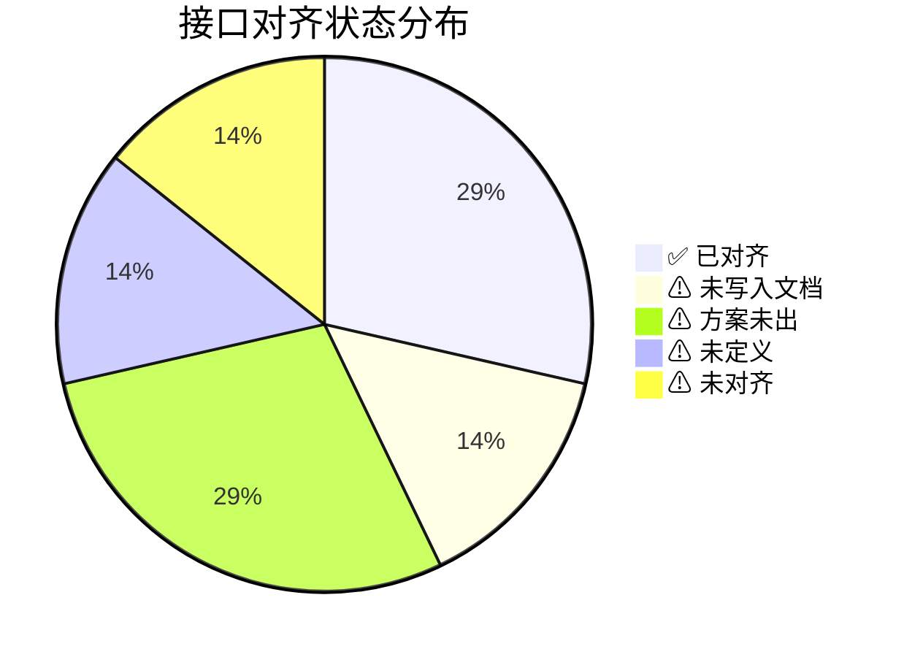
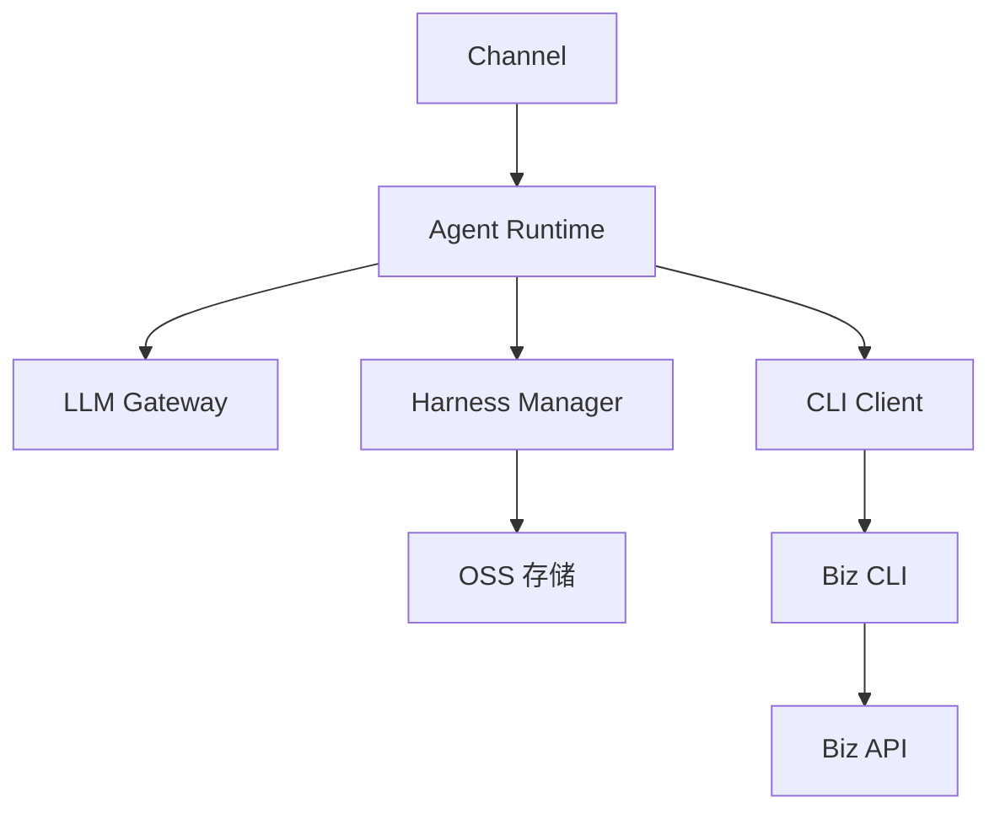

# 接口依赖矩阵

<cite>
**本文档引用的文件**
- [Sai整体架构设计.md](file://project/standup/Sai整体架构设计.md)
- [cross-module-design-review-2026-04-24.md](file://notes/zhaobomin/cross-module-design-review-2026-04-24.md)
- [SAI_CLI_设计文档_v1.2.md](file://plan/SAI_CLI_设计文档_v1.2.md)
- [Agent-Runtime方案.md](file://plan/Agent-Runtime方案.md)
- [LLM-Gateway建设方案.md](file://plan/LLM-Gateway建设方案.md)
- [agent-api-discovery-architecture-review.zh-CN.md](file://notes/zhaobomin/agent-api-discovery-architecture-review.zh-CN.md)
- [项目管理方案v1.0.md](file://project/项目管理方案v1.0.md)
- [suiyun.md](file://daily/2026-04-22/suiyun.md)
</cite>

## 目录
1. [简介](#简介)
2. [项目结构](#项目结构)
3. [核心组件](#核心组件)
4. [架构概览](#架构概览)
5. [详细组件分析](#详细组件分析)
6. [依赖分析](#依赖分析)
7. [性能考量](#性能考量)
8. [故障排查指南](#故障排查指南)
9. [结论](#结论)
10. [附录](#附录)

## 简介
本文件围绕 SAI 平台的模块接口依赖，基于接口依赖关系表，系统化分析模块间的调用关系与依赖强度，提供接口对齐状态的可视化分布，并识别风险点与潜在冲突，提出优化建议与治理机制。文档同时解释接口版本兼容性与演进策略，给出可操作的监控指标与治理实践。

## 项目结构
SAI 项目采用三层架构与五模块划分，公共文档库统一沉淀设计与接口契约：
- 三层架构：Channel 层（用户接入）、核心层（Agent Runtime、Harness Manager）、基础设施层（LLM Gateway、CLI API）
- 五模块职责：Agent Runtime（意图理解与执行）、LLM Gateway（统一代理与成本控制）、Harness Manager（知识库、Skills、CLI 注册分发）、Channel（前端接入）、Biz CLI（业务能力封装）

**图表来源**
- [Sai整体架构设计.md:19-65](file://project/standup/Sai整体架构设计.md#L19-L65)

**章节来源**
- [项目管理方案v1.0.md:21-49](file://project/项目管理方案v1.0.md#L21-L49)
- [项目管理方案v1.0.md:90-131](file://project/项目管理方案v1.0.md#L90-L131)

## 核心组件
- Agent Runtime：负责意图理解、会话管理、CLI 调用与执行，依赖 LLM Gateway 进行意图理解，依赖 HM 拉取 Skills 与 CLI 元数据，依赖 Biz CLI 执行业务 API。
- LLM Gateway：统一代理与路由，提供 OpenAI 格式接口，负责成本控制与额度告警。
- Harness Manager：控制面服务，提供知识库、Skills、CLI 注册分发，通过 OSS 存储与分发产物。
- Channel（申懂懂 App）：用户接入层，负责前端交互与会话转发，需与 Agent Runtime 对齐接口。
- Biz CLI：封装业务能力，提供后端 API，由 HM 统一构建与分发。

**章节来源**
- [Sai整体架构设计.md:142-151](file://project/standup/Sai整体架构设计.md#L142-L151)
- [Agent-Runtime方案.md:4-13](file://plan/Agent-Runtime方案.md#L4-L13)

## 架构概览
SAI 两条核心链路：
- 意图理解链路：用户 → App → Agent → LLM Gateway → LLM
- 业务执行链路：Agent → CLI Client → Biz CLI → Biz API

**图表来源**
- [Sai整体架构设计.md:115-138](file://project/standup/Sai整体架构设计.md#L115-L138)

**章节来源**
- [Sai整体架构设计.md:108-138](file://project/standup/Sai整体架构设计.md#L108-L138)

## 详细组件分析

### 模块间接口依赖矩阵
基于接口依赖关系表，对齐状态分为三类：✅ 已对齐、⚠ 未写入文档、⚠ 方案未出。

**图表来源**
- [Sai整体架构设计.md:154-170](file://project/standup/Sai整体架构设计.md#L154-L170)

**章节来源**
- [Sai整体架构设计.md:154-170](file://project/standup/Sai整体架构设计.md#L154-L170)

### 接口对齐状态可视化
- 已对齐：LLM 调用（OpenAI 格式）、CLI 注册（v1.2 已定义接口路径）
- 未写入文档：Agent 会话（Channel → Agent Runtime）
- 方案未出：Skill 拉取（Agent Runtime → HM）、CLI 拉取（CLI Client → HM）
- 未定义：知识检索（Agent Runtime → HM）
- 未对齐：前端交互（申懂懂 App → Channel）

**图表来源**
- [Sai整体架构设计.md:154-170](file://project/standup/Sai整体架构设计.md#L154-L170)

**章节来源**
- [cross-module-design-review-2026-04-24.md:254-267](file://notes/zhaobomin/cross-module-design-review-2026-04-24.md#L254-L267)

### 接口依赖风险与潜在冲突
- Agent Runtime ↔ HM 接口契约缺失：缺少具体 schema、分页与缓存策略，导致对接返工风险高。
- Channel 设计文档缺失：前端接入方案、消息协议、会话管理均未定义，阻塞前端集成。
- LLM Gateway 逃生方案未定：网关故障时无明确回退路径，影响业务连续性。
- CLI 开发职责矛盾：v1.0 与 v1.2 方案对 CLI 开发职责相反，易引发返工。
- OSS 挂载个性化需求未评估：若阿里云评估无结论，将影响 HM CLI 分发方案。

**章节来源**
- [cross-module-design-review-2026-04-24.md:171-221](file://notes/zhaobomin/cross-module-design-review-2026-04-24.md#L171-L221)
- [cross-module-design-review-2026-04-24.md:115-135](file://notes/zhaobomin/cross-module-design-review-2026-04-24.md#L115-L135)
- [cross-module-design-review-2026-04-24.md:128-135](file://notes/zhaobomin/cross-module-design-review-2026-04-24.md#L128-L135)

### 依赖优化建议
- 明确接口契约：优先补齐 Agent Runtime ↔ HM 的 Skill/CLI 拉取接口 schema，确保分页、缓存策略与版本管理。
- 同步文档与实现：落实“Git 即进度”原则，接口设计完成后同步到 docs 仓库，避免口头确认。
- 统一 CLI 开发职责：确保所有业务域与开发者明确 v1.2 的统一构建与分发模式，避免返工。
- 制定逃生方案：明确 LLM Gateway 的 bypass 模式与业务侧 fallback 直连方案，保障故障时的业务连续性。
- 建立全局错误码规范：统一认证、参数、服务不可用、限流与业务错误的错误码体系，降低跨模块集成成本。

**章节来源**
- [cross-module-design-review-2026-04-24.md:270-292](file://notes/zhaobomin/cross-module-design-review-2026-04-24.md#L270-L292)
- [项目管理方案v1.0.md:74-82](file://project/项目管理方案v1.0.md#L74-L82)

### 接口版本兼容性与演进策略
- 以 v1.2 为基准：统一构建与分发模式、9 维 Tag 体系、PoP Token 分期实施，确保接口演进的一致性。
- 兼容性设计：Agent Runtime 的 CLI 层保持薄而可靠，不负责复杂语义搜索，将 API 语义、适用边界与参数推断交由 HM 注册中心承担。
- 演进路线：先修复 CLI 可靠性问题（非 2xx 映射、动态命令兜底分发），再扩展注册中心元数据协议，最后增强 Agent 工具链与内部实现拆分。

**章节来源**
- [SAI_CLI_设计文档_v1.2.md:11-16](file://plan/SAI_CLI_设计文档_v1.2.md#L11-L16)
- [agent-api-discovery-architecture-review.zh-CN.md:527-552](file://notes/zhaobomin/agent-api-discovery-architecture-review.zh-CN.md#L527-L552)

### 接口依赖监控指标与治理机制
- 监控指标
  - 接口可用性：成功率、错误率、P95/P99 延迟
  - 性能指标：冷启动/热启动时间、Agent 实例并发、CLI 命令执行时延
  - 成本与预算：额度使用率、告警触发次数、熔断次数
  - 集成健康：Skill/CLI 拉取成功率、OSS 分发命中率、缓存命中率
- 治理机制
  - 接口契约治理：接口设计与实现同步，文档与代码同日更新
  - 风险分级与处置：P0（4/25 前必须完成）优先级项，明确责任人与完成时限
  - 逃生与降级：建立网关 bypass 与业务侧 fallback 机制，确保故障时业务连续性

**章节来源**
- [Sai整体架构设计.md:236-245](file://project/standup/Sai整体架构设计.md#L236-L245)
- [cross-module-design-review-2026-04-24.md:270-292](file://notes/zhaobomin/cross-module-design-review-2026-04-24.md#L270-L292)

## 依赖分析
模块间依赖关系与强度：
- Agent Runtime 依赖 LLM Gateway（意图理解）、HM（Skills/CLI 元数据）、Biz CLI（业务执行）
- HM 依赖 OSS 存储与分发，提供注册中心与知识库能力
- Channel 依赖 Agent Runtime 的会话与消息协议
- Biz CLI 依赖后端 API，由 HM 统一构建与分发

**图表来源**
- [Sai整体架构设计.md:154-170](file://project/standup/Sai整体架构设计.md#L154-L170)

**章节来源**
- [Sai整体架构设计.md:154-170](file://project/standup/Sai整体架构设计.md#L154-L170)

## 性能考量
- Agent Runtime：冷启动 <1s，热启动 <200ms，实例按会话隔离，Serverless 平台支持秒级销毁重建
- LLM Gateway：支持 qwen 系列模型路由，个人用户并发与额度告警可触发
- HM：控制面服务，故障时 Agent 使用本地缓存继续运行，不影响业务执行链路
- CLI：统一构建为单一二进制文件，部署简单，跨平台支持良好

**章节来源**
- [Agent-Runtime方案.md:4-13](file://plan/Agent-Runtime方案.md#L4-L13)
- [LLM-Gateway建设方案.md:95-101](file://plan/LLM-Gateway建设方案.md#L95-L101)
- [Sai整体架构设计.md:236-245](file://project/standup/Sai整体架构设计.md#L236-L245)

## 故障排查指南
- HM 不可用：Agent 使用本地缓存最近一次 Skill/CLI 定义，降级为无知识检索模式
- LLM Gateway 熔断：Agent 返回固定提示，业务执行链路不受影响
- Biz API 超时/失败：CLI Client 单次重试（≤3s），失败后向用户说明具体接口不可用
- OSS 不可用：Agent 使用本地缓存版本运行，日志告警通知 HM 团队
- Agent Runtime 实例崩溃：Serverless 平台自动重建实例，用户会话需重新发起

**章节来源**
- [Sai整体架构设计.md:236-245](file://project/standup/Sai整体架构设计.md#L236-L245)

## 结论
SAI 平台在整体架构与 CLI 设计方面具备清晰的职责边界与演进路线，但在跨模块接口契约、文档完整性与风险处置方面仍存在较大缺口。建议优先补齐 Agent Runtime ↔ HM 的接口契约、Channel 设计文档与 LLM Gateway 逃生方案，建立全局错误码规范与监控治理机制，确保 4/30 交付目标的顺利达成。

## 附录
- 接口对齐状态汇总（基于 2026-04-24 审查）
  - ✅ 已对齐：LLM 调用（OpenAI 格式）、CLI 注册（v1.2 接口定义）
  - ⚠ 未写入文档：Agent 会话（Channel → Agent Runtime）
  - ⚠ 方案未出：Skill 拉取（Agent Runtime → HM）、CLI 拉取（CLI Client → HM）
  - ⚠ 未定义：知识检索（Agent Runtime → HM）
  - ⚠ 未对齐：前端交互（申懂懂 App → Channel）

**章节来源**
- [cross-module-design-review-2026-04-24.md:254-267](file://notes/zhaobomin/cross-module-design-review-2026-04-24.md#L254-L267)