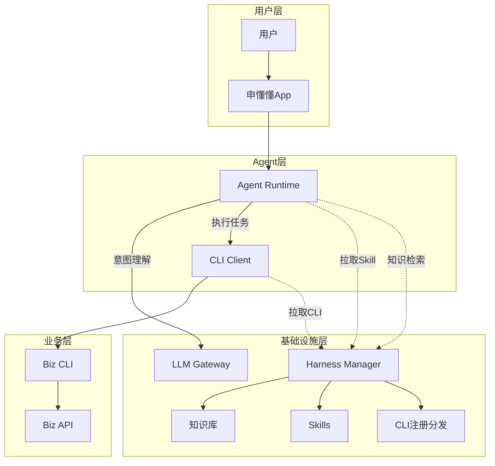
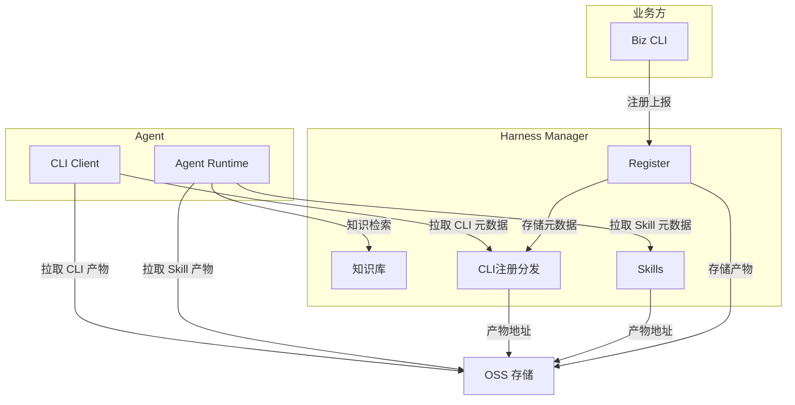
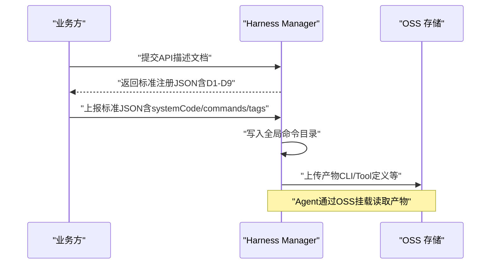
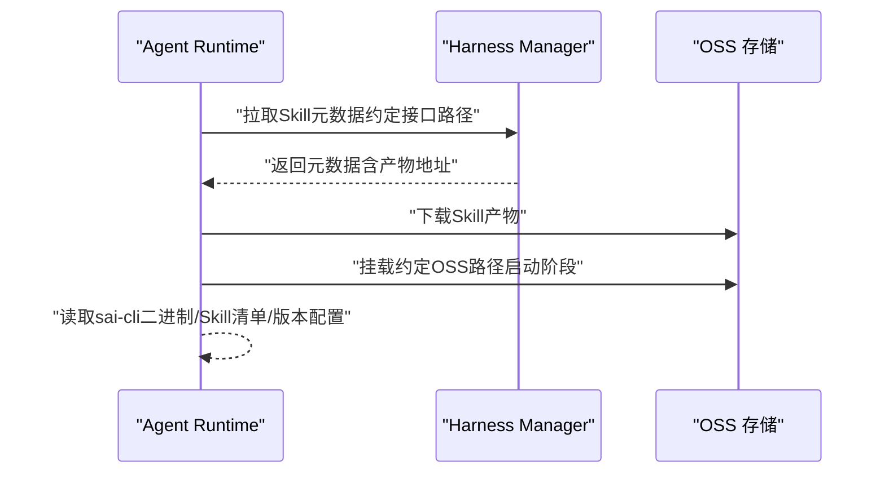
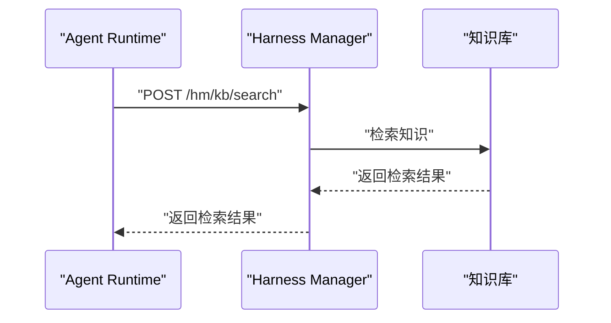
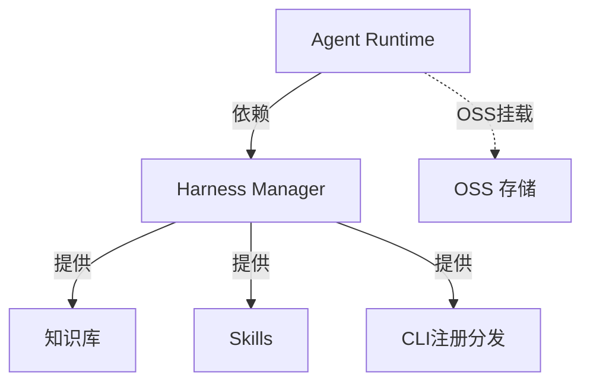

# Harness Manager数据流

<cite>
**本文引用的文件**
- [Sai整体架构设计.md](file://project/standup/Sai整体架构设计.md)
- [SAI_CLI_设计文档_v1.2.md](file://plan/SAI_CLI_设计文档_v1.2.md)
- [2026-04-22日报.md](file://daily/2026-04-22/suiyun.md)
- [2026-04-23日报.md](file://daily/2026-04-23/suiyun.md)
- [Agent-Runtime方案review.md](file://notes/zhaobomin/Agent-Runtime方案review.md)
- [cross-module-design-review-2026-04-24.md](file://notes/zhaobomin/cross-module-design-review-2026-04-24.md)
- [agent-api-discovery-architecture-review.zh-CN.md](file://notes/zhaobomin/agent-api-discovery-architecture-review.zh-CN.md)
</cite>

## 目录
1. [简介](#简介)
2. [项目结构](#项目结构)
3. [核心组件](#核心组件)
4. [架构总览](#架构总览)
5. [详细组件分析](#详细组件分析)
6. [依赖分析](#依赖分析)
7. [性能考量](#性能考量)
8. [故障排查指南](#故障排查指南)
9. [结论](#结论)
10. [附录](#附录)

## 简介
本文件聚焦Harness Manager（简称HM）作为控制面服务的三条核心数据流：注册流、拉取流、检索流。围绕业务方如何通过HM注册CLI、Agent如何从HM拉取Skill和CLI定义、Agent如何进行知识检索，系统阐述OSS存储的使用方式、元数据管理机制与产物分发流程，并提供注册、拉取、检索的API示例路径、数据格式规范与错误处理策略。

## 项目结构
- 整体架构以“用户层 → Agent层 → 基础设施层（LLM Gateway、HM）→ 业务层（Biz CLI/Biz API）”为主线，HM在基础设施层内提供知识库（KB）、Skills、CLI注册分发三大子模块。
- HM与Agent之间通过OSS挂载进行解耦：Agent在启动阶段挂载约定的OSS路径，直接从挂载目录读取sai-cli二进制、Skill元数据清单及版本配置，避免直接调用HM API。

**图表来源**
- [Sai整体架构设计.md:19-65](file://project/standup/Sai整体架构设计.md#L19-L65)

**章节来源**
- [Sai整体架构设计.md:15-65](file://project/standup/Sai整体架构设计.md#L15-L65)

## 核心组件
- 知识库（KB）：企业知识存储与检索，Agent可进行知识检索辅助决策。
- Skills：Skill注册与管理，Agent从HM拉取Skill定义。
- CLI注册分发：业务方上报CLI元数据，存储到OSS，Agent从OSS拉取CLI定义。

**章节来源**
- [Sai整体架构设计.md:173-195](file://project/standup/Sai整体架构设计.md#L173-L195)

## 架构总览
HM三条核心数据流：
- 注册流：业务方 → HM → OSS（元数据与产物）
- 拉取流：Agent → HM（元数据） → OSS（产物）
- 检索流：Agent → HM → KB

**图表来源**
- [Sai整体架构设计.md:67-106](file://project/standup/Sai整体架构设计.md#L67-L106)

**章节来源**
- [Sai整体架构设计.md:67-106](file://project/standup/Sai整体架构设计.md#L67-L106)

## 详细组件分析

### 注册流（业务方 → HM → OSS）
- 业务方通过API提交API描述文档，调用AI元数据生成接口，得到标准注册JSON（含systemCode、commands、tags等），随后调用命令注册接口，将标准JSON写入全局命令目录。
- HM将元数据与产物分别存储到OSS，Agent通过OSS挂载读取。
- 注册流程要点：
  - AI自动提取Tag（D1-D9），重复度检测，返回补充指引。
  - 注册接口接收标准JSON，写入全局命令目录。
  - 产物上传至约定OSS路径，便于Agent挂载读取。

**图表来源**
- [2026-04-22日报.md:19-31](file://daily/2026-04-22/suiyun.md#L19-L31)
- [Sai整体架构设计.md:156-163](file://project/standup/Sai整体架构设计.md#L156-L163)

**章节来源**
- [2026-04-22日报.md:19-31](file://daily/2026-04-22/suiyun.md#L19-L31)
- [Sai整体架构设计.md:156-163](file://project/standup/Sai整体架构设计.md#L156-L163)

### 拉取流（Agent → HM → OSS）
- Agent在启动阶段自动挂载指定OSS路径，从挂载目录读取sai-cli二进制、Skill元数据清单及版本配置。
- Agent通过HM拉取Skill元数据，再从OSS下载对应产物；CLI拉取亦遵循相同模式。
- 拉取流程要点：
  - Agent不直接调用HM API，通过OSS挂载进行解耦。
  - 挂载时机：Agent启动阶段。
  - 挂载规范：完成OSS Bucket申请与目录结构定义，确保产物存放路径与Agent侧读取逻辑对齐。
  - 路径规范：CLI网关、系统内置技能、公共技能、用户技能等均有约定的OSS路径前缀。

**图表来源**
- [2026-04-22日报.md:40-43](file://daily/2026-04-22/suiyun.md#L40-L43)
- [Sai整体架构设计.md:156-163](file://project/standup/Sai整体架构设计.md#L156-L163)
- [SAI_CLI_设计文档_v1.2.md:565-591](file://plan/SAI_CLI_设计文档_v1.2.md#L565-L591)

**章节来源**
- [2026-04-22日报.md:40-43](file://daily/2026-04-22/suiyun.md#L40-L43)
- [SAI_CLI_设计文档_v1.2.md:565-591](file://plan/SAI_CLI_设计文档_v1.2.md#L565-L591)

### 检索流（Agent → HM → KB）
- Agent通过HM的知识库进行检索，辅助决策与结果解读。
- 检索接口路径与认证方式在接口矩阵中有约定，但KB具体设计仍在完善中。

**图表来源**
- [Sai整体架构设计.md:156-163](file://project/standup/Sai整体架构设计.md#L156-L163)

**章节来源**
- [Sai整体架构设计.md:156-163](file://project/standup/Sai整体架构设计.md#L156-L163)

## 依赖分析
- Agent Runtime与HM的接口契约尚未完全闭合，存在“Skill拉取”“CLI拉取”“知识检索”等接口定义缺失或不完整的情况。
- Agent Runtime文档中提及“看隋云那边skill分发的策略”，但未明确具体接口定义与数据格式。
- OSS挂载在Agent Runtime中为Block点，若阿里云个性化挂载评估无结论，则需启动Agent层自行实现文件权限的B方案。

**图表来源**
- [cross-module-design-review-2026-04-24.md:160-168](file://notes/zhaobomin/cross-module-design-review-2026-04-24.md#L160-L168)
- [Agent-Runtime方案review.md:12-13](file://notes/zhaobomin/Agent-Runtime方案review.md#L12-L13)

**章节来源**
- [cross-module-design-review-2026-04-24.md:160-168](file://notes/zhaobomin/cross-module-design-review-2026-04-24.md#L160-L168)
- [Agent-Runtime方案review.md:12-13](file://notes/zhaobomin/Agent-Runtime方案review.md#L12-L13)

## 性能考量
- 冷启动目标：<1s；热启动<200ms（来自Agent Runtime方案）。
- Agent启动阶段通过OSS挂载读取产物，减少网络请求与解析开销。
- 注册流与拉取流均强调“约定路径规范”，有利于缓存与增量同步策略的落地。

**章节来源**
- [Agent-Runtime方案.md:1-60](file://plan/Agent-Runtime方案.md#L1-L60)
- [2026-04-23日报.md:1-53](file://daily/2026-04-23/suiyun.md#L1-L53)

## 故障排查指南
- HM不可用：Agent使用本地缓存的Skill/CLI定义继续运行，知识检索降级为无知识检索模式。
- OSS不可用：Agent使用本地缓存版本运行，日志告警通知HM团队。
- LLM Gateway熔断：Agent返回固定提示，业务执行链路不受影响。
- Biz API超时/失败：CLI Client单次重试（≤3s等待），失败后Agent向用户说明具体接口不可用。

**章节来源**
- [Sai整体架构设计.md:236-245](file://project/standup/Sai整体架构设计.md#L236-L245)

## 结论
- HM通过“注册流→元数据+产物存储→OSS挂载→Agent拉取”的闭环，实现业务方与Agent的解耦。
- 注册流强调AI自动生成9维Tag与重复度检测；拉取流强调OSS挂载与路径规范；检索流强调KB与Agent的协作。
- 当前接口契约与KB设计仍有缺失，需尽快补齐Skill/CLI拉取接口定义与KB检索规范，以保障4/30交付。

## 附录

### API示例与数据格式规范
- 注册接口（示例路径）
  - AI元数据生成：POST /api/v1/sai/cli/metadata/generate
  - 命令注册：POST /api/v1/sai/cli/registry（支持add/update/remove）
- 拉取接口（示例路径）
  - Skill拉取：GET /hm/skills/list（需补充请求参数、响应schema、分页、缓存策略）
  - CLI元数据：GET /hm/cli/meta（需补充版本查询、增量同步）
- 检索接口（示例路径）
  - 知识检索：POST /hm/kb/search（需补充查询语法、返回格式、相似度阈值）

**章节来源**
- [SAI_CLI_设计文档_v1.2.md:376-391](file://plan/SAI_CLI_设计文档_v1.2.md#L376-L391)
- [Sai整体架构设计.md:156-163](file://project/standup/Sai整体架构设计.md#L156-L163)
- [cross-module-design-review-2026-04-24.md:187-197](file://notes/zhaobomin/cross-module-design-review-2026-04-24.md#L187-L197)

### 元数据与产物分发
- 9维Tag体系（D1-D9）：路由与分类组、NLU理解组、执行与展示组，用于命令匹配、参数构造与结果解读。
- 产物分发：统一sai-cli二进制与Skill/CLI定义通过OSS挂载分发，Agent启动阶段读取。
- 目录规范：CLI网关、系统内置技能、公共技能、用户技能等路径前缀已明确。

**章节来源**
- [SAI_CLI_设计文档_v1.2.md:151-223](file://plan/SAI_CLI_设计文档_v1.2.md#L151-L223)
- [SAI_CLI_设计文档_v1.2.md:565-591](file://plan/SAI_CLI_设计文档_v1.2.md#L565-L591)

### 错误处理策略
- 结构化错误输出：统一包含type、code、message、hint字段，便于Agent与用户理解与修复。
- 重试与降级：Biz API失败单次重试；HM/KM/OSS不可用时Agent使用本地缓存并告警。
- 全局错误码建议：认证错误（401/403）、参数错误（400）、服务不可用（503）、限流（429）、业务错误（带code+message）。

**章节来源**
- [SAI_CLI_设计文档_v1.2.md:295-336](file://plan/SAI_CLI_设计文档_v1.2.md#L295-L336)
- [Sai整体架构设计.md:236-245](file://project/standup/Sai整体架构设计.md#L236-L245)