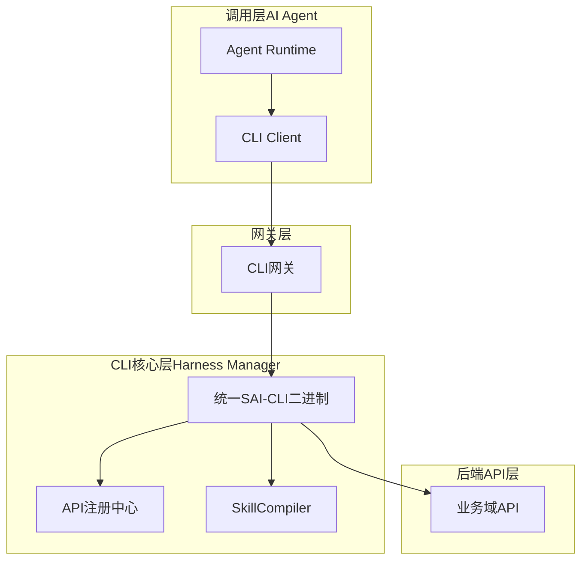
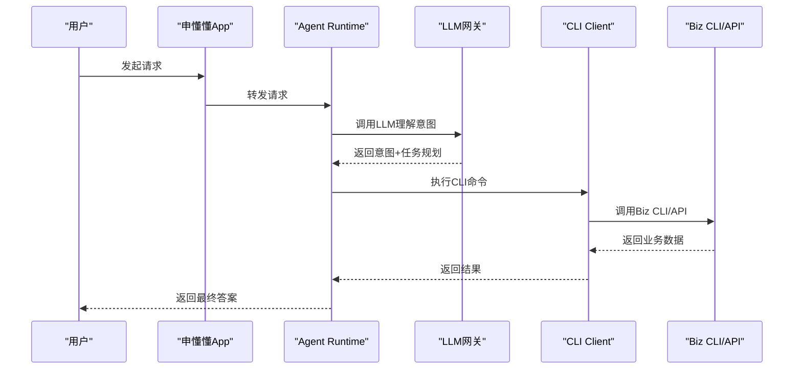
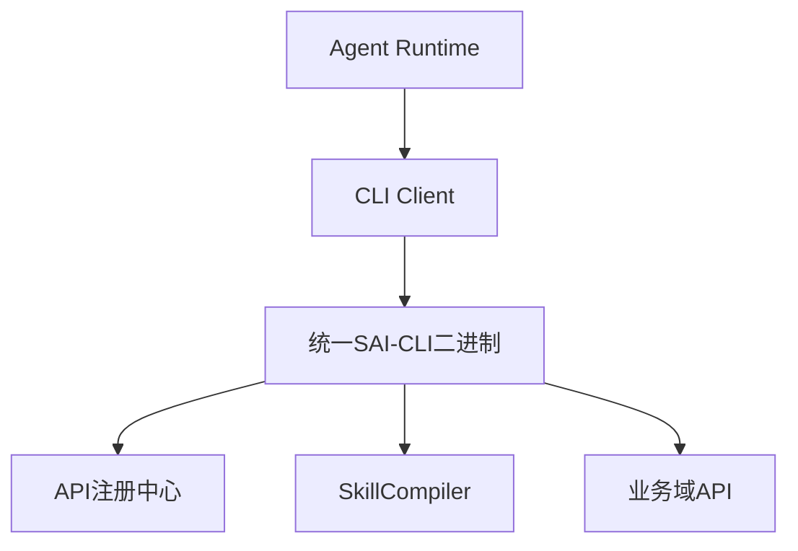
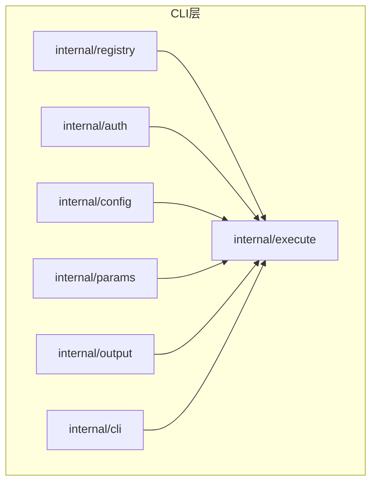

# 业务执行链路

<cite>
**本文引用的文件**   
- [Agent-Runtime方案.md](file://plan/Agent-Runtime方案.md)
- [SAI_CLI_设计文档_v1.2.md](file://plan/SAI_CLI_设计文档_v1.2.md)
- [agent-api-discovery-architecture-review.zh-CN.md](file://notes/zhaobomin/agent-api-discovery-architecture-review.zh-CN.md)
- [CLI 架构与规范对焦.md](file://plan/CLI 架构与规范对焦.md)
- [Sai整体架构设计.md](file://project/standup/Sai整体架构设计.md)
- [2026-04-22日报.md](file://project/SAI-daily-report-2026-04-22-final.md)
- [2026-04-20早会记录.md](file://project/standup/2026-04-20-zhaobomin.md)
- [项目管理方案v1.0.md](file://project/项目管理方案v1.0.md)
- [2026-04-23凌雪.md](file://daily/2026-04-23/lingxue.md)
</cite>

## 目录
1. [简介](#简介)
2. [项目结构](#项目结构)
3. [核心组件](#核心组件)
4. [架构总览](#架构总览)
5. [详细组件分析](#详细组件分析)
6. [依赖分析](#依赖分析)
7. [性能考量](#性能考量)
8. [故障排查指南](#故障排查指南)
9. [结论](#结论)
10. [附录](#附录)

## 简介
本文件聚焦SAI智能体平台的业务执行链路，围绕以下目标展开：
- Agent Runtime如何执行CLI命令
- CLI Client如何调用Biz CLI
- Biz CLI如何访问Biz API
- 本地CLI调用协议、HTTP调用规范与API响应格式
- CLI命令的执行机制、参数传递、错误处理与重试策略
- 具体CLI命令示例、API调用示例与故障排查指南
- 执行链路中的性能瓶颈与优化建议

## 项目结构
SAI采用四层分层架构，实现AI Agent与各业务域后端服务的标准化接入：
- 调用层（AI Agent）：根据用户提问搜索SAI-CLI中的API，结合上下文选择匹配API，拼接执行命令并返回结构化结果
- 网关层（CLI路由/鉴权）：路由转发、鉴权校验（PoP签名验证）、负载均衡、命令清单同步
- CLI核心层（Harness Manager统一构建与维护）：统一命令规范、入参/出参JSON、公共能力（认证/日志）、API注册中心、SkillCompiler
- 后端API层（各业务域只提供API接口）

图表来源
- [SAI_CLI_设计文档_v1.2.md:29-75](file://plan/SAI_CLI_设计文档_v1.2.md#L29-L75)

章节来源
- [SAI_CLI_设计文档_v1.2.md:29-75](file://plan/SAI_CLI_设计文档_v1.2.md#L29-L75)

## 核心组件
- Agent Runtime：负责意图理解、任务规划、与CLI Client交互、执行CLI命令、返回结构化结果
- CLI Client：在Agent Runtime中作为本地命令执行器，负责拼接命令、调用统一SAI-CLI并解析结果
- SAI-CLI（Harness Manager统一构建）：统一命令规范、入参/出参JSON、鉴权、路由与负载均衡
- Biz CLI：业务域CLI，封装具体API调用，提供HTTP/RPC接口
- Biz API：业务域后端API，提供REST接口
- 网关层：负责路由转发、鉴权（PoP签名验证）、命令清单同步

章节来源
- [Sai整体架构设计.md:108-138](file://project/standup/Sai整体架构设计.md#L108-L138)
- [SAI_CLI_设计文档_v1.2.md:69-74](file://plan/SAI_CLI_设计文档_v1.2.md#L69-L74)

## 架构总览
SAI的整体调用链路分为两条：
- 意图理解链路：用户 → App → Agent → LLM Gateway → LLM
- 业务执行链路：Agent → CLI Client → Biz CLI → Biz API

图表来源
- [Sai整体架构设计.md:115-138](file://project/standup/Sai整体架构设计.md#L115-L138)

章节来源
- [Sai整体架构设计.md:108-138](file://project/standup/Sai整体架构设计.md#L108-L138)

## 详细组件分析

### Agent Runtime与CLI Client交互
- Agent Runtime负责意图理解与任务规划，随后通过CLI Client执行CLI命令
- CLI Client在Agent Runtime中作为本地命令执行器，负责拼接命令、调用统一SAI-CLI并解析结果
- Agent Runtime与CLI Client之间通过本地调用协议交互，CLI命令格式为统一规范

图表来源
- [Sai整体架构设计.md:108-138](file://project/standup/Sai整体架构设计.md#L108-L138)

章节来源
- [Sai整体架构设计.md:108-138](file://project/standup/Sai整体架构设计.md#L108-L138)

### CLI命令执行机制与参数传递
- 命令格式：{product} {module} {action} [params]
- 参数传递：支持--params JSON与--key value合并规则，兼顾机器调用与人工调试
- 无交互式输入要求：CLI命令必须支持纯参数化调用，禁止运行时弹出任何交互式提示
- 结构化输出：所有输出必须为结构化JSON，包含固定字段（type、code、message、hint）

章节来源
- [SAI_CLI_设计文档_v1.2.md:117-146](file://plan/SAI_CLI_设计文档_v1.2.md#L117-L146)
- [SAI_CLI_设计文档_v1.2.md:295-336](file://plan/SAI_CLI_设计文档_v1.2.md#L295-L336)

### HTTP调用规范与API响应格式
- 调用协议：Agent → CLI Client（本地调用）；CLI Client → Biz CLI（HTTP）；Biz CLI → Biz API（HTTP/RPC）
- 鉴权方案：PoP Token + ECDSA签名（分一期/二期实施），支持AK/SK签名鉴权（Harness Manager API）
- 响应格式：统一JSON envelope输出，成功与失败均以结构化JSON呈现

章节来源
- [Sai整体架构设计.md:197-222](file://project/standup/Sai整体架构设计.md#L197-L222)
- [SAI_CLI_设计文档_v1.2.md:394-471](file://plan/SAI_CLI_设计文档_v1.2.md#L394-L471)

### Biz CLI如何访问Biz API
- Biz CLI封装具体业务API调用，提供HTTP接口
- 通过统一SAI-CLI路由与鉴权，Biz CLI与后端API之间采用HTTP调用
- 配置文件格式：~/.sai/sso-auth.json，包含token、identity_type、scopes、expires_at等

章节来源
- [SAI_CLI_设计文档_v1.2.md:461-471](file://plan/SAI_CLI_设计文档_v1.2.md#L461-L471)

### 错误处理与重试策略
- 结构化错误输出：type、code、message、hint四个字段
- 非2xx状态码处理：建议在执行器中对非2xx返回typed error，并按状态码映射错误类型
- 重试策略：建议在执行器中引入指数退避重试，针对5xx与鉴权错误（401/403）进行差异化处理

章节来源
- [agent-api-discovery-architecture-review.zh-CN.md:68-95](file://notes/zhaobomin/agent-api-discovery-architecture-review.zh-CN.md#L68-L95)
- [SAI_CLI_设计文档_v1.2.md:295-336](file://plan/SAI_CLI_设计文档_v1.2.md#L295-L336)

### CLI命令示例与API调用示例
- 命令示例：kunlun timeliness query --type 出港滞留 --date 2026-04-24
- API调用示例：通过CLI Client调用Biz CLI，Biz CLI调用后端API返回JSON结果
- 本地调用：Agent Runtime通过CLI Client执行本地CLI命令，命令格式与参数传递遵循统一规范

章节来源
- [SAI_CLI_设计文档_v1.2.md:136-145](file://plan/SAI_CLI_设计文档_v1.2.md#L136-L145)
- [Sai整体架构设计.md:115-138](file://project/standup/Sai整体架构设计.md#L115-L138)

## 依赖分析
SAI的模块边界清晰，职责分离：
- internal/cli：Cobra命令注册、鉴权门禁、动态命令分发
- internal/registry：命令注册中心客户端、schema读取、本地缓存、discover/list解析
- internal/execute：按registry的execute元数据构造并调用目标API
- internal/auth：本地登录态读写和token过期判断
- internal/config：环境profile、URL、TTL、超时等配置解析
- internal/params：参数解析与合并
- internal/output：统一JSON输出

图表来源
- [agent-api-discovery-architecture-review.zh-CN.md:28-38](file://notes/zhaobomin/agent-api-discovery-architecture-review.zh-CN.md#L28-L38)

章节来源
- [agent-api-discovery-architecture-review.zh-CN.md:28-38](file://notes/zhaobomin/agent-api-discovery-architecture-review.zh-CN.md#L28-L38)

## 性能考量
- 热启动与冷启动：Agent Runtime采用serverless（AgentRun），热启动约100ms，冷启动<1s
- 动态命令兜底分发：建议在main.go或root command层接入TryDynamicDispatch，避免合法动态命令依赖启动时预挂载
- 下游请求日志：建议仅在SAI_DEBUG=true时输出，并对敏感字段做masking
- 构建阶段校验：生产profile中不允许占位URL进入产物，避免发布后暴露问题

章节来源
- [Agent-Runtime方案.md:6-13](file://plan/Agent-Runtime方案.md#L6-L13)
- [agent-api-discovery-architecture-review.zh-CN.md:42-67](file://notes/zhaobomin/agent-api-discovery-architecture-review.zh-CN.md#L42-L67)
- [agent-api-discovery-architecture-review.zh-CN.md:115-134](file://notes/zhaobomin/agent-api-discovery-architecture-review.zh-CN.md#L115-L134)
- [agent-api-discovery-architecture-review.zh-CN.md:96-114](file://notes/zhaobomin/agent-api-discovery-architecture-review.zh-CN.md#L96-L114)

## 故障排查指南
- 非2xx状态码被包装成成功：修复执行器对非2xx返回typed error，并按状态码映射错误类型
- 动态命令兜底分发未接入：在main.go或root command层接入TryDynamicDispatch，保留预挂载仅用于shell help与补全
- 默认prod profile占位URL：构建脚本在-Env prod时校验profile，不允许REPLACE_占位进入产物
- 下游请求日志污染：仅在SAI_DEBUG=true时输出，并对敏感字段做masking
- 依赖责任过重：registry.Client与execute.RunQuery边界偏厚，建议拆分为transport、cache_store、commands_client、parser、refresh等模块

章节来源
- [agent-api-discovery-architecture-review.zh-CN.md:68-95](file://notes/zhaobomin/agent-api-discovery-architecture-review.zh-CN.md#L68-L95)
- [agent-api-discovery-architecture-review.zh-CN.md:42-67](file://notes/zhaobomin/agent-api-discovery-architecture-review.zh-CN.md#L42-L67)
- [agent-api-discovery-architecture-review.zh-CN.md:96-114](file://notes/zhaobomin/agent-api-discovery-architecture-review.zh-CN.md#L96-L114)
- [agent-api-discovery-architecture-review.zh-CN.md:115-134](file://notes/zhaobomin/agent-api-discovery-architecture-review.zh-CN.md#L115-L134)
- [agent-api-discovery-architecture-review.zh-CN.md:135-187](file://notes/zhaobomin/agent-api-discovery-architecture-review.zh-CN.md#L135-L187)

## 结论
SAI智能体平台通过四层分层架构实现了Agent Runtime、CLI Client、Biz CLI与Biz API的解耦与标准化接入。统一的命令规范、结构化输出与鉴权机制为自动化执行提供了坚实基础。当前设计已具备可执行的v1骨架，但仍需在发现机制、执行前校验与内部实现拆分方面持续演进，以支持多历史系统、数百API的高效发现与正确调用。

## 附录
- 项目管理方案：明确仓库划分、提交规范、文档目录、日报制度与语言选型
- 仓库与团队：channel、agent-runtime、harness-manager、llm-router、cli-api、docs六个仓库
- 日报制度：每日提交，记录当日工作内容，支持AI辅助生成

章节来源
- [项目管理方案v1.0.md:21-50](file://project/项目管理方案v1.0.md#L21-L50)
- [项目管理方案v1.0.md:90-134](file://project/项目管理方案v1.0.md#L90-L134)
- [项目管理方案v1.0.md:137-147](file://project/项目管理方案v1.0.md#L137-L147)