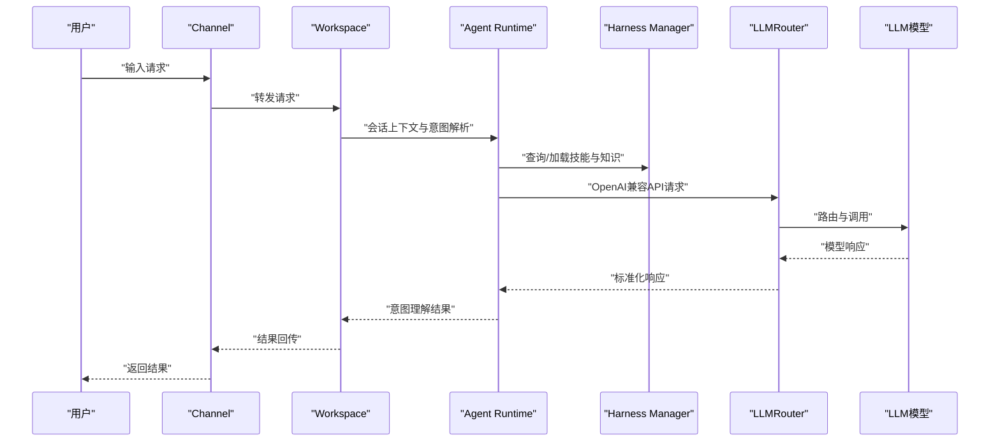
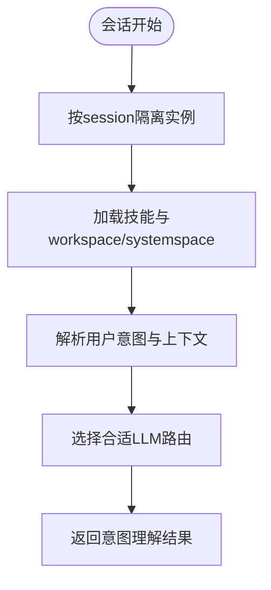
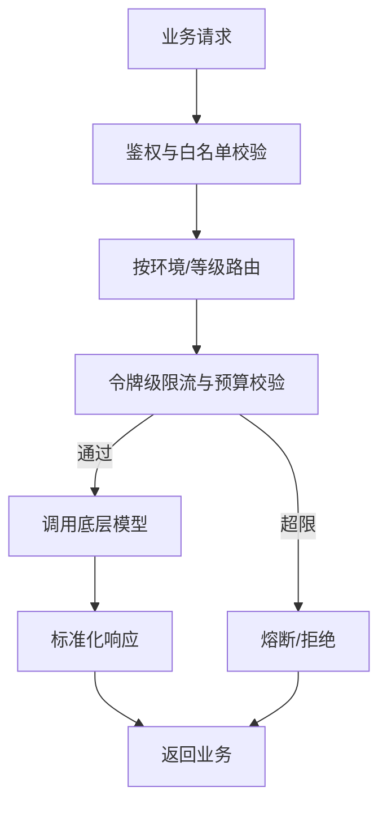
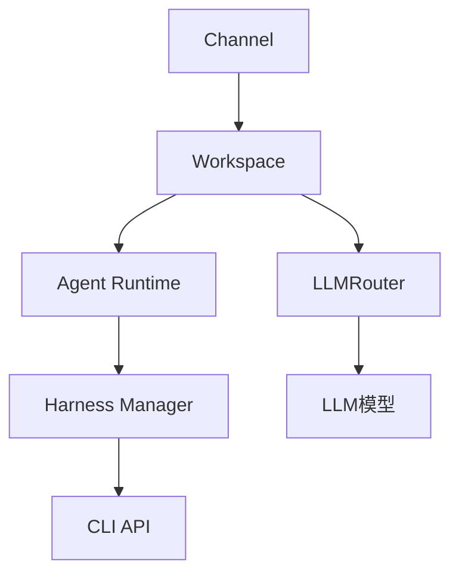

# 意图理解链路

<cite>
**本文引用的文件**
- [Agent-Runtime方案review.md](file://notes/zhaobomin/Agent-Runtime方案review.md)
- [LLM-Gateway方案review.md](file://notes/zhaobomin/LLM-Gateway方案review.md)
- [Agent-Runtime方案.md](file://plan/Agent-Runtime方案.md)
- [LLM-Gateway建设方案.md](file://plan/LLM-Gateway建设方案.md)
- [LLM-Gateway一期功能规划.md](file://plan/LLM-Gateway一期功能规划.md)
- [LLM Gateway 热门开源项目对比.md](file://plan/LLM Gateway 热门开源项目对比.md)
- [2026-04-20-zhaobomin.md](file://project/standup/2026-04-20-zhaobomin.md)
- [config.yaml](file://openspec/config.yaml)
</cite>

## 目录
1. [引言](#引言)
2. [项目结构](#项目结构)
3. [核心组件](#核心组件)
4. [架构总览](#架构总览)
5. [详细组件分析](#详细组件分析)
6. [依赖分析](#依赖分析)
7. [性能考量](#性能考量)
8. [故障排查指南](#故障排查指南)
9. [结论](#结论)
10. [附录](#附录)

## 引言
本文件围绕SAI智能体平台的“意图理解链路”展开，系统化梳理从用户请求输入到LLM模型理解与响应输出的完整流程。重点覆盖以下方面：
- Agent Runtime如何接收用户请求、隔离与调度
- LLM Gateway如何进行意图识别与任务规划、路由与计费
- LLM模型的响应格式与OpenAI兼容API调用协议
- 认证机制、数据格式、关键参数、上下文保持机制与错误处理策略
- 请求/响应示例与常见问题的解决方案

## 项目结构
SAI平台采用模块化分层设计，涉及Agent Runtime、Harness Manager、Workspace、LLMRouter、CLI API与Channel等模块。模块间通过明确的职责边界协作，形成“通道—运行时—编排—基础设施”的闭环。

```mermaid
graph TB
subgraph "通道层"
CH["Channel<br/>弘宇"]
SDD["申懂懂App"]
end
subgraph "核心层"
AR["Agent Runtime<br/>奕杭"]
WS["Workspace"]
HM["Harness Manager<br/>隋云"]
end
subgraph "基础设施层"
LR["LLMRouter<br/>老徐"]
CA["CLI API<br/>淩雪"]
end
SDD --> CH
CH --> WS
AR --> WS
WS < --> HM
HM --> KB["知识库"]
HM --> SK["Skills"]
HM --> CLI["CLI 管理和分发"]
CLI --> CA
WS --> LR
```

图表来源
- [2026-04-20-zhaobomin.md:1-40](file://project/standup/2026-04-20-zhaobomin.md#L1-L40)

章节来源
- [2026-04-20-zhaobomin.md:1-84](file://project/standup/2026-04-20-zhaobomin.md#L1-L84)

## 核心组件
- Agent Runtime：面向会话的Serverless运行时，按session隔离实例，冷启动<1s、热启动~100ms，基于Claude Agent SDK构建，具备日志与错误处理能力。
- Harness Manager：负责技能（Skills）、知识库（KB）与CLI的管理与分发，支持workspace/systemspace分离与按用户/领域/公共组织。
- Workspace：连接Agent Runtime与Harness Manager，承载会话上下文与技能分发。
- LLMRouter：统一LLM网关，向下接入多家模型，向上提供OpenAI兼容API，支持路由、限流、熔断与成本控制。
- CLI API：提供API原始描述，由Harness的CLI管理模块负责分发与集成。

章节来源
- [Agent-Runtime方案.md:1-60](file://plan/Agent-Runtime方案.md#L1-L60)
- [LLM-Gateway建设方案.md:1-109](file://plan/LLM-Gateway建设方案.md#L1-L109)
- [2026-04-20-zhaobomin.md:44-62](file://project/standup/2026-04-20-zhaobomin.md#L44-L62)

## 架构总览
意图理解链路由“通道层—运行时—编排—基础设施”四层协同完成。用户通过Channel进入，经Workspace与Agent Runtime进行会话隔离与技能调度；LLMRouter统一接入多模型并提供OpenAI兼容API；Harness Manager负责技能与CLI的生命周期管理。



图表来源
- [LLM-Gateway建设方案.md:23-25](file://plan/LLM-Gateway建设方案.md#L23-L25)
- [2026-04-20-zhaobomin.md:1-40](file://project/standup/2026-04-20-zhaobomin.md#L1-L40)

## 详细组件分析

### Agent Runtime（会话与意图解析）
- 会话隔离：基于Serverless按session分配实例，实例内无状态，会话结束即销毁，确保用户隔离与资源回收。
- 启动性能：冷启动<1s，热启动~100ms，满足通用Agent调用的实时性要求。
- 技能隔离：通过OSS挂载与文件权限控制实现技能隔离，若云侧挂载不可行，则在Agent层实现基于用户的文件路径权限。
- 日志与兼容：基于Claude Agent SDK构建，支持用户日志与错误处理；考虑向后兼容ACP协议（当前以HTTP协议与Python SDK适配为主）。



图表来源
- [Agent-Runtime方案.md:4-13](file://plan/Agent-Runtime方案.md#L4-L13)
- [Agent-Runtime方案.md:15-32](file://plan/Agent-Runtime方案.md#L15-L32)

章节来源
- [Agent-Runtime方案.md:1-60](file://plan/Agent-Runtime方案.md#L1-L60)
- [Agent-Runtime方案review.md:9-25](file://notes/zhaobomin/Agent-Runtime方案review.md#L9-L25)

### LLM Gateway（路由、计费与安全）
- 统一代理与OpenAI兼容：向上提供OpenAI格式API，向下接入多家模型（含国内Qwen系列与国际模型），业务线仅需更换Base URL与Token即可无缝切换。
- 路由策略：按环境（本地/测试/预发/生产）与应用等级（核心/非核心/边缘）智能路由，测试环境强制路由至低成本模型，生产核心使用旗舰模型。
- 成本控制：额度预警与熔断（80%/90%/100%三级告警），支持按令牌维度的TPM/RPM限流与预算重置。
- 安全与审计：密钥白名单、访问控制（虎盾/内网）、请求日志拦截与隐私数据脱敏（可选）。



图表来源
- [LLM-Gateway建设方案.md:36-65](file://plan/LLM-Gateway建设方案.md#L36-L65)
- [LLM-Gateway一期功能规划.md:3-11](file://plan/LLM-Gateway一期功能规划.md#L3-L11)

章节来源
- [LLM-Gateway建设方案.md:1-109](file://plan/LLM-Gateway建设方案.md#L1-L109)
- [LLM-Gateway一期功能规划.md:1-23](file://plan/LLM-Gateway一期功能规划.md#L1-L23)
- [LLM-Gateway方案review.md:9-16](file://notes/zhaobomin/LLM-Gateway方案review.md#L9-L16)

### OpenAI兼容API与认证机制
- 协议与格式：向上提供OpenAI兼容API，支持标准消息结构（如messages数组）与响应格式（choices、usage等）。业务侧通过Base URL与Token接入，无需改动SDK。
- 认证与密钥：采用虚拟Key（业务侧可见）+ 网关托管真实Key的模式，支持按令牌维度的额度与告警配置，动态注入到CI/CD环境变量。
- 使用方式：支持IDE插件（如RooCode）、CLI工具（如Qwen Code）与AI客户端（如Cherry Studio），推荐配置自定义Base URL与Key。

章节来源
- [LLM-Gateway建设方案.md:29-41](file://plan/LLM-Gateway建设方案.md#L29-L41)
- [LLM-Gateway一期功能规划.md:13-23](file://plan/LLM-Gateway一期功能规划.md#L13-L23)

### 上下文保持与意图理解
- 上下文保持：Agent Runtime在会话内维护上下文，结合Harness Manager提供的技能与知识库，增强意图识别的准确性与一致性。
- 任务规划：在Agent层进行任务拆解与技能选择，必要时通过CLI API调用业务数据，最终形成可执行的计划或回答。
- 错误处理：运行时具备日志与错误处理能力，结合网关熔断与限流，保障服务稳定性与用户体验。

章节来源
- [Agent-Runtime方案.md:33-42](file://plan/Agent-Runtime方案.md#L33-L42)
- [LLM-Gateway建设方案.md:43-65](file://plan/LLM-Gateway建设方案.md#L43-L65)

## 依赖分析
- 模块耦合：Channel与Workspace负责入口与上下文，Agent Runtime承担会话与意图解析，Harness Manager负责技能与CLI生命周期，LLMRouter提供统一模型接入与治理。
- 外部依赖：LLMRouter基于LiteLLM，具备企业级路由、限流、熔断与可观测性能力；与DevOps平台联动实现令牌自动化发放与额度管理。
- 风险与缓解：Review指出Agent Runtime对Claude SDK的强依赖、LLM Gateway上线时间紧张与逃生方案待确认等问题，建议通过SDK抽象、最小可用范围与Bypass模式等缓解。



图表来源
- [2026-04-20-zhaobomin.md:1-40](file://project/standup/2026-04-20-zhaobomin.md#L1-L40)

章节来源
- [LLM-Gateway热门开源项目对比.md:1-22](file://plan/LLM Gateway 热门开源项目对比.md#L1-L22)
- [LLM-Gateway方案review.md:21-38](file://notes/zhaobomin/LLM-Gateway方案review.md#L21-L38)
- [Agent-Runtime方案review.md:44-48](file://notes/zhaobomin/Agent-Runtime方案review.md#L44-L48)

## 性能考量
- 启动性能：Agent Runtime冷启动<1s、热启动~100ms，满足通用Agent调用的实时性。
- 路由优化：按环境与等级智能路由，测试环境使用低成本模型，生产核心使用旗舰模型，兼顾成本与质量。
- 限流与熔断：令牌级TPM/RPM限流与额度预警熔断，避免突发流量导致的系统过载。
- 观测性：请求日志拦截、审计与告警，便于定位性能瓶颈与异常。

章节来源
- [Agent-Runtime方案.md:6-12](file://plan/Agent-Runtime方案.md#L6-L12)
- [LLM-Gateway建设方案.md:43-54](file://plan/LLM-Gateway建设方案.md#L43-L54)

## 故障排查指南
- 网关不可用：启用逃生方案（业务侧直连百炼/OpenAI原生API或网关停用路由规则），并检查白名单与访问控制。
- 超额熔断：检查令牌额度与告警阈值，必要时扩容或调整路由策略。
- 认证失败：核对Base URL与Token配置，确认虚拟Key与真实Key映射关系。
- 性能异常：查看LLMRouter的限流与熔断日志，结合业务侧日志定位瓶颈。
- 技能加载失败：检查OSS挂载与文件权限策略，或回退到Agent层的用户级权限实现。

章节来源
- [LLM-Gateway建设方案.md:105-109](file://plan/LLM-Gateway建设方案.md#L105-L109)
- [LLM-Gateway方案review.md:32-38](file://notes/zhaobomin/LLM-Gateway方案review.md#L32-L38)
- [Agent-Runtime方案.md:15-32](file://plan/Agent-Runtime方案.md#L15-L32)

## 结论
SAI智能体平台通过“通道—运行时—编排—基础设施”的分层架构，实现了从用户请求到LLM理解与响应的高效链路。Agent Runtime提供强隔离与高性能的会话执行环境，Harness Manager负责技能与CLI的生命周期管理，LLMRouter则提供统一的OpenAI兼容API、路由与成本治理能力。结合鉴权、限流、熔断与可观测性，平台在保证稳定性的同时，兼顾成本与扩展性。

## 附录
- 开源对比参考：LiteLLM在路由、限流、熔断与可观测性方面具备企业级能力，适合当前与未来需求。
- 规范与上下文：openspec配置文件支持规范驱动的制品生成，便于在后续文档与规范制定中复用。

章节来源
- [LLM-Gateway热门开源项目对比.md:1-22](file://plan/LLM Gateway 热门开源项目对比.md#L1-L22)
- [config.yaml:1-21](file://openspec/config.yaml#L1-L21)