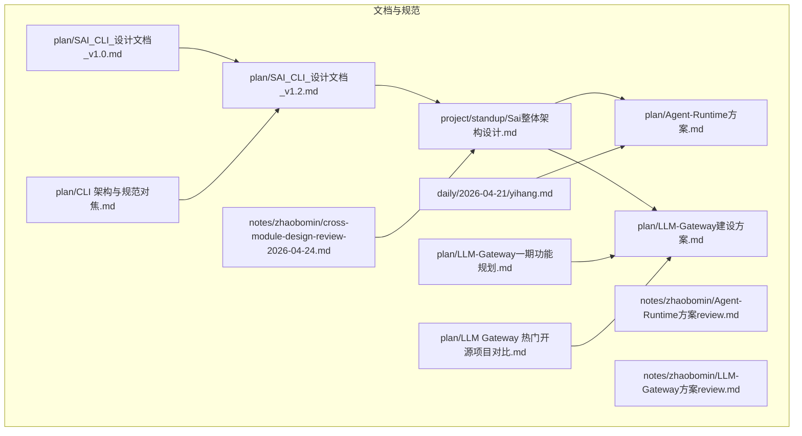
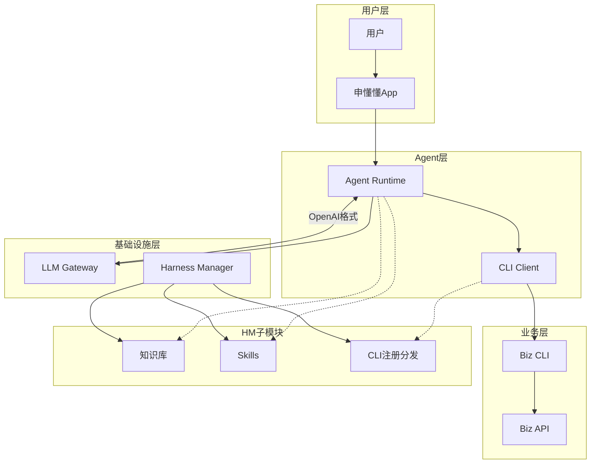
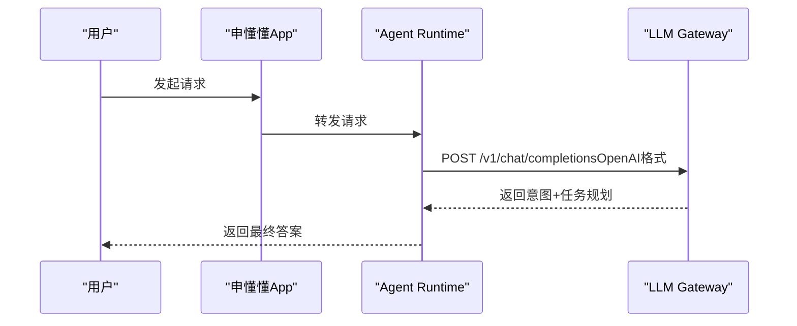
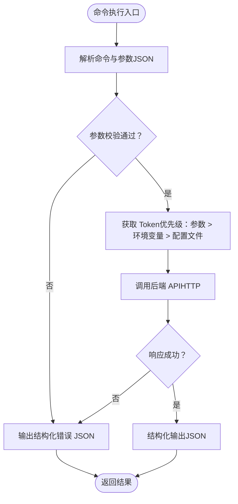
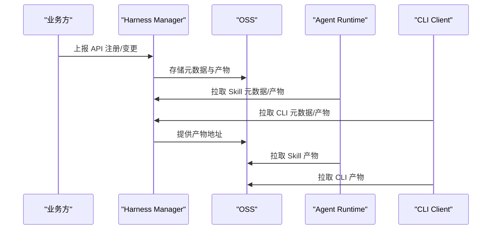
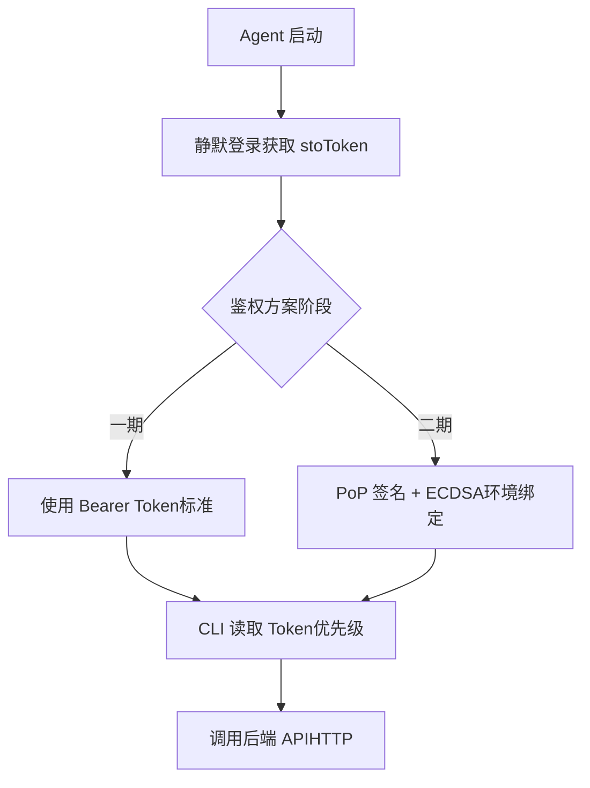
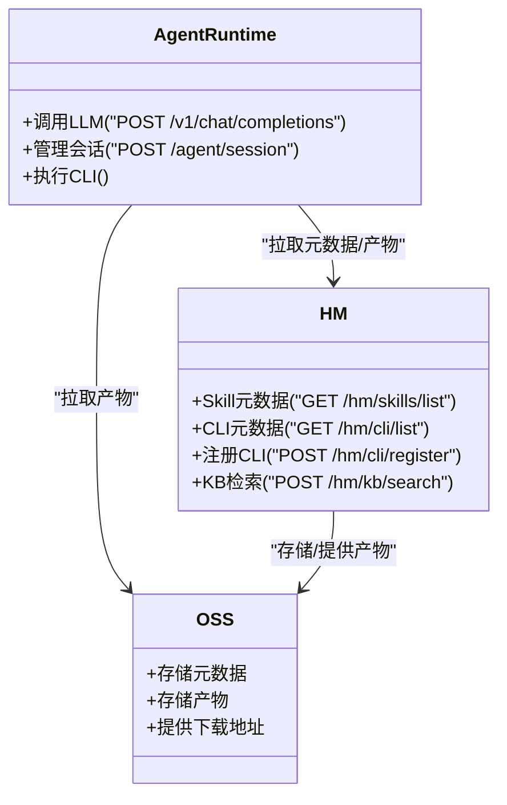
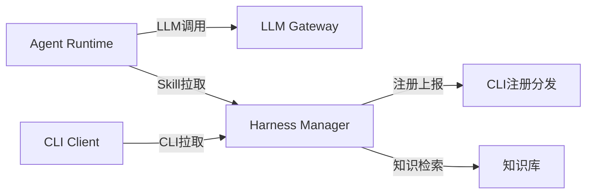

# 控制协议与接口

<cite>
**本文引用的文件**
- [SAI CLI 架构设计文档 v1.0](file://plan/SAI_CLI_设计文档_v1.0.md)
- [SAI CLI 架构设计文档 v1.2](file://plan/SAI_CLI_设计文档_v1.2.md)
- [Agent Runtime 方案 review](file://notes/zhaobomin/Agent-Runtime方案review.md)
- [LLM Gateway 方案 review](file://notes/zhaobomin/LLM-Gateway方案review.md)
- [Agent Runtime 方案](file://plan/Agent-Runtime方案.md)
- [LLM Gateway 建设方案](file://plan/LLM-Gateway建设方案.md)
- [Sai 整体架构设计](file://project/standup/Sai整体架构设计.md)
- [CLI 架构与规范对焦](file://plan/CLI 架构与规范对焦.md)
- [跨模块设计 review（2026-04-24）](file://notes/zhaobomin/cross-module-design-review-2026-04-24.md)
- [LLM Gateway 一期功能规划](file://plan/LLM-Gateway一期功能规划.md)
- [LLM Gateway 热门开源项目对比](file://plan/LLM Gateway 热门开源项目对比.md)
- [每日站会记录（2026-04-21）](file://daily/2026-04-21/yihang.md)
</cite>

## 目录
1. [引言](#引言)
2. [项目结构](#项目结构)
3. [核心组件](#核心组件)
4. [架构总览](#架构总览)
5. [详细组件分析](#详细组件分析)
6. [依赖分析](#依赖分析)
7. [性能考虑](#性能考虑)
8. [故障排查指南](#故障排查指南)
9. [结论](#结论)
10. [附录](#附录)

## 引言
本文件面向 SAIAgent 平台的控制协议与接口，系统化梳理如下内容：
- 各模块间通信协议：HTTP/OpenAI API 协议、本地 CLI 调用协议、OSS 交互协议
- 认证机制：Bearer Token、业务方 Token、HM 内部 Token 的使用方式与安全策略
- 完整 API 接口规范：请求格式、响应结构、错误码定义与使用示例
- 协议版本管理、向后兼容性与迁移策略

## 项目结构
仓库中与协议与接口相关的关键文档集中在 plan、notes、project 等目录，涵盖 CLI 架构、Agent Runtime、LLM Gateway、跨模块接口契约与总体架构设计等。

**图表来源**
- [Sai 整体架构设计:1-277](file://project/standup/Sai整体架构设计.md#L1-L277)
- [SAI CLI 架构设计文档 v1.2:1-635](file://plan/SAI_CLI_设计文档_v1.2.md#L1-L635)
- [Agent Runtime 方案:1-60](file://plan/Agent-Runtime方案.md#L1-L60)
- [LLM Gateway 建设方案:1-109](file://plan/LLM-Gateway建设方案.md#L1-L109)

**章节来源**
- [Sai 整体架构设计:1-277](file://project/standup/Sai整体架构设计.md#L1-L277)
- [SAI CLI 架构设计文档 v1.2:1-635](file://plan/SAI_CLI_设计文档_v1.2.md#L1-L635)

## 核心组件
- Agent Runtime：负责意图理解、会话管理、CLI 调用与结果返回
- LLM Gateway：统一 OpenAI 格式 API，提供虚拟 Key 管理、成本控制与安全策略
- Harness Manager（HM）：控制面服务，负责 CLI 注册、元数据编译、技能与 CLI 分发
- CLI 客户端与业务 CLI：封装后端 API，提供统一命令规范与结构化输出
- OSS：作为 HM 与 Agent/CLI 的分发介质，承载元数据与执行包

**章节来源**
- [Sai 整体架构设计:142-195](file://project/standup/Sai整体架构设计.md#L142-L195)
- [Agent Runtime 方案:1-60](file://plan/Agent-Runtime方案.md#L1-L60)
- [LLM Gateway 建设方案:1-109](file://plan/LLM-Gateway建设方案.md#L1-L109)
- [SAI CLI 架构设计文档 v1.2:545-635](file://plan/SAI_CLI_设计文档_v1.2.md#L545-L635)

## 架构总览
SAI 平台采用“意图理解链路 + 业务执行链路”的双链路架构，辅以 HM 的控制面能力，实现跨模块解耦与可扩展。

**图表来源**
- [Sai 整体架构设计:19-138](file://project/standup/Sai整体架构设计.md#L19-L138)

**章节来源**
- [Sai 整体架构设计:19-138](file://project/standup/Sai整体架构设计.md#L19-L138)

## 详细组件分析

### 1) HTTP/OpenAI API 协议
- 意图理解链路：Agent Runtime 通过 HTTP 调用 LLM Gateway 的 OpenAI 格式接口，统一返回意图与任务规划
- LLM Gateway 选型与能力：采用 LiteLLM，提供统一代理、虚拟 Key 管理、预算/配额控制、熔断降级、审计日志与可观测性集成
- 一致性与兼容性：向上统一 OpenAI 格式，向下兼容多家模型，便于业务线零成本切换

**图表来源**
- [Sai 整体架构设计:115-138](file://project/standup/Sai整体架构设计.md#L115-L138)
- [LLM Gateway 建设方案:29-65](file://plan/LLM-Gateway建设方案.md#L29-L65)

**章节来源**
- [Sai 整体架构设计:197-221](file://project/standup/Sai整体架构设计.md#L197-L221)
- [LLM Gateway 建设方案:29-65](file://plan/LLM-Gateway建设方案.md#L29-L65)
- [LLM Gateway 热门开源项目对比:1-22](file://plan/LLM Gateway 热门开源项目对比.md#L1-L22)

### 2) 本地 CLI 调用协议
- 命令规范：统一采用 JSON 入参/出参，命令格式为 {product} {module} {action} [params]
- 无交互式输入：CLI 命令必须纯参数化，禁止运行时弹出交互式提示
- 结构化错误输出：统一错误 JSON，包含 type、code、message、hint 四要素
- Dry-Run：写操作支持 --dry-run，返回将要执行的操作描述
- 开发语言：统一 Golang，编译为单一二进制文件，跨平台部署

**图表来源**
- [SAI CLI 架构设计文档 v1.2:115-146](file://plan/SAI_CLI_设计文档_v1.2.md#L115-L146)
- [SAI CLI 架构设计文档 v1.2:295-336](file://plan/SAI_CLI_设计文档_v1.2.md#L295-L336)
- [SAI CLI 架构设计文档 v1.2:474-513](file://plan/SAI_CLI_设计文档_v1.2.md#L474-L513)

**章节来源**
- [SAI CLI 架构设计文档 v1.2:115-146](file://plan/SAI_CLI_设计文档_v1.2.md#L115-L146)
- [SAI CLI 架构设计文档 v1.2:295-336](file://plan/SAI_CLI_设计文档_v1.2.md#L295-L336)
- [SAI CLI 架构设计文档 v1.2:474-513](file://plan/SAI_CLI_设计文档_v1.2.md#L474-L513)

### 3) OSS 交互协议
- HM 与 Agent/CLI 的分发：通过 OSS 存储元数据与执行包，Agent 从 HM 拉取，CLI 从 HM 拉取
- CLI 发布流程：业务方提供 API → HM 更新代码 → 打包为统一 SAI-CLI 二进制 → 上传 OSS → 调用网关“发布通知”接口 → 网关生效
- 路径规范：CLI 网关、系统内置技能、公共技能、用户技能均有约定 OSS 路径

**图表来源**
- [Sai 整体架构设计:67-106](file://project/standup/Sai整体架构设计.md#L67-L106)
- [SAI CLI 架构设计文档 v1.2:561-591](file://plan/SAI_CLI_设计文档_v1.2.md#L561-L591)

**章节来源**
- [Sai 整体架构设计:67-106](file://project/standup/Sai整体架构设计.md#L67-L106)
- [SAI CLI 架构设计文档 v1.2:561-591](file://plan/SAI_CLI_设计文档_v1.2.md#L561-L591)

### 4) 认证机制与安全策略
- Bearer Token：全链路统一使用 SSO Token，Agent 通过静默登录接口获取 stoToken
- Token 获取优先级：命令行参数 > 环境变量 > 本地配置文件（~/.sai/sso-auth.json）
- 鉴权方案（PoP）：一期使用标准 Bearer Token；二期引入 PoP 签名 + ECDSA，实现 Token 与设备/环境绑定
- AK/SK 签名：Harness Manager API 统一使用 HMAC-SHA256 签名（X-Access-Key、X-Signature、X-Timestamp）
- 身份体系：Bot Token（应用级）+ User Token（人工用户级），高危操作需更高权限或二次确认

**图表来源**
- [SAI CLI 架构设计文档 v1.2:413-433](file://plan/SAI_CLI_设计文档_v1.2.md#L413-L433)
- [SAI CLI 架构设计文档 v1.2:452-460](file://plan/SAI_CLI_设计文档_v1.2.md#L452-L460)
- [Sai 整体架构设计:154-164](file://project/standup/Sai整体架构设计.md#L154-L164)

**章节来源**
- [SAI CLI 架构设计文档 v1.2:394-470](file://plan/SAI_CLI_设计文档_v1.2.md#L394-L470)
- [Sai 整体架构设计:154-164](file://project/standup/Sai整体架构设计.md#L154-L164)

### 5) API 接口规范
- LLM 调用（OpenAI 格式）：POST /v1/chat/completions，使用 Bearer Token
- Agent 会话（草案）：POST /agent/session → get_session / send_request（需对齐）
- Skill 拉取：GET /hm/skills/list（需定义请求参数、响应 schema、分页、缓存策略）
- CLI 拉取：GET /hm/cli/list（需定义版本查询、增量同步）
- CLI 注册：POST /hm/cli/register（业务方 Token，SDK 注解设计完成）
- 知识检索：POST /hm/kb/search（需定义查询语法、返回格式、相似度阈值）

**图表来源**
- [Sai 整体架构设计:154-164](file://project/standup/Sai整体架构设计.md#L154-L164)
- [Sai 整体架构设计:67-106](file://project/standup/Sai整体架构设计.md#L67-L106)

**章节来源**
- [Sai 整体架构设计:154-164](file://project/standup/Sai整体架构设计.md#L154-L164)
- [Sai 整体架构设计:67-106](file://project/standup/Sai整体架构设计.md#L67-L106)

### 6) 错误码与错误处理
- 结构化错误输出：type、code、message、hint 四要素，覆盖 AUTH_ERROR、PARAM_ERROR、API_ERROR 等
- 全局错误码建议：401/403（认证）、400（参数）、503（服务不可用）、429（限流）、业务错误（带 code + message）
- 降级矩阵：HM 不可用、LLM Gateway 熔断、Biz API 超时/失败、OSS 不可用、Agent Runtime 实例崩溃等场景的降级策略

**章节来源**
- [SAI CLI 架构设计文档 v1.2:295-336](file://plan/SAI_CLI_设计文档_v1.2.md#L295-L336)
- [Sai 整体架构设计:236-245](file://project/standup/Sai整体架构设计.md#L236-L245)
- [跨模块设计 review（2026-04-24）:210-222](file://notes/zhaobomin/cross-module-design-review-2026-04-24.md#L210-L222)

### 7) 协议版本管理、向后兼容与迁移策略
- 版本演进：CLI v1.0 → v1.2，开发职责从“各域自建 CLI”转向“HM 统一构建单一 CLI”
- 向后兼容：ACP 协议在 Agent 层集成 SDK Adapter，向前兼容；LLM Gateway 采用 OpenAI 格式，便于迁移
- 迁移策略：以 LiteLLM 替代 New API 管理接口，统一虚拟 Key 管理与预算控制；OSS 挂载路径规范化，确保 HM 分发闭环

**章节来源**
- [跨模块设计 review（2026-04-24）:103-137](file://notes/zhaobomin/cross-module-design-review-2026-04-24.md#L103-L137)
- [LLM Gateway 建设方案:36-41](file://plan/LLM-Gateway建设方案.md#L36-L41)
- [LLM Gateway 热门开源项目对比:1-22](file://plan/LLM Gateway 热门开源项目对比.md#L1-L22)

## 依赖分析
- 模块间接口依赖矩阵（草案）：明确 LLM 调用、Agent 会话、Skill/CLI 拉取、CLI 注册、知识检索等接口的调用方、提供方、认证方式与对齐状态
- 风险与对齐：跨模块接口契约尚未全部对齐，需尽快补齐 Agent Runtime ↔ HM 的接口定义与前端交互协议

**图表来源**
- [Sai 整体架构设计:154-164](file://project/standup/Sai整体架构设计.md#L154-L164)
- [Sai 整体架构设计:67-106](file://project/standup/Sai整体架构设计.md#L67-L106)

**章节来源**
- [Sai 整体架构设计:154-164](file://project/standup/Sai整体架构设计.md#L154-L164)
- [跨模块设计 review（2026-04-24）:187-197](file://notes/zhaobomin/cross-module-design-review-2026-04-24.md#L187-L197)

## 性能考虑
- Agent Runtime：冷启动 <1s，热启动 <200ms，基于 Serverless（AgentRun）按会话分配实例
- LLM Gateway：支持多模型路由、限额/熔断、降级与可观测性，保障成本与稳定性
- CLI：统一 Golang 开发，单一二进制文件，跨平台部署，减少运行时依赖

**章节来源**
- [Agent Runtime 方案:1-60](file://plan/Agent-Runtime方案.md#L1-L60)
- [LLM Gateway 建设方案:43-65](file://plan/LLM-Gateway建设方案.md#L43-L65)
- [SAI CLI 架构设计文档 v1.2:339-362](file://plan/SAI_CLI_设计文档_v1.2.md#L339-L362)

## 故障排查指南
- HM 不可用：Agent 使用本地缓存 Skill/CLI 继续运行，降级为无知识检索模式
- LLM Gateway 熔断：Agent 返回固定提示，业务执行链路不受影响
- Biz API 超时/失败：CLI Client 单次重试（≤3s），失败后向用户说明具体接口不可用
- OSS 不可用：Agent 使用本地缓存版本运行，日志告警通知 HM 团队
- Agent Runtime 实例崩溃：Serverless 平台自动重建实例，用户会话需重新发起

**章节来源**
- [Sai 整体架构设计:236-245](file://project/standup/Sai整体架构设计.md#L236-L245)

## 结论
SAI 智能体平台通过清晰的协议分层与接口契约，实现了意图理解与业务执行的解耦，结合 LLM Gateway 的统一 OpenAI 接口与 LiteLLM 能力，以及 HM 的控制面分发与 CLI 统一构建，形成了可扩展、可运维、可迁移的智能体平台。建议尽快补齐跨模块接口契约与前端交互协议，确保整体方案的可执行性与一致性。

## 附录
- LLM Gateway 4/30 目标：个人令牌申请/管理、监控告警、LiteLLM 网关配置与测试验证
- CLI 发布与部署：OSS 路径规范、统一 SAI-CLI 二进制打包、发布通知接口与生效流程

**章节来源**
- [LLM Gateway 一期功能规划:1-11](file://plan/LLM-Gateway一期功能规划.md#L1-L11)
- [SAI CLI 架构设计文档 v1.2:561-591](file://plan/SAI_CLI_设计文档_v1.2.md#L561-L591)