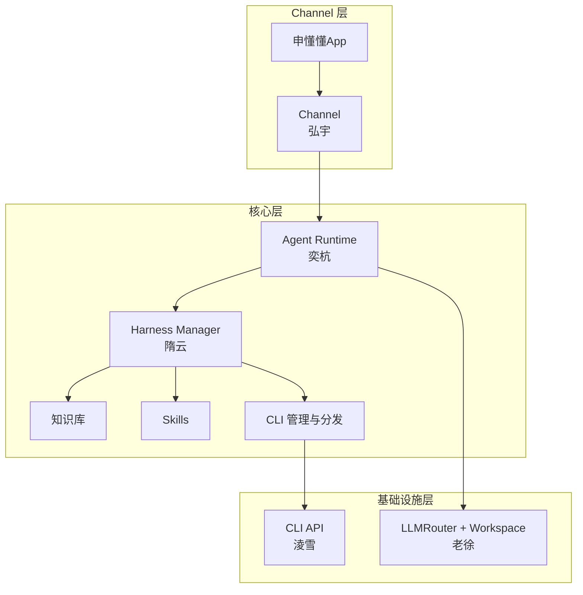
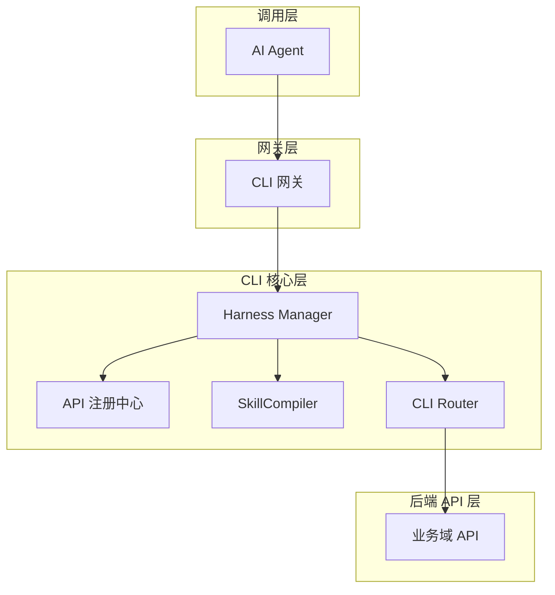
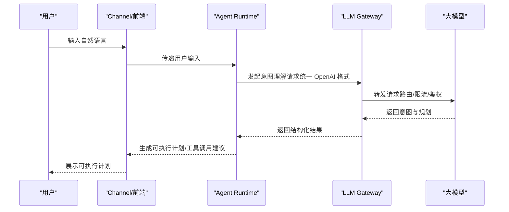
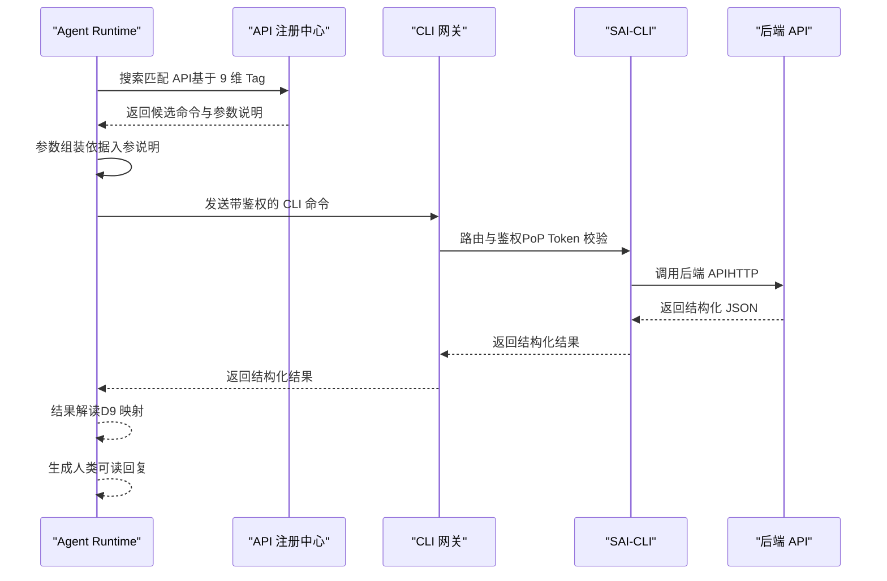
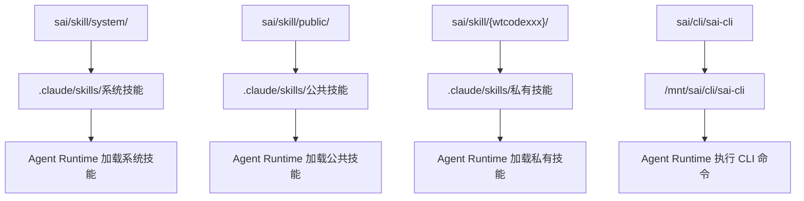
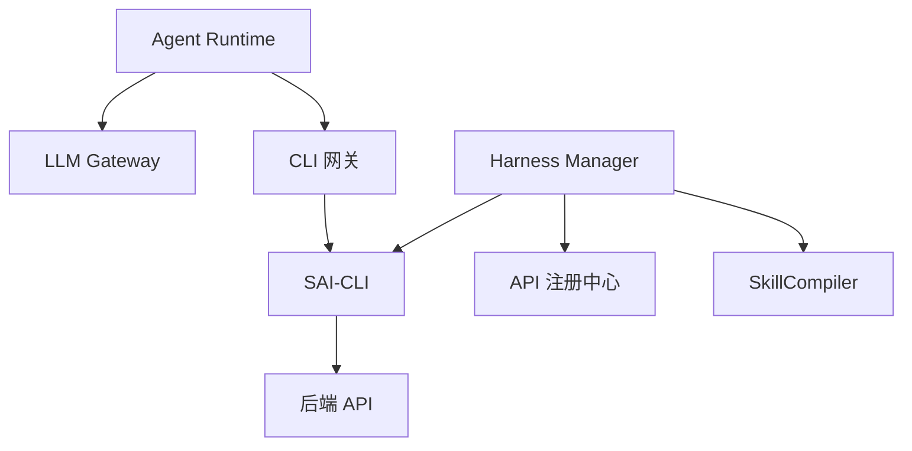

# 数据流与控制流

<cite>
**本文引用的文件**
- [SAI CLI 架构设计文档 v1.2](file://plan/SAI_CLI_设计文档_v1.2.md)
- [Agent Runtime 方案 Review](file://notes/zhaobomin/Agent-Runtime方案review.md)
- [LLM Gateway 建设方案](file://plan/LLM-Gateway建设方案.md)
- [LLM Gateway 一期功能规划](file://plan/LLM-Gateway一期功能规划.md)
- [LLM Gateway 模型不同计费方式对比](file://plan/LLM Gateway 模型不同计费方式对比.md)
- [SAI 项目日报 | 项目待办和风险跟踪](file://project/SAI-daily-report-2026-04-22-final.md)
- [4.20 早会记录](file://project/standup/2026-04-20-zhaobomin.md)
- [Agent_ai_claw 资源路径映射方案](file://daily/2026-04-24/yihang.md)
- [项目管理方案 v1.0](file://project/项目管理方案v1.0.md)
</cite>

## 目录
1. [简介](#简介)
2. [项目结构](#项目结构)
3. [核心组件](#核心组件)
4. [架构总览](#架构总览)
5. [详细组件分析](#详细组件分析)
6. [依赖分析](#依赖分析)
7. [性能考量](#性能考量)
8. [故障排查指南](#故障排查指南)
9. [结论](#结论)
10. [附录](#附录)

## 简介
本文件围绕 SAIAgent 平台，系统化梳理两条核心链路的“数据流与控制流”：意图理解链路与业务执行链路。文档从用户请求的生命周期出发，覆盖从输入到输出的完整路径，重点解释 Agent Runtime 的意图理解、任务规划、CLI 调用等关键步骤，以及各模块之间的数据传递格式与控制协议。同时，提供时序图与数据流图，帮助读者直观理解系统工作原理，并分析关键节点的性能特征与潜在瓶颈。

## 项目结构
SAI 项目采用“三层架构、五团队代码库、一个公共文档库”的组织方式，形成清晰的模块边界与协作关系：
- Channel 层：负责前端接入与交互（如申懂懂 App）
- 核心层：Agent Runtime、Harness Manager（知识库、Skills、CLI 管理与分发）
- 基础设施层：LLM Router（Workspace）与 CLI API（提供 API 原始描述）

图表来源
- [4.20 早会记录:5-40](file://project/standup/2026-04-20-zhaobomin.md#L5-L40)

章节来源
- [项目管理方案 v1.0:21-49](file://project/项目管理方案v1.0.md#L21-L49)
- [4.20 早会记录:5-40](file://project/standup/2026-04-20-zhaobomin.md#L5-L40)

## 核心组件
- Agent Runtime：负责意图理解、任务规划、与 CLI 的交互与调用，以及与 LLM Gateway 的对接。
- Harness Manager：统一构建与维护 SAI-CLI，提供注册中心、SkillCompiler、路由与鉴权、发布通知等能力。
- CLI API：提供后端 API 原始描述，不直接承担发现机制，由 Harness 的 CLI 管理与分发模块负责。
- LLM Gateway：统一代理与路由，提供统一 OpenAI 格式 API、成本预算与安全控制、告警熔断等能力。
- Channel/前端：负责用户输入与展示，与 Agent Runtime 交互。

章节来源
- [LLM Gateway 建设方案:15-26](file://plan/LLM-Gateway建设方案.md#L15-L26)
- [4.20 早会记录:52-59](file://project/standup/2026-04-20-zhaobomin.md#L52-L59)

## 架构总览
SAI 采用四层分层架构，实现 AI Agent 与各业务域后端服务的标准化接入：
- 调用层（AI Agent）：根据用户提问搜索 SAI-CLI 中的 API，结合上下文选择匹配 API，拼接执行命令并返回结构化结果。
- 网关层（CLI 路由与鉴权）：路由转发、鉴权校验（PoP 签名验证）、负载均衡、命令清单同步。
- CLI 核心层（Harness Manager 统一构建与维护）：统一命令规范、入参/出参 JSON、公共能力（认证/日志）、API 注册中心与 SkillCompiler。
- 后端 API 层：各域只提供 API 接口，无需改造前端 GUI，无需开发任何 CLI 代码。

图表来源
- [SAI CLI 架构设计文档 v1.2:29-75](file://plan/SAI_CLI_设计文档_v1.2.md#L29-L75)

章节来源
- [SAI CLI 架构设计文档 v1.2:29-75](file://plan/SAI_CLI_设计文档_v1.2.md#L29-L75)

## 详细组件分析

### 意图理解链路（调用层 → LLM Gateway → LLM）
该链路由用户输入触发，经过 Agent Runtime 的意图理解与任务规划，最终返回可用于业务执行的结构化指令或工具调用计划。

图表来源
- [LLM Gateway 建设方案:15-26](file://plan/LLM-Gateway建设方案.md#L15-L26)
- [SAI CLI 架构设计文档 v1.2:250-268](file://plan/SAI_CLI_设计文档_v1.2.md#L250-L268)

章节来源
- [LLM Gateway 建设方案:15-26](file://plan/LLM-Gateway建设方案.md#L15-L26)
- [LLM Gateway 一期功能规划:1-23](file://plan/LLM-Gateway一期功能规划.md#L1-L23)
- [SAI CLI 架构设计文档 v1.2:250-268](file://plan/SAI_CLI_设计文档_v1.2.md#L250-L268)

### 业务执行链路（Agent Runtime → CLI 网关 → SAI-CLI → 后端 API）
该链路由 Agent Runtime 的意图理解与任务规划结果驱动，通过 SAI-CLI 的注册中心与路由，完成命令拼接、鉴权与执行，并返回结构化结果。

图表来源
- [SAI CLI 架构设计文档 v1.2:151-268](file://plan/SAI_CLI_设计文档_v1.2.md#L151-L268)
- [SAI CLI 架构设计文档 v1.2:543-632](file://plan/SAI_CLI_设计文档_v1.2.md#L543-L632)

章节来源
- [SAI CLI 架构设计文档 v1.2:151-268](file://plan/SAI_CLI_设计文档_v1.2.md#L151-L268)
- [SAI CLI 架构设计文档 v1.2:543-632](file://plan/SAI_CLI_设计文档_v1.2.md#L543-L632)

### 关键节点与数据格式
- 统一协议：HTTP 调用与 CLI 的入参/出参统一使用 JSON 格式，错误输出同样遵循结构化约定。
- 结构化错误输出：包含 type、code、message、hint 四个固定字段，便于 Agent 自动化解析与引导修复。
- 9 维 Tag 体系：用于语义理解、参数构造、消歧防误判与结果解读，贯穿注册、编译与调用全过程。
- 结果解读：通过 D9 出参映射将 JSON 字段翻译为中文，生成人类可读的回复。

章节来源
- [SAI CLI 架构设计文档 v1.2:109-112](file://plan/SAI_CLI_设计文档_v1.2.md#L109-L112)
- [SAI CLI 架构设计文档 v1.2:295-336](file://plan/SAI_CLI_设计文档_v1.2.md#L295-L336)
- [SAI CLI 架构设计文档 v1.2:151-168](file://plan/SAI_CLI_设计文档_v1.2.md#L151-L168)
- [SAI CLI 架构设计文档 v1.2:289-292](file://plan/SAI_CLI_设计文档_v1.2.md#L289-L292)

### 资源挂载与路径映射（Agent Runtime 侧）
为实现 SKILL 与 CLI 的隔离与统一加载，系统在 Agent 运行环境中提供统一挂载路径，映射关系如下：

图表来源
- [Agent_ai_claw 资源路径映射方案:10-31](file://daily/2026-04-24/yihang.md#L10-L31)

章节来源
- [Agent_ai_claw 资源路径映射方案:10-31](file://daily/2026-04-24/yihang.md#L10-L31)

## 依赖分析
- 模块耦合与协作
  - Agent Runtime 依赖 LLM Gateway 提供统一的意图理解与任务规划输出。
  - Agent Runtime 通过 CLI 网关与 SAI-CLI 交互，后者由 Harness Manager 统一构建与维护。
  - CLI API 仅提供后端 API 原始描述，不参与 CLI 开发与发现机制。
- 外部依赖与集成点
  - LLM Gateway 提供统一 OpenAI 格式 API，支持多模型路由与成本控制。
  - CLI 网关负责鉴权（PoP Token + ECDSA 签名，分阶段实施）与路由转发。
  - 各业务域 API 零侵入接入，仅维护自身接口。

图表来源
- [4.20 早会记录:5-40](file://project/standup/2026-04-20-zhaobomin.md#L5-L40)
- [SAI CLI 架构设计文档 v1.2:543-632](file://plan/SAI_CLI_设计文档_v1.2.md#L543-L632)

章节来源
- [4.20 早会记录:5-40](file://project/standup/2026-04-20-zhaobomin.md#L5-L40)
- [SAI CLI 架构设计文档 v1.2:543-632](file://plan/SAI_CLI_设计文档_v1.2.md#L543-L632)

## 性能考量
- LLM Gateway 性能与成本
  - LiteLLM 提供精细化限流、额度重置、告警与熔断机制，支持按环境与应用等级动态路由，降低测试/边缘业务对昂贵模型的占用。
  - 模型计费对比显示，直接发起请求相较 AI 客户端/IDE 插件在耗时与 token 消耗上更具稳定性与透明度。
- CLI 调用链路
  - 6 步 NLU Pipeline 明确意图分类、实体抽取、Tag 匹配、参数组装、API 调用与结果解读，有助于减少误判与重试，提升端到端吞吐。
  - 鉴权与路由在网关层集中处理，避免业务域感知 Agent 存在，降低跨域耦合带来的性能波动。
- 热启动与隔离
  - Agent Runtime 基于 serverless（AgentRun）实现按 session 的实例隔离，热启动在 100ms 级别，有利于快速响应与弹性伸缩。

章节来源
- [LLM Gateway 建设方案:43-54](file://plan/LLM-Gateway建设方案.md#L43-L54)
- [LLM Gateway 模型不同计费方式对比:1-9](file://plan/LLM Gateway 模型不同计费方式对比.md#L1-L9)
- [Agent Runtime 方案 Review:11-12](file://notes/zhaobomin/Agent-Runtime方案review.md#L11-L12)
- [SAI CLI 架构设计文档 v1.2:250-268](file://plan/SAI_CLI_设计文档_v1.2.md#L250-L268)

## 故障排查指南
- LLM Gateway 熔断与降级
  - 若 LLM Gateway 发生故障，意图理解链路将中断，Agent 将返回固定提示：“当前 AI 服务暂时不可用，请稍后重试”。业务执行链路不受影响。
- CLI 鉴权与路由
  - 若鉴权失败或权限不足，CLI 网关将拒绝请求并返回结构化错误（type、code、message、hint）。建议检查 Token 获取优先级与 Scope 权限。
- 结构化错误输出
  - 所有错误输出遵循统一 JSON 格式，便于 Agent 自动化解析与引导修复。常见类型包括 AUTH_ERROR、PARAM_ERROR、API_ERROR 等。
- 资源挂载与路径映射
  - 若 SKILL/CLI 无法加载，检查挂载路径映射与软链接创建脚本是否正确执行，确保 Agent 运行环境具备正确的挂载点。

章节来源
- [LLM Gateway 建设方案:105-109](file://plan/LLM-Gateway建设方案.md#L105-L109)
- [SAI CLI 架构设计文档 v1.2:295-336](file://plan/SAI_CLI_设计文档_v1.2.md#L295-L336)
- [Agent_ai_claw 资源路径映射方案:32-42](file://daily/2026-04-24/yihang.md#L32-L42)

## 结论
SAI 智能体平台通过四层分层架构与两条核心链路，实现了意图理解与业务执行的解耦与标准化。意图理解链路依托 LLM Gateway 提供统一的 OpenAI 格式 API 与成本/安全控制；业务执行链路通过 SAI-CLI 的注册中心、9 维 Tag 与 SkillCompiler，完成从自然语言到结构化命令的自动拼接与执行。资源挂载与路径映射进一步强化了 SKILL 与 CLI 的隔离与统一加载。整体设计在性能、可维护性与可扩展性方面具备良好基础，建议在后续阶段完善接口定义与监控审计，持续优化端到端时延与稳定性。

## 附录
- 项目进展与风险跟踪：截至 4/22，已完成多项关键任务，4/30 为 LLM Gateway 一期上线的关键节点，需聚焦最小可用功能确保按时交付。
- 仓库与文档规范：采用“Git 即进度”的管理方式，每日提交、文档同步与快速看板，保障信息透明与协作效率。

章节来源
- [SAI 项目日报 | 项目待办和风险跟踪:1-77](file://project/SAI-daily-report-2026-04-22-final.md#L1-L77)
- [项目管理方案 v1.0:137-175](file://project/项目管理方案v1.0.md#L137-L175)