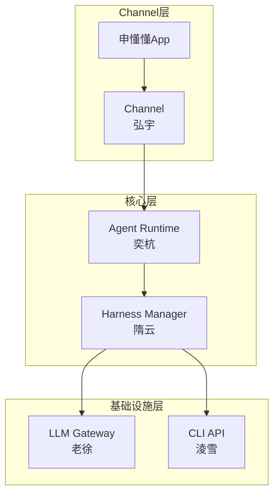
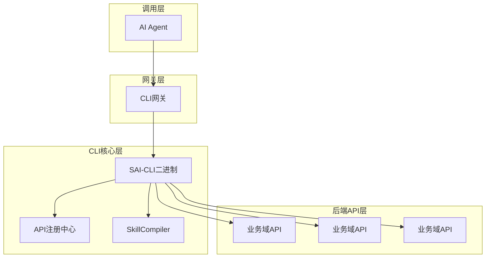
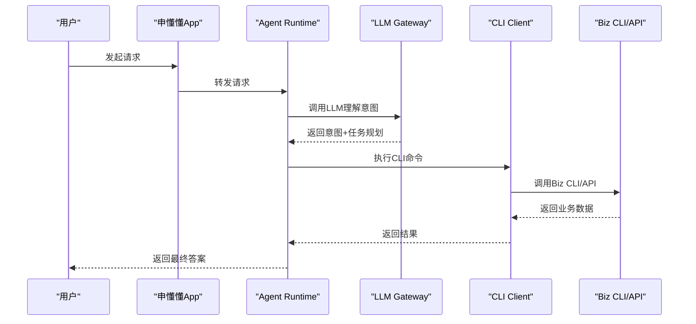
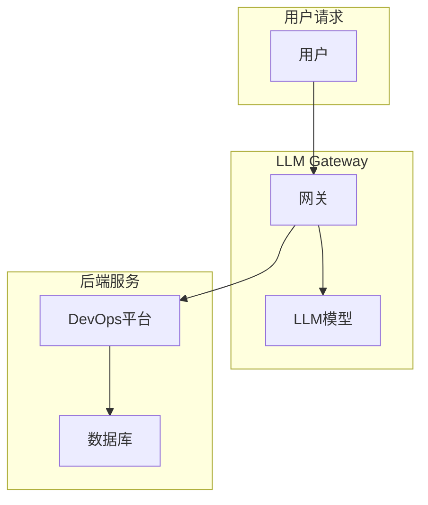
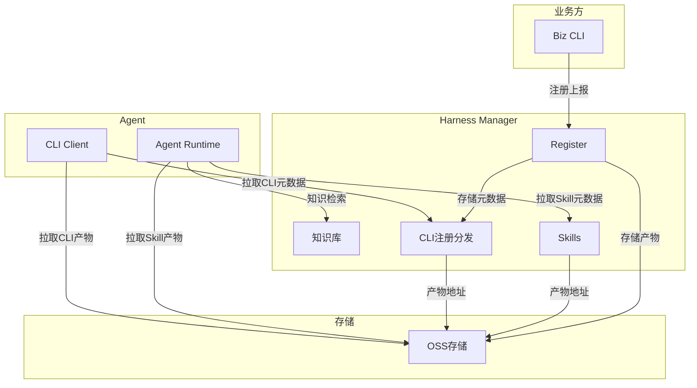
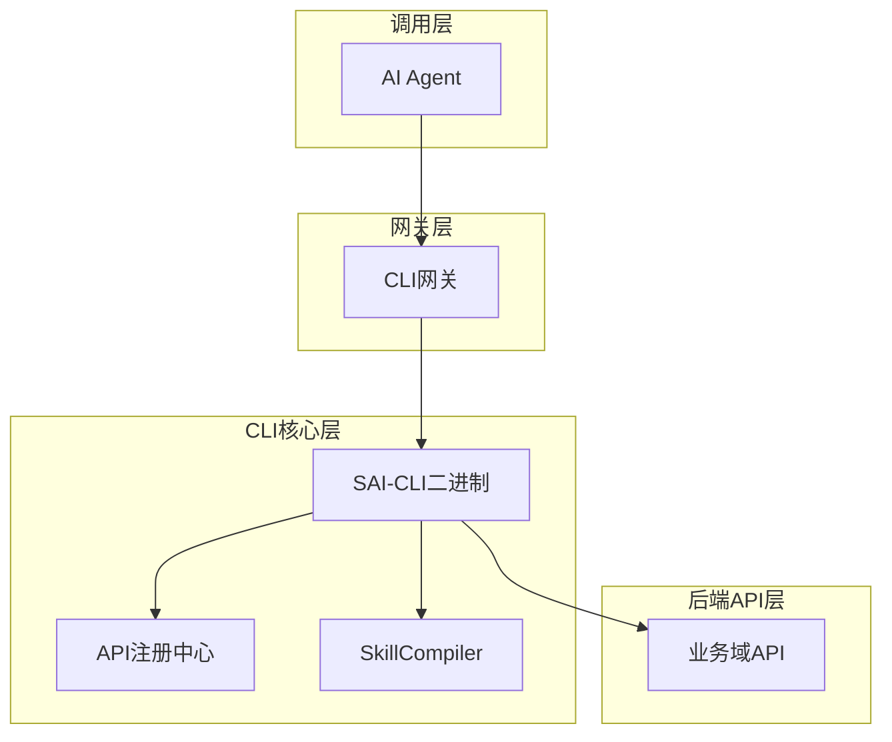
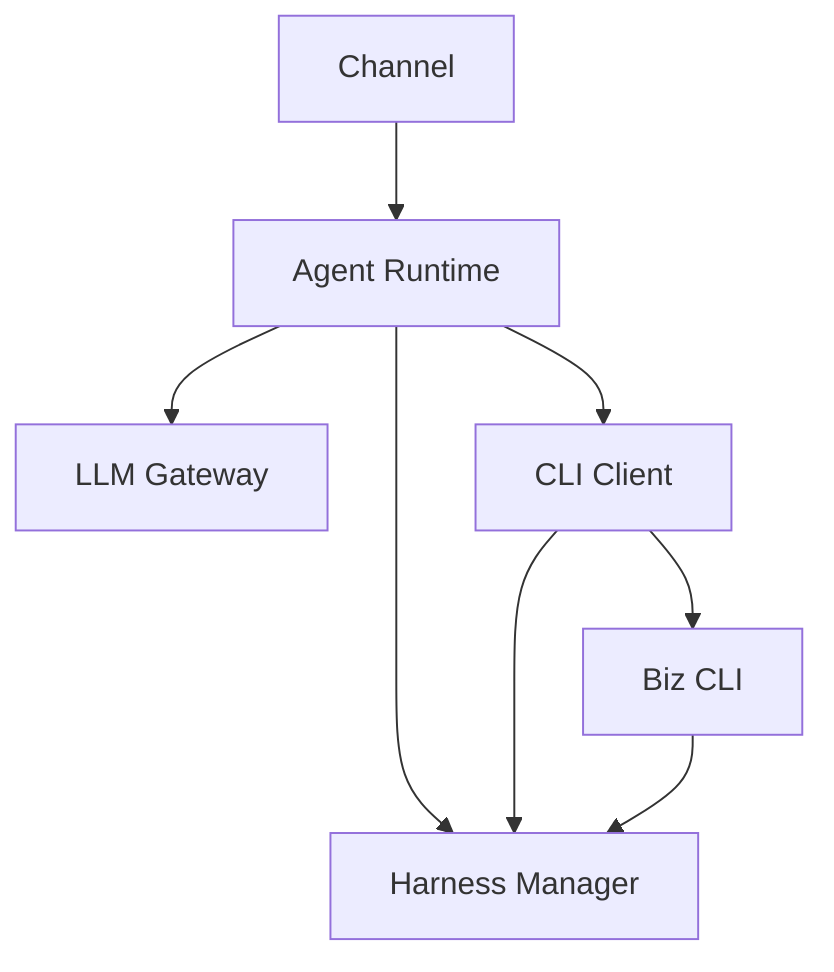
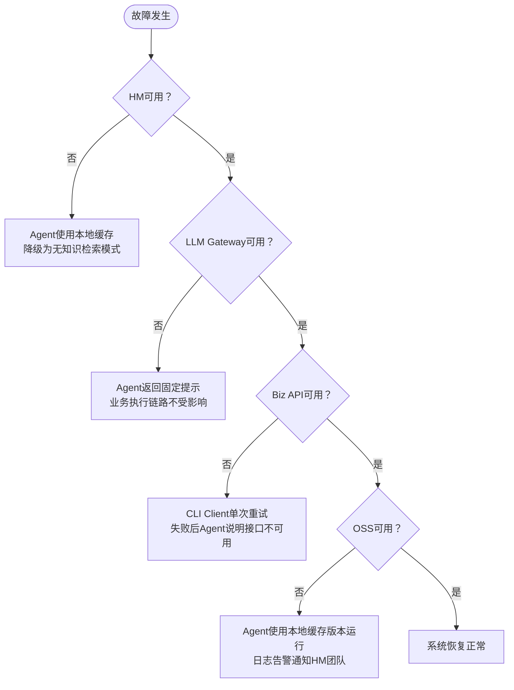

# 整体架构概览

<cite>
**本文引用的文件**
- [Sai整体架构设计.md](file://project/standup/Sai整体架构设计.md)
- [Agent-Runtime方案review.md](file://notes/zhaobomin/Agent-Runtime方案review.md)
- [LLM-Gateway方案review.md](file://notes/zhaobomin/LLM-Gateway方案review.md)
- [LLM-Gateway建设方案.md](file://plan/LLM-Gateway建设方案.md)
- [Agent-Runtime方案.md](file://plan/Agent-Runtime方案.md)
- [SAI_CLI_设计文档_v1.2.md](file://plan/SAI_CLI_设计文档_v1.2.md)
- [CLI 架构与规范对焦.md](file://plan/CLI 架构与规范对焦.md)
- [LLM Gateway 模型不同计费方式对比.md](file://plan/LLM Gateway 模型不同计费方式对比.md)
- [SAI-daily-report-2026-04-22-final.md](file://project/SAI-daily-report-2026-04-22-final.md)
- [2026-04-20-zhaobomin.md](file://project/standup/2026-04-20-zhaobomin.md)
- [cross-module-design-review-2026-04-24.md](file://notes/zhaobomin/cross-module-design-review-2026-04-24.md)
- [项目管理方案v1.0.md](file://project/项目管理方案v1.0.md)
</cite>

## 目录
1. [引言](#引言)
2. [项目结构](#项目结构)
3. [核心组件](#核心组件)
4. [架构总览](#架构总览)
5. [详细组件分析](#详细组件分析)
6. [依赖关系分析](#依赖关系分析)
7. [性能考量](#性能考量)
8. [故障处理与降级](#故障处理与降级)
9. [结论](#结论)
10. [附录](#附录)

## 引言
本文件为SAI智能体平台的整体架构概览文档，旨在帮助读者快速理解系统的高层设计原理、核心组件划分与模块边界定义。文档围绕四层分层架构展开，详细阐述意图理解链路与业务执行链路的完整路径，并提供清晰的架构图表与组件关系图，同时涵盖系统的技术约束、设计权衡与扩展性考虑。

## 项目结构
SAI项目采用“五团队六仓库”的组织方式，围绕四层架构进行模块化划分：
- Channel层：负责用户接入与前端交互（申懂懂App）
- 核心层：Agent Runtime与Harness Manager，承担意图理解、技能分发与控制面管理
- 基础设施层：LLM Gateway与CLI API，提供统一的AI调用入口与业务能力封装
- 公共文档库：docs，统一沉淀设计、接口与日报

**图表来源**
- [项目管理方案v1.0.md:34-49](file://project/项目管理方案v1.0.md#L34-L49)
- [2026-04-20-zhaobomin.md:5-40](file://project/standup/2026-04-20-zhaobomin.md#L5-L40)

**章节来源**
- [项目管理方案v1.0.md:21-49](file://project/项目管理方案v1.0.md#L21-L49)

## 核心组件
SAI系统由五大模块协同组成，职责边界清晰，接口契约明确：
- Agent Runtime：负责Agent执行、意图理解与CLI调用，采用Serverless（AgentRun）实现用户隔离与热启动优化
- LLM Gateway：统一代理LLM调用，提供Token管理、成本控制与环境路由策略
- Harness Manager：控制面服务，负责知识库、Skills与CLI注册分发，支撑Agent与CLI的资源分发
- Channel：用户接入与前端交互，负责将用户请求转发至Agent Runtime
- Biz CLI：业务能力封装与API调用，提供统一的CLI接口供Agent调用

**章节来源**
- [Sai整体架构设计.md:142-151](file://project/standup/Sai整体架构设计.md#L142-L151)
- [Agent-Runtime方案.md:4-13](file://plan/Agent-Runtime方案.md#L4-L13)
- [LLM-Gateway建设方案.md:15-26](file://plan/LLM-Gateway建设方案.md#L15-L26)
- [SAI_CLI_设计文档_v1.2.md:545-563](file://plan/SAI_CLI_设计文档_v1.2.md#L545-L563)

## 架构总览
SAI采用四层分层架构，实现AI Agent与各业务域后端服务的标准化接入：
- 调用层：统一AI Agent，负责根据用户提问在SAI-CLI中搜索相关API、结合上下文选择匹配API并拼接执行命令
- 网关层：CLI路由转发、负载均衡、同步机制与权限校验
- CLI核心层：由Harness Manager统一构建与维护，封装所有业务域命令，内置API注册中心与SkillCompiler
- 后端API层：各域只提供API接口，无需改造前端GUI或开发CLI

**图表来源**
- [SAI_CLI_设计文档_v1.2.md:29-64](file://plan/SAI_CLI_设计文档_v1.2.md#L29-L64)

**章节来源**
- [SAI_CLI_设计文档_v1.2.md:29-75](file://plan/SAI_CLI_设计文档_v1.2.md#L29-L75)

## 详细组件分析

### Agent Runtime（意图理解与执行）
- 用户隔离：基于Serverless（AgentRun）按session分配实例，实现一实例一session的隔离
- 热启动优化：冷启动<1s，热启动<200ms，满足端到端场景联调要求
- 技能分发：通过Harness Manager拉取Skill定义与产物，支持OSS挂载与本地缓存
- CLI调用：本地执行CLI命令，与业务域API交互

**图表来源**
- [Sai整体架构设计.md:115-138](file://project/standup/Sai整体架构设计.md#L115-L138)

**章节来源**
- [Agent-Runtime方案.md:4-13](file://plan/Agent-Runtime方案.md#L4-L13)
- [Sai整体架构设计.md:108-138](file://project/standup/Sai整体架构设计.md#L108-L138)

### LLM Gateway（统一代理与成本控制）
- 统一代理：向下支持接入千问、OpenAI、Claude、Gemini等主流模型，向上统一暴露OpenAI格式API
- 环境路由：本地/测试环境强制路由低成本模型，生产环境按应用等级分配不同模型
- 额度预警与熔断：80%/90%/100%三级告警，自动熔断降级
- DevOps融合：审批流、令牌管理、监控告警与网关配置一体化

**图表来源**
- [LLM-Gateway建设方案.md:15-26](file://plan/LLM-Gateway建设方案.md#L15-L26)

**章节来源**
- [LLM-Gateway建设方案.md:27-54](file://plan/LLM-Gateway建设方案.md#L27-L54)
- [LLM-Gateway建设方案.md:95-101](file://plan/LLM-Gateway建设方案.md#L95-L101)

### Harness Manager（控制面与资源分发）
- 知识库：企业知识存储与检索，辅助Agent决策
- Skills：Skill注册与管理，Agent从HM拉取Skill定义
- CLI注册分发：业务方上报CLI元数据，存储至OSS，Agent从OSS拉取CLI定义
- HM不参与调用链路，只做资源分发，CLI鉴权由业务方负责

**图表来源**
- [Sai整体架构设计.md:67-106](file://project/standup/Sai整体架构设计.md#L67-L106)

**章节来源**
- [Sai整体架构设计.md:173-194](file://project/standup/Sai整体架构设计.md#L173-L194)

### CLI与后端API（四层架构与职责边界）
- GUI零改造：各业务域只需提供后端API接口，CLI由Harness Manager统一开发
- 架构解耦：Agent→网关→SAI-CLI→API，层层解耦，不穿透调用
- 统一协议：HTTP调用与CLI入参/出参统一使用JSON格式
- 命令规范：{product} {module} {action} [params]，支持多维Tag与语义理解

**图表来源**
- [SAI_CLI_设计文档_v1.2.md:29-64](file://plan/SAI_CLI_设计文档_v1.2.md#L29-L64)

**章节来源**
- [SAI_CLI_设计文档_v1.2.md:79-106](file://plan/SAI_CLI_设计文档_v1.2.md#L79-L106)
- [CLI 架构与规范对焦.md:7-22](file://plan/CLI 架构与规范对焦.md#L7-L22)

## 依赖关系分析
模块间接口依赖矩阵体现了核心交互路径与认证方式：
- LLM调用：Agent Runtime → LLM Gateway，OpenAI格式，Bearer Token
- Agent会话：Channel → Agent Runtime，用户Token透传
- Skill拉取：Agent Runtime → HM，HTTP/OSS，HM内部Token
- CLI拉取：CLI Client → HM，HTTP/OSS，HM内部Token
- CLI注册：Biz CLI → HM，HTTP，业务方Token
- 知识检索：Agent Runtime → HM，HTTP，HM内部Token
- 前端交互：申懂懂App → Channel，待定义

**图表来源**
- [Sai整体架构设计.md:154-164](file://project/standup/Sai整体架构设计.md#L154-L164)

**章节来源**
- [Sai整体架构设计.md:154-170](file://project/standup/Sai整体架构设计.md#L154-L170)

## 性能考量
- Agent热启动：冷启动<1s，热启动<200ms，满足端到端场景联调
- LLM Gateway：基于LiteLLM，支持精细化限流、额度重置与告警，环境路由策略降低成本
- CLI分发：OSS挂载与本地缓存相结合，减少拉取延迟
- 成本控制：按域组/项目分配额度池，钉钉通知与自动熔断，避免超支

**章节来源**
- [Agent-Runtime方案.md:4-13](file://plan/Agent-Runtime方案.md#L4-L13)
- [LLM-Gateway建设方案.md:43-54](file://plan/LLM-Gateway建设方案.md#L43-L54)
- [LLM Gateway 模型不同计费方式对比.md:1-9](file://plan/LLM Gateway 模型不同计费方式对比.md#L1-L9)

## 故障处理与降级
- HM不可用：Agent本地缓存最近一次Skill/CLI定义，降级为无知识检索模式
- LLM Gateway熔断：Agent返回固定提示，业务执行链路不受影响
- Biz API超时/失败：CLI Client单次重试（≤3s等待），失败后Agent向用户说明具体接口不可用
- OSS不可用：Agent使用本地缓存版本运行，日志告警通知HM团队
- Agent Runtime实例崩溃：Serverless平台自动重建实例，用户会话需重新发起

**图表来源**
- [Sai整体架构设计.md:236-245](file://project/standup/Sai整体架构设计.md#L236-L245)

**章节来源**
- [Sai整体架构设计.md:236-245](file://project/standup/Sai整体架构设计.md#L236-L245)

## 结论
SAI智能体平台通过四层分层架构实现了AI Agent与业务域的解耦与标准化接入，结合Harness Manager的控制面能力与LLM Gateway的成本控制策略，形成了稳定、可扩展且具备高可用性的企业级智能体平台。模块间的职责清晰、接口契约明确，既满足当前业务需求，也为未来的扩展与演进奠定了坚实基础。

## 附录
- 项目管理方案：采用“最小约束、核心必做、Git即进度”的原则，确保代码与文档同步、进度透明可见
- 一期验收标准：覆盖Agent Runtime、LLM Gateway、Harness Manager、Channel与Biz CLI的关键指标
- 风险与应对：针对Claude SDK依赖、HM方案未出、LLM Gateway上线压力等风险制定应对策略

**章节来源**
- [项目管理方案v1.0.md:13-175](file://project/项目管理方案v1.0.md#L13-L175)
- [Sai整体架构设计.md:224-233](file://project/standup/Sai整体架构设计.md#L224-L233)
- [SAI-daily-report-2026-04-22-final.md:67-77](file://project/SAI-daily-report-2026-04-22-final.md#L67-L77)