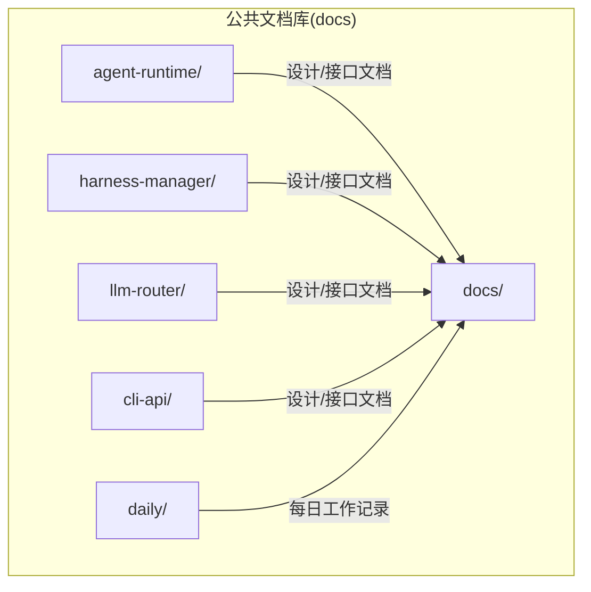
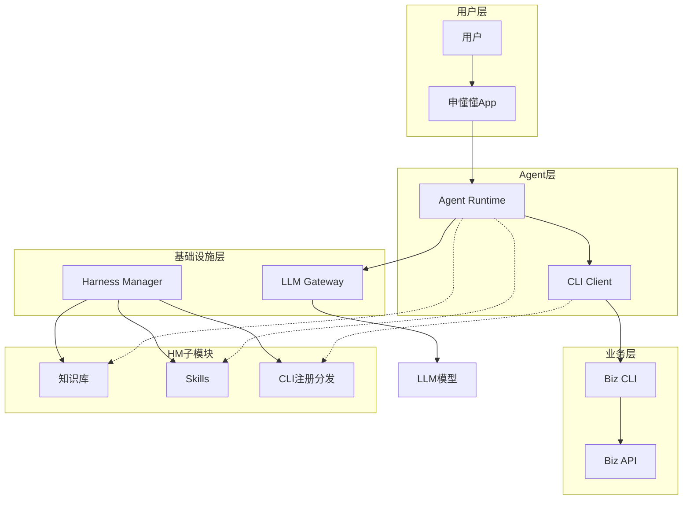
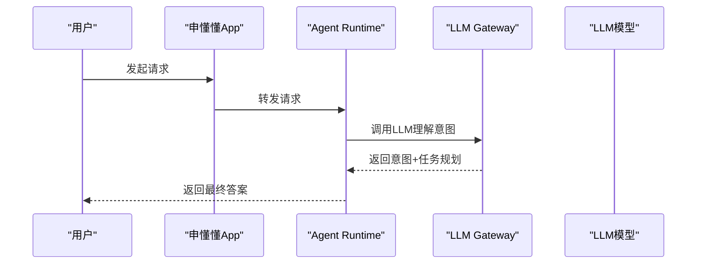
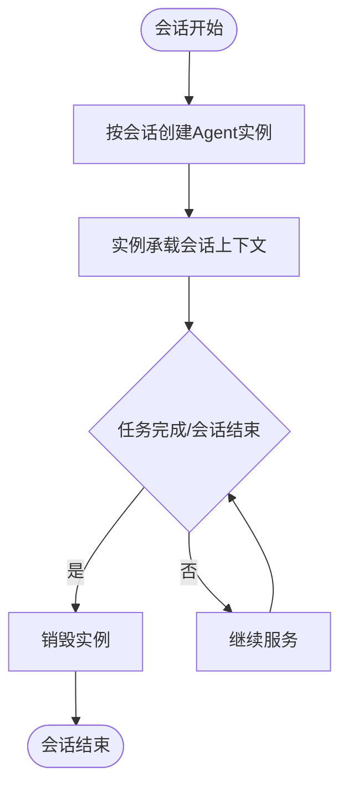
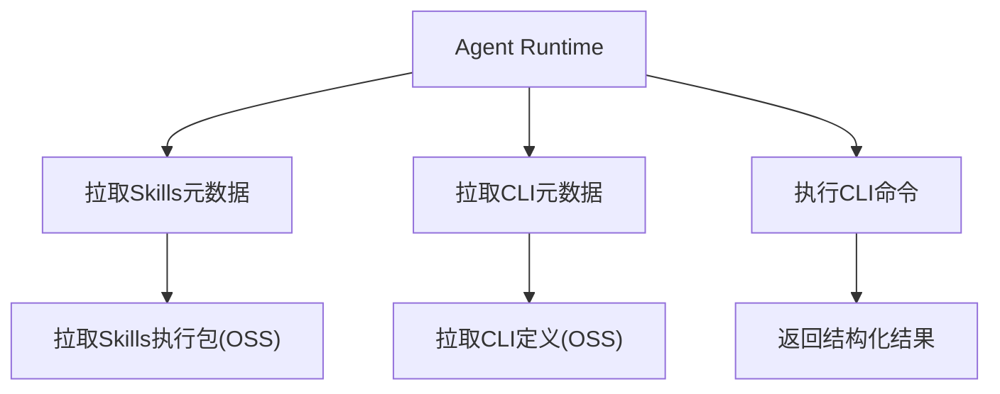
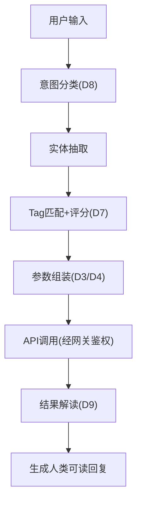
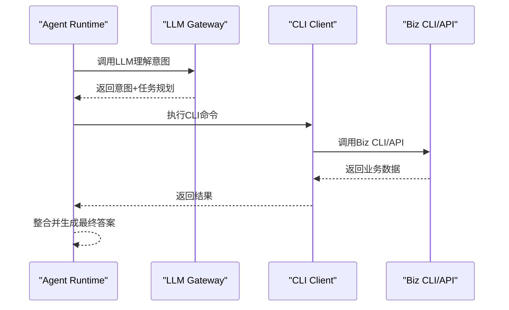
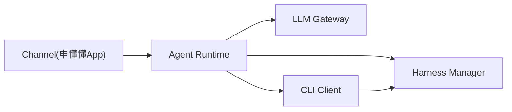
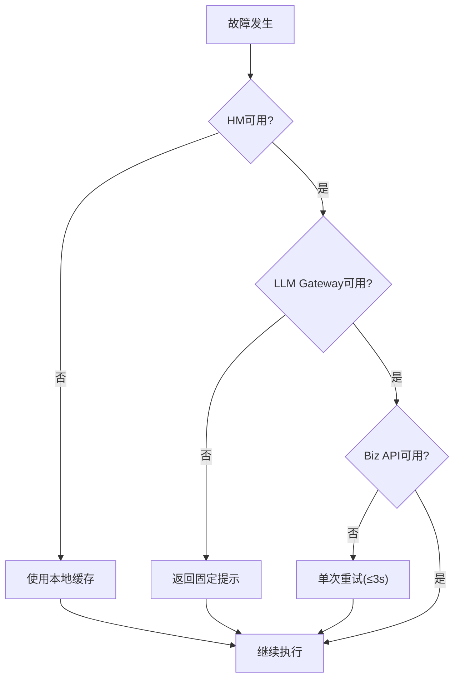

# Agent Runtime模块职责

<cite>
**本文引用的文件**
- [Agent-Runtime方案.md](file://plan/Agent-Runtime方案.md)
- [Agent-Runtime方案review.md](file://notes/zhaobomin/Agent-Runtime方案review.md)
- [SAI_CLI_设计文档_v1.2.md](file://plan/SAI_CLI_设计文档_v1.2.md)
- [LLM-Gateway建设方案.md](file://plan/LLM-Gateway建设方案.md)
- [Sai整体架构设计.md](file://project/standup/Sai整体架构设计.md)
- [cross-module-design-review-2026-04-24.md](file://notes/zhaobomin/cross-module-design-review-2026-04-24.md)
- [项目管理方案v1.0.md](file://project/项目管理方案v1.0.md)
</cite>

## 目录
1. [简介](#简介)
2. [项目结构](#项目结构)
3. [核心组件](#核心组件)
4. [架构总览](#架构总览)
5. [详细组件分析](#详细组件分析)
6. [依赖关系分析](#依赖关系分析)
7. [性能考量](#性能考量)
8. [故障排查指南](#故障排查指南)
9. [结论](#结论)
10. [附录](#附录)

## 简介
本文件聚焦于Agent Runtime模块的职责说明，围绕其作为智能体运行时的核心定位，系统阐述以下方面：
- Agent执行与意图理解
- Serverless执行架构与用户隔离
- 技能管理（Skills）与CLI集成
- 与LLM Gateway和CLI Client的协同
- 错误处理策略与降级机制
- 实现细节、配置选项与使用模式

Agent Runtime在整体架构中承担“意图理解链路”的LLM调用与“业务执行链路”的CLI调度双重职责，通过Serverless实例按会话隔离，结合Harness Manager提供的Skills与CLI元数据，实现与业务系统的标准化对接。

## 项目结构
- 文档仓库按团队维度组织，Agent Runtime模块职责说明位于公共文档库docs中，便于跨团队查阅与同步。
- 项目管理方案明确了仓库划分、提交规范与文档同步要求，确保Agent Runtime的设计与实现过程可追溯、可审计。

图表来源
- [项目管理方案v1.0.md:90-131](file://project/项目管理方案v1.0.md#L90-L131)

章节来源
- [项目管理方案v1.0.md:21-49](file://project/项目管理方案v1.0.md#L21-L49)
- [项目管理方案v1.0.md:90-131](file://project/项目管理方案v1.0.md#L90-L131)

## 核心组件
- Agent Runtime：负责会话生命周期管理、意图理解（调用LLM Gateway）、CLI命令执行与结果整合。
- LLM Gateway：统一代理LLM调用，提供OpenAI格式接口，支持令牌管理与成本控制。
- Harness Manager（HM）：提供Skills与CLI的注册、编译、分发与检索能力，通过OSS挂载支撑Agent Runtime按需拉取。
- CLI Client：在Agent Runtime侧执行本地CLI命令，连接业务域CLI与API。
- Channel（申懂懂App）：前端接入层，负责用户交互与消息协议，将用户请求转发至Agent Runtime。

章节来源
- [Sai整体架构设计.md:142-151](file://project/standup/Sai整体架构设计.md#L142-L151)
- [Sai整体架构设计.md:154-164](file://project/standup/Sai整体架构设计.md#L154-L164)

## 架构总览
Agent Runtime在系统中的定位与作用：
- 作为“意图理解链路”的调用者与“业务执行链路”的调度者，实现LLM与CLI的协同。
- 通过Serverless按会话实例化，确保用户隔离与快速冷热启动。
- 与HM协作，拉取Skills与CLI元数据，实现技能与命令的标准化编排。

图表来源
- [Sai整体架构设计.md:19-65](file://project/standup/Sai整体架构设计.md#L19-L65)

章节来源
- [Sai整体架构设计.md:17-65](file://project/standup/Sai整体架构设计.md#L17-L65)

## 详细组件分析

### Agent执行与意图理解
- 会话生命周期：Agent Runtime按会话实例化，实例内承载用户上下文，会话结束后销毁，确保实例与用户一一对应。
- 意图理解：Agent Runtime调用LLM Gateway的统一接口，将用户输入转化为意图与任务规划，随后驱动业务执行。
- LLM调用协议：统一OpenAI格式，便于跨模型切换与成本控制。

图表来源
- [Sai整体架构设计.md:115-138](file://project/standup/Sai整体架构设计.md#L115-L138)

章节来源
- [Sai整体架构设计.md:197-213](file://project/standup/Sai整体架构设计.md#L197-L213)
- [LLM-Gateway建设方案.md:29-34](file://plan/LLM-Gateway建设方案.md#L29-L34)

### Serverless执行架构与用户隔离
- 实例模型：基于Serverless（AgentRun）按会话分配实例，一实例一会话，实现用户隔离与快速销毁重建。
- 启动性能：冷启动<1s，热启动约100ms，满足通用Agent调用的实时性要求。
- 基础设施选择：存在函数计算、K8s CloneSet、ACS等多种方案讨论，需明确最终落地以达成5s目标。

图表来源
- [Agent-Runtime方案.md:4-13](file://plan/Agent-Runtime方案.md#L4-L13)
- [Agent-Runtime方案review.md:11-12](file://notes/zhaobomin/Agent-Runtime方案review.md#L11-L12)

章节来源
- [Agent-Runtime方案.md:4-13](file://plan/Agent-Runtime方案.md#L4-L13)
- [Agent-Runtime方案review.md:11-12](file://notes/zhaobomin/Agent-Runtime方案review.md#L11-L12)
- [cross-module-design-review-2026-04-24.md:149-156](file://notes/zhaobomin/cross-module-design-review-2026-04-24.md#L149-L156)

### 技能管理（Skills）与CLI集成
- Skills分发：Agent Runtime从Harness Manager拉取Skills元数据与执行包，通过OSS挂载实现按需拉取与版本管理。
- CLI集成：Agent通过CLI Client执行CLI命令，CLI命令由Harness Manager统一构建并分发，支持9维Tag体系与NLU Pipeline。
- SkillCompiler：将业务方上报的注册元数据编译为Agent可读的Tool定义，包含LLM可见层与框架控制层。

图表来源
- [Sai整体架构设计.md:96-106](file://project/standup/Sai整体架构设计.md#L96-L106)
- [SAI_CLI_设计文档_v1.2.md:225-249](file://plan/SAI_CLI_设计文档_v1.2.md#L225-L249)

章节来源
- [Sai整体架构设计.md:173-194](file://project/standup/Sai整体架构设计.md#L173-L194)
- [SAI_CLI_设计文档_v1.2.md:225-249](file://plan/SAI_CLI_设计文档_v1.2.md#L225-L249)

### Agent与CLI的NLU调用流程
- 6步NLU Pipeline：意图分类→实体抽取→Tag匹配与评分→参数组装→API调用→结果解读。
- 9维Tag体系：D1-D9覆盖路由、NLU理解与执行展示，其中D7的negative关键词用于防误判。
- 结果解读：基于D9出参映射将JSON字段翻译为人类可读回复。

图表来源
- [SAI_CLI_设计文档_v1.2.md:250-288](file://plan/SAI_CLI_设计文档_v1.2.md#L250-L288)

章节来源
- [SAI_CLI_设计文档_v1.2.md:149-288](file://plan/SAI_CLI_设计文档_v1.2.md#L149-L288)

### 与LLM Gateway和CLI Client的协同
- LLM Gateway：提供统一OpenAI格式接口，Agent Runtime通过Bearer Token调用，支持额度预警与熔断。
- CLI Client：在Agent Runtime侧执行本地CLI命令，连接业务域CLI与API，支持结构化错误输出与Dry-Run。
- 协同要点：Agent Runtime负责意图理解与任务规划，CLI Client负责命令执行与结果回传。

图表来源
- [Sai整体架构设计.md:115-138](file://project/standup/Sai整体架构设计.md#L115-L138)
- [Sai整体架构设计.md:197-221](file://project/standup/Sai整体架构设计.md#L197-L221)

章节来源
- [Sai整体架构设计.md:197-221](file://project/standup/Sai整体架构设计.md#L197-L221)

## 依赖关系分析
- Agent Runtime与LLM Gateway：通过OpenAI格式HTTP接口通信，认证采用Gateway分配的虚拟Token。
- Agent Runtime与Harness Manager：通过HTTP接口拉取Skills与CLI元数据，产物通过OSS挂载分发。
- CLI Client与Harness Manager：通过HTTP接口拉取CLI定义，产物通过OSS挂载分发。
- Agent Runtime与Channel：Channel负责前端交互，Agent Runtime提供会话接口（接口路径与认证方式待对齐）。

图表来源
- [Sai整体架构设计.md:154-164](file://project/standup/Sai整体架构设计.md#L154-L164)

章节来源
- [Sai整体架构设计.md:154-164](file://project/standup/Sai整体架构设计.md#L154-L164)
- [cross-module-design-review-2026-04-24.md:254-267](file://notes/zhaobomin/cross-module-design-review-2026-04-24.md#L254-L267)

## 性能考量
- 冷启动与热启动：目标冷启动<1s，热启动<200ms；需明确底层基础设施（函数计算/K8s/ACS）以达成5s目标。
- 并发与容量：需评估预期QPS、并发用户数、Token消耗与存储容量规划。
- 启动时间与元数据规模：1500个API Tag元数据量级对Agent启动速度的影响需进行容量预估。

章节来源
- [Agent-Runtime方案.md:6-10](file://plan/Agent-Runtime方案.md#L6-L10)
- [cross-module-design-review-2026-04-24.md:243-251](file://notes/zhaobomin/cross-module-design-review-2026-04-24.md#L243-L251)

## 故障排查指南
- HM不可用：Agent使用本地缓存的Skills/CLI定义，降级为无知识检索模式。
- LLM Gateway熔断：意图理解链路中断，Agent返回固定提示；业务执行链路不受影响。
- Biz API超时/失败：CLI Client单次重试（≤3s等待），失败后向用户说明具体接口不可用。
- OSS不可用：Agent使用本地缓存版本运行，日志告警通知HM团队。
- Agent Runtime实例崩溃：Serverless平台自动重建实例，用户会话需重新发起。

图表来源
- [Sai整体架构设计.md:236-245](file://project/standup/Sai整体架构设计.md#L236-L245)

章节来源
- [Sai整体架构设计.md:236-245](file://project/standup/Sai整体架构设计.md#L236-L245)

## 结论
Agent Runtime模块在整体架构中承担“意图理解”与“业务执行”的双重职责，通过Serverless实例化与按会话隔离，确保用户隔离与快速启动；与LLM Gateway、Harness Manager、CLI Client协同，实现从自然语言到业务数据的完整闭环。当前文档在接口定义、错误处理机制等方面仍有完善空间，建议尽快补齐正式设计文档，明确与HM的接口契约与Channel交互协议，以保障4/30交付目标的顺利达成。

## 附录
- 配置与使用模式
  - 会话接口：Channel → Agent Runtime（接口路径与认证方式待对齐）
  - LLM调用：Agent Runtime → LLM Gateway（OpenAI格式，Bearer Token）
  - Skills/CLI拉取：Agent Runtime/CLI Client → HM（HTTP接口 + OSS挂载）
  - CLI命令：Agent Runtime → CLI Client → 业务域CLI/API（统一JSON入参/出参）

章节来源
- [Sai整体架构设计.md:154-164](file://project/standup/Sai整体架构设计.md#L154-L164)
- [Sai整体架构设计.md:197-221](file://project/standup/Sai整体架构设计.md#L197-L221)