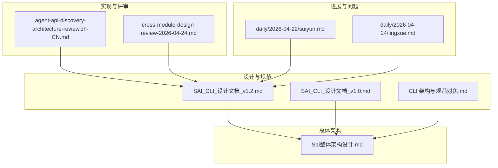
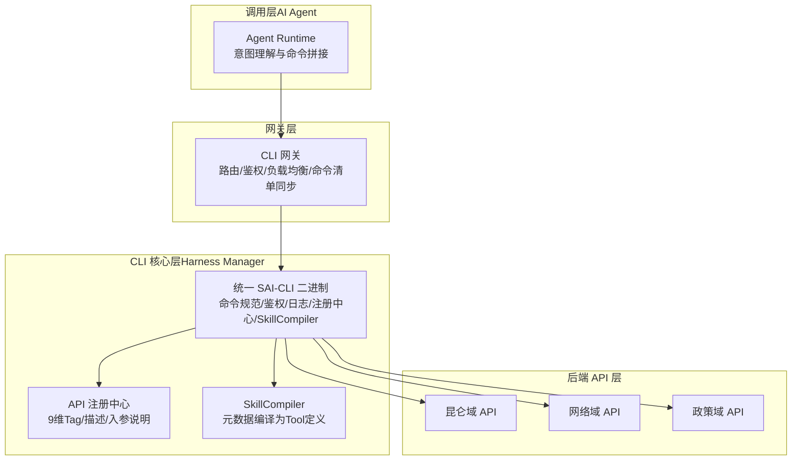
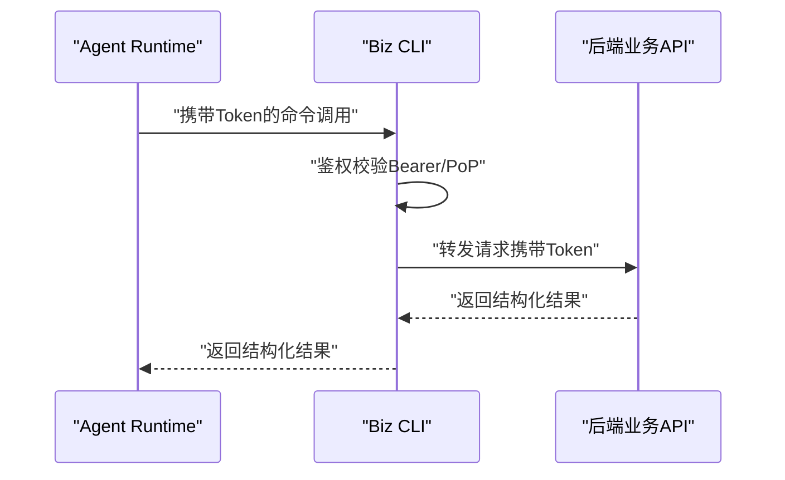
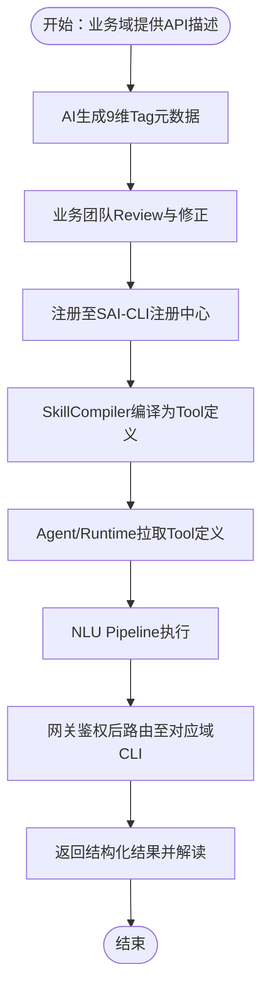
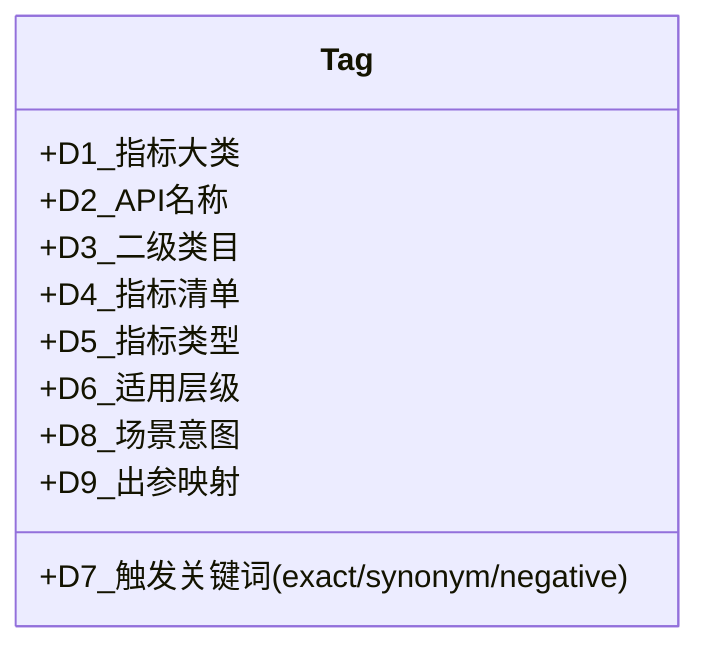
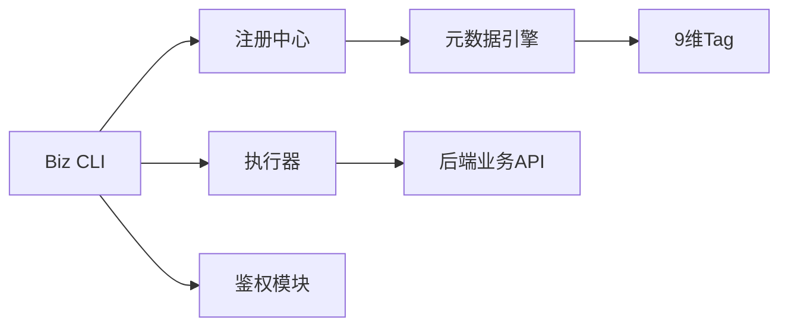

# Biz CLI模块职责

<cite>
**本文引用的文件**   
- [SAI_CLI_设计文档_v1.2.md](file://plan/SAI_CLI_设计文档_v1.2.md)
- [SAI_CLI_设计文档_v1.0.md](file://plan/SAI_CLI_设计文档_v1.0.md)
- [CLI 架构与规范对焦.md](file://plan/CLI 架构与规范对焦.md)
- [Sai整体架构设计.md](file://project/standup/Sai整体架构设计.md)
- [agent-api-discovery-architecture-review.zh-CN.md](file://notes/zhaobomin/agent-api-discovery-architecture-review.zh-CN.md)
- [cross-module-design-review-2026-04-24.md](file://notes/zhaobomin/cross-module-design-review-2026-04-24.md)
- [suiyun.md](file://daily/2026-04-22/suiyun.md)
- [lingxue.md](file://daily/2026-04-24/lingxue.md)
</cite>

## 目录
1. [引言](#引言)
2. [项目结构](#项目结构)
3. [核心组件](#核心组件)
4. [架构总览](#架构总览)
5. [详细组件分析](#详细组件分析)
6. [依赖关系分析](#依赖关系分析)
7. [性能考虑](#性能考虑)
8. [故障排查指南](#故障排查指南)
9. [结论](#结论)
10. [附录](#附录)

## 引言
本文件聚焦 Biz CLI 模块在 SAI（企业智能体平台）中的核心职责与实现规范，系统阐述其作为“业务能力封装层”的定位：统一命令规范、标准化 API 调用、鉴权与安全、9 维 Tag 元数据体系、以及与 Harness Manager、Agent 的协作关系。Biz CLI 通过四层分层架构，将各业务域 API 统一封装为单一可执行文件，实现“零侵入”接入与“可被 Agent 调用”的目标。

## 项目结构
围绕 Biz CLI 的设计与实现，相关文档与资料分布如下：
- 设计文档：SAI_CLI_设计文档_v1.0.md、SAI_CLI_设计文档_v1.2.md
- 架构与规范：CLI 架构与规范对焦.md
- 总体架构：Sai整体架构设计.md
- 代码实现与评审：agent-api-discovery-architecture-review.zh-CN.md
- 跨模块对齐与矛盾点：cross-module-design-review-2026-04-24.md
- 日报与进展：daily/2026-04-22/suiyun.md、daily/2026-04-24/lingxue.md

**图表来源**
- [SAI_CLI_设计文档_v1.2.md:29-64](file://plan/SAI_CLI_设计文档_v1.2.md#L29-L64)
- [Sai整体架构设计.md:19-65](file://project/standup/Sai整体架构设计.md#L19-L65)

**章节来源**
- [SAI_CLI_设计文档_v1.2.md:29-64](file://plan/SAI_CLI_设计文档_v1.2.md#L29-L64)
- [Sai整体架构设计.md:19-65](file://project/standup/Sai整体架构设计.md#L19-L65)

## 核心组件
- 四层分层架构
  - 调用层（AI Agent）：根据用户提问在 SAI-CLI 中搜索 API，结合上下文选择匹配 API，拼接执行命令并返回结构化结果。
  - 网关层：路由转发、鉴权校验（PoP 签名验证）、负载均衡、命令清单同步。
  - CLI 核心层（Harness Manager 统一构建与维护）：统一命令规范、入参/出参 JSON、公共能力（认证/日志）；内置 API 注册中心（9 维 Tag、description、入参说明）；SkillCompiler 将元数据编译为 Agent 可读的 Tool 定义。
  - 后端 API 层：各域只提供 API 接口（无需改造前端 GUI，无需开发 CLI）。
- 9 维 Tag 元数据体系：路由与分类组（D1-D4）、NLU 理解组（D5、D7、D8）、执行与展示组（D3、D6、D9），覆盖语义理解、参数构造、消歧防误判与结果解读。
- 标准化命令规范：统一命令格式 {product} {module} {action} [params]，参数以 JSON 格式传递，禁止交互式输入。
- 鉴权与安全：PoP Token（Bearer Token 为基础链路，PoP 签名+ECDSA 为增强链路），支持 AK/SK 签名鉴权（Harness Manager 内部接口）。
- 可测试性与 Dry-Run：写操作命令支持 --dry-run，返回将要执行的操作描述，便于风险前置。

**章节来源**
- [SAI_CLI_设计文档_v1.2.md:66-75](file://plan/SAI_CLI_设计文档_v1.2.md#L66-L75)
- [SAI_CLI_设计文档_v1.2.md:150-168](file://plan/SAI_CLI_设计文档_v1.2.md#L150-L168)
- [SAI_CLI_设计文档_v1.2.md:115-146](file://plan/SAI_CLI_设计文档_v1.2.md#L115-L146)
- [SAI_CLI_设计文档_v1.2.md:394-471](file://plan/SAI_CLI_设计文档_v1.2.md#L394-L471)
- [SAI_CLI_设计文档_v1.2.md:474-501](file://plan/SAI_CLI_设计文档_v1.2.md#L474-L501)

## 架构总览
Biz CLI 作为业务能力封装层，承担“统一命令规范、统一鉴权、统一 API 调用”的职责，向上对接 Agent，向下对接各业务域 API。Harness Manager 负责统一构建、注册中心与 SkillCompiler，确保 CLI 的标准化与可扩展性。

**图表来源**
- [SAI_CLI_设计文档_v1.2.md:29-64](file://plan/SAI_CLI_设计文档_v1.2.md#L29-L64)
- [Sai整体架构设计.md:108-138](file://project/standup/Sai整体架构设计.md#L108-L138)

**章节来源**
- [SAI_CLI_设计文档_v1.2.md:29-64](file://plan/SAI_CLI_设计文档_v1.2.md#L29-L64)
- [Sai整体架构设计.md:108-138](file://project/standup/Sai整体架构设计.md#L108-L138)

## 详细组件分析

### 业务能力封装
- 统一命令规范：所有命令遵循 {product} {module} {action} [params]，参数以 JSON 格式传递，确保 Agent 可自动化拼接与执行。
- 零侵入接入：业务域仅提供 API 接口，无需改造前端 GUI，也无需开发 CLI。
- 单 CLI 统一封装：由 Harness Manager 统一开发与维护，打包为单一二进制文件，包含各域命令集，降低接入与维护成本。

**章节来源**
- [SAI_CLI_设计文档_v1.2.md:79-84](file://plan/SAI_CLI_设计文档_v1.2.md#L79-L84)
- [SAI_CLI_设计文档_v1.2.md:115-146](file://plan/SAI_CLI_设计文档_v1.2.md#L115-L146)
- [suiyun.md:3-13](file://daily/2026-04-22/suiyun.md#L3-L13)

### 鉴权管理
- 一期：标准 Bearer Token，支持命令行参数、环境变量、本地配置文件三种获取方式，按优先级自动选择。
- 二期：PoP Token + ECDSA 签名，引入 sai-agent 作为安全代理，实现 Token 与设备/环境绑定，防止复用。
- 接口鉴权：Harness Manager 内部 API 统一使用 AK/SK（HMAC-SHA256）签名。
- 配置文件：统一格式 ~/.sai/sso-auth.json，包含 token、identity_type、scopes、expires_at 等字段。

**图表来源**
- [SAI_CLI_设计文档_v1.2.md:405-449](file://plan/SAI_CLI_设计文档_v1.2.md#L405-L449)
- [Sai整体架构设计.md:206-213](file://project/standup/Sai整体架构设计.md#L206-L213)

**章节来源**
- [SAI_CLI_设计文档_v1.2.md:394-471](file://plan/SAI_CLI_设计文档_v1.2.md#L394-L471)
- [Sai整体架构设计.md:206-213](file://project/standup/Sai整体架构设计.md#L206-L213)

### API 调用机制
- 注册与发现：所有业务域 API 必须在 SAI-CLI 注册中心完成注册，支持 AI 自动生成 9 维 Tag 元数据，业务团队 Review 确认后生效。
- 元数据编译：Harness Manager 内置 SkillCompiler，将注册元数据编译为 Agent 可读的 Tool 定义（LLM 可见层 + 框架控制层）。
- 调用流程：Agent 通过 NLU Pipeline（意图分类、实体抽取、Tag 匹配评分、参数组装、API 调用、结果解读）完成端到端执行。

**图表来源**
- [SAI_CLI_设计文档_v1.2.md:225-268](file://plan/SAI_CLI_设计文档_v1.2.md#L225-L268)
- [SAI_CLI_设计文档_v1.2.md:365-391](file://plan/SAI_CLI_设计文档_v1.2.md#L365-L391)

**章节来源**
- [SAI_CLI_设计文档_v1.2.md:225-268](file://plan/SAI_CLI_设计文档_v1.2.md#L225-L268)
- [SAI_CLI_设计文档_v1.2.md:365-391](file://plan/SAI_CLI_设计文档_v1.2.md#L365-L391)

### 9 维 Tag 元数据体系
- 路由与分类组：D1（指标大类）、D2（API 名称）、D4（指标清单）
- NLU 理解组：D5（指标类型）、D7（触发关键词，含 exact/synonym/negative）、D8（场景意图）
- 执行与展示组：D3（二级类目）、D6（适用层级）、D9（出参映射）

**图表来源**
- [SAI_CLI_设计文档_v1.2.md:155-168](file://plan/SAI_CLI_设计文档_v1.2.md#L155-L168)

**章节来源**
- [SAI_CLI_设计文档_v1.2.md:150-168](file://plan/SAI_CLI_设计文档_v1.2.md#L150-L168)

### 标准化命令规范
- 命令格式：{product} {module} {action} [params]
- 参数规范：JSON 格式，禁止交互式输入，确保 Agent 可自动化执行。
- 错误输出：统一结构化 JSON，包含 type、code、message、hint 四个字段。

**章节来源**
- [SAI_CLI_设计文档_v1.2.md:115-146](file://plan/SAI_CLI_设计文档_v1.2.md#L115-L146)
- [SAI_CLI_设计文档_v1.2.md:295-336](file://plan/SAI_CLI_设计文档_v1.2.md#L295-L336)

### 可测试性与 Dry-Run
- 写操作命令支持 --dry-run，返回将要执行的操作描述，便于风险前置与影响评估。
- 单元测试：通过接口抽象实现，支持 vfs、HTTP 客户端、Token 读取等依赖注入与 Mock。

**章节来源**
- [SAI_CLI_设计文档_v1.2.md:474-501](file://plan/SAI_CLI_设计文档_v1.2.md#L474-L501)
- [SAI_CLI_设计文档_v1.2.md:502-512](file://plan/SAI_CLI_设计文档_v1.2.md#L502-L512)

## 依赖关系分析
- 模块边界清晰：CLI 保持通用能力，API 知识放在注册中心，后续新增历史系统 API 时不需要发版 CLI。
- 动态命令兜底分发：当前 TryDynamicDispatch 未接入主流程，可能导致合法动态命令在特定环境下不可用，建议在 main.go 或 root command 层接入。

**图表来源**
- [agent-api-discovery-architecture-review.zh-CN.md:24-38](file://notes/zhaobomin/agent-api-discovery-architecture-review.zh-CN.md#L24-L38)

**章节来源**
- [agent-api-discovery-architecture-review.zh-CN.md:24-66](file://notes/zhaobomin/agent-api-discovery-architecture-review.zh-CN.md#L24-L66)

## 性能考虑
- 单一二进制部署：Go 编译产物跨平台支持良好，适合在 Agent 容器环境中运行，减少运行时依赖与部署复杂度。
- 无交互式输入：命令参数全部通过命令行传入，避免运行时等待与阻塞，提升 Agent 自动化执行效率。
- 9 维 Tag 与 NLU Pipeline：通过 D7 negative 关键词与 D8 场景意图，减少误判与重试，提高 API 命中率与执行成功率。

**章节来源**
- [SAI_CLI_设计文档_v1.2.md:339-350](file://plan/SAI_CLI_设计文档_v1.2.md#L339-L350)
- [SAI_CLI_设计文档_v1.2.md:250-268](file://plan/SAI_CLI_设计文档_v1.2.md#L250-L268)

## 故障排查指南
- 鉴权失败
  - 检查 Token 获取优先级：命令行参数 > 环境变量 > 本地配置文件。
  - 本地配置文件格式：~/.sai/sso-auth.json，确认 token、identity_type、scopes、expires_at 字段齐全。
  - 二期 PoP 签名：确认 sai-agent 与设备/环境绑定配置正确。
- API 命中率低
  - 检查 9 维 Tag 生成质量：D7 触发关键词是否完整，D8 场景意图是否准确。
  - 业务区分度不足：优化 Tag 生成工具，提升不同业务域的标签边界与关键维度识别。
- 动态命令不可用
  - 确认 TryDynamicDispatch 已接入主流程，避免仅依赖启动期预挂载导致的可用性问题。
- 错误输出
  - 统一使用结构化 JSON，包含 type、code、message、hint，便于 Agent 与用户理解与修复。

**章节来源**
- [SAI_CLI_设计文档_v1.2.md:405-471](file://plan/SAI_CLI_设计文档_v1.2.md#L405-L471)
- [lingxue.md:17-28](file://daily/2026-04-24/lingxue.md#L17-L28)
- [agent-api-discovery-architecture-review.zh-CN.md:40-66](file://notes/zhaobomin/agent-api-discovery-architecture-review.zh-CN.md#L40-L66)

## 结论
Biz CLI 通过四层分层架构与 9 维 Tag 元数据体系，实现了企业内部业务系统的统一封装与标准化调用。Harness Manager 负责统一构建、注册中心与 SkillCompiler，确保 CLI 的可扩展性与可被 Agent 调用。鉴权与安全机制分阶段演进，既满足基础链路需求，又为未来 PoP 签名增强提供路径。通过严格的命令规范、结构化输出与 Dry-Run 能力，Biz CLI 有效降低了业务域接入成本，并提升了自动化执行的可靠性与安全性。

## 附录
- 设计原则与规范要点
  - GUI 零改造：业务域仅提供 API 接口，CLI 由 Harness Manager 统一开发。
  - 架构解耦：Agent → 网关 → CLI → API，层层解耦，独立演进。
  - 协议统一：所有 HTTP 调用及 CLI 的入参/出参统一使用 JSON 格式。
  - 可被 Agent 调用：命令必须支持纯参数化调用，禁止交互式输入；提供结构化 Tag 元数据。
  - 结构化错误输出：统一 JSON 字段，便于 Agent 与用户理解与修复。
  - 开发语言统一：CLI 统一使用 Golang 开发，编译为单一二进制文件。
  - Tag 自动化生成：由 AI 根据 API 描述文档自动生成，业务团队 Review 确认后注册。
  - 安全与鉴权：PoP Token（Bearer Token 为基础链路，PoP 签名+ECDSA 为增强链路），Harness Manager 内部接口使用 AK/SK 签名。
  - 可测试性与 Dry-Run：写操作命令支持 --dry-run，返回将要执行的操作描述。

**章节来源**
- [SAI_CLI_设计文档_v1.2.md:79-391](file://plan/SAI_CLI_设计文档_v1.2.md#L79-L391)
- [SAI_CLI_设计文档_v1.0.md:57-251](file://plan/SAI_CLI_设计文档_v1.0.md#L57-L251)
- [CLI 架构与规范对焦.md:7-25](file://plan/CLI 架构与规范对焦.md#L7-L25)