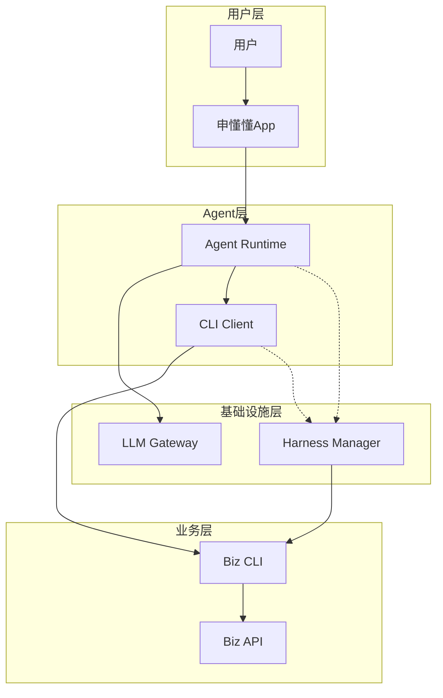
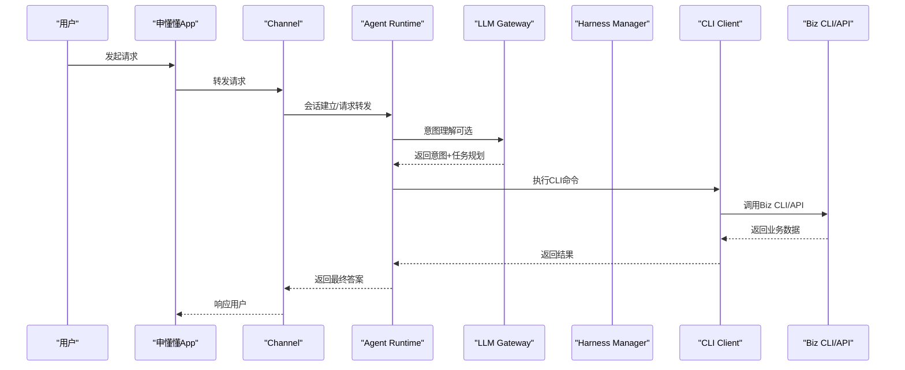
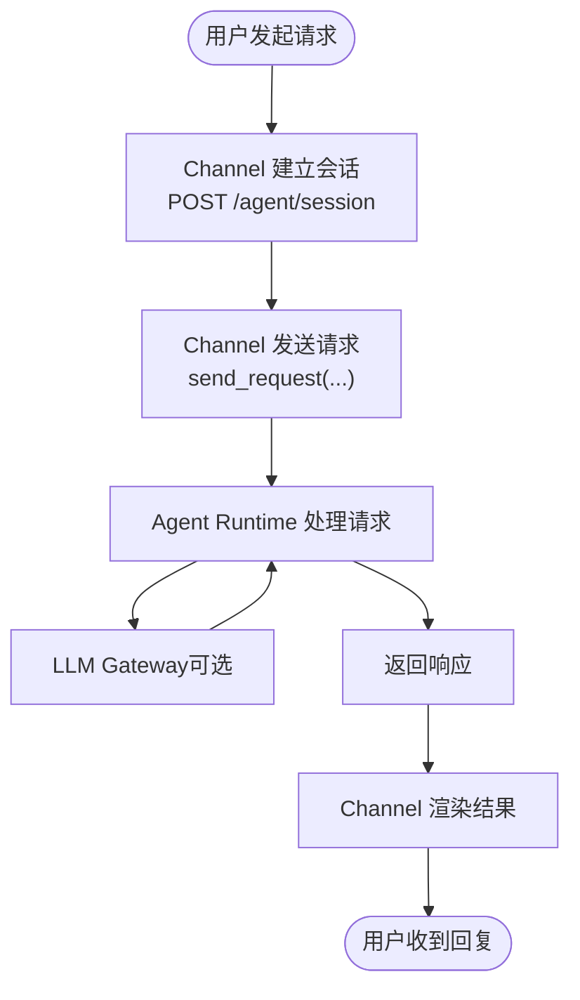
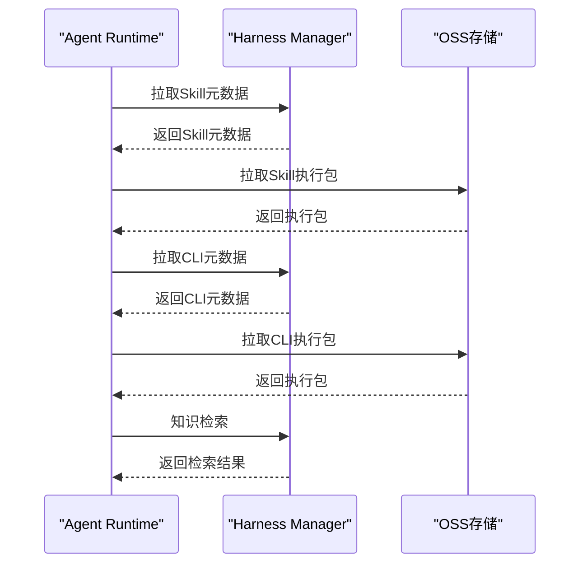
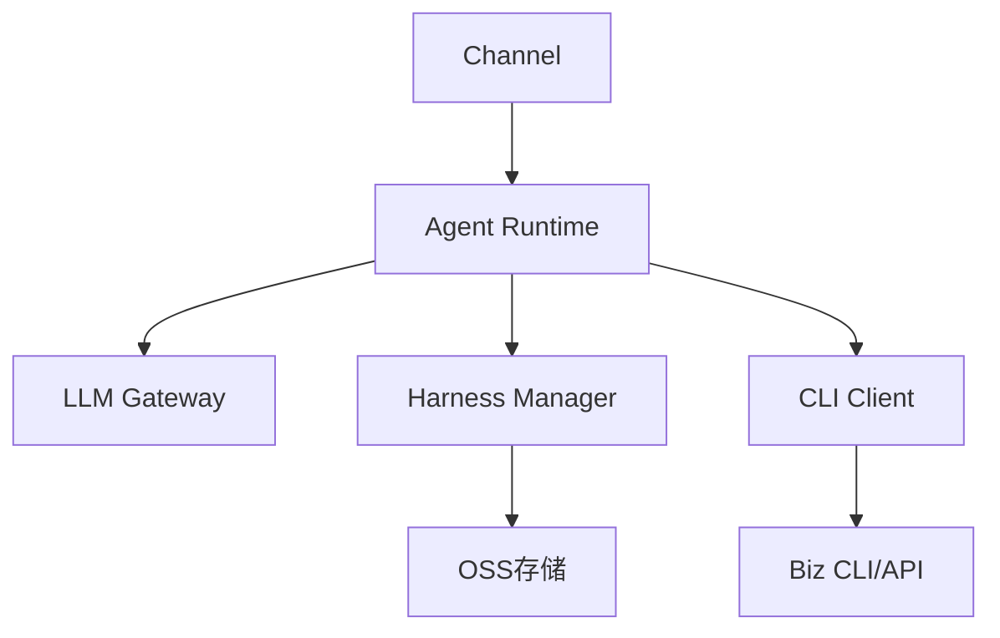

# Channel模块职责

<cite>
**本文档引用的文件**
- [Sai整体架构设计.md](file://project/standup/Sai整体架构设计.md)
- [cross-module-design-review-2026-04-24.md](file://notes/zhaobomin/cross-module-design-review-2026-04-24.md)
- [Agent-Runtime方案.md](file://plan/Agent-Runtime方案.md)
- [2026-04-20日报.md](file://daily/2026-04-20/yihang.md)
- [2026-04-23日报.md](file://daily/2026-04-23/yihang.md)
- [SAI-daily-2026-04-21.md](file://project/SAI-daily-2026-04-21.md)
- [SAI-daily-report-2026-04-22-final.md](file://project/SAI-daily-report-2026-04-22-final.md)
</cite>

## 目录
1. [简介](#简介)
2. [项目结构](#项目结构)
3. [核心组件](#核心组件)
4. [架构总览](#架构总览)
5. [详细组件分析](#详细组件分析)
6. [依赖关系分析](#依赖关系分析)
7. [性能考量](#性能考量)
8. [故障排查指南](#故障排查指南)
9. [结论](#结论)

## 简介
本文件聚焦于Channel模块在SAI项目中的核心职责，围绕用户接入层的关键职能进行系统化说明。依据现有文档，Channel模块由弘宇负责，承担“用户接入、前端交互”的职责，并负责将申懂懂App与Agent Runtime进行对接。当前阶段，Channel模块的前端交互架构、消息协议、会话管理、生成式UI方案以及与Agent Runtime的接口定义尚处于缺失状态，需要尽快补齐。

## 项目结构
SAI项目采用“用户层-Agent层-基础设施层-业务层”的分层架构，Channel位于用户层与Agent层之间，承担用户请求的接入与转发职责。整体架构图展示了从申懂懂App到Agent Runtime再到LLM Gateway与业务系统的调用链路。

**图表来源**
- [Sai整体架构设计.md: 19-65:19-65](file://project/standup/Sai整体架构设计.md#L19-L65)

**章节来源**
- [Sai整体架构设计.md: 17-65:17-65](file://project/standup/Sai整体架构设计.md#L17-L65)

## 核心组件
- Channel（用户接入层）
  - 负责人：弘宇
  - 核心职责：用户接入、前端交互
  - 与Agent Runtime的接口：`POST /agent/session` → `get_session` / `send_request`
  - 与申懂懂App的集成：前端H5 SDK对接，通过agent-gateway路由至Agent Runtime
- Agent Runtime（智能体执行层）
  - 负责人：奕杭
  - 核心职责：意图理解、业务执行、Serverless实例管理
  - 与Channel的接口：基于会话的请求转发与响应
- LLM Gateway（基础设施层）
  - 负责人：老徐
  - 核心职责：LLM统一代理、Token管理、成本控制
- Harness Manager（基础设施层）
  - 负责人：隋云
  - 核心职责：知识库、Skills、CLI注册分发
- Biz CLI（业务层）
  - 负责人：淩雪
  - 核心职责：业务能力封装、鉴权、API调用

**章节来源**
- [Sai整体架构设计.md: 142-151:142-151](file://project/standup/Sai整体架构设计.md#L142-L151)
- [Sai整体架构设计.md: 154-164:154-164](file://project/standup/Sai整体架构设计.md#L154-L164)

## 架构总览
Channel在系统中的作用是作为用户接入层，负责将申懂懂App的用户请求转发至Agent Runtime，并在必要时与LLM Gateway、Harness Manager进行交互。整体调用序列如下：

**图表来源**
- [Sai整体架构设计.md: 115-138:115-138](file://project/standup/Sai整体架构设计.md#L115-L138)

**章节来源**
- [Sai整体架构设计.md: 108-138:108-138](file://project/standup/Sai整体架构设计.md#L108-L138)

## 详细组件分析

### Channel模块职责分解
- 用户接入
  - 通过H5 SDK与申懂懂App集成，实现用户请求的捕获与转发
  - 与Agent Runtime的会话接口对接，完成用户身份与上下文的传递
- 前端交互
  - 输入输出层设计：输入框布局、语音输入、快捷指令、状态流转
  - 生成式UI：Markdown渲染、表格/代码块增强、引用溯源
  - 会话管理：历史会话、新建会话、会话恢复与重命名
- 与Agent SDK集成
  - 基于H5 SDK的前端集成方案，通过agent-gateway进行路由
  - 支持多产品登录态适配（客户管家、申懂懂产品）

**章节来源**
- [Sai整体架构设计.md: 148-149:148-149](file://project/standup/Sai整体架构设计.md#L148-L149)
- [Agent-Runtime方案.md: 40-43:40-43](file://plan/Agent-Runtime方案.md#L40-L43)
- [2026-04-23日报.md: 17-20:17-20](file://daily/2026-04-23/yihang.md#L17-L20)

### 与Agent Runtime的接口定义
- 会话建立
  - 接口路径：`POST /agent/session`
  - 调用方式：Channel → Agent Runtime
  - 认证方式：用户Token透传
- 会话交互
  - 接口路径：`send_request(session, content_body)`
  - 调用方式：Agent Runtime → Channel（通过agent-gateway）
  - 认证方式：沿用会话建立时的用户Token

**图表来源**
- [Sai整体架构设计.md: 158-159:158-159](file://project/standup/Sai整体架构设计.md#L158-L159)
- [2026-04-20日报.md: 5-11:5-11](file://daily/2026-04-20/yihang.md#L5-L11)

**章节来源**
- [Sai整体架构设计.md: 158-159:158-159](file://project/standup/Sai整体架构设计.md#L158-L159)
- [2026-04-20日报.md: 5-11:5-11](file://daily/2026-04-20/yihang.md#L5-L11)

### 与Harness Manager的接口依赖
- Skill拉取
  - 接口路径：`GET /hm/skills/list`
  - 认证方式：HM内部Token
- 知识检索
  - 接口路径：`POST /hm/kb/search`
  - 认证方式：HM内部Token
- CLI拉取
  - 接口路径：`GET /hm/cli/list`
  - 认证方式：HM内部Token

**图表来源**
- [Sai整体架构设计.md: 160-163:160-163](file://project/standup/Sai整体架构设计.md#L160-L163)

**章节来源**
- [Sai整体架构设计.md: 160-163:160-163](file://project/standup/Sai整体架构设计.md#L160-L163)

### 前端交互与用户体验优化
- 输入输出层设计
  - 输入框底部固定、多行自适应、扩展收纳、全屏编辑、状态机
  - 语音转录范式（非Live）、点击录音、流式转录、权限三态
  - 快捷标签（可编辑再发送、角色化）
- 输出阶段体验
  - 思考状态标签（折叠、动态文案）、逐字流式输出、自动滚动到底部
  - Markdown结构化渲染（标题/列表/加粗斜体/分割线/代码/表格/引用）
  - 表格超宽横滑、引用溯源（角标+引用列表+半屏抽屉+查看完整文档）
  - 代码块增强（高亮/复制/横滑）
- 使用阶段操作
  - 回答完成后操作栏：点赞（埋点）、吐槽（问题类型+可选说明）、复制（Markdown）、更多（扩展位）
  - 长按同款菜单、停止生成后支持“重新生成”（原Prompt重试）

**章节来源**
- [2026-04-22日报.md: 15-22:15-22](file://daily/2026-04-22/hongyu.md#L15-L22)

### 与LLM Gateway的集成
- 协议格式：OpenAI API格式
- 认证方式：Bearer Token（Gateway分配的虚拟key）
- 适用场景：意图理解链路中的LLM调用

**章节来源**
- [Sai整体架构设计.md: 158](file://project/standup/Sai整体架构设计.md#L158)
- [Sai整体架构设计.md: 199-204:199-204](file://project/standup/Sai整体架构设计.md#L199-L204)

## 依赖关系分析
- Channel与Agent Runtime
  - 依赖关系：Channel → Agent Runtime（会话建立与请求转发）
  - 认证方式：用户Token透传
- Channel与LLM Gateway
  - 依赖关系：Agent Runtime → LLM Gateway（OpenAI格式调用）
  - 认证方式：虚拟key
- Channel与Harness Manager
  - 依赖关系：Agent Runtime → HM（Skill/CLI拉取、知识检索）
  - 认证方式：HM内部Token

**图表来源**
- [Sai整体架构设计.md: 154-163:154-163](file://project/standup/Sai整体架构设计.md#L154-L163)

**章节来源**
- [Sai整体架构设计.md: 154-163:154-163](file://project/standup/Sai整体架构设计.md#L154-L163)

## 性能考量
- 冷启动与热启动
  - Agent Runtime目标：冷启动<1s，热启动<200ms
- 并发与容量
  - LLM Gateway目标：支持≥5个个人用户并发使用
- 降级与容灾
  - HM不可用：Agent使用本地缓存最近一次Skill/CLI定义，降级为无知识检索模式
  - LLM Gateway熔断：Agent返回固定提示，业务执行链路不受影响
  - Biz API超时/失败：CLI Client单次重试（≤3s），失败后Agent向用户说明具体接口不可用
  - OSS不可用：Agent使用本地缓存版本运行，日志告警通知HM团队
  - Agent Runtime实例崩溃：Serverless平台自动重建实例，用户会话需重新发起

**章节来源**
- [Sai整体架构设计.md: 224-245:224-245](file://project/standup/Sai整体架构设计.md#L224-L245)

## 故障排查指南
- Channel接口缺失
  - 现状：前端交互、消息协议、会话管理、生成式UI方案、与Agent Runtime接口定义均未对齐
  - 建议：尽快补齐Channel设计文档，明确前端架构、消息协议（流式/非流式、SSE/WebSocket）、会话管理与生成式UI方案
- Agent Runtime与Harness Manager接口未定义
  - 现状：Skill拉取、CLI拉取、知识检索接口schema缺失
  - 建议：与隋云对齐接口契约，定义请求参数、响应schema、分页、缓存策略、版本查询与增量同步
- LLM Gateway逃生方案未定
  - 现状：文档写了"待确认"但未定义
  - 建议：至少准备两个方案：业务侧fallback直连百炼原生API；Gateway bypass模式一键关闭所有路由规则
- 全局错误码与状态码规范缺失
  - 现状：各模块各自定义错误码，缺乏统一标准
  - 建议：定义一套跨模块的错误码体系，覆盖认证错误、参数错误、服务不可用、限流、业务错误

**章节来源**
- [cross-module-design-review-2026-04-24.md: 171-222:171-222](file://notes/zhaobomin/cross-module-design-review-2026-04-24.md#L171-L222)
- [cross-module-design-review-2026-04-24.md: 254-257:254-257](file://notes/zhaobomin/cross-module-design-review-2026-04-24.md#L254-L257)

## 结论
Channel模块在SAI项目中承担着用户接入与前端交互的核心职责，是连接申懂懂App与Agent Runtime的关键桥梁。当前阶段，Channel模块在前端交互架构、消息协议、会话管理、生成式UI方案以及与Agent Runtime的接口定义方面存在缺失，亟需补齐。建议优先完成Channel设计文档，明确前端集成方案与接口契约，确保与Agent Runtime、LLM Gateway、Harness Manager的协同顺畅，从而支撑申懂懂App的MVP上线与后续迭代。