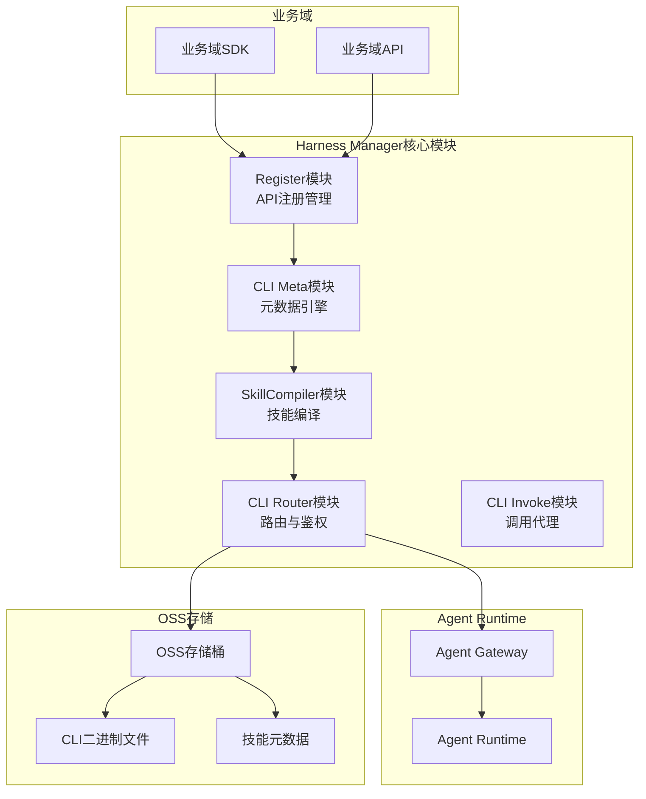
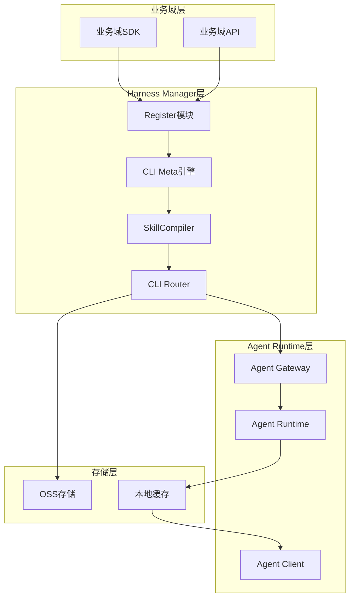
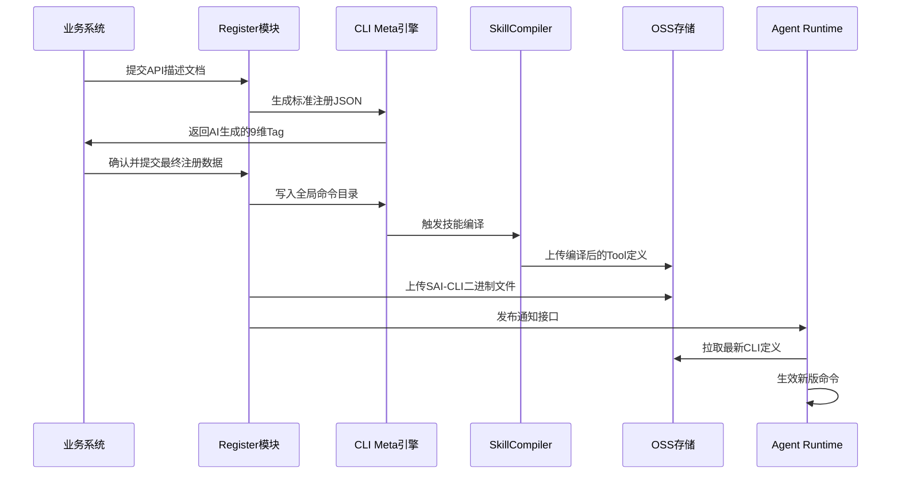
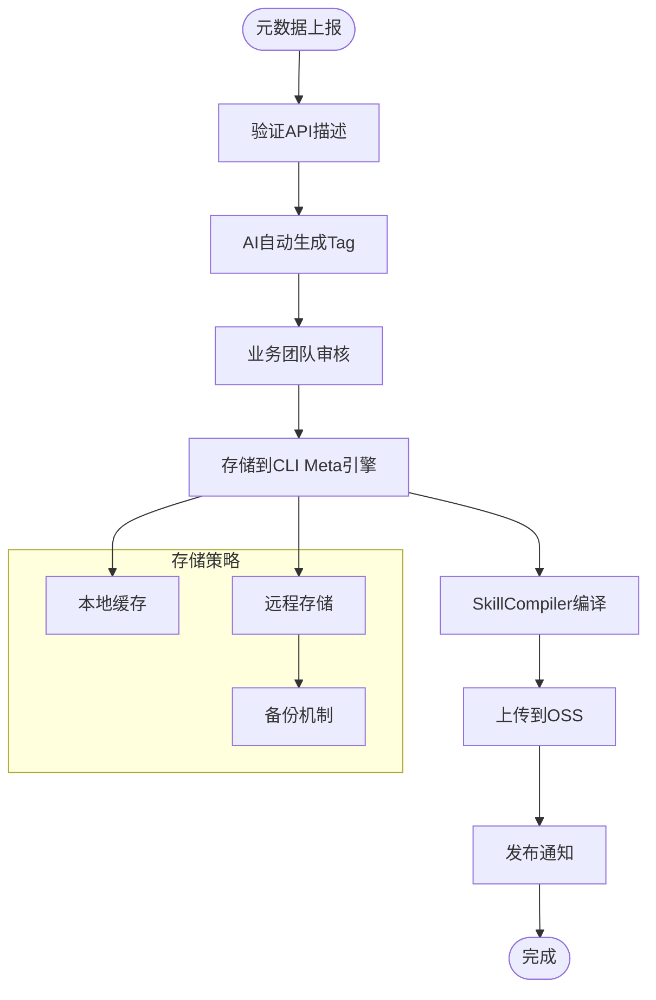
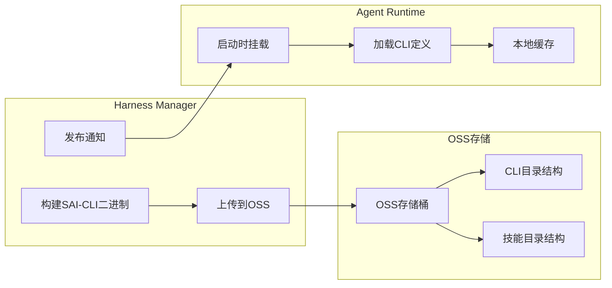
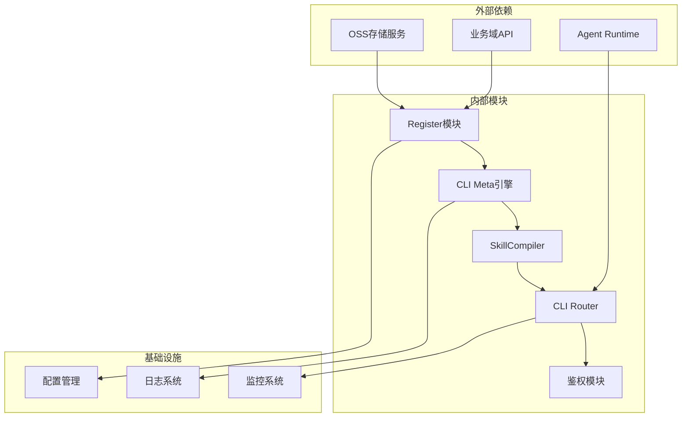

# CLI注册分发模块

<cite>
**本文档引用的文件**
- [SAI_CLI_设计文档_v1.2.md](file://plan/SAI_CLI_设计文档_v1.2.md)
- [SAI_CLI_设计文档_v1.0.md](file://plan/SAI_CLI_设计文档_v1.0.md)
- [Agent-Runtime方案review.md](file://notes/zhaobomin/Agent-Runtime方案review.md)
- [agent-api-discovery-architecture-review.zh-CN.md](file://notes/zhaobomin/agent-api-discovery-architecture-review.zh-CN.md)
- [2026-04-22项目日报.md](file://daily/2026-04-22/suiyun.md)
- [2026-04-23项目日报.md](file://daily/2026-04-23/suiyun.md)
- [2026-04-24项目日报.md](file://daily/2026-04-24/yihang.md)
- [2026-04-24平台技术部项目日报.md](file://daily/2026-04-24/xuchunhui.md)
- [CLI架构与规范对焦.md](file://plan/CLI 架构与规范对焦.md)
</cite>

## 目录
1. [简介](#简介)
2. [项目结构](#项目结构)
3. [核心组件](#核心组件)
4. [架构概览](#架构概览)
5. [详细组件分析](#详细组件分析)
6. [依赖关系分析](#依赖关系分析)
7. [性能考虑](#性能考虑)
8. [故障排除指南](#故障排除指南)
9. [结论](#结论)

## 简介

Harness Manager的CLI注册分发模块是SAI（Smart Agent Interface）架构中的关键组件，负责统一管理各业务域的CLI命令注册、元数据存储和产物分发。该模块实现了从"多CLI分域部署"到"单CLI统一封装"的重大架构演进，通过Harness Manager统一构建和维护SAI-CLI二进制文件，为Agent Runtime和CLI Client提供标准化的服务接口。

该模块的核心职责包括：
- 业务方上报CLI元数据的接收和处理
- CLI命令的统一注册、更新和注销管理
- 元数据的AI自动生成和9维Tag体系
- CLI产物的OSS存储和分发机制
- 与Agent Runtime和CLI Client的协作集成

## 项目结构

基于现有文档分析，CLI注册分发模块的项目结构呈现以下特点：

**图表来源**
- [SAI_CLI_设计文档_v1.2.md:545-590](file://plan/SAI_CLI_设计文档_v1.2.md#L545-L590)
- [2026-04-22项目日报.md:32-44](file://daily/2026-04-22/suiyun.md#L32-L44)

**章节来源**
- [SAI_CLI_设计文档_v1.2.md:545-590](file://plan/SAI_CLI_设计文档_v1.2.md#L545-L590)
- [2026-04-22项目日报.md:32-44](file://daily/2026-04-22/suiyun.md#L32-L44)

## 核心组件

### 1. Register模块（API注册管理）

Register模块是CLI注册分发的核心，负责接收业务方上报的API描述，管理CLI命令的注册、更新和注销操作。

**核心功能：**
- 接收业务系统提交的API描述文档
- 通过AI自动生成标准注册JSON
- 支持add（新增）、update（更新）、remove（注销）三种操作模式
- 与9维Tag体系集成，确保元数据的完整性和一致性

**接口设计：**
- 元数据生成接口：`POST /api/v1/sai/cli/metadata/generate`
- 命令注册接口：`POST /api/v1/sai/cli/registry`

### 2. CLI Meta模块（元数据引擎）

CLI Meta模块负责存储和管理9维Tag元数据，支持AI自动生成和人工确认的双重机制。

**9维Tag体系：**
- D1_D9维度覆盖路由分类、NLU理解、执行展示等关键要素
- 支持触发关键词（exact/synonym/negative）的三层匹配
- 提供适用层级和出参映射的细粒度控制

### 3. SkillCompiler模块（技能编译）

SkillCompiler模块将业务方上报的原始注册JSON编译为Agent可读的"增强型Tool定义"。

**编译流程：**
1. 业务方上报API注册信息（含9维Tag）
2. Manager接收并存储原始注册数据
3. SkillCompiler编译为Agent Tool定义
4. Agent Runtime拉取编译后的Tool定义

### 4. CLI Router模块（路由与鉴权）

CLI Router模块提供统一的路由转发和权限校验功能，确保命令的安全执行。

**核心能力：**
- 根据product字段将请求路由至对应域的CLI
- 验证Token合法性及Scope权限
- 支持PoP签名验证（二期增强）
- 负载均衡和命令清单同步

**章节来源**
- [SAI_CLI_设计文档_v1.2.md:545-590](file://plan/SAI_CLI_设计文档_v1.2.md#L545-L590)
- [SAI_CLI_设计文档_v1.2.md:365-393](file://plan/SAI_CLI_设计文档_v1.2.md#L365-L393)
- [2026-04-22项目日报.md:19-31](file://daily/2026-04-22/suiyun.md#L19-L31)

## 架构概览

CLI注册分发模块采用分层架构设计，实现了业务域API与Agent调用的解耦分离：

**图表来源**
- [SAI_CLI_设计文档_v1.2.md:29-75](file://plan/SAI_CLI_设计文档_v1.2.md#L29-L75)
- [SAI_CLI_设计文档_v1.2.md:545-590](file://plan/SAI_CLI_设计文档_v1.2.md#L545-L590)

**章节来源**
- [SAI_CLI_设计文档_v1.2.md:29-75](file://plan/SAI_CLI_设计文档_v1.2.md#L29-L75)
- [SAI_CLI_设计文档_v1.2.md:545-590](file://plan/SAI_CLI_设计文档_v1.2.md#L545-L590)

## 详细组件分析

### CLI注册流程

CLI注册流程经历了从v1.0的多CLI分域部署到v1.2的单CLI统一封装的重大演进：

**图表来源**
- [SAI_CLI_设计文档_v1.2.md:574-588](file://plan/SAI_CLI_设计文档_v1.2.md#L574-L588)
- [2026-04-23项目日报.md:18-28](file://daily/2026-04-23/suiyun.md#L18-L28)

### 元数据存储策略

元数据存储采用了分布式存储和本地缓存相结合的策略：

**图表来源**
- [2026-04-23项目日报.md:18-28](file://daily/2026-04-23/suiyun.md#L18-L28)
- [SAI_CLI_设计文档_v1.2.md:365-393](file://plan/SAI_CLI_设计文档_v1.2.md#L365-L393)

### 产物分发机制

产物分发机制通过OSS挂载实现，确保Agent Runtime能够及时获取最新的CLI定义：

**图表来源**
- [SAI_CLI_设计文档_v1.2.md:561-590](file://plan/SAI_CLI_设计文档_v1.2.md#L561-L590)
- [2026-04-24项目日报.md:24-31](file://daily/2026-04-24/yihang.md#L24-L31)

**章节来源**
- [SAI_CLI_设计文档_v1.2.md:561-590](file://plan/SAI_CLI_设计文档_v1.2.md#L561-L590)
- [2026-04-24项目日报.md:24-31](file://daily/2026-04-24/yihang.md#L24-L31)

### 安全性与完整性保障

CLI注册分发模块在安全性方面采用了多层次的保障机制：

**鉴权机制：**
- 支持PoP（Proof-of-Possession）Token方案
- 采用AK/SK签名鉴权（HMAC-SHA256）
- Token获取优先级：命令行参数 > 环境变量 > 本地配置文件

**完整性校验：**
- 9维Tag体系确保元数据的完整性
- AI自动生成与人工审核相结合
- 注册操作的幂等性保证

**章节来源**
- [SAI_CLI_设计文档_v1.2.md:394-471](file://plan/SAI_CLI_设计文档_v1.2.md#L394-L471)
- [SAI_CLI_设计文档_v1.2.md:592-599](file://plan/SAI_CLI_设计文档_v1.2.md#L592-L599)

## 依赖关系分析

CLI注册分发模块的依赖关系呈现清晰的层次化特征：

**图表来源**
- [SAI_CLI_设计文档_v1.2.md:545-590](file://plan/SAI_CLI_设计文档_v1.2.md#L545-L590)
- [agent-api-discovery-architecture-review.zh-CN.md:28-36](file://notes/zhaobomin/agent-api-discovery-architecture-review.zh-CN.md#L28-L36)

**章节来源**
- [SAI_CLI_设计文档_v1.2.md:545-590](file://plan/SAI_CLI_设计文档_v1.2.md#L545-L590)
- [agent-api-discovery-architecture-review.zh-CN.md:28-36](file://notes/zhaobomin/agent-api-discovery-architecture-review.zh-CN.md#L28-L36)

## 性能考虑

基于现有文档分析，CLI注册分发模块在性能方面采取了多项优化措施：

**缓存策略：**
- 本地缓存registry schema和TTL机制
- 减少Agent高频调用discover/list的延迟
- 支持离线或弱网环境下的基本可用性验证

**并发处理：**
- 多业务域API的并行处理能力
- 异步注册和编译机制
- 负载均衡和弹性扩展支持

**存储优化：**
- OSS挂载减少网络传输开销
- 二进制文件的增量更新机制
- CDN加速和就近访问优化

## 故障排除指南

### 常见问题及解决方案

**1. 注册接口调用失败**
- 检查API描述文档的格式和完整性
- 验证9维Tag的生成质量和业务团队确认
- 确认注册操作的幂等性处理

**2. CLI二进制文件下载失败**
- 检查OSS存储桶的访问权限
- 验证文件路径和版本号的正确性
- 确认Agent Runtime的挂载配置

**3. 元数据编译错误**
- 检查SkillCompiler的日志输出
- 验证输入元数据的格式规范
- 确认编译过程中的依赖关系

**4. 鉴权失败问题**
- 验证Token的获取和传递流程
- 检查AK/SK签名的生成和验证
- 确认PoP签名（二期）的环境绑定

**章节来源**
- [agent-api-discovery-architecture-review.zh-CN.md:503-558](file://notes/zhaobomin/agent-api-discovery-architecture-review.zh-CN.md#L503-L558)

## 结论

Harness Manager的CLI注册分发模块通过统一的架构设计和严格的流程管控，成功实现了从多CLI分域部署到单CLI统一封装的转型。该模块不仅简化了业务域的接入成本，还通过9维Tag体系和AI自动生成机制提升了元数据的质量和一致性。

模块的关键优势包括：
- **标准化程度高**：统一的接口规范和元数据标准
- **安全性强**：多层次的鉴权机制和完整性保障
- **可扩展性好**：模块化的架构设计支持灵活扩展
- **可靠性高**：完善的缓存策略和故障恢复机制

随着Agent Runtime方案的不断完善和OSS挂载机制的成熟，CLI注册分发模块将在SAI架构中发挥越来越重要的作用，为AI Agent与各业务域后端服务的标准化接入提供强有力的技术支撑。