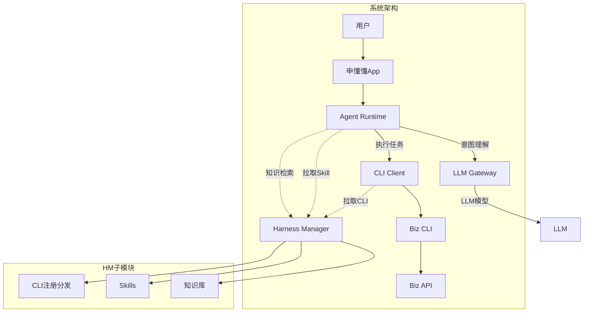
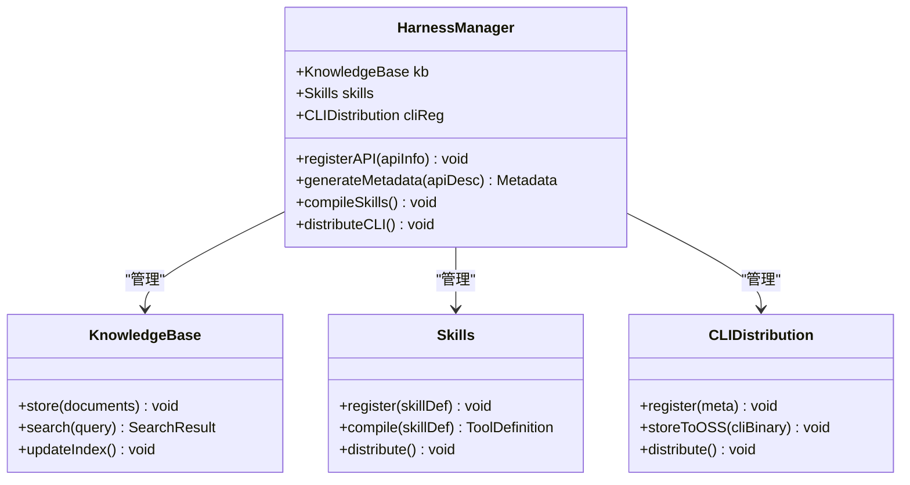
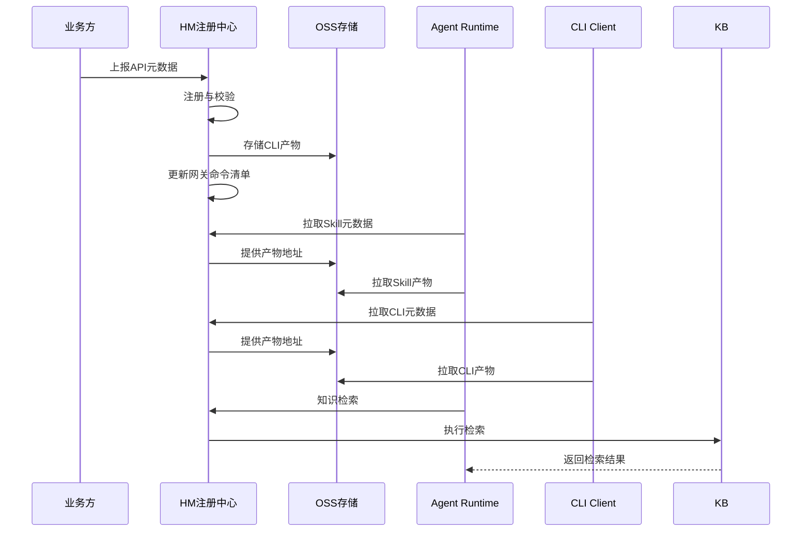
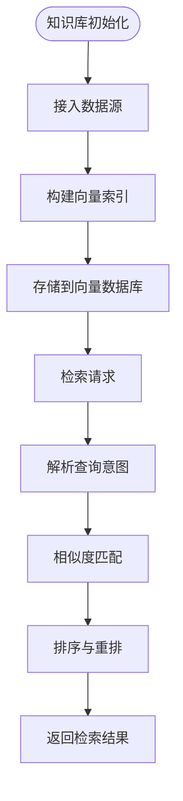
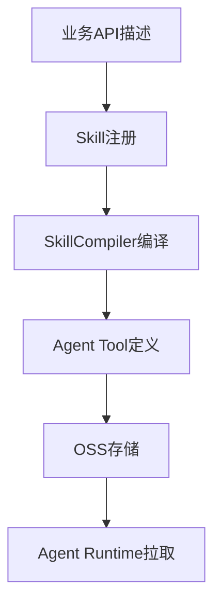
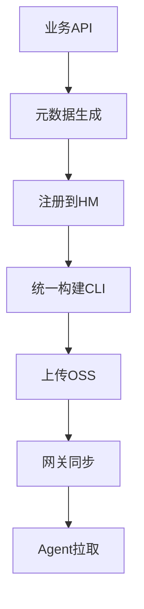
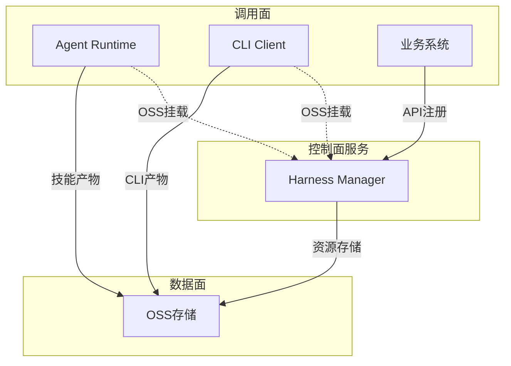

# Harness Manager模块职责

<cite>
**本文档引用的文件**
- [Harness Manager Cli方案设计方案.md](file://plan/Harness Manager Cli方案设计方案.md)
- [Sai整体架构设计.md](file://project/standup/Sai整体架构设计.md)
- [SAI_CLI_设计文档_v1.2.md](file://plan/SAI_CLI_设计文档_v1.2.md)
- [cross-module-design-review-2026-04-24.md](file://notes/zhaobomin/cross-module-design-review-2026-04-24.md)
- [2026-04-22/suiyun.md](file://daily/2026-04-22/suiyun.md)
- [2026-04-22/lingxue.md](file://daily/2026-04-22/lingxue.md)
- [Agent-Runtime方案.md](file://plan/Agent-Runtime方案.md)
- [Agent-Runtime方案review.md](file://notes/zhaobomin/Agent-Runtime方案review.md)
- [CLI 架构与规范对焦.md](file://plan/CLI 架构与规范对焦.md)
</cite>

## 目录
1. [简介](#简介)
2. [项目结构](#项目结构)
3. [核心组件](#核心组件)
4. [架构概览](#架构概览)
5. [详细组件分析](#详细组件分析)
6. [依赖分析](#依赖分析)
7. [性能考虑](#性能考虑)
8. [故障排查指南](#故障排查指南)
9. [结论](#结论)

## 简介
Harness Manager（简称HM）是SAI-CLI体系中的控制面服务，承担统一管理与分发的关键职责。其核心目标是将各业务域的API统一封装为单一CLI二进制文件，通过OSS挂载方式为Agent Runtime提供资源分发能力，同时支撑Skills管理与知识库检索。HM不直接参与业务调用链路，而是专注于资源的统一管理与分发，确保Agent Runtime能够稳定、高效地获取所需的CLI与技能定义。

## 项目结构
本项目围绕Harness Manager模块展开，涉及多个相关文档与设计文件，形成了从整体架构到具体实现的完整设计体系。关键文件包括：
- 整体架构设计文档：定义了HM在系统中的定位与三大子模块职责
- CLI设计文档：详细描述了HM的职责、部署方式与OSS路径规范
- 接口设计文档：明确了业务系统、Agent Runtime与HM之间的接口契约
- 跨模块设计评审：指出了接口对齐状态与缺失项
- 日常工作记录：体现了架构演进与职责收敛的过程

**图表来源**
- [Sai整体架构设计.md:19-65](file://project/standup/Sai整体架构设计.md#L19-L65)

**章节来源**
- [Sai整体架构设计.md:1-277](file://project/standup/Sai整体架构设计.md#L1-L277)

## 核心组件
HM作为控制面服务，包含三大核心子模块：
- 知识库（KB）：提供企业知识存储与检索能力，辅助Agent进行决策
- Skills：管理技能的注册与编译，将业务元数据编译为Agent可读的Tool定义
- CLI注册分发：负责业务方上报CLI元数据、存储到OSS并分发给Agent Runtime

**图表来源**
- [Sai整体架构设计.md:173-194](file://project/standup/Sai整体架构设计.md#L173-L194)

**章节来源**
- [Sai整体架构设计.md:173-194](file://project/standup/Sai整体架构设计.md#L173-L194)

## 架构概览
HM在系统中的支撑作用体现在三条核心数据流：
1. 注册流：业务方上报API元数据 → HM注册中心 → CLI网关同步生效
2. 拉取流：Agent Runtime/CLI Client从HM拉取元数据 → 通过OSS获取产物
3. 检索流：Agent Runtime通过HM进行知识检索

**图表来源**
- [Sai整体架构设计.md:67-106](file://project/standup/Sai整体架构设计.md#L67-L106)

**章节来源**
- [Sai整体架构设计.md:67-106](file://project/standup/Sai整体架构设计.md#L67-L106)

## 详细组件分析

### 知识库（KB）子模块
知识库作为HM的重要组成部分，承担以下职责：
- 企业知识存储与检索：提供结构化的知识库，支持Agent进行辅助决策
- 检索算法与更新机制：通过向量存储与检索算法，实现高效的语义检索
- 数据源管理：支持多种数据源的导入与同步

**图表来源**
- [Sai整体架构设计.md:175-178](file://project/standup/Sai整体架构设计.md#L175-L178)

**章节来源**
- [Sai整体架构设计.md:175-178](file://project/standup/Sai整体架构设计.md#L175-L178)

### Skills子模块
Skills模块负责将业务元数据编译为Agent可读的Tool定义，具体职责包括：
- Skill注册与管理：接收业务方上报的技能定义，进行注册与版本管理
- 元数据编译：将9维Tag元数据编译为Agent Tool定义，包含LLM可见层与框架控制层
- 分发机制：通过OSS提供技能产物的分发能力

**图表来源**
- [SAI_CLI_设计文档_v1.2.md:225-239](file://plan/SAI_CLI_设计文档_v1.2.md#L225-L239)

**章节来源**
- [SAI_CLI_设计文档_v1.2.md:225-239](file://plan/SAI_CLI_设计文档_v1.2.md#L225-L239)

### CLI注册分发子模块
CLI注册分发模块是HM的核心职责之一，负责：
- 业务方上报CLI元数据：接收业务系统的API描述与命令元数据
- 存储到OSS：将统一构建的CLI二进制文件存储到OSS指定路径
- Agent分发：通过OSS挂载方式为Agent Runtime提供CLI产物

**图表来源**
- [SAI_CLI_设计文档_v1.2.md:547-559](file://plan/SAI_CLI_设计文档_v1.2.md#L547-L559)

**章节来源**
- [SAI_CLI_设计文档_v1.2.md:547-559](file://plan/SAI_CLI_设计文档_v1.2.md#L547-L559)

## 依赖分析
HM与各模块的协作关系如下：
- 与Agent Runtime：通过OSS挂载方式进行资源分发，Agent不直接调用HM API
- 与CLI Client：提供CLI元数据与产物的分发能力
- 与业务系统：接收API注册与元数据上报
- 与OSS存储：作为统一的资源分发介质

**图表来源**
- [Harness Manager Cli方案设计方案.md:105-134](file://plan/Harness Manager Cli方案设计方案.md#L105-L134)

**章节来源**
- [Harness Manager Cli方案设计方案.md:105-134](file://plan/Harness Manager Cli方案设计方案.md#L105-L134)

## 性能考虑
- 冷启动优化：通过OSS挂载减少Agent启动时的下载时间
- 资源分发效率：统一构建CLI二进制，避免重复下载
- 缓存策略：Agent本地缓存最近一次的Skill/CLI定义，提高可用性
- 并发控制：同一API的注册操作采用串行处理，避免冲突

## 故障排查指南
- HM不可用：Agent使用本地缓存的Skill/CLI继续运行，知识检索降级
- OSS不可用：Agent使用本地缓存版本运行，日志告警通知HM团队
- 接口对齐问题：需要补齐Agent Runtime与HM之间的接口契约文档
- Tag生成方式：明确AI自动生成与手工编写两种路径的使用场景

**章节来源**
- [Sai整体架构设计.md:236-245](file://project/standup/Sai整体架构设计.md#L236-L245)
- [cross-module-design-review-2026-04-24.md:254-268](file://notes/zhaobomin/cross-module-design-review-2026-04-24.md#L254-L268)

## 结论
Harness Manager作为SAI-CLI体系的控制面服务，通过三大子模块实现了资源的统一管理与分发。其核心价值在于：
- 架构标准化：从业务域各自开发CLI演进为统一构建，降低协调成本
- 资源分发优化：通过OSS挂载实现高效的资源分发与缓存
- 职责清晰：HM专注于控制面管理，Agent Runtime专注于业务执行
- 安全保障：通过AK/SK签名与PoP Token机制确保调用安全

随着v1.2版本的推进，HM的设计日趋完善，但仍需补齐接口契约、知识库设计与Skills分发等关键文档，以确保4/30的交付目标。