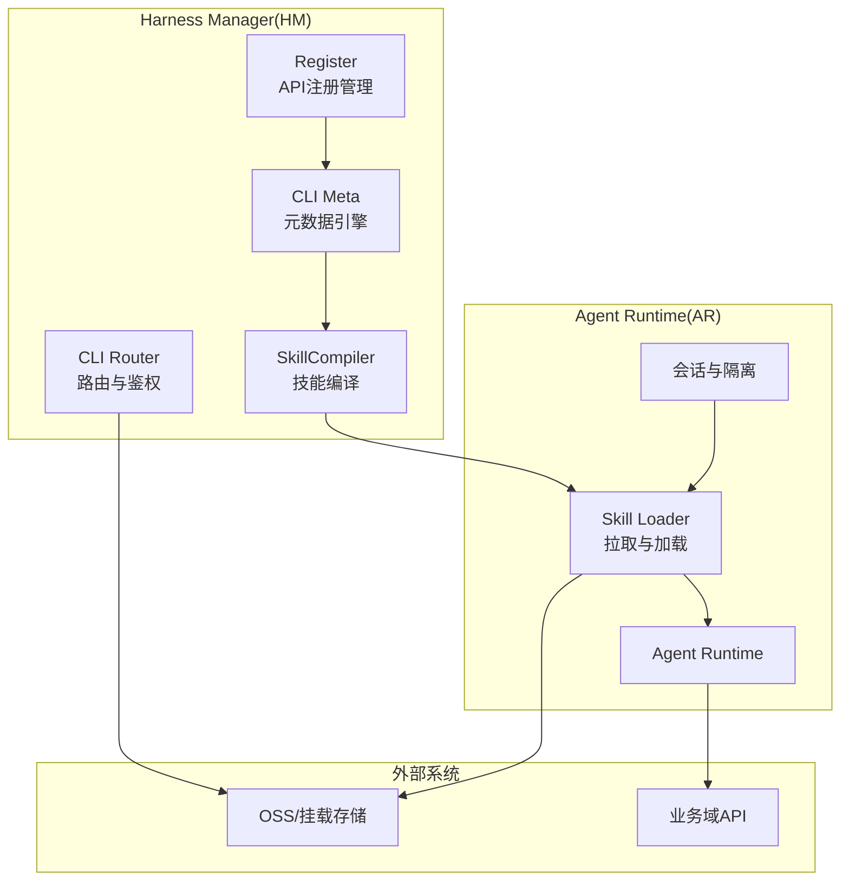
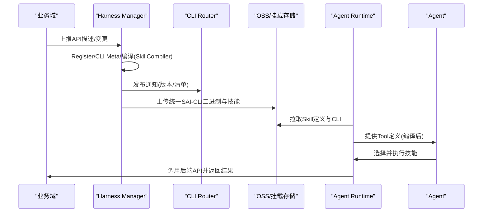
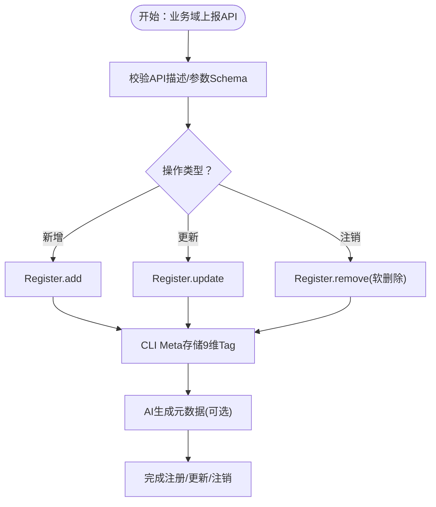
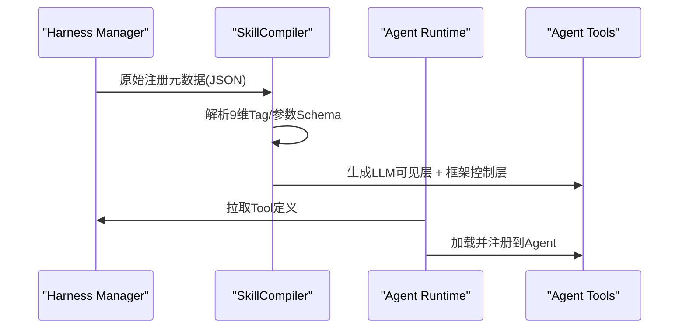
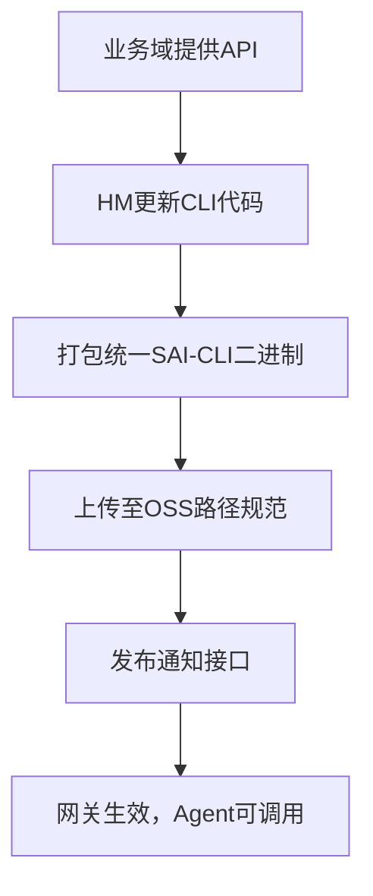
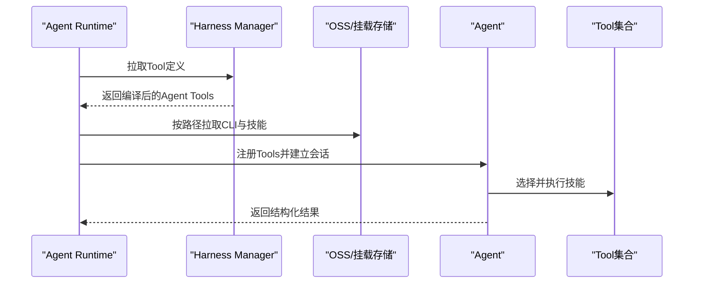
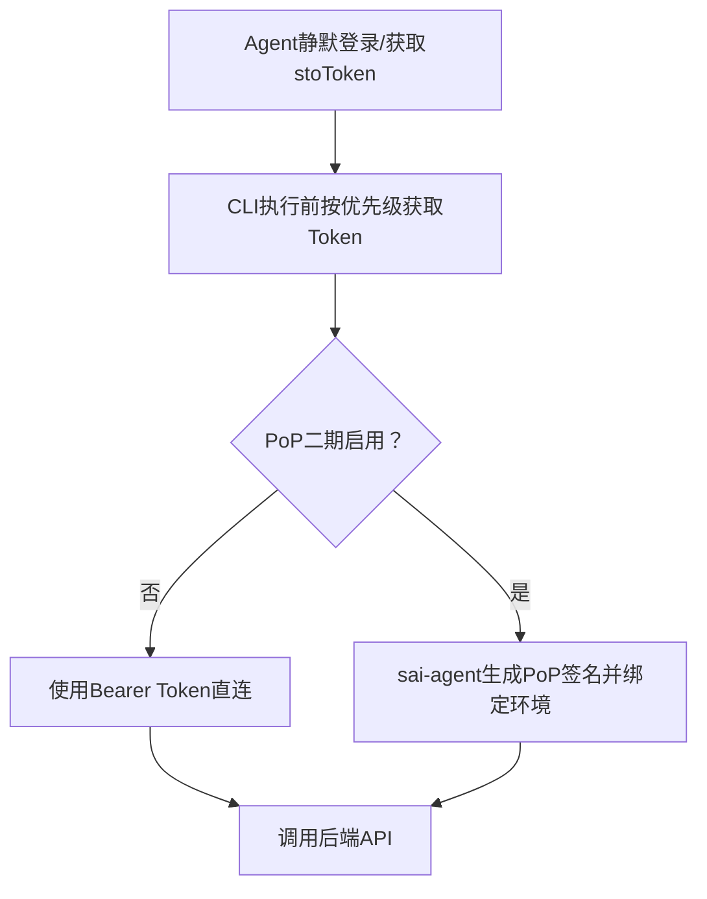
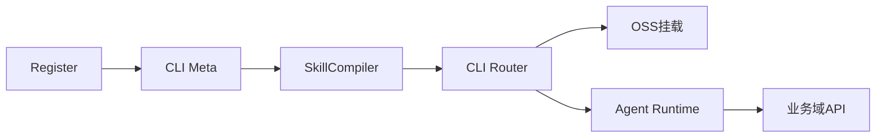

# Skills模块

<cite>
**本文引用的文件**
- [SAI_CLI_设计文档_v1.2.md](file://plan/SAI_CLI_设计文档_v1.2.md)
- [Agent-Runtime方案.md](file://plan/Agent-Runtime方案.md)
- [cross-module-design-review-2026-04-24.md](file://notes/zhaobomin/cross-module-design-review-2026-04-24.md)
- [Agent-Runtime方案review.md](file://notes/zhaobomin/Agent-Runtime方案review.md)
- [openspec-explore/SKILL.md](file://.claude/skills/openspec-explore/SKILL.md)
- [openspec-propose/SKILL.md](file://.claude/skills/openspec-propose/SKILL.md)
- [openspec-apply-change/SKILL.md](file://.claude/skills/openspec-apply-change/SKILL.md)
- [openspec-archive-change/SKILL.md](file://.claude/skills/openspec-archive-change/SKILL.md)
- [openspec-new-change/SKILL.md](file://.claude/skills/openspec-new-change/SKILL.md)
- [sai/SKILL.md](file://.claude/skills/sai/SKILL.md)
- [config.yaml](file://openspec/config.yaml)
</cite>

## 目录
1. [简介](#简介)
2. [项目结构](#项目结构)
3. [核心组件](#核心组件)
4. [架构总览](#架构总览)
5. [详细组件分析](#详细组件分析)
6. [依赖分析](#依赖分析)
7. [性能考量](#性能考量)
8. [故障排查指南](#故障排查指南)
9. [结论](#结论)
10. [附录](#附录)

## 简介
本文件面向Harness Manager（简称HM）的Skills模块，提供面向使用者与工程师的系统化说明。重点涵盖：
- Skills模块的核心职责与边界：API注册、元数据编译、技能分发与版本管理
- Agent如何从HM拉取技能定义，以及技能生命周期管理
- 元数据结构（9维Tag体系）、版本控制与分发机制
- Skills与Agent Runtime的协作关系，以及多技能同时挂载执行的实现思路
- 技能注册流程、接口设计、认证机制与性能优化策略

## 项目结构
仓库中与Skills模块直接相关的内容主要分布在以下位置：
- plan/SAI_CLI_设计文档_v1.2.md：定义了Skills模块在HM中的职责、SkillCompiler编译流程、CLI与Agent对接方式
- plan/Agent-Runtime方案.md：描述Agent Runtime如何拉取Skill/CLI、隔离与挂载策略
- notes/zhaobomin/cross-module-design-review-2026-04-24.md：跨模块Review中明确了Skills分发设计缺失、接口契约缺失等关键问题
- .claude/skills/*：OpenSpec实验工作流的技能模板，体现变更管理与制品化流程
- openspec/config.yaml：OpenSpec工作流配置，支撑Skills模块的规范化变更

**图表来源**
- [SAI_CLI_设计文档_v1.2.md:545-591](file://plan/SAI_CLI_设计文档_v1.2.md#L545-L591)
- [Agent-Runtime方案.md:15-32](file://plan/Agent-Runtime方案.md#L15-L32)

**章节来源**
- [SAI_CLI_设计文档_v1.2.md:29-75](file://plan/SAI_CLI_设计文档_v1.2.md#L29-L75)
- [Agent-Runtime方案.md:15-32](file://plan/Agent-Runtime方案.md#L15-L32)

## 核心组件
- Register（API注册管理）：接收业务域上报的API描述，完成注册、更新、注销（软删除30天可恢复）
- CLI Meta（元数据引擎）：存储与管理9维Tag元数据，支持AI自动生成
- SkillCompiler（技能编译）：将注册元数据编译为Agent可读的Tool定义
- CLI Router（路由与鉴权）：提供API注册接口、元数据搜索接口、发布通知接口、路由转发与权限校验
- Agent Runtime（Agent运行时）：按会话拉取Skill定义，隔离执行，支持多技能挂载

**章节来源**
- [SAI_CLI_设计文档_v1.2.md:547-560](file://plan/SAI_CLI_设计文档_v1.2.md#L547-L560)
- [Agent-Runtime方案.md:4-13](file://plan/Agent-Runtime方案.md#L4-L13)

## 架构总览
Skills模块在HM内的职责是“统一构建与维护”，在Agent Runtime内的职责是“按需拉取与执行”。二者通过CLI Router与OSS挂载形成闭环。

**图表来源**
- [SAI_CLI_设计文档_v1.2.md:574-588](file://plan/SAI_CLI_设计文档_v1.2.md#L574-L588)
- [Agent-Runtime方案.md:27-32](file://plan/Agent-Runtime方案.md#L27-L32)

## 详细组件分析

### 组件A：Register与CLI Meta（API注册与元数据管理）
- 职责
  - 接收业务域API描述，完成注册、更新、注销（软删除30天可恢复）
  - 存储9维Tag元数据，支持AI自动生成
- 关键流程
  - AI生成接口：根据API描述生成D1-D9标签与命令元数据
  - 注册接口：支持add/update/remove三种操作
- 元数据结构要点
  - 9维Tag：路由与分类组（D1/D2/D4）、NLU理解组（D5/D7/D8）、执行与展示组（D3/D6/D9）
  - 出参映射（D9）：JSON字段到中文含义的映射，便于Agent结果解读
- 与SkillCompiler的关系
  - Register/CLI Meta产出原始注册数据，SkillCompiler将其编译为Agent Tool定义

**图表来源**
- [SAI_CLI_设计文档_v1.2.md:376-391](file://plan/SAI_CLI_设计文档_v1.2.md#L376-L391)

**章节来源**
- [SAI_CLI_设计文档_v1.2.md:151-223](file://plan/SAI_CLI_设计文档_v1.2.md#L151-L223)
- [SAI_CLI_设计文档_v1.2.md:376-391](file://plan/SAI_CLI_设计文档_v1.2.md#L376-L391)

### 组件B：SkillCompiler（技能编译）
- 职责
  - 将业务方上报的原始注册JSON编译为Agent可读的“增强型Tool定义”
- 编译产物
  - LLM可见层：name、description、parameters
  - 框架控制层：__agent_meta__（含domain、intent_scenarios、negative_keywords、result_fields）
- 与Agent Runtime协作
  - AR拉取编译后的Tool定义，用于意图识别、参数组装与结果解读

**图表来源**
- [SAI_CLI_设计文档_v1.2.md:225-249](file://plan/SAI_CLI_设计文档_v1.2.md#L225-L249)

**章节来源**
- [SAI_CLI_设计文档_v1.2.md:225-249](file://plan/SAI_CLI_设计文档_v1.2.md#L225-L249)

### 组件C：CLI Router与发布流程（分发与版本控制）
- 职责
  - API注册接口：接收HM的API注册请求，写入注册中心
  - 元数据搜索接口：支持Agent语义搜索，返回候选命令
  - 元数据生成接口：AI自动生成9维Tag与命令元数据
  - 发布通知接口：接收HM的CLI版本上报，触发命令清单同步
  - 路由转发与鉴权：按product字段路由，校验Token与Scope
- 发布流程
  - 各域提供API → HM更新CLI代码 → 打包统一SAI-CLI二进制 → 上传OSS → 发布通知 → 网关生效
- 版本控制与分发
  - 采用OSS挂载形式，路径规范包含CLI网关、系统内置技能、公共技能、用户技能
  - 与Agent Runtime的挂载策略（workspace/systemspace）配合

**图表来源**
- [SAI_CLI_设计文档_v1.2.md:574-588](file://plan/SAI_CLI_设计文档_v1.2.md#L574-L588)
- [SAI_CLI_设计文档_v1.2.md:561-573](file://plan/SAI_CLI_设计文档_v1.2.md#L561-L573)

**章节来源**
- [SAI_CLI_设计文档_v1.2.md:603-632](file://plan/SAI_CLI_设计文档_v1.2.md#L603-L632)
- [SAI_CLI_设计文档_v1.2.md:561-591](file://plan/SAI_CLI_设计文档_v1.2.md#L561-L591)

### 组件D：Agent Runtime（拉取与执行）
- 职责
  - 会话隔离：基于Serverless按session分配实例，实例与会话一一对应
  - 拉取技能：从HM拉取Tool定义与CLI二进制
  - 执行与结果解读：结合9维Tag与D9映射，完成意图识别、参数组装与结果解读
- 挂载策略
  - 优先采用OSS挂载；若个性化挂载不可用，则在Agent层实现基于用户路径的文件权限
- 多技能挂载执行
  - 通过Tool定义集合与会话上下文，实现多技能并发挂载与调度

**图表来源**
- [Agent-Runtime方案.md:4-13](file://plan/Agent-Runtime方案.md#L4-L13)
- [Agent-Runtime方案.md:27-32](file://plan/Agent-Runtime方案.md#L27-L32)

**章节来源**
- [Agent-Runtime方案.md:4-13](file://plan/Agent-Runtime方案.md#L4-L13)
- [Agent-Runtime方案.md:27-32](file://plan/Agent-Runtime方案.md#L27-L32)

### 组件E：认证与鉴权（PoP Token与AK/SK）
- PoP Token（分两期）
  - 一期：标准Bearer Token，Agent→sai-cli→业务API
  - 二期：PoP签名+ECDSA，引入环境绑定签名防复用
- AK/SK签名
  - HM内部API统一使用AK/SK签名（HMAC-SHA256）
- 配置文件
  - ~/.sai/sso-auth.json：包含token、identity_type、scopes、expires_at

**图表来源**
- [SAI_CLI_设计文档_v1.2.md:413-471](file://plan/SAI_CLI_设计文档_v1.2.md#L413-L471)
- [SAI_CLI_设计文档_v1.2.md:452-460](file://plan/SAI_CLI_设计文档_v1.2.md#L452-L460)

**章节来源**
- [SAI_CLI_设计文档_v1.2.md:413-471](file://plan/SAI_CLI_设计文档_v1.2.md#L413-L471)
- [SAI_CLI_设计文档_v1.2.md:452-460](file://plan/SAI_CLI_设计文档_v1.2.md#L452-L460)

### 组件F：OpenSpec实验工作流（Skills变更管理）
- Explore/Propose/Apply/Archive等技能体现了变更的规范化流程
- 与Skills模块的关联
  - 通过OpenSpec规范化的制品化流程，确保Skills注册、编译、分发的可追溯与可审计

**章节来源**
- [.claude/skills/openspec-explore/SKILL.md:12-289](file://.claude/skills/openspec-explore/SKILL.md#L12-L289)
- [.claude/skills/openspec-propose/SKILL.md:12-111](file://.claude/skills/openspec-propose/SKILL.md#L12-L111)
- [.claude/skills/openspec-apply-change/SKILL.md:12-157](file://.claude/skills/openspec-apply-change/SKILL.md#L12-L157)
- [.claude/skills/openspec-archive-change/SKILL.md:12-115](file://.claude/skills/openspec-archive-change/SKILL.md#L12-L115)
- [.claude/skills/openspec-new-change/SKILL.md:12-75](file://.claude/skills/openspec-new-change/SKILL.md#L12-L75)
- [openspec/config.yaml:1-21](file://openspec/config.yaml#L1-L21)

## 依赖分析
- HM内部模块耦合
  - Register/CLI Meta → SkillCompiler → CLI Router
  - CLI Router与OSS挂载紧密耦合，保障分发效率
- 与Agent Runtime的接口契约
  - Review中明确指出：Skill拉取、CLI拉取、知识库检索等接口契约缺失，需尽快补齐
- 与Channel/前端的接口
  - Channel设计文档缺失，导致前端接入、消息协议、会话管理未定义

**图表来源**
- [SAI_CLI_设计文档_v1.2.md:547-560](file://plan/SAI_CLI_设计文档_v1.2.md#L547-L560)
- [cross-module-design-review-2026-04-24.md:187-197](file://notes/zhaobomin/cross-module-design-review-2026-04-24.md#L187-L197)

**章节来源**
- [cross-module-design-review-2026-04-24.md:187-197](file://notes/zhaobomin/cross-module-design-review-2026-04-24.md#L187-L197)

## 性能考量
- 冷启动与热启动
  - Agent Runtime采用Serverless，冷启动<1s，热启动~100ms，满足通用Agent调用
- 挂载策略
  - 优先OSS挂载，减少Agent层文件权限实现带来的额外开销
- 并发与隔离
  - 按session隔离，避免资源争用；多技能挂载时注意并发控制与资源上限
- 版本与缓存
  - CLI与Skill版本管理、增量同步与缓存策略需明确，避免频繁全量拉取

**章节来源**
- [Agent-Runtime方案.md:4-13](file://plan/Agent-Runtime方案.md#L4-L13)
- [cross-module-design-review-2026-04-24.md:233-241](file://notes/zhaobomin/cross-module-design-review-2026-04-24.md#L233-L241)

## 故障排查指南
- 认证失败
  - 检查Token来源优先级（命令行参数/环境变量/本地配置文件）
  - 二期PoP签名需确认sai-agent与环境绑定配置
- 接口不可用
  - 确认CLI Router的发布通知是否生效，OSS挂载路径是否正确
- 技能未生效
  - 检查SkillCompiler是否成功编译Tool定义，Agent是否拉取到最新版本
- 性能问题
  - 观察冷启动与热启动耗时，评估OSS挂载策略与并发控制

**章节来源**
- [SAI_CLI_设计文档_v1.2.md:413-471](file://plan/SAI_CLI_设计文档_v1.2.md#L413-L471)
- [SAI_CLI_设计文档_v1.2.md:561-591](file://plan/SAI_CLI_设计文档_v1.2.md#L561-L591)

## 结论
Skills模块在HM中承担“统一构建与维护”的核心职责，通过9维Tag元数据与SkillCompiler编译，为Agent Runtime提供可读的Tool定义。Agent Runtime通过OSS挂载与会话隔离实现高效、安全的技能执行。当前跨模块Review明确了接口契约与Channel设计缺失等关键风险点，建议优先补齐Skill拉取与CLI拉取的接口schema、Channel设计文档与知识库设计，以确保4/30交付目标的达成。

## 附录
- SAI CLI示例（来自.sai/SKILL.md）展示了典型命令发现、理解与执行流程，可作为Skills模块在实际场景中的参考范式

**章节来源**
- [.claude/skills/sai/SKILL.md:19-155](file://.claude/skills/sai/SKILL.md#L19-L155)