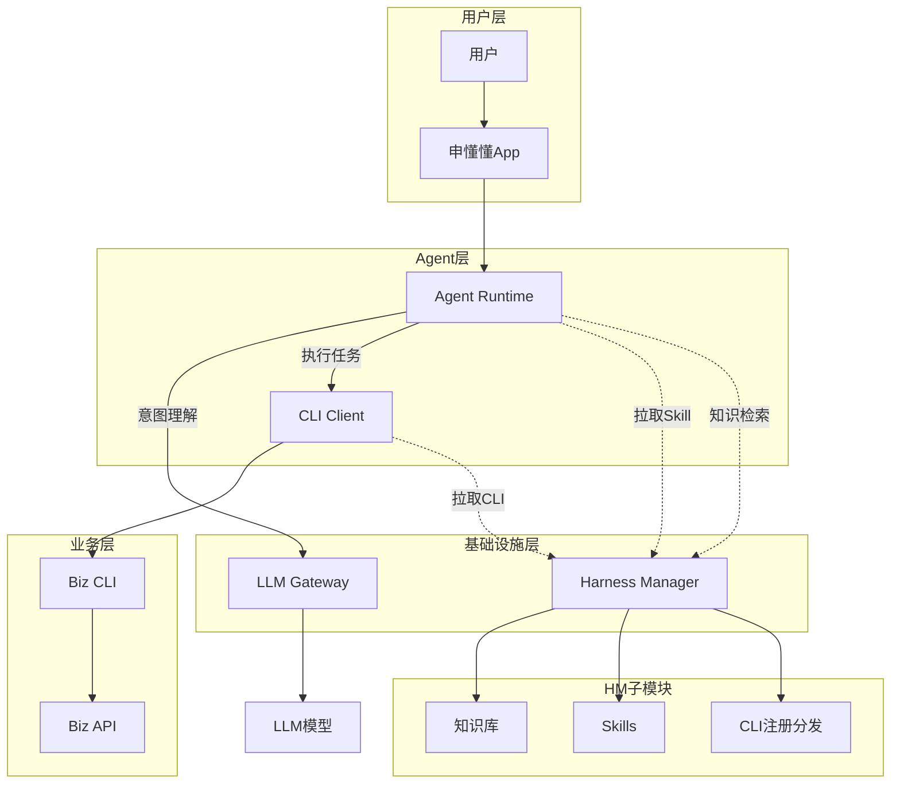
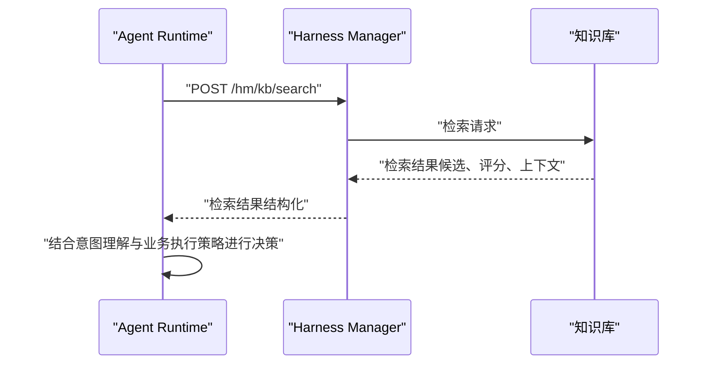
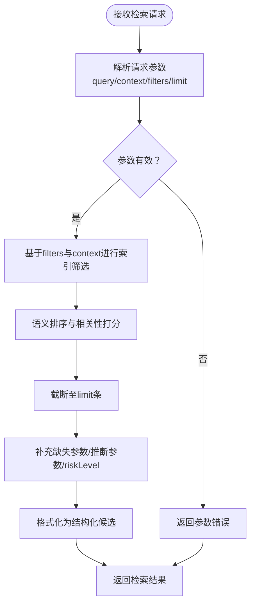
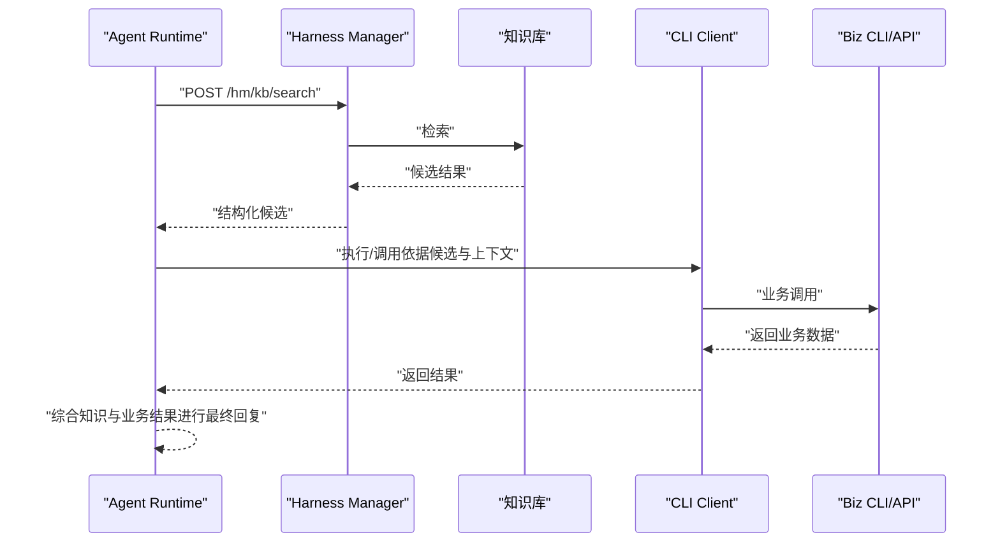
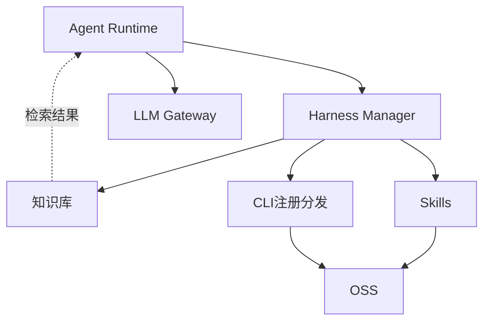

# 知识库模块

<cite>
**本文引用的文件**
- [Sai整体架构设计.md](file://project/standup/Sai整体架构设计.md)
- [cross-module-design-review-2026-04-24.md](file://notes/zhaobomin/cross-module-design-review-2026-04-24.md)
- [agent-api-discovery-architecture-review.zh-CN.md](file://notes/zhaobomin/agent-api-discovery-architecture-review.zh-CN.md)
- [Agent-Runtime方案.md](file://plan/Agent-Runtime方案.md)
- [LLM-Gateway建设方案.md](file://plan/LLM-Gateway建设方案.md)
</cite>

## 目录
1. [简介](#简介)
2. [项目结构](#项目结构)
3. [核心组件](#核心组件)
4. [架构总览](#架构总览)
5. [详细组件分析](#详细组件分析)
6. [依赖分析](#依赖分析)
7. [性能考虑](#性能考虑)
8. [故障排查指南](#故障排查指南)
9. [结论](#结论)
10. [附录](#附录)

## 简介
本文件围绕Harness Manager的知识库（KB）模块，系统化阐述其在Sai平台中的定位与职责：为企业提供知识存储与检索能力，支撑Agent在意图理解与业务执行过程中进行知识辅助决策。结合现有架构文档与评审材料，本文从系统架构、数据与检索设计、与Agent Runtime交互方式、配置与性能优化、扩展机制等方面进行说明，并给出可落地的接口与流程设计建议，帮助读者快速理解并推进KB模块的落地实施。

## 项目结构
- 本仓库中与知识库模块直接相关的资料主要集中在以下文档：
  - 整体架构设计文档：明确HM子模块划分与KB职责，给出HM数据流与检索链路示意。
  - 跨模块设计评审：指出KB设计缺失项（数据源、向量存储、检索算法、更新机制），并提出接口契约缺口。
  - Agent API发现机制Review：强调“结构化、可解释、可验证”的API发现协议，为KB检索结果的可决策性提供方法论指导。
  - Agent Runtime方案：说明Agent实例与OSS挂载、技能隔离等运行时特性，为KB检索结果的落地执行提供上下文。
  - LLM Gateway方案：提供统一的LLM调用入口与成本控制思路，为KB检索后的意图理解链路提供基础能力。

**图表来源**
- [Sai整体架构设计.md:19-65](file://project/standup/Sai整体架构设计.md#L19-L65)

**章节来源**
- [Sai整体架构设计.md:17-65](file://project/standup/Sai整体架构设计.md#L17-L65)

## 核心组件
- 知识库（KB）：负责企业知识的存储与检索，支撑Agent在决策过程中的信息辅助。
- Skills：技能定义与分发，为Agent提供可执行的工具集合。
- CLI注册分发：业务CLI的注册、元数据管理与产物分发，使Agent可按需拉取并执行。

上述职责与交互在整体架构文档中有明确描述，其中KB与Agent Runtime的交互路径为“知识检索”。

**章节来源**
- [Sai整体架构设计.md:173-194](file://project/standup/Sai整体架构设计.md#L173-L194)

## 架构总览
- HM作为控制面服务，承载三条核心数据流：注册流（业务方→HM→OSS）、拉取流（Agent/HM/OSS）、检索流（Agent→HM→KB）。
- KB检索链路示意如下：Agent Runtime向HM发起检索请求，HM调用KB进行检索，KB返回候选结果，Agent据此进行决策或进一步调用业务CLI/API。

**图表来源**
- [Sai整体架构设计.md:67-106](file://project/standup/Sai整体架构设计.md#L67-L106)
- [Sai整体架构设计.md:154-164](file://project/standup/Sai整体架构设计.md#L154-L164)

**章节来源**
- [Sai整体架构设计.md:67-106](file://project/standup/Sai整体架构设计.md#L67-L106)
- [Sai整体架构设计.md:154-164](file://project/standup/Sai整体架构设计.md#L154-L164)

## 详细组件分析

### 知识库模块职责与边界
- 企业知识存储与检索：KB负责将企业知识入库并提供检索能力，支持Agent在不同上下文中召回相关知识。
- 与Agent Runtime协作：Agent在意图理解与任务规划阶段，通过HM的检索接口获取知识辅助决策；KB不参与业务调用链路，仅做资源分发与检索支撑。

**章节来源**
- [Sai整体架构设计.md:175-178](file://project/standup/Sai整体架构设计.md#L175-L178)
- [Sai整体架构设计.md:191-193](file://project/standup/Sai整体架构设计.md#L191-L193)

### 知识检索接口设计与实现建议
- 接口路径与方法：建议采用“POST /hm/kb/search”，与整体架构文档中“POST /hm/kb/search”的路径约定保持一致。
- 请求参数建议：
  - query：自然语言查询文本
  - limit：返回候选数量上限
  - context：上下文信息（如领域、偏好、最近路径、会话提示等），用于排序与参数推断
  - filters：可选过滤器（如标签、域、时间范围等）
- 响应格式建议：
  - 结构化候选列表：包含path、summary、domain、intent、score、confidence、matchReason、riskLevel等字段
  - missingFlags/inferredParams：缺失参数与可推断参数
  - nextHelp：下一步帮助指令提示
- 错误处理：返回统一的错误码与消息，便于Agent进行降级与重试策略。

**图表来源**
- [Sai整体架构设计.md:154-164](file://project/standup/Sai整体架构设计.md#L154-L164)

**章节来源**
- [Sai整体架构设计.md:154-164](file://project/standup/Sai整体架构设计.md#L154-L164)

### 数据结构与存储策略
- 数据源与导入：建议支持多源导入（文档、API元数据、FAQ、内部Wiki等），并提供标准化的清洗与分段策略。
- 向量化与索引：采用嵌入模型对知识进行向量化，结合倒排索引或近似最近邻（ANN）索引加速检索。
- 元数据与标签：为知识条目建立标签、域、风险等级、适用边界等元数据，便于检索过滤与排序。
- 更新机制：支持增量更新与批量同步，提供版本化与回滚能力，保障检索结果的时效性与一致性。

（本节为概念性设计说明，不直接引用具体文件）

### 检索算法与排序
- 语义检索：结合BM25与向量相似度，综合考虑关键词匹配与语义相关性。
- 上下文感知：利用context信息对候选进行重排序，提升与当前会话的契合度。
- 风险与边界：结合元数据中的风险等级与适用边界，对候选进行过滤与标注，辅助Agent做出更安全的决策。

（本节为概念性设计说明，不直接引用具体文件）

### 与Agent Runtime的交互方式
- 拉取与分发：Agent通过HM的检索接口获取知识，KB不直接参与业务调用，仅提供结构化的检索结果。
- 执行链路：Agent在获得检索结果后，结合意图理解与业务执行链路，决定是否调用CLI或API，或进一步追问用户。

**图表来源**
- [Sai整体架构设计.md:104-106](file://project/standup/Sai整体架构设计.md#L104-L106)
- [Sai整体架构设计.md:206-213](file://project/standup/Sai整体架构设计.md#L206-L213)

**章节来源**
- [Sai整体架构设计.md:104-106](file://project/standup/Sai整体架构设计.md#L104-L106)
- [Sai整体架构设计.md:206-213](file://project/standup/Sai整体架构设计.md#L206-L213)

### 与Agent API发现机制的关系
- Agent API发现机制强调“候选召回→候选解释→适用边界→参数需求→执行前校验→结构化错误”的四层协议，KB检索结果可作为“候选召回”的上游输入，为Agent提供更丰富的上下文与可解释信息。
- KB检索结果应包含matchReason、confidence、riskLevel、missingFlags、inferredParams等字段，以满足Agent的决策需求。

**章节来源**
- [agent-api-discovery-architecture-review.zh-CN.md:217-281](file://notes/zhaobomin/agent-api-discovery-architecture-review.zh-CN.md#L217-L281)
- [agent-api-discovery-architecture-review.zh-CN.md:487-500](file://notes/zhaobomin/agent-api-discovery-architecture-review.zh-CN.md#L487-L500)

### 配置选项与扩展机制
- 配置选项建议：
  - 检索参数：limit、filters、context开关
  - 索引与向量化：嵌入模型选择、索引类型、相似度阈值
  - 缓存策略：本地缓存TTL、热点候选预热
  - 安全与合规：敏感信息脱敏、访问控制、审计日志
- 扩展机制：
  - 多源数据接入：文档、API元数据、FAQ、Wiki等
  - 动态标签与元数据：支持业务方自定义标签与适用边界
  - 模型与算法演进：支持A/B测试与在线评估

（本节为概念性设计说明，不直接引用具体文件）

## 依赖分析
- 组件耦合与协作：
  - KB与Agent Runtime：通过HM的检索接口耦合，KB不参与业务调用，仅提供结构化检索结果。
  - KB与Skills/CLI注册分发：同属HM子模块，共享元数据与产物分发能力。
- 外部依赖：
  - LLM Gateway：为Agent的意图理解提供统一入口，间接影响KB检索后的决策质量。
  - OSS：作为产物分发载体，支撑Skills与CLI的拉取与执行。

**图表来源**
- [Sai整体架构设计.md:67-106](file://project/standup/Sai整体架构设计.md#L67-L106)
- [Sai整体架构设计.md:197-221](file://project/standup/Sai整体架构设计.md#L197-L221)

**章节来源**
- [Sai整体架构设计.md:67-106](file://project/standup/Sai整体架构设计.md#L67-L106)
- [Sai整体架构设计.md:197-221](file://project/standup/Sai整体架构设计.md#L197-L221)

## 性能考虑
- 检索性能：
  - 索引优化：采用高效的ANN索引与分片策略，结合缓存与预热，降低延迟。
  - 查询优化：支持filters与context的快速过滤，减少候选集规模。
- 服务性能：
  - 并发与限流：为检索接口设置合理的QPS与并发限制，结合熔断与降级策略。
  - 资源规划：结合预期并发与Token消耗，评估存储容量（OSS、RDS、Redis）与实例数量。
- 运行时优化：
  - Agent层可利用本地缓存与TTL，减少高频检索带来的压力。
  - 与LLM Gateway协同，控制意图理解阶段的Token消耗，提升整体性价比。

（本节为通用性能建议，不直接引用具体文件）

## 故障排查指南
- HM不可用：
  - 现象：Agent无法拉取Skill/CLI，知识检索中断。
  - 处理：Agent使用本地缓存的最近一次Skill/CLI定义，降级为无知识检索模式。
- OSS不可用：
  - 现象：Agent无法拉取新的Skill/CLI执行包。
  - 处理：Agent使用本地缓存版本运行，日志告警通知HM团队。
- LLM Gateway熔断：
  - 现象：意图理解链路中断。
  - 处理：Agent返回固定提示，业务执行链路不受影响。

**章节来源**
- [Sai整体架构设计.md:236-244](file://project/standup/Sai整体架构设计.md#L236-L244)

## 结论
- 知识库模块在Sai平台中承担“企业知识存储与检索”的关键职责，通过与Agent Runtime的协作，为Agent在意图理解与业务执行阶段提供决策辅助。
- 当前架构文档明确了KB的职责与交互路径，但在数据源、向量存储、检索算法与更新机制方面尚需完善。结合Agent API发现机制的协议设计，建议在KB检索结果中提供更丰富的可解释信息与风险标注，以提升Agent的决策质量与安全性。
- 建议尽快补齐KB接口契约与设计文档，明确检索接口、数据结构、更新策略与性能容量规划，确保与Agent Runtime与HM其他子模块的协同顺畅。

## 附录
- 接口与流程建议清单（供设计与开发参考）：
  - 接口：POST /hm/kb/search
  - 请求参数：query、limit、context、filters
  - 响应字段：候选列表（path、summary、domain、intent、score、confidence、matchReason、riskLevel、missingFlags、inferredParams、nextHelp）
  - 错误码：统一错误码与消息，便于Agent降级与重试
  - 性能：索引优化、缓存与预热、并发与限流、容量规划
  - 安全：敏感信息脱敏、访问控制、审计日志

**章节来源**
- [Sai整体架构设计.md:154-164](file://project/standup/Sai整体架构设计.md#L154-L164)
- [agent-api-discovery-architecture-review.zh-CN.md:487-500](file://notes/zhaobomin/agent-api-discovery-architecture-review.zh-CN.md#L487-L500)