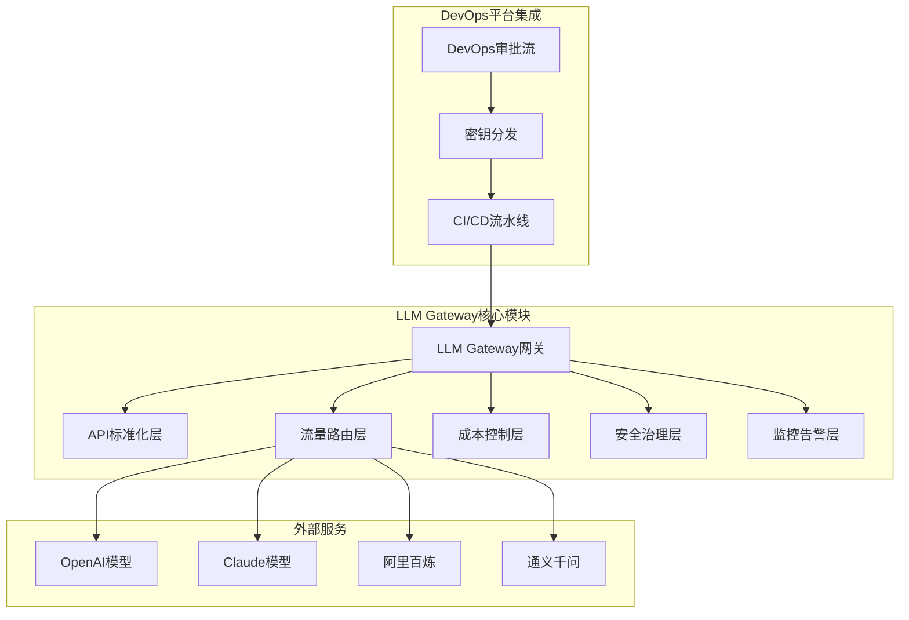
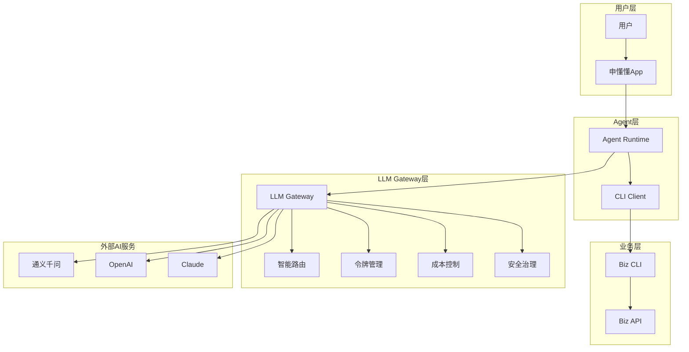
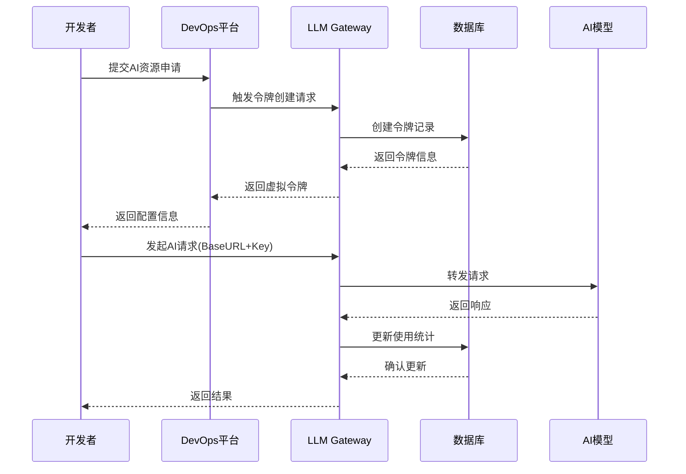
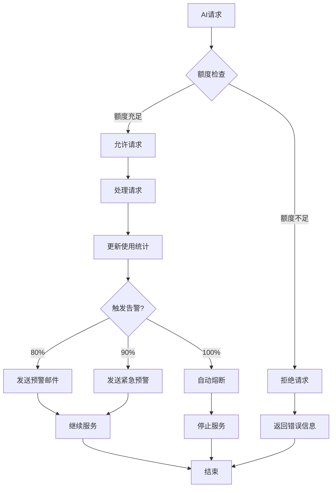
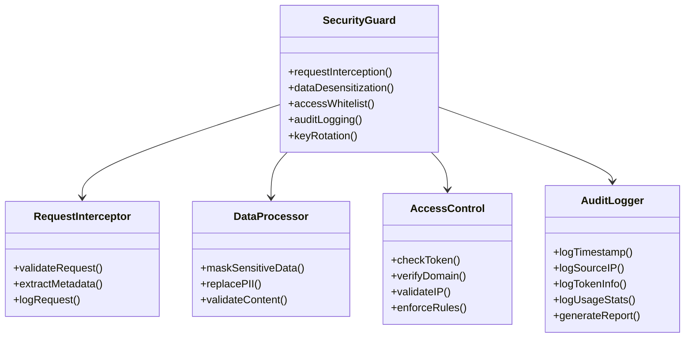
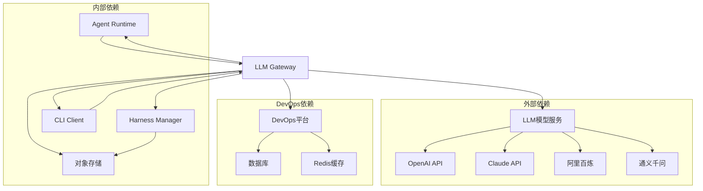

# LLM Gateway模块职责

<cite>
**本文引用的文件**
- [LLM Gateway建设方案.md](file://plan/LLM-Gateway建设方案.md)
- [LLM Gateway一期功能规划.md](file://plan/LLM-Gateway一期功能规划.md)
- [LLM Gateway方案Review.md](file://notes/zhaobomin/LLM-Gateway方案review.md)
- [LLM Gateway计费逻辑.md](file://plan/LLM Gateway 计费逻辑.md)
- [LLM Gateway模型不同计费方式对比.md](file://plan/LLM Gateway 模型不同计费方式对比.md)
- [Sai整体架构设计.md](file://project/standup/Sai整体架构设计.md)
- [SAI CLI设计文档_v1.2.md](file://plan/SAI_CLI_设计文档_v1.2.md)
</cite>

## 目录
1. [引言](#引言)
2. [项目结构](#项目结构)
3. [核心组件](#核心组件)
4. [架构概览](#架构概览)
5. [详细组件分析](#详细组件分析)
6. [依赖关系分析](#依赖关系分析)
7. [性能考量](#性能考量)
8. [故障排查指南](#故障排查指南)
9. [结论](#结论)

## 引言

LLM Gateway作为申通快递企业级AI智能体平台的核心组件，承担着统一AI服务入口的重要职责。该模块通过LiteLLM开源项目构建，旨在解决当前AI模型接入面临的多重挑战：多模型缺乏统一管理、预算和成本难以控制、安全风险突出、缺乏优先级管控以及缺乏自动化流程等问题。

LLM Gateway的核心价值在于提供统一的API标准、精细化的成本控制、完善的安全治理机制，以及智能化的资源调度能力。通过建立统一的令牌管理体系、实施多层次的告警机制、实现智能的流量路由策略，LLM Gateway能够有效降低AI服务的使用成本，提升系统的安全性和可靠性。

## 项目结构

基于现有文档分析，LLM Gateway模块的项目结构主要包含以下几个关键部分：



**图表来源**
- [LLM Gateway建设方案.md:15-26](file://plan/LLM-Gateway建设方案.md#L15-L26)
- [Sai整体架构设计.md:19-65](file://project/standup/Sai整体架构设计.md#L19-L65)

**章节来源**
- [LLM Gateway建设方案.md:15-26](file://plan/LLM-Gateway建设方案.md#L15-L26)
- [Sai整体架构设计.md:19-65](file://project/standup/Sai整体架构设计.md#L19-L65)

## 核心组件

### API标准化组件

LLM Gateway的核心职责之一是实现API的标准化，通过统一代理层向下支持接入各种主流AI模型，向上对内统一暴露标准的OpenAI格式API。

**主要功能特性：**
- 统一代理：支持接入通义千问、OpenAI、Claude、Gemini等国际主流大模型
- 无缝切换：向上统一暴露OpenAI格式API，业务线代码只需修改Base URL和Token即可实现零成本切换
- 协议兼容：支持OpenAI/百炼协议，确保与现有业务系统的兼容性

### 流量路由组件

智能的流量路由策略是LLM Gateway成本控制的关键。系统根据环境维度和应用等级实施差异化路由策略：

**路由策略：**
- 本地/测试环境：强制路由至低成本模型（qwen-turbo轻量版、免费版开源模型）或内部自建的开源本地模型
- 生产环境（非核心应用）：路由至性价比模型（qwen-plus均衡版），设置严格的TPM/RPM上限
- 生产环境（核心应用）：使用最新qwen-max旗舰版强力模型，配置多渠道轮询重试机制

### 成本控制组件

LLM Gateway实现了精细化的成本控制机制，包括额度管理、告警机制和熔断保护：

**成本控制机制：**
- 额度池管理：针对每个分配的Token设定独立的资金或Token额度池
- 三级告警：80%触发告警，90%进入预警，100%自动熔断降级
- 额度重置：支持按自然月自动重置额度规则
- 预算分配：按域组/项目分配额度池，实现精细化核算

### 安全治理组件

安全治理是LLM Gateway的重要组成部分，通过多重安全措施保护企业数据和隐私：

**安全机制：**
- 请求日志拦截：记录所有请求的元数据（时间、发起方IP、Token归属域组、消耗Token数、响应延迟）
- 隐私数据脱敏：高敏业务可选配脱敏插件，在请求发往公有云大模型前进行数据遮盖或替换
- Key访问白名单：对每个key加白处理，只有白名单中的key才能使用
- 访问控制：应用通过白名单方式内网访问，用户通过虎盾（VPN）方式访问

### DevOps集成组件

LLM Gateway与DevOps平台深度集成，实现资源申请的自动化流程：

**自动化流程：**
- 资源申请自动化：研发在DevOps发起"AI资源申请"，审批通过后触发Webhook调用New API的管理接口
- 流水线动态注入：在CI/CD流水线打包部署时，系统根据当前部署环境将对应的网关Token动态注入为环境变量
- 全流程自动化：从账号创建、Key分发到审批流程的全流程自动化

**章节来源**
- [LLM Gateway建设方案.md:29-65](file://plan/LLM-Gateway建设方案.md#L29-L65)
- [LLM Gateway建设方案.md:43-65](file://plan/LLM-Gateway建设方案.md#L43-L65)
- [LLM Gateway建设方案.md:36-41](file://plan/LLM-Gateway建设方案.md#L36-L41)

## 架构概览

LLM Gateway在整个Sai智能体平台中扮演着关键的桥梁角色，连接用户意图理解与业务系统执行：



**图表来源**
- [Sai整体架构设计.md:19-65](file://project/standup/Sai整体架构设计.md#L19-L65)
- [Sai整体架构设计.md:108-138](file://project/standup/Sai整体架构设计.md#L108-L138)

**章节来源**
- [Sai整体架构设计.md:19-65](file://project/standup/Sai整体架构设计.md#L19-L65)
- [Sai整体架构设计.md:108-138](file://project/standup/Sai整体架构设计.md#L108-L138)

## 详细组件分析

### 智能路由策略组件

LLM Gateway的智能路由策略是其实现成本优化的核心机制。该策略基于环境维度和应用等级实施差异化路由：

```mermaid
flowchart TD
START([请求到达]) --> ENV{环境判断}
ENV --> |本地/测试| LOW_COST[低成本模型路由]
ENV --> |生产(非核心)| MID_COST[性价比模型路由]
ENV --> |生产(核心)| HIGH_PERF[旗舰模型路由]
LOW_COST --> TURBO[qwen-turbo轻量版]
LOW_COST --> FREE[免费开源模型]
MID_COST --> PLUS[qwen-plus均衡版]
MID_COST --> LIMIT[RPM/TPM限制]
HIGH_PERF --> MAX[qwen-max旗舰版]
HIGH_PERF --> REDUNDANCY[多渠道轮询重试]
TURBO --> END([响应返回])
FREE --> END
PLUS --> END
LIMIT --> END
MAX --> END
REDUNDANCY --> END
```

**图表来源**
- [LLM Gateway建设方案.md:45-52](file://plan/LLM-Gateway建设方案.md#L45-L52)

**路由策略特点：**
- **成本优化**：测试环境使用低成本模型，显著降低调试成本
- **性能保障**：核心业务使用旗舰模型，确保关键业务的性能需求
- **弹性扩展**：支持多渠道轮询重试，提高系统的可用性
- **实时监控**：根据模型健康状况动态调整路由策略

### Token管理组件

LLM Gateway实现了完善的令牌管理系统，包括令牌申请、分配、监控和回收：



**图表来源**
- [LLM Gateway建设方案.md:36-41](file://plan/LLM-Gateway建设方案.md#L36-L41)
- [LLM Gateway一期功能规划.md:7](file://plan/LLM-Gateway一期功能规划.md#L7)

**Token管理功能：**
- **自动化申请**：DevOps平台自动创建令牌，减少人工干预
- **动态注入**：CI/CD流水线自动注入环境变量，避免硬编码
- **使用统计**：实时跟踪令牌使用情况，支持用量详情查询
- **权限控制**：基于白名单的访问控制机制

### 成本控制与告警组件

LLM Gateway实现了多层次的成本控制和告警机制，确保AI服务使用的可控性和透明性：



**图表来源**
- [LLM Gateway建设方案.md:53](file://plan/LLM-Gateway建设方案.md#L53)

**告警机制特点：**
- **三级告警**：80%触发预警，90%紧急预警，100%自动熔断
- **多渠道通知**：支持钉钉群通知和个人工作通知
- **灵活配置**：支持不同阈值的自定义配置
- **自动恢复**：额度重置后自动恢复正常服务

### 安全治理组件

LLM Gateway的安全治理机制涵盖了数据保护、访问控制和审计追踪等多个方面：



**图表来源**
- [LLM Gateway建设方案.md:56-65](file://plan/LLM-Gateway建设方案.md#L56-L65)

**安全治理功能：**
- **请求拦截**：拦截所有AI请求，记录关键元数据
- **数据脱敏**：对高敏数据进行遮盖或替换处理
- **访问控制**：基于白名单的严格访问控制
- **审计追踪**：完整的使用记录和合规审计

**章节来源**
- [LLM Gateway建设方案.md:29-65](file://plan/LLM-Gateway建设方案.md#L29-L65)
- [LLM Gateway建设方案.md:43-65](file://plan/LLM-Gateway建设方案.md#L43-L65)

## 依赖关系分析

LLM Gateway模块与整个Sai智能体平台形成了紧密的依赖关系，同时对外部AI服务也有重要依赖：



**图表来源**
- [Sai整体架构设计.md:154-164](file://project/standup/Sai整体架构设计.md#L154-L164)

**依赖关系特点：**
- **控制面依赖**：与Harness Manager的紧密集成，确保技能和CLI的统一管理
- **数据面依赖**：与外部LLM服务的API对接，实现多模型统一接入
- **基础设施依赖**：依赖DevOps平台的自动化流程和数据库服务
- **存储依赖**：通过OSS实现静态资源的统一分发

**章节来源**
- [Sai整体架构设计.md:154-164](file://project/standup/Sai整体架构设计.md#L154-L164)

## 性能考量

LLM Gateway在设计时充分考虑了性能优化和资源利用效率：

### 路由性能优化

- **智能缓存**：对常用模型配置和路由规则进行缓存，减少查询开销
- **异步处理**：使用异步处理机制处理令牌验证和额度检查
- **连接池管理**：对后端AI服务的连接进行池化管理，提高连接复用率

### 成本优化策略

- **动态路由**：根据模型性能和成本进行动态路由选择
- **批量处理**：对相似请求进行批量处理，减少API调用次数
- **资源预热**：对热点模型进行预热，减少首次调用延迟

### 可扩展性设计

- **水平扩展**：支持多实例部署，通过负载均衡分担请求压力
- **弹性伸缩**：根据请求量自动调整实例数量
- **微服务架构**：将功能模块化，支持独立扩展和维护

## 故障排查指南

### 常见故障类型与处理

**网关熔断故障**
- **现象**：所有AI请求被拒绝
- **原因**：达到100%使用阈值触发自动熔断
- **处理**：检查额度配置，等待自动重置或手动扩容

**模型不可用故障**
- **现象**：特定模型请求失败
- **原因**：模型服务宕机或网络异常
- **处理**：检查模型健康状态，切换到备用模型

**令牌失效故障**
- **现象**：认证失败，无法访问AI服务
- **原因**：令牌过期或被禁用
- **处理**：重新申请令牌或检查权限配置

### 监控指标与告警

**关键监控指标：**
- 请求成功率和失败率
- 平均响应时间和P95延迟
- Token使用量和剩余额度
- 模型调用成功率和错误率

**告警阈值配置：**
- 80%额度预警：提前通知用户即将达到使用上限
- 90%紧急预警：提醒用户注意使用情况
- 100%熔断保护：自动阻止进一步使用

**章节来源**
- [LLM Gateway建设方案.md:53](file://plan/LLM-Gateway建设方案.md#L53)
- [Sai整体架构设计.md:236-245](file://project/standup/Sai整体架构设计.md#L236-L245)

## 结论

LLM Gateway模块作为Sai智能体平台的核心组件，通过统一的API标准、智能的路由策略、精细化的成本控制和完善的安全部署，为企业提供了高效、安全、可控的AI服务管理解决方案。

该模块的核心价值体现在：

**统一管理价值**：通过LiteLLM实现多模型统一接入，消除接口不统一带来的开发成本和维护难度

**成本控制价值**：通过智能路由策略和三级告警机制，实现AI服务使用的精细化成本控制

**安全治理价值**：通过多层次的安全防护和审计机制，确保企业数据的安全性和合规性

**自动化价值**：通过DevOps平台的深度集成，实现从申请到使用的全流程自动化

随着Sai项目的持续推进，LLM Gateway将继续发挥其作为企业级AI服务入口的关键作用，为企业数字化转型提供强有力的技术支撑。通过持续优化路由算法、完善成本控制机制、加强安全防护能力，LLM Gateway将成为企业AI服务管理的最佳实践典范。