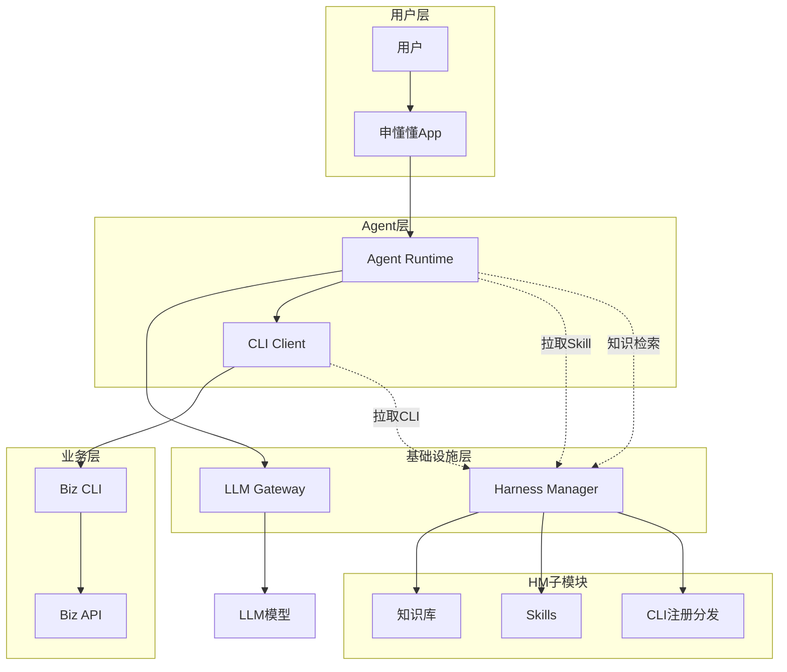
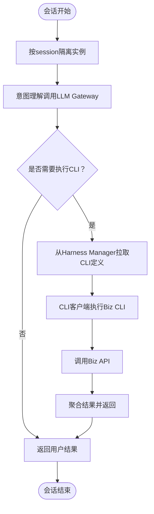
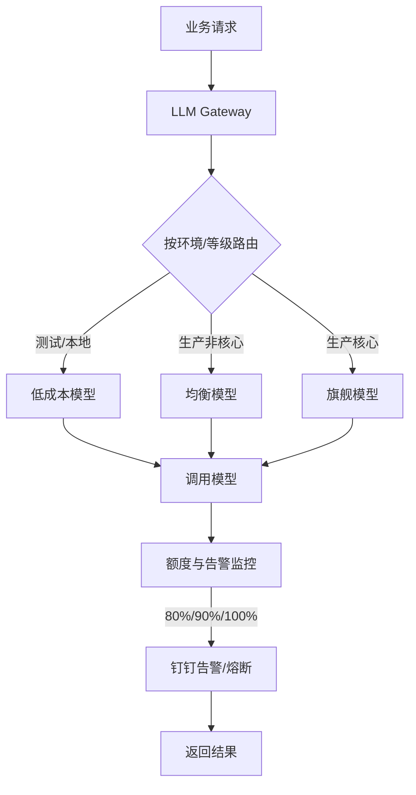
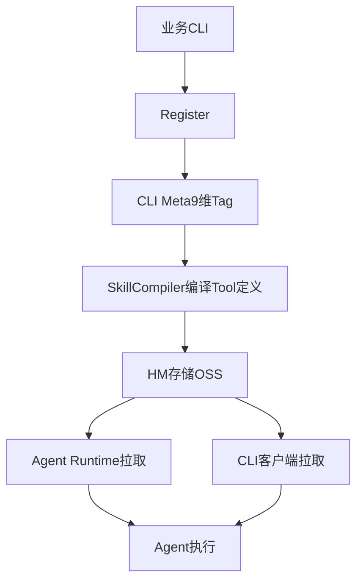
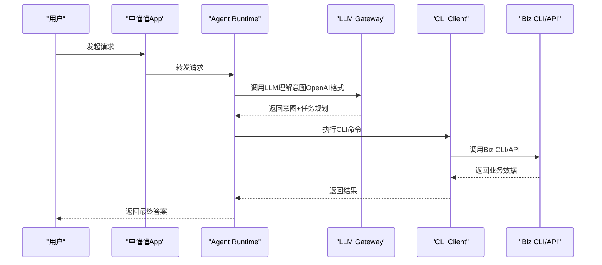

# 模块职责划分

<cite>
**本文引用的文件**
- [README.md](file://README.md)
- [项目管理方案v1.0.md](file://project/项目管理方案v1.0.md)
- [Sai整体架构设计.md](file://project/standup/Sai整体架构设计.md)
- [Agent-Runtime方案.md](file://plan/Agent-Runtime方案.md)
- [LLM-Gateway建设方案.md](file://plan/LLM-Gateway建设方案.md)
- [LLM-Gateway一期功能规划.md](file://plan/LLM-Gateway一期功能规划.md)
- [SAI_CLI_设计文档_v1.2.md](file://plan/SAI_CLI_设计文档_v1.2.md)
- [Agent-Runtime方案review.md](file://notes/zhaobomin/Agent-Runtime方案review.md)
- [LLM-Gateway方案review.md](file://notes/zhaobomin/LLM-Gateway方案review.md)
- [SAI-daily-report-2026-04-22-final.md](file://project/SAI-daily-report-2026-04-22-final.md)
</cite>

## 目录
1. [简介](#简介)
2. [项目结构](#项目结构)
3. [核心模块](#核心模块)
4. [架构总览](#架构总览)
5. [详细组件分析](#详细组件分析)
6. [依赖分析](#依赖分析)
7. [性能考量](#性能考量)
8. [故障排查指南](#故障排查指南)
9. [结论](#结论)
10. [附录](#附录)

## 简介
本文件围绕 SAIAgent 平台的模块职责进行系统化梳理，聚焦 Agent Runtime、LLM Gateway、Harness Manager、Channel 与 Biz CLI 五大模块，明确各模块的职责边界、功能范围、协作关系与依赖关系，辅以接口依赖矩阵与职责矩阵，帮助读者快速理解模块在系统中的定位与协同方式，支撑完整 AI 智能体平台能力的实现。

## 项目结构
SAI 采用三层分层架构：Channel 层（用户接入与前端交互）、核心层（Agent Runtime、Workspace、Harness Manager）、基础设施层（LLMRouter、CLI API）。模块间通过明确的接口契约与数据流协同工作，确保各层独立演进、独立部署、独立测试。

```mermaid
graph TB
subgraph "Channel层"
CH["Channel<br/>用户接入与前端交互"]
SDD["申懂懂App"]
end
subgraph "核心层"
AR["Agent Runtime<br/>Agent执行、意图理解、CLI调用"]
WS["Workspace<br/>Agent与HM交互"]
HM["Harness Manager<br/>知识库、Skills、CLI注册分发"]
end
subgraph "基础设施层"
LR["LLMRouter<br/>LLM统一代理、Token管理、成本控制"]
CA["CLI API<br/>提供API原始描述"]
end
SDD --> CH
CH --> WS
AR --> WS
WS < --> HM
HM --> HM_KB["知识库"]
HM --> HM_SK["Skills"]
HM --> HM_CLI["CLI注册分发"]
HM_CLI --> CA
WS --> LR
```

图表来源
- [README.md:11-41](file://README.md#L11-L41)
- [项目管理方案v1.0.md:34-49](file://project/项目管理方案v1.0.md#L34-L49)

章节来源
- [README.md:9-41](file://README.md#L9-L41)
- [项目管理方案v1.0.md:21-49](file://project/项目管理方案v1.0.md#L21-L49)

## 核心模块
本节对五大核心模块进行职责拆解与边界界定，强调模块定位、关键能力与对外接口。

- Agent Runtime
  - 定位：通用 Agent 执行与编排，负责意图理解、任务规划与 CLI 调用。
  - 关键职责：会话生命周期管理、与 LLM Gateway 的 OpenAI 格式调用、CLI 客户端执行、用户隔离与热启动优化。
  - 依赖：LLM Gateway（意图理解）、Harness Manager（Skills/CLI 定义拉取）、Channel（前端交互）。
  - 交付目标：冷启动 <1s、热启动 <200ms、≥3 个 Skill 挂载、≥1 个端到端联调场景。

- LLM Gateway
  - 定位：统一 LLM 代理与成本控制，提供标准化 OpenAI 格式接口与令牌管理。
  - 关键职责：模型路由、额度预警与熔断、密钥分发与白名单、环境与等级策略、告警与监控。
  - 依赖：DevOps 平台（审批与密钥发放）、业务应用（统一 BaseURL + Token）。
  - 交付目标：qwen 系列模型路由、≥5 个个人用户并发、80%/90%/100% 三级告警。

- Harness Manager
  - 定位：控制面服务，负责知识库、Skills 与 CLI 的注册、编译与分发。
  - 关键职责：API 元数据注册与管理、9 维 Tag 编译为 Agent Tool 定义、CLI 定义与产物分发（OSS）、鉴权与路由。
  - 依赖：业务 CLI（注册上报）、Agent Runtime（拉取定义）、CLI 客户端（拉取定义）。
  - 交付目标：注册→分发→调用闭环、≥1 个业务 CLI 接入、Skill 拉取接口可用。

- Channel
  - 定位：用户接入与前端交互，承载申懂懂 App 的前端体验。
  - 关键职责：输入框交互规则、前端 SDK 集成、与 Agent Runtime 的协议对接。
  - 依赖：Agent Runtime（会话与回复）、业务系统（后端 API）。
  - 交付目标：App 可发起请求并收到 Agent 回复、Agent SDK 前端集成 demo。

- Biz CLI
  - 定位：业务能力封装与 API 调用，面向 Agent 的可执行命令集合。
  - 关键职责：业务 API 封装、鉴权与参数校验、结构化输出与错误处理、与 Harness Manager 的注册对接。
  - 依赖：CLI API（原始 API 描述）、Harness Manager（注册与分发）、Agent Runtime（调用执行）。
  - 交付目标：≥1 个业务 CLI demo 上报并可被 Agent 调用。

章节来源
- [Sai整体架构设计.md:142-151](file://project/standup/Sai整体架构设计.md#L142-L151)
- [Agent-Runtime方案.md:1-60](file://plan/Agent-Runtime方案.md#L1-L60)
- [LLM-Gateway建设方案.md:1-109](file://plan/LLM-Gateway建设方案.md#L1-L109)
- [SAI_CLI_设计文档_v1.2.md:543-635](file://plan/SAI_CLI_设计文档_v1.2.md#L543-L635)

## 架构总览
SAI 的系统架构由两条核心链路构成：意图理解链路（用户 → App → Agent → LLM Gateway → LLM）与业务执行链路（Agent → CLI Client → Biz CLI → Biz API）。Harness Manager 作为控制面，提供 Skills 与 CLI 的元数据与产物分发，保障 Agent 的可扩展与可演进。



图表来源
- [project/standup/Sai整体架构设计.md:19-65](file://project/standup/Sai整体架构设计.md#L19-L65)

章节来源
- [project/standup/Sai整体架构设计.md:108-138](file://project/standup/Sai整体架构设计.md#L108-L138)

## 详细组件分析

### Agent Runtime 分析
- 职责边界
  - 会话隔离与实例管理：基于 Serverless（AgentRun）按 session 分配实例，一实例一 session，实现用户隔离与热启动优化。
  - 意图理解与任务规划：通过 LLM Gateway 的 OpenAI 格式接口调用，完成用户意图解析与任务规划。
  - CLI 调用与结果回传：驱动 CLI 客户端执行 Biz CLI 命令，聚合业务数据并返回给用户。
  - 技术选型与风险：基于 Claude Agent SDK 构建通用 Agent，存在 SDK 强依赖风险，建议做 SDK 抽象层。
- 与上下游协作
  - 与 LLM Gateway：通过统一 OpenAI 格式接口进行意图理解调用。
  - 与 Harness Manager：拉取 Skills 与 CLI 定义，支持本地缓存降级。
  - 与 Channel：接收前端请求，返回 Agent 回复。
- 性能与可靠性
  - 冷启动 <1s，热启动 <100ms，满足通用 Agent 调用性能要求。
  - 风险与应对：SDK 强依赖、OSS 挂载个性化需求未评估、Channel → Agent 交互协议未对齐。



图表来源
- [Agent-Runtime方案.md:3-13](file://plan/Agent-Runtime方案.md#L3-L13)
- [Sai整体架构设计.md:108-138](file://project/standup/Sai整体架构设计.md#L108-L138)

章节来源
- [Agent-Runtime方案.md:1-60](file://plan/Agent-Runtime方案.md#L1-L60)
- [Agent-Runtime方案review.md:18-54](file://notes/zhaobomin/Agent-Runtime方案review.md#L18-L54)

### LLM Gateway 分析
- 职责边界
  - 统一代理与标准化：向下接入多家模型（qwen、OpenAI、Claude、Gemini），向上统一暴露 OpenAI 格式 API。
  - 成本与预算：额度池管理、80%/90%/100% 三级告警与熔断、按环境与等级路由降级。
  - 安全与审计：密钥白名单、隐私数据脱敏、访问控制（虎盾/内网）。
  - DevOps 融合：审批流自动化、流水线动态注入、真实 Key 清零与轮转。
- 与上下游协作
  - 与业务应用：统一 BaseURL + Token，零成本切换底层模型。
  - 与 DevOps：审批回调、AI AppKey 申请流程、网关配置与监控。
- 风险与应对
  - 4/30 上线 scope 偏大，建议砍到最小可用（网关跑通 + 手动发 key + 基础告警）。
  - 逃生方案：业务侧 fallback 直连百炼/原生 API，或 Gateway bypass 模式一键关闭路由。



图表来源
- [LLM-Gateway建设方案.md:29-65](file://plan/LLM-Gateway建设方案.md#L29-L65)
- [LLM-Gateway一期功能规划.md:3-23](file://plan/LLM-Gateway一期功能规划.md#L3-L23)

章节来源
- [LLM-Gateway建设方案.md:1-109](file://plan/LLM-Gateway建设方案.md#L1-L109)
- [LLM-Gateway方案review.md:19-70](file://notes/zhaobomin/LLM-Gateway方案review.md#L19-L70)
- [LLM-Gateway一期功能规划.md:1-23](file://plan/LLM-Gateway一期功能规划.md#L1-L23)

### Harness Manager 分析
- 职责边界
  - Register：接收业务方上报，管理 CLI 命令的注册、更新与注销。
  - CLI Meta：存储与管理 9 维 Tag 元数据，支持 AI 自动生成。
  - SkillCompiler：将注册元数据编译为 Agent 可读的 Tool 定义。
  - CLI Router：CLI 命令路由转发与鉴权。
  - CLI Invoke：可选的调用代理节点（一期可跳过）。
- 与上下游协作
  - 与业务 CLI：注册上报、元数据生成与注册、产物分发（OSS）。
  - 与 Agent Runtime：拉取 Skills 与 CLI 定义，支持本地缓存降级。
  - 与 CLI 客户端：提供统一 CLI 二进制与命令清单。
- 风险与应对
  - Skill/CLI 方案未出，需在 4/25 前产出接口定义文档，否则 Agent 对接会返工。
  - OSS 挂载个性化需求未评估，若无结论则走 Agent 层自行实现文件权限的 B 方案。



图表来源
- [SAI_CLI_设计文档_v1.2.md:547-588](file://plan/SAI_CLI_设计文档_v1.2.md#L547-L588)
- [Sai整体架构设计.md:173-194](file://project/standup/Sai整体架构设计.md#L173-L194)

章节来源
- [SAI_CLI_设计文档_v1.2.md:543-635](file://plan/SAI_CLI_设计文档_v1.2.md#L543-L635)
- [Sai整体架构设计.md:173-194](file://project/standup/Sai整体架构设计.md#L173-L194)

### Channel 分析
- 职责边界
  - 用户接入：申懂懂 App 的前端交互与输入框规则定义。
  - 前端 SDK 集成：与 Agent Runtime 的协议对接，确保请求转发与回复展示。
  - 产品框架：竞品分析与系统性差异研究，支撑前端体验设计。
- 与上下游协作
  - 与 Agent Runtime：会话建立、请求转发、结果回传。
  - 与业务系统：通过 Agent 间接调用后端 API，前端零改造。
- 风险与应对
  - Channel → Agent 交互协议未对齐，需尽快与前端负责人对齐方案。

章节来源
- [project/SAI-daily-report-2026-04-22-final.md:3-44](file://project/SAI-daily-report-2026-04-22-final.md#L3-L44)
- [Sai整体架构设计.md:142-151](file://project/standup/Sai整体架构设计.md#L142-L151)

### Biz CLI 分析
- 职责边界
  - 业务能力封装：将后端 API 封装为可被 Agent 调用的 CLI 命令。
  - 鉴权与参数校验：支持多种鉴权方式与结构化错误输出。
  - 与 Harness Manager 对接：注册上报、元数据生成与注册、产物分发。
- 与上下游协作
  - 与 CLI API：提供原始 API 描述，无需考虑发现机制。
  - 与 Agent Runtime：通过 CLI 客户端执行，返回结构化结果。
- 风险与应对
  - 业务侧需提供 API 接口文档，无需开发 CLI 工具，降低接入成本。

章节来源
- [SAI_CLI_设计文档_v1.2.md:81-105](file://plan/SAI_CLI_设计文档_v1.2.md#L81-L105)
- [Sai整体架构设计.md:142-151](file://project/standup/Sai整体架构设计.md#L142-L151)

## 依赖分析
模块间接口依赖矩阵与调用协议如下：

- 接口依赖矩阵（摘要）
  - LLM 调用：Agent Runtime → LLM Gateway，OpenAI 格式，Bearer Token。
  - Agent 会话：Channel → Agent Runtime，get_session/send_request，用户 Token 透传。
  - Skill 拉取：Agent Runtime → HM，HTTP + OSS 拉取执行包。
  - CLI 拉取：CLI 客户端 → HM，HTTP + OSS 拉取定义包。
  - CLI 注册：Biz CLI → HM，POST /hm/cli/register，业务方 Token。
  - 知识检索：Agent Runtime → HM，HTTP，HM 内部 Token。
  - 前端交互：申懂懂 App → Channel，待定义。

- 调用协议
  - 意图理解链路：Agent → LLM Gateway（HTTP/OpenAI），Gateway → LLM（HTTP）。
  - 业务执行链路：Agent → CLI Client（本地调用），CLI Client → Biz CLI（HTTP），Biz CLI → Biz API（HTTP/RPC）。
  - HM 支撑交互：Agent → HM（HTTP/OSS），CLI 客户端 → HM（HTTP/OSS），业务方 → HM（HTTP）。



图表来源
- [project/standup/Sai整体架构设计.md:115-138](file://project/standup/Sai整体架构设计.md#L115-L138)

章节来源
- [Sai整体架构设计.md:154-170](file://project/standup/Sai整体架构设计.md#L154-L170)
- [Sai整体架构设计.md:197-221](file://project/standup/Sai整体架构设计.md#L197-L221)

## 性能考量
- Agent Runtime：冷启动 <1s、热启动 <100ms，满足通用 Agent 调用性能要求；用户隔离与实例销毁确保资源利用率与安全性。
- LLM Gateway：按环境与等级路由降级，避免核心业务占用昂贵资源；额度预警与熔断机制保障成本可控。
- Harness Manager：通过 OSS 分发与本地缓存降级，减少对控制面的强依赖，提升系统韧性。
- Channel：前端交互规则与 SDK 集成直接影响用户体验，需与 Agent Runtime 协同对齐。

## 故障排查指南
- HM 不可用：Agent 使用本地缓存的 Skills/CLI 定义，降级为无知识检索模式。
- LLM Gateway 熔断：意图理解链路中断，Agent 返回固定提示；业务执行链路不受影响。
- Biz API 超时/失败：CLI 客户端单次重试（≤3s），失败后 Agent 向用户说明具体接口不可用。
- OSS 不可用：Agent 使用本地缓存版本运行，日志告警通知 HM 团队。
- Agent Runtime 实例崩溃：Serverless 平台自动重建实例，用户会话需重新发起。

章节来源
- [Sai整体架构设计.md:236-245](file://project/standup/Sai整体架构设计.md#L236-L245)

## 结论
SAI 智能体平台通过清晰的模块职责划分与严格的接口契约，实现了用户接入、意图理解、业务执行与控制面分发的解耦。Agent Runtime、LLM Gateway、Harness Manager、Channel 与 Biz CLI 各司其职、协同演进，既满足当前 4/30 上线目标，又为后续 DevOps 融合、全量推广与安全增强预留空间。建议尽快补齐接口定义与架构图，明确上下游对齐状态，确保模块间协作顺畅。

## 附录
- 一期验收标准
  - Agent Runtime：≥3 个 Skill 挂载、冷启动 <1s、热启动 <200ms、≥1 个端到端联调场景。
  - LLM Gateway：qwen 系列模型路由、≥5 个个人用户并发、80%/90%/100% 三级告警。
  - Harness Manager：注册→分发→调用闭环、≥1 个业务 CLI 接入、Skill 拉取接口可用。
  - Channel：App 可发起请求并收到 Agent 回复、Agent SDK 前端集成 demo。
  - Biz CLI：≥1 个业务 CLI demo 上报并可被 Agent 调用。

章节来源
- [Sai整体架构设计.md:224-233](file://project/standup/Sai整体架构设计.md#L224-L233)