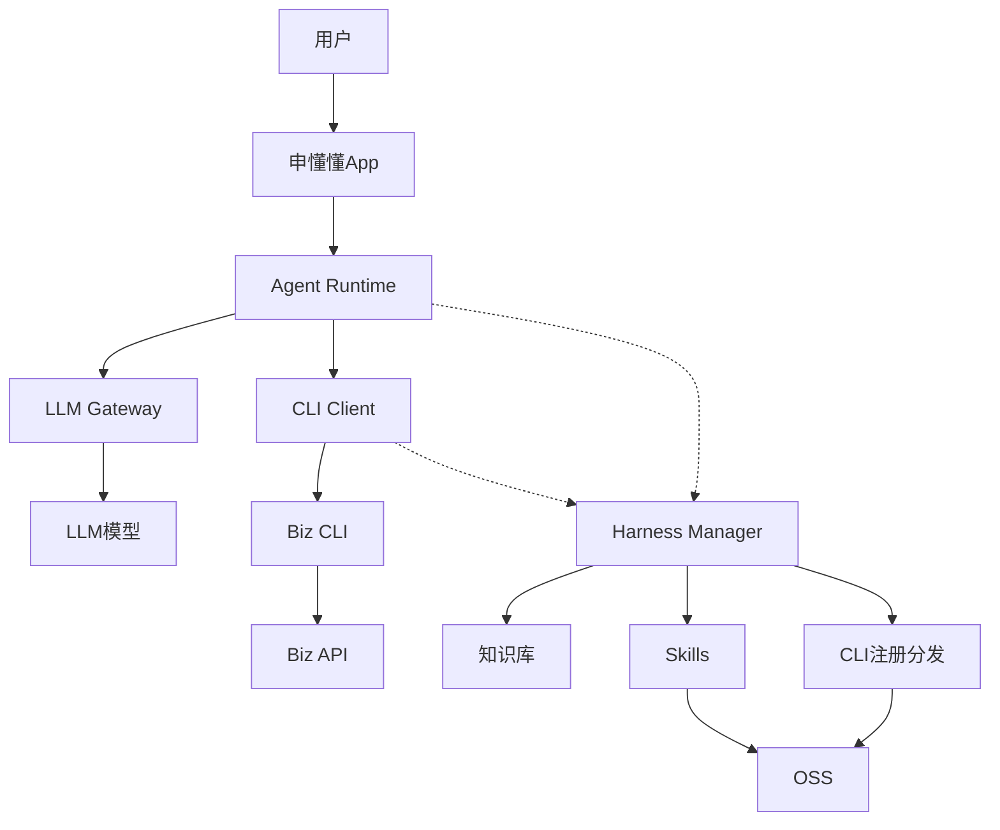
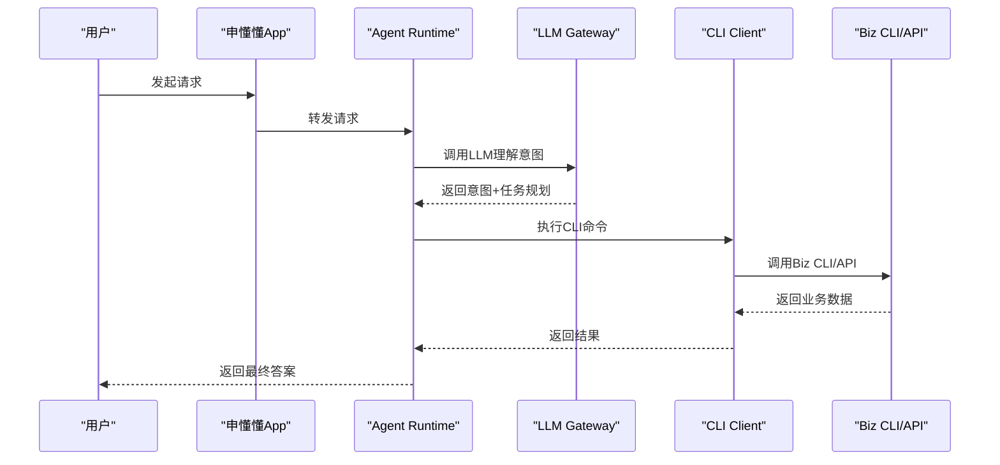
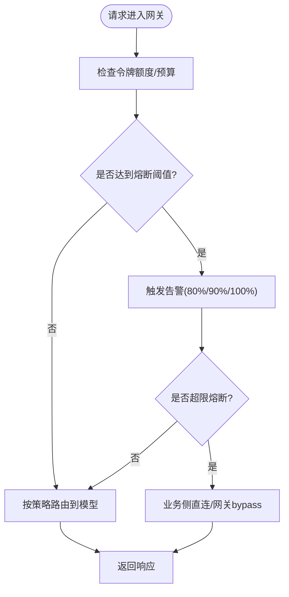
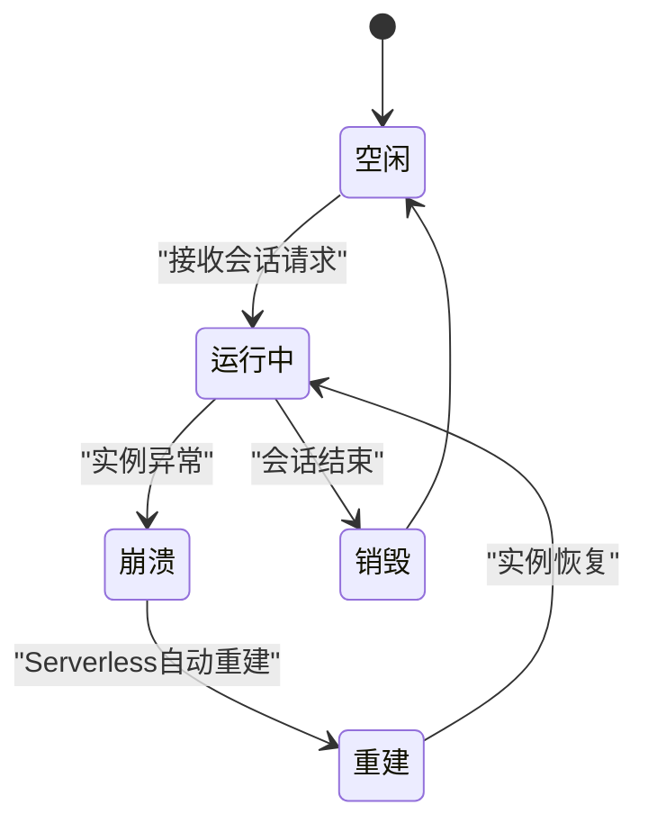
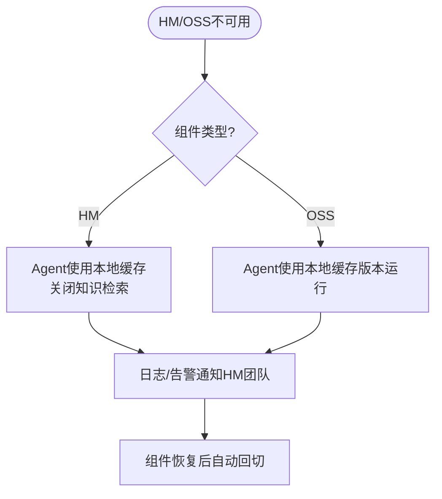
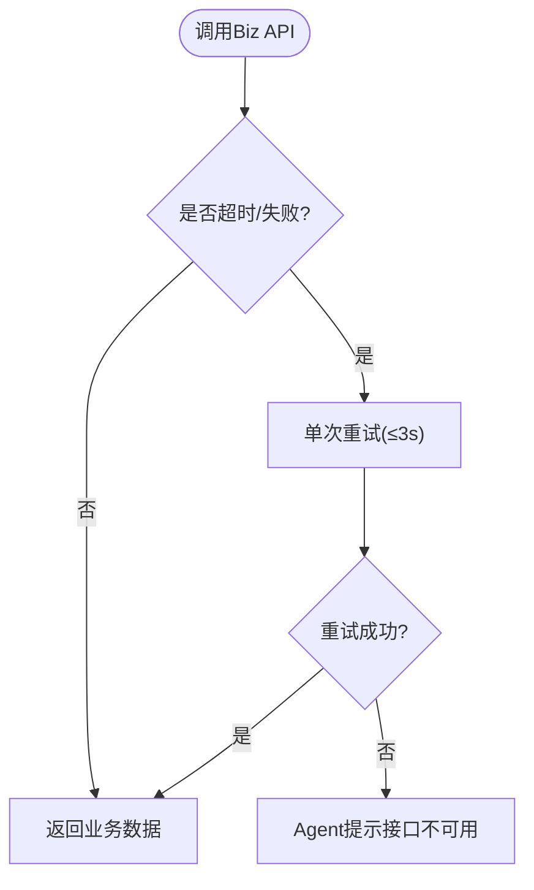
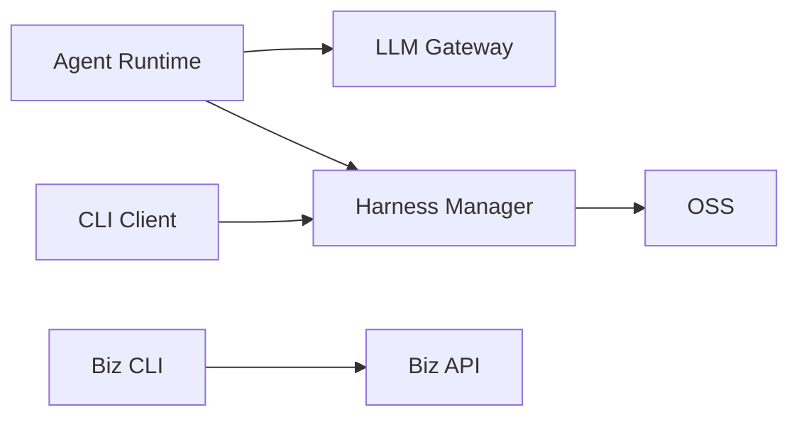

# 错误处理与降级策略

<cite>
**本文引用的文件**
- [Sai整体架构设计.md](file://project/standup/Sai整体架构设计.md)
- [Agent-Runtime方案.md](file://plan/Agent-Runtime方案.md)
- [LLM-Gateway建设方案.md](file://plan/LLM-Gateway建设方案.md)
- [LLM-Gateway一期功能规划.md](file://plan/LLM-Gateway一期功能规划.md)
- [LLM-Gateway计费逻辑.md](file://plan/LLM Gateway 计费逻辑.md)
- [LLM-Gateway模型不同计费方式对比.md](file://plan/LLM Gateway 模型不同计费方式对比.md)
- [Agent-Runtime方案review.md](file://notes/zhaobomin/Agent-Runtime方案review.md)
- [LLM-Gateway方案review.md](file://notes/zhaobomin/LLM-Gateway方案review.md)
- [agent-api-discovery-architecture-review.zh-CN.md](file://notes/zhaobomin/agent-api-discovery-architecture-review.zh-CN.md)
- [SAI_CLI_设计文档_v1.2.md](file://plan/SAI_CLI_设计文档_v1.2.md)
</cite>

## 目录
1. [引言](#引言)
2. [项目结构](#项目结构)
3. [核心组件](#核心组件)
4. [架构总览](#架构总览)
5. [详细组件分析](#详细组件分析)
6. [依赖分析](#依赖分析)
7. [性能考量](#性能考量)
8. [故障处理矩阵与降级优先级](#故障处理矩阵与降级优先级)
9. [监控告警与恢复最佳实践](#监控告警与恢复最佳实践)
10. [结论](#结论)
11. [附录](#附录)

## 引言
本文件聚焦SAI智能体平台在多种故障场景下的错误处理与降级策略，覆盖HM不可用、LLM Gateway熔断、Biz API超时/失败、OSS不可用、Agent Runtime实例崩溃等关键故障路径。通过对架构设计、模块职责、调用协议与上线策略的系统化梳理，给出可执行的降级机制、恢复策略与监控告警建议，帮助在部分组件失效情况下维持系统的可用性与用户体验。

## 项目结构
SAI项目围绕“用户—Agent—LLM Gateway—LLM”与“Agent—CLI Client—Biz CLI—Biz API”两条主链路构建，Harness Manager(HM)作为控制面提供技能(Skill)与CLI注册分发、知识库检索支撑。关键文件与职责如下：
- 架构与接口：Sai整体架构设计.md
- Agent Runtime：Agent-Runtime方案.md、Agent-Runtime方案review.md
- LLM Gateway：LLM-Gateway建设方案.md、LLM-Gateway一期功能规划.md、LLM-Gateway方案review.md、LLM-Gateway计费逻辑.md、LLM-Gateway模型不同计费方式对比.md
- CLI与标签体系：SAI_CLI_设计文档_v1.2.md
- CLI发现与执行可靠性：agent-api-discovery-architecture-review.zh-CN.md

图表来源
- [Sai整体架构设计.md:19-65](file://project/standup/Sai整体架构设计.md#L19-L65)
- [Sai整体架构设计.md:108-138](file://project/standup/Sai整体架构设计.md#L108-L138)

章节来源
- [Sai整体架构设计.md:17-65](file://project/standup/Sai整体架构设计.md#L17-L65)
- [Sai整体架构设计.md:108-138](file://project/standup/Sai整体架构设计.md#L108-L138)

## 核心组件
- Agent Runtime：负责意图理解、会话管理、CLI调用与执行，采用Serverless按会话隔离实例，具备冷/热启动性能目标。
- LLM Gateway：统一代理与路由，支持多模型接入、额度与告警、成本控制与熔断。
- Harness Manager(HM)：控制面服务，提供Skill/CLI注册分发、知识库检索，支撑Agent与CLI元数据与产物拉取。
- Channel/前端：申懂懂App接入，负责用户交互与Agent SDK集成。
- Biz CLI/Biz API：封装业务能力，提供HTTP/RPC接口供Agent调用。

章节来源
- [Sai整体架构设计.md:142-151](file://project/standup/Sai整体架构设计.md#L142-L151)
- [Agent-Runtime方案.md:4-13](file://plan/Agent-Runtime方案.md#L4-L13)
- [LLM-Gateway建设方案.md:15-26](file://plan/LLM-Gateway建设方案.md#L15-L26)

## 架构总览
两条核心链路：
- 意图理解链路：用户→App→Agent→LLM Gateway→LLM
- 业务执行链路：Agent→CLI Client→Biz CLI→Biz API

图表来源
- [Sai整体架构设计.md:115-138](file://project/standup/Sai整体架构设计.md#L115-L138)

章节来源
- [Sai整体架构设计.md:108-138](file://project/standup/Sai整体架构设计.md#L108-L138)

## 详细组件分析

### LLM Gateway 熔断与逃生
- 熔断机制：基于额度阈值(80%/90%/100%)触发告警与自动熔断，保障成本可控与服务稳定性。
- 逃生方案：建议至少准备两类逃生路径：
  - 业务侧fallback：直连百炼/OpenAI原生API绕过网关
  - 网关bypass模式：一键关闭路由规则，临时透传
- 上线策略：4/30先聚焦“网关跑通+手动发key+基础告警”，审批流与前端管理页面延后至5/15。

图表来源
- [LLM-Gateway建设方案.md:43-54](file://plan/LLM-Gateway建设方案.md#L43-L54)
- [LLM-Gateway建设方案.md:105-109](file://plan/LLM-Gateway建设方案.md#L105-L109)
- [LLM-Gateway一期功能规划.md:7-11](file://plan/LLM-Gateway一期功能规划.md#L7-L11)
- [LLM-Gateway方案review.md:32-38](file://notes/zhaobomin/LLM-Gateway方案review.md#L32-L38)

章节来源
- [LLM-Gateway建设方案.md:43-54](file://plan/LLM-Gateway建设方案.md#L43-L54)
- [LLM-Gateway建设方案.md:105-109](file://plan/LLM-Gateway建设方案.md#L105-L109)
- [LLM-Gateway一期功能规划.md:7-11](file://plan/LLM-Gateway一期功能规划.md#L7-L11)
- [LLM-Gateway方案review.md:32-38](file://notes/zhaobomin/LLM-Gateway方案review.md#L32-L38)

### Agent Runtime 容错与实例恢复
- 用户隔离与实例生命周期：基于Serverless按会话分配实例，一实例一会话，会话结束销毁；热启动<200ms，冷启动<1s。
- 实例崩溃恢复：Serverless平台自动重建实例，用户会话需重新发起。
- Skill分发与OSS挂载：若OSS挂载不可用，提供Agent层自行实现文件权限的B方案，保障拉起时延。

图表来源
- [Agent-Runtime方案.md:4-13](file://plan/Agent-Runtime方案.md#L4-L13)
- [Agent-Runtime方案.md:15-32](file://plan/Agent-Runtime方案.md#L15-L32)
- [Sai整体架构设计.md:244](file://project/standup/Sai整体架构设计.md#L244)

章节来源
- [Agent-Runtime方案.md:4-13](file://plan/Agent-Runtime方案.md#L4-L13)
- [Agent-Runtime方案.md:15-32](file://plan/Agent-Runtime方案.md#L15-L32)
- [Sai整体架构设计.md:244](file://project/standup/Sai整体架构设计.md#L244)

### HM 不可用与OSS不可用的降级
- HM不可用：Agent本地缓存最近一次Skill/CLI定义，降级为无知识检索模式，业务执行链路不受影响。
- OSS不可用：Agent使用本地缓存版本运行，日志告警通知HM团队，待OSS恢复后自动回切。

图表来源
- [Sai整体架构设计.md:240-244](file://project/standup/Sai整体架构设计.md#L240-L244)

章节来源
- [Sai整体架构设计.md:240-244](file://project/standup/Sai整体架构设计.md#L240-L244)

### Biz API 超时/失败的降级
- 单次重试：CLI Client对Biz API进行单次重试（等待时间≤3s）。
- 失败处理：若重试失败，Agent向用户说明具体接口不可用，避免误导。

图表来源
- [Sai整体架构设计.md:242-243](file://project/standup/Sai整体架构设计.md#L242-L243)

章节来源
- [Sai整体架构设计.md:242-243](file://project/standup/Sai整体架构设计.md#L242-L243)

### CLI与发现执行的可靠性建议
- 现状问题：下游4xx/5xx被包装为成功、默认prod profile含占位URL、调试日志默认输出业务参数、registry.Client责任过重、execute.RunQuery边界偏厚。
- 建议改进：在执行层对非2xx状态码可靠映射为错误envelope；构建阶段校验prod profile；仅在显式开关下输出调试日志并对敏感字段脱敏；拆分registry.Client与execute.RunQuery，提升可维护性与可测试性。

章节来源
- [agent-api-discovery-architecture-review.zh-CN.md:68-94](file://notes/zhaobomin/agent-api-discovery-architecture-review.zh-CN.md#L68-L94)
- [agent-api-discovery-architecture-review.zh-CN.md:96-113](file://notes/zhaobomin/agent-api-discovery-architecture-review.zh-CN.md#L96-L113)
- [agent-api-discovery-architecture-review.zh-CN.md:115-133](file://notes/zhaobomin/agent-api-discovery-architecture-review.zh-CN.md#L115-L133)
- [agent-api-discovery-architecture-review.zh-CN.md:135-165](file://notes/zhaobomin/agent-api-discovery-architecture-review.zh-CN.md#L135-L165)
- [agent-api-discovery-architecture-review.zh-CN.md:166-186](file://notes/zhaobomin/agent-api-discovery-architecture-review.zh-CN.md#L166-L186)

## 依赖分析
- 接口依赖矩阵（摘自设计文档）：
  - LLM调用：Agent Runtime → LLM Gateway（OpenAI格式）
  - Skill/CLI拉取：Agent Runtime/HM → HM（HTTP/OSS）
  - CLI注册：Biz CLI → HM（HTTP）
  - 知识检索：Agent Runtime → HM（HTTP）

图表来源
- [Sai整体架构设计.md:154-164](file://project/standup/Sai整体架构设计.md#L154-L164)
- [Sai整体架构设计.md:173-194](file://project/standup/Sai整体架构设计.md#L173-L194)

章节来源
- [Sai整体架构设计.md:154-164](file://project/standup/Sai整体架构设计.md#L154-L164)
- [Sai整体架构设计.md:173-194](file://project/standup/Sai整体架构设计.md#L173-L194)

## 性能考量
- Agent Runtime：冷启动<1s，热启动<200ms，满足端到端场景联调与高并发个人用户使用目标。
- LLM Gateway：按环境与应用等级路由，测试/本地环境降级至低成本模型，核心应用使用旗舰模型并配置多渠道轮询重试，保障高可用。
- CLI与标签体系：9维Tag设计用于路由与分类，结合NLU意图与关键词匹配，减少误判与路由开销。

章节来源
- [Sai整体架构设计.md:228-232](file://project/standup/Sai整体架构设计.md#L228-L232)
- [LLM-Gateway建设方案.md:45-52](file://plan/LLM-Gateway建设方案.md#L45-L52)
- [SAI_CLI_设计文档_v1.2.md:155-170](file://plan/SAI_CLI_设计文档_v1.2.md#L155-L170)

## 故障处理矩阵与降级优先级
以下矩阵总结了关键故障场景、影响范围、降级策略与负责人，便于快速决策与演练：

| 故障场景 | 影响范围 | 降级策略 | 负责人 |
|---|---|---|---|
| HM 不可用 | Agent 无法拉取 Skill/CLI；知识检索中断 | Agent 本地缓存最近一次 Skill/CLI 定义，降级为无知识检索模式 | 隋云 |
| LLM Gateway 熔断 | 意图理解链路完全中断 | Agent 返回固定提示："当前 AI 服务暂时不可用，请稍后重试"；业务执行链路不受影响 | 老徐 |
| Biz API 超时/失败 | 单个 CLI 命令执行失败 | CLI Client 单次重试（≤3s 等待），失败后 Agent 向用户说明具体接口不可用 | 淩雪 |
| OSS 不可用 | Agent 无法拉取新 Skill/CLI 执行包 | Agent 使用本地缓存版本运行，日志告警通知 HM 团队 | 隋云 |
| Agent Runtime 实例崩溃 | 单个用户会话中断 | Serverless 平台自动重建实例，用户会话需重新发起 | 奕杭 |

章节来源
- [Sai整体架构设计.md:236-246](file://project/standup/Sai整体架构设计.md#L236-L246)

## 监控告警与恢复最佳实践
- LLM Gateway监控告警
  - 令牌级阈值告警：80%/90%/100%触发钉钉推送；支持一键屏蔽告警与用量详情、配额记录查看。
  - 网关与模型健康监控：网关不可用与模型健康检查失败推送至钉钉群。
  - 逃生与回退：业务侧fallback直连原生API；网关bypass模式一键关闭路由规则。
- Agent Runtime恢复
  - Serverless平台自动重建实例，确保用户会话在实例恢复后继续执行。
  - 若因OSS挂载不可用导致拉起失败，采用Agent层自行实现文件权限的B方案。
- CLI与执行可靠性
  - 修复下游非2xx仍返回成功的问题，按状态码映射为结构化错误，确保Agent可正确重试与提示。
  - 构建阶段校验prod profile，避免占位URL进入产物；调试日志默认关闭，仅在显式开关下输出并对敏感字段脱敏。
- 灰度与回滚
  - LLM Gateway：4/30面向个人用户开放，5/15接入DevOps后开放应用级接入；支持bypass模式与直连回退。
  - Agent Runtime：先在内部项目灰度验证，验证通过后开放给申懂懂App；实例可秒级销毁重建，旧版本镜像保留以便回滚。

章节来源
- [LLM-Gateway一期功能规划.md:7-11](file://plan/LLM-Gateway一期功能规划.md#L7-L11)
- [LLM-Gateway建设方案.md:43-54](file://plan/LLM-Gateway建设方案.md#L43-L54)
- [LLM-Gateway建设方案.md:105-109](file://plan/LLM-Gateway建设方案.md#L105-L109)
- [Agent-Runtime方案.md:4-13](file://plan/Agent-Runtime方案.md#L4-L13)
- [Agent-Runtime方案.md:15-32](file://plan/Agent-Runtime方案.md#L15-L32)
- [Sai整体架构设计.md:261-269](file://project/standup/Sai整体架构设计.md#L261-L269)
- [agent-api-discovery-architecture-review.zh-CN.md:68-94](file://notes/zhaobomin/agent-api-discovery-architecture-review.zh-CN.md#L68-L94)
- [agent-api-discovery-architecture-review.zh-CN.md:96-113](file://notes/zhaobomin/agent-api-discovery-architecture-review.zh-CN.md#L96-L113)
- [agent-api-discovery-architecture-review.zh-CN.md:115-133](file://notes/zhaobomin/agent-api-discovery-architecture-review.zh-CN.md#L115-L133)

## 结论
SAI平台通过清晰的链路划分与模块职责，结合LLM Gateway的熔断与逃生、Agent Runtime的Serverless隔离与实例恢复、HM/OSS的本地缓存降级策略，形成了在部分组件失效情况下的可用性保障。配合灰度与回滚机制、完善的监控告警与结构化错误映射，平台可在复杂故障场景下维持核心服务能力并快速恢复。

## 附录
- 术语
  - HM：Harness Manager，控制面服务
  - LLM Gateway：统一LLM代理与路由网关
  - OSS：对象存储，用于Skill/CLI产物分发
  - Serverless：无服务器计算，按会话隔离实例
- 参考文档
  - [Sai整体架构设计.md](file://project/standup/Sai整体架构设计.md)
  - [Agent-Runtime方案.md](file://plan/Agent-Runtime方案.md)
  - [LLM-Gateway建设方案.md](file://plan/LLM-Gateway建设方案.md)
  - [LLM-Gateway一期功能规划.md](file://plan/LLM-Gateway一期功能规划.md)
  - [LLM-Gateway计费逻辑.md](file://plan/LLM Gateway 计费逻辑.md)
  - [LLM-Gateway模型不同计费方式对比.md](file://plan/LLM Gateway 模型不同计费方式对比.md)
  - [Agent-Runtime方案review.md](file://notes/zhaobomin/Agent-Runtime方案review.md)
  - [LLM-Gateway方案review.md](file://notes/zhaobomin/LLM-Gateway方案review.md)
  - [agent-api-discovery-architecture-review.zh-CN.md](file://notes/zhaobomin/agent-api-discovery-architecture-review.zh-CN.md)
  - [SAI_CLI_设计文档_v1.2.md](file://plan/SAI_CLI_设计文档_v1.2.md)