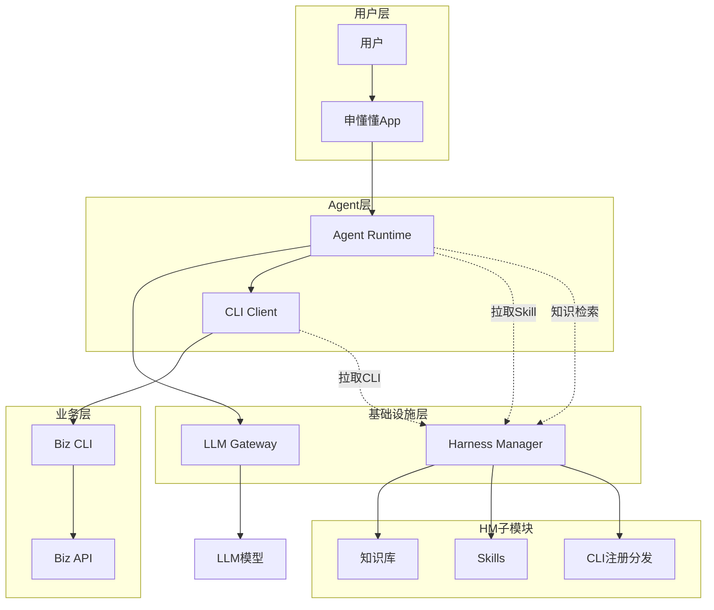
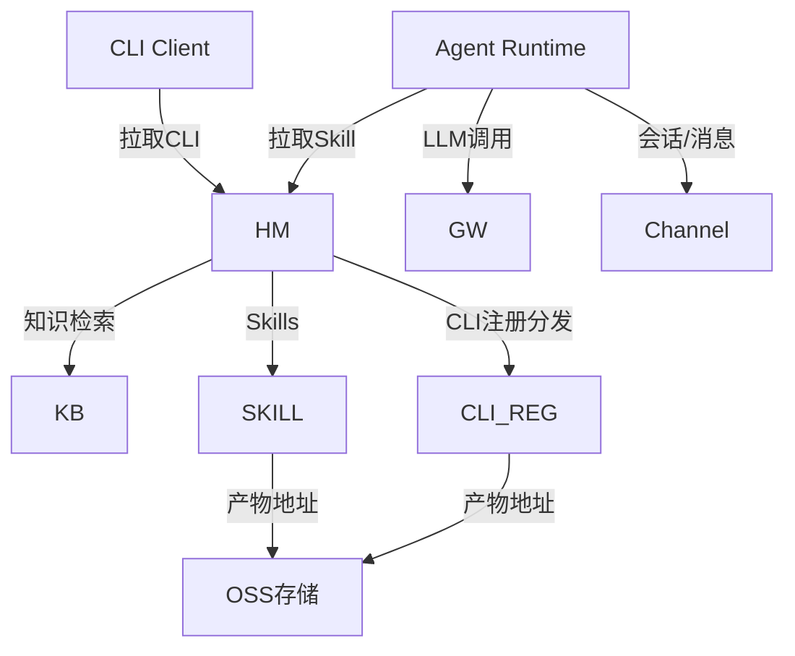

# 技术评审与规范

<cite>
**本文引用的文件**   
- [cross-module-design-review-2026-04-24.md](file://notes/zhaobomin/cross-module-design-review-2026-04-24.md)
- [Agent-Runtime方案review.md](file://notes/zhaobomin/Agent-Runtime方案review.md)
- [LLM-Gateway方案review.md](file://notes/zhaobomin/LLM-Gateway方案review.md)
- [LLM-Gateway建设方案.md](file://plan/LLM-Gateway建设方案.md)
- [Agent-Runtime方案.md](file://plan/Agent-Runtime方案.md)
- [SAI_CLI_设计文档_v1.2.md](file://plan/SAI_CLI_设计文档_v1.2.md)
- [CLI 架构与规范对焦.md](file://plan/CLI 架构与规范对焦.md)
- [Sai整体架构设计.md](file://project/standup/Sai整体架构设计.md)
- [yihang.md](file://daily/2026-04-24/yihang.md)
- [SAI-daily-report-2026-04-22-final.md](file://project/SAI-daily-report-2026-04-22-final.md)
- [项目管理方案v1.0.md](file://project/项目管理方案v1.0.md)
- [README.md](file://README.md)
</cite>

## 目录
1. [简介](#简介)
2. [项目结构](#项目结构)
3. [核心组件](#核心组件)
4. [架构总览](#架构总览)
5. [详细组件分析](#详细组件分析)
6. [依赖关系分析](#依赖关系分析)
7. [性能考量](#性能考量)
8. [故障与风险处置指南](#故障与风险处置指南)
9. [结论](#结论)
10. [附录](#附录)

## 简介
本文件面向SAI项目的技术评审与规范制定，系统梳理跨模块设计评审、技术方案评审与规范制定过程，聚焦评审中的技术争议、解决方案与最终决策，总结项目规范、标准与最佳实践。文档同时提供评审会议纪要、决策依据与实施效果跟踪方法，配套技术规范模板、评审标准与质量检查清单，为技术决策者与开发者提供权威的技术指导与规范参考。

## 项目结构
SAI项目采用三层架构与五团队协作模式，公共文档库集中管理各模块设计、评审与日常进展。仓库划分与职责边界清晰，Git即进度，文档同步与日报制度保障透明协作。

```mermaid
graph TB
subgraph "Channel层"
CH["Channel<br/>弘宇"]
SDD["申懂懂App"]
end
subgraph "核心层"
AR["Agent Runtime<br/>奕杭"]
WS["Workspace"]
HM["Harness Manager<br/>隋云"]
end
subgraph "基础设施层"
LR["LLMRouter<br/>老徐"]
CA["CLI API<br/>淩雪"]
end
subgraph "Harness Manager 子模块"
KB["知识库"]
SK["Skills"]
CLI["CLI 管理和分发"]
end
SDD --> CH
CH --> WS
AR --> WS
WS < --> HM
HM --> KB
HM --> SK
HM --> CLI
CLI --> CA
WS --> LR
CA -.->|提供 API raw 描述| CLI
```

图表来源
- [README.md:11-41](file://README.md#L11-L41)

章节来源
- [项目管理方案v1.0.md:23-49](file://project/项目管理方案v1.0.md#L23-L49)
- [README.md:9-41](file://README.md#L9-L41)

## 核心组件
- Agent Runtime：通用Agent与业务Skill/CLI隔离，基于Serverless按会话实例化，强调用户隔离与冷热启动性能。
- LLM Gateway：统一LLM代理与路由，支持成本控制、额度预警与熔断，采用LiteLLM选型。
- Harness Manager（HM）：控制面服务，负责知识库、Skills与CLI注册分发，支撑Agent侧拉取与执行。
- Channel（申懂懂App）：用户接入层，负责前端交互与Agent SDK集成，当前设计文档缺失。
- CLI API：提供业务API原始描述，供HM进行元数据编译与Agent可读Tool定义生成。

章节来源
- [Sai整体架构设计.md:142-151](file://project/standup/Sai整体架构设计.md#L142-L151)
- [Agent-Runtime方案.md:4-12](file://plan/Agent-Runtime方案.md#L4-L12)
- [LLM-Gateway建设方案.md:17-25](file://plan/LLM-Gateway建设方案.md#L17-L25)
- [SAI_CLI_设计文档_v1.2.md:547-559](file://plan/SAI_CLI_设计文档_v1.2.md#L547-L559)

## 架构总览
SAI整体架构包含两条核心链路：意图理解链路（用户→App→Agent→LLM Gateway→LLM）与业务执行链路（Agent→CLI Client→Biz CLI→Biz API）。HM作为控制面，提供Skills、CLI注册分发与知识检索支撑。



图表来源
- [Sai整体架构设计.md:19-65](file://project/standup/Sai整体架构设计.md#L19-L65)

章节来源
- [Sai整体架构设计.md:108-138](file://project/standup/Sai整体架构设计.md#L108-L138)

## 详细组件分析

### Agent Runtime 组件
- 用户隔离与冷热启动：基于Serverless按会话实例化，冷启动<1s，热启动<200ms，具备实测数据支撑。
- 技能与CLI挂载：当前Block点在于OSS个性化挂载未评估，提供Agent层自行实现文件权限的B方案。
- 接口依赖：与LLM Gateway的意图理解接口与与HM的Skills/CLI拉取接口需明确契约。
- ACP协议：向前兼容考虑，当前不实现，等待Python SDK与阿里云环境适配。

章节来源
- [Agent-Runtime方案.md:4-12](file://plan/Agent-Runtime方案.md#L4-L12)
- [Agent-Runtime方案.md:18-26](file://plan/Agent-Runtime方案.md#L18-L26)
- [Agent-Runtime方案.md:27-36](file://plan/Agent-Runtime方案.md#L27-L36)
- [Agent-Runtime方案.md:44-48](file://plan/Agent-Runtime方案.md#L44-L48)
- [Agent-Runtime方案review.md:9-14](file://notes/zhaobomin/Agent-Runtime方案review.md#L9-L14)
- [Agent-Runtime方案review.md:20-36](file://notes/zhaobomin/Agent-Runtime方案review.md#L20-L36)

### LLM Gateway 组件
- 选型与架构：LiteLLM优于New API，具备限流、告警、降级与路由策略，适合企业级使用。
- 逃生方案：文档标注“待确认”，建议至少提供业务侧fallback直连与Gateway bypass一键关闭路由两种方案。
- 计费误差：存在分词规则差异与不支持阶梯计费导致的误差，建议开展实测对比以量化偏差。
- 前端技术选型：方案中未明确前端技术栈，影响4/30可行性。

章节来源
- [LLM-Gateway建设方案.md:17-25](file://plan/LLM-Gateway建设方案.md#L17-L25)
- [LLM-Gateway建设方案.md:38-40](file://plan/LLM-Gateway建设方案.md#L38-L40)
- [LLM-Gateway建设方案.md:53-54](file://plan/LLM-Gateway建设方案.md#L53-L54)
- [LLM-Gateway建设方案.md:105-109](file://plan/LLM-Gateway建设方案.md#L105-L109)
- [LLM-Gateway方案review.md:11-15](file://notes/zhaobomin/LLM-Gateway方案review.md#L11-L15)
- [LLM-Gateway方案review.md:32-38](file://notes/zhaobomin/LLM-Gateway方案review.md#L32-L38)
- [LLM-Gateway方案review.md:40-44](file://notes/zhaobomin/LLM-Gateway方案review.md#L40-L44)
- [LLM-Gateway方案review.md:53-57](file://notes/zhaobomin/LLM-Gateway方案review.md#L53-L57)

### Harness Manager（HM）组件
- 职责与子模块：知识库、Skills与CLI注册分发，不参与调用链路，只做资源分发。
- CLI注册与分发：业务方上报元数据，HM存储并分发至OSS，Agent侧拉取执行产物。
- 接口契约缺失：Skills/CLI拉取接口schema、分页与缓存策略未定义，需尽快补齐。

章节来源
- [Sai整体架构设计.md:173-194](file://project/standup/Sai整体架构设计.md#L173-L194)
- [Sai整体架构设计.md:154-170](file://project/standup/Sai整体架构设计.md#L154-L170)
- [cross-module-design-review-2026-04-24.md:187-197](file://notes/zhaobomin/cross-module-design-review-2026-04-24.md#L187-L197)

### Channel（申懂懂App）组件
- 现状：设计文档与架构定义缺失，前端接入方案、消息协议、会话管理与Agent SDK集成方式均未定义。
- 影响：整体架构中标注“未写入文档”，阻碍前端接入与端到端联调。

章节来源
- [cross-module-design-review-2026-04-24.md:91-99](file://notes/zhaobomin/cross-module-design-review-2026-04-24.md#L91-L99)
- [Sai整体架构设计.md:154-164](file://project/standup/Sai整体架构设计.md#L154-L164)

### CLI API 组件
- 职责：提供业务API原始描述，供HM进行元数据编译与Agent可读Tool定义生成。
- 与HM协作：CLI注册上报接口与元数据生成接口需明确schema与操作类型。

章节来源
- [Sai整体架构设计.md:154-164](file://project/standup/Sai整体架构设计.md#L154-L164)
- [SAI_CLI_设计文档_v1.2.md:384-391](file://plan/SAI_CLI_设计文档_v1.2.md#L384-L391)

## 依赖关系分析
跨模块接口对齐状态与风险评估如下：



图表来源
- [Sai整体架构设计.md:67-106](file://project/standup/Sai整体架构设计.md#L67-L106)
- [Sai整体架构设计.md:154-164](file://project/standup/Sai整体架构设计.md#L154-L164)

章节来源
- [Sai整体架构设计.md:154-164](file://project/standup/Sai整体架构设计.md#L154-L164)
- [cross-module-design-review-2026-04-24.md:254-267](file://notes/zhaobomin/cross-module-design-review-2026-04-24.md#L254-L267)

## 性能考量
- 冷启动目标：Agent Runtime冷启动<1s，热启动<200ms，需在Serverless与容器化方案间明确基础设施选型。
- QPS与并发：需进行预期QPS/并发用户数、Token消耗预估与存储容量规划（OSS、RDS、Redis）。
- 启动性能：1500个API Tag元数据量级对Agent启动速度的影响需量化评估。

章节来源
- [Agent-Runtime方案.md:6-10](file://plan/Agent-Runtime方案.md#L6-L10)
- [cross-module-design-review-2026-04-24.md:243-251](file://notes/zhaobomin/cross-module-design-review-2026-04-24.md#L243-L251)

## 故障与风险处置指南

### 风险与降级矩阵
- HM不可用：Agent使用本地缓存Skill/CLI定义，降级为无知识检索模式。
- LLM Gateway熔断：意图理解链路中断，Agent返回固定提示；业务执行链路不受影响。
- Biz API超时/失败：CLI Client单次重试（≤3s），失败后Agent向用户说明接口不可用。
- OSS不可用：Agent使用本地缓存版本运行，日志告警通知HM团队。
- Agent Runtime实例崩溃：Serverless平台自动重建实例，用户会话需重新发起。

章节来源
- [Sai整体架构设计.md:236-245](file://project/standup/Sai整体架构设计.md#L236-L245)

### 已知风险与应对
- Claude Agent SDK强依赖：做SDK抽象层，保留切换能力。
- HM Skill/CLI方案未出：需在4/25前产出接口定义文档，否则Agent对接返工。
- LLM Gateway 4/30 scope偏大：先砍到最小可用，审批流与前端管理页面延后。
- OSS挂载个性化需求未评估：若4/30前无结论，走Agent层自行实现文件权限的B方案。
- Channel→Agent交互协议未对齐：需与弘宇约时间对齐前端集成方案。
- LLM Gateway逃生方案未定：至少准备业务侧fallback直连与Gateway bypass两种方案。

章节来源
- [Sai整体架构设计.md:248-258](file://project/standup/Sai整体架构设计.md#L248-L258)

### 评审会议与决策跟踪
- 4/24跨模块设计Review：明确各模块文档完备性、跨文档矛盾与缺失，提出P0/P1/P2优先级行动项。
- 4/22项目日报：完成方案设计、基础设施搭建与产品调研，进入4/30里程碑冲刺阶段。
- 4/24日报：Agent侧完成Skill/CLI资源路径映射方案对齐，Serverless伸缩容联调安排。

章节来源
- [cross-module-design-review-2026-04-24.md:270-292](file://notes/zhaobomin/cross-module-design-review-2026-04-24.md#L270-L292)
- [SAI-daily-report-2026-04-22-final.md:48-64](file://project/SAI-daily-report-2026-04-22-final.md#L48-L64)
- [yihang.md:71-89](file://daily/2026-04-24/yihang.md#L71-L89)

## 结论
SAI项目整体架构清晰，Harness Manager/CLI（v1.2）与整体架构文档质量较高，但存在以下关键短板：
- Channel设计文档缺失，前端接入与消息协议未定义；
- Agent Runtime文档完整度不足，接口定义与错误处理机制缺失；
- HM↔Agent Runtime接口契约未定义，Skills/CLI拉取schema与缓存策略缺失；
- LLM Gateway逃生方案未定，New API/LiteLLM描述前后不一致；
- 全局错误码与状态码规范缺失，性能与容量规划未量化。

建议优先完成P0行动项，补齐关键接口契约与Channel设计，确保4/30里程碑交付。

## 附录

### 技术评审与规范模板

#### 评审会议纪要模板
- 会议主题、时间、参会人员
- 评审范围与方法
- 各模块文档完备性评分
- 跨文档矛盾与不一致项
- 关键缺失项与风险评估
- 优先级行动项（P0/P1/P2）
- 决策结论与责任人

章节来源
- [cross-module-design-review-2026-04-24.md:1-306](file://notes/zhaobomin/cross-module-design-review-2026-04-24.md#L1-L306)

#### 技术方案评审标准
- 选型合理性与替代方案对比
- 接口定义完整性（schema、认证、错误码）
- 架构图与时序图清晰度
- 前后文一致性与冲突处理
- 风险识别与降级策略
- 性能与容量规划
- 前端/用户侧可行性

章节来源
- [LLM-Gateway方案review.md:9-69](file://notes/zhaobomin/LLM-Gateway方案review.md#L9-L69)
- [Agent-Runtime方案review.md:9-55](file://notes/zhaobomin/Agent-Runtime方案review.md#L9-L55)

#### 质量检查清单
- 接口契约：是否定义schema、认证方式、错误码、分页与缓存策略
- 文档完备性：架构图、接口定义、错误处理、风险与上线策略
- 跨模块一致性：接口路径、认证方式、数据格式是否一致
- 前后文一致性：术语统一、前后描述一致
- 风险与逃生：是否定义逃生方案与降级策略
- 性能与容量：是否量化QPS/并发、Token消耗、存储容量与启动时间

章节来源
- [cross-module-design-review-2026-04-24.md:171-251](file://notes/zhaobomin/cross-module-design-review-2026-04-24.md#L171-L251)

#### 接口契约定义模板（示例）
- 接口名称与用途
- 调用方与提供方
- 请求/响应schema
- 认证方式与权限
- 错误码与提示
- 分页与缓存策略
- 示例请求/响应

章节来源
- [cross-module-design-review-2026-04-24.md:187-197](file://notes/zhaobomin/cross-module-design-review-2026-04-24.md#L187-L197)

#### 全局错误码规范建议
- 认证错误：401/403
- 参数错误：400
- 服务不可用：503
- 限流：429
- 业务错误：带code+message

章节来源
- [cross-module-design-review-2026-04-24.md:210-220](file://notes/zhaobomin/cross-module-design-review-2026-04-24.md#L210-L220)

#### CLI设计规范要点
- 命令格式：{product} {module} {action} [params]
- JSON入参/出参，结构化错误输出
- 9维Tag体系：路由与分类组、NLU理解组、执行与展示组
- NLU Pipeline：意图分类→实体抽取→Tag匹配+评分→参数组装→API调用→结果解读
- 安全与鉴权：PoP Token（分两期实施）、AK/SK签名
- 可测试性：Dry-Run模式、接口抽象与Mock

章节来源
- [SAI_CLI_设计文档_v1.2.md:115-146](file://plan/SAI_CLI_设计文档_v1.2.md#L115-L146)
- [SAI_CLI_设计文档_v1.2.md:151-288](file://plan/SAI_CLI_设计文档_v1.2.md#L151-L288)
- [SAI_CLI_设计文档_v1.2.md:295-336](file://plan/SAI_CLI_设计文档_v1.2.md#L295-L336)
- [SAI_CLI_设计文档_v1.2.md:394-471](file://plan/SAI_CLI_设计文档_v1.2.md#L394-L471)
- [SAI_CLI_设计文档_v1.2.md:474-512](file://plan/SAI_CLI_设计文档_v1.2.md#L474-L512)

#### 项目管理与评审流程
- Git即进度：提交信息规范、文档同步、每日提交
- 文档目录：按团队维度组织，公共日报集中管理
- 评审与跟踪：跨模块Review、日报与风险跟踪、里程碑冲刺

章节来源
- [项目管理方案v1.0.md:59-87](file://project/项目管理方案v1.0.md#L59-L87)
- [项目管理方案v1.0.md:90-134](file://project/项目管理方案v1.0.md#L90-L134)
- [SAI-daily-report-2026-04-22-final.md:13-16](file://project/SAI-daily-report-2026-04-22-final.md#L13-L16)
- [SAI-daily-report-2026-04-22-final.md:67-73](file://project/SAI-daily-report-2026-04-22-final.md#L67-L73)