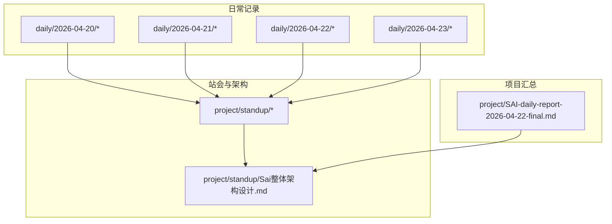
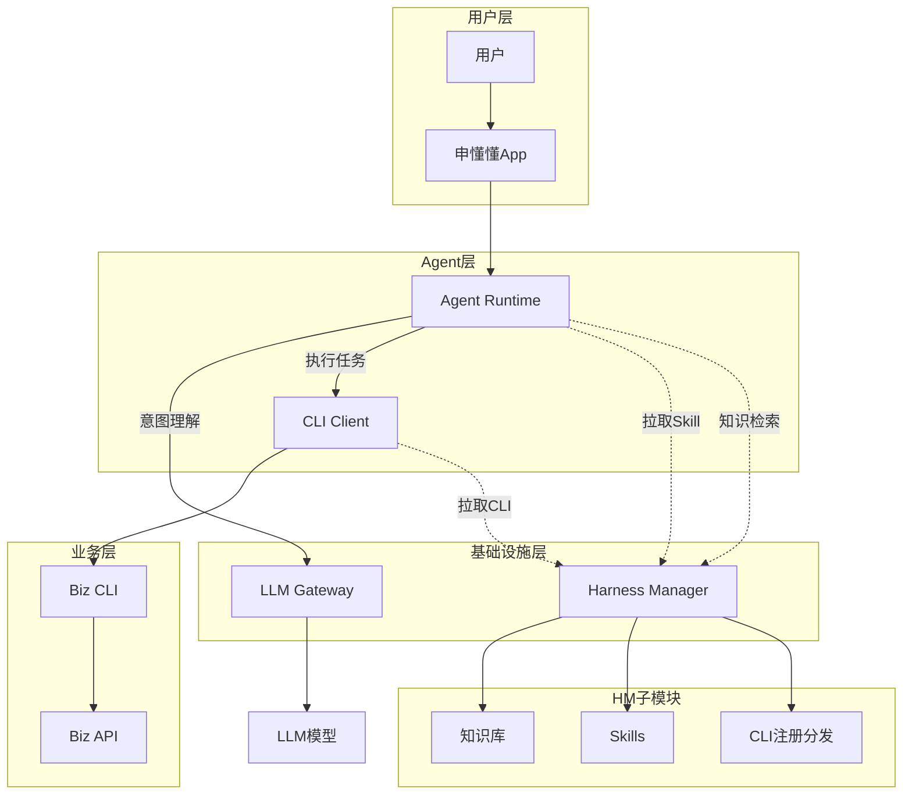
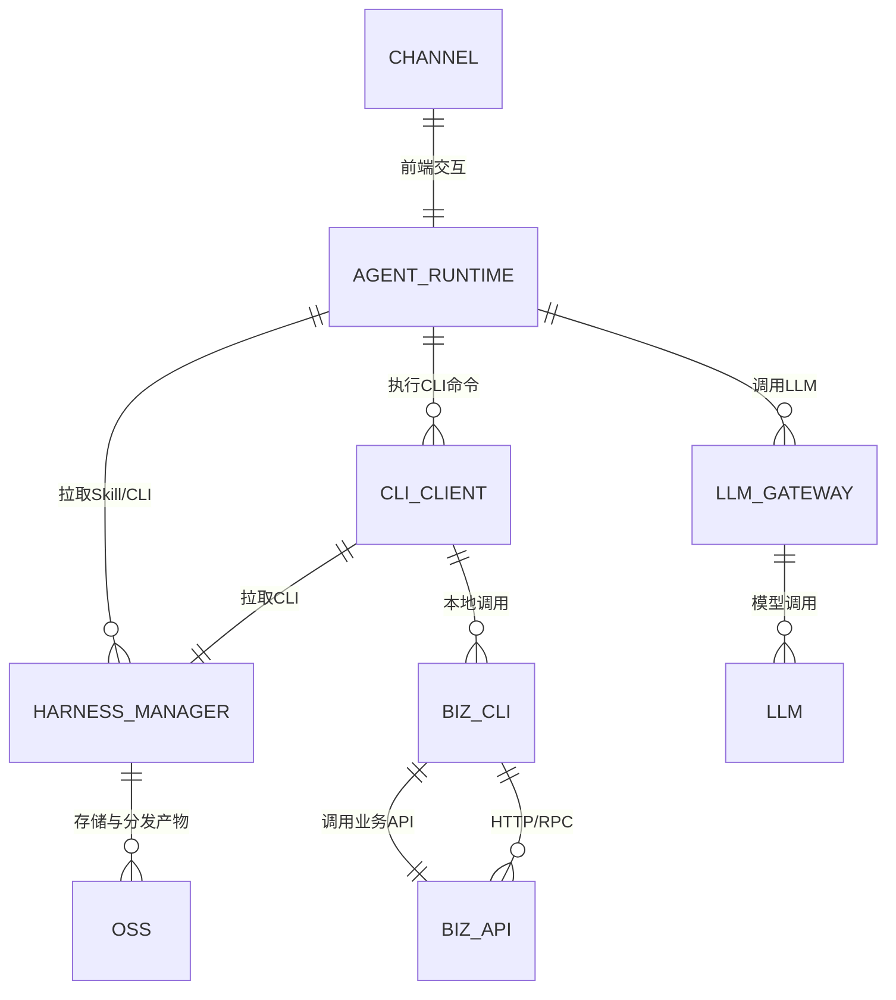

# 日常工作记录

<cite>
**本文档引用的文件**
- [daily/2026-04-20/yihang.md](file://daily/2026-04-20/yihang.md)
- [daily/2026-04-20/suiyun.md](file://daily/2026-04-20/suiyun.md)
- [project/standup/2026-04-20-zhaobomin.md](file://project/standup/2026-04-20-zhaobomin.md)
- [daily/2026-04-21/hongyu.md](file://daily/2026-04-21/hongyu.md)
- [daily/2026-04-21/suiyun.md](file://daily/2026-04-21/suiyun.md)
- [daily/2026-04-21/xuchunhui.md](file://daily/2026-04-21/xuchunhui.md)
- [daily/2026-04-22/hongyu.md](file://daily/2026-04-22/hongyu.md)
- [daily/2026-04-22/suiyun.md](file://daily/2026-04-22/suiyun.md)
- [daily/2026-04-22/yihang.md](file://daily/2026-04-22/yihang.md)
- [project/SAI-daily-report-2026-04-22-final.md](file://project/SAI-daily-report-2026-04-22-final.md)
- [daily/2026-04-23/hongyu.md](file://daily/2026-04-23/hongyu.md)
- [daily/2026-04-23/lingxue.md](file://daily/2026-04-23/lingxue.md)
- [daily/2026-04-23/xuchunhui.md](file://daily/2026-04-23/xuchunhui.md)
- [project/standup/Sai整体架构设计.md](file://project/standup/Sai整体架构设计.md)
</cite>

## 目录
1. [简介](#简介)
2. [项目结构](#项目结构)
3. [核心组件](#核心组件)
4. [架构总览](#架构总览)
5. [详细组件分析](#详细组件分析)
6. [依赖关系分析](#依赖关系分析)
7. [性能考量](#性能考量)
8. [故障排查指南](#故障排查指南)
9. [结论](#结论)
10. [附录](#附录)

## 简介
本文件为SAI项目日常工作记录的综合文档，覆盖每日站会要点、开发进展跟踪、问题与风险汇总、技术决策过程、经验教训与最佳实践，以及项目动态、里程碑达成与团队协作反馈。内容来源于仓库中的每日日报、站会记录、架构设计文档与阶段性汇总报告，旨在为项目管理者与团队成员提供实时项目状态与历史参考。

## 项目结构
SAI项目文档主要分布在以下目录：
- daily：按日期记录的个人日报，涵盖各模块负责人当日工作、问题与计划
- project/standup：站会记录与整体架构设计文档
- project：阶段性日报汇总与项目管理方案
- plan：设计文档与方案规划
- notes：评审与设计回顾笔记
- openspec：规范与配置

**图表来源**
- [project/standup/2026-04-20-zhaobomin.md:1-84](file://project/standup/2026-04-20-zhaobomin.md#L1-L84)
- [project/standup/Sai整体架构设计.md:1-277](file://project/standup/Sai整体架构设计.md#L1-L277)
- [project/SAI-daily-report-2026-04-22-final.md:1-77](file://project/SAI-daily-report-2026-04-22-final.md#L1-L77)

**章节来源**
- [project/standup/2026-04-20-zhaobomin.md:1-84](file://project/standup/2026-04-20-zhaobomin.md#L1-L84)
- [project/standup/Sai整体架构设计.md:1-277](file://project/standup/Sai整体架构设计.md#L1-L277)
- [project/SAI-daily-report-2026-04-22-final.md:1-77](file://project/SAI-daily-report-2026-04-22-final.md#L1-L77)

## 核心组件
- Agent Runtime（奕杭）：负责Agent执行、意图理解与CLI调用，承担通用Agent与CLI客户端的开发
- LLM Gateway（老徐）：负责LLM统一代理、Token管理与成本控制，推进LiteLLM方案与基础设施部署
- Harness Manager（隋云）：负责知识库、Skills与CLI注册分发，推动单CLI封装与鉴权兼容设计
- Channel（弘宇）：负责用户接入与前端交互，推进申懂懂App接入与输入输出层设计
- Biz CLI（凌雪）：负责业务能力封装、鉴权与API调用，推进CLI demo与API注册

**章节来源**
- [project/standup/Sai整体架构设计.md:142-151](file://project/standup/Sai整体架构设计.md#L142-L151)
- [project/standup/2026-04-20-zhaobomin.md:48-62](file://project/standup/2026-04-20-zhaobomin.md#L48-L62)

## 架构总览
SAI整体架构分为用户层、Agent层、基础设施层与业务层，通过LLM Gateway与Harness Manager实现意图理解与业务执行的双链路协同。HM作为控制面服务，提供技能与CLI的注册、分发与拉取能力，Agent通过OSS挂载获取执行产物。

**图表来源**
- [project/standup/Sai整体架构设计.md:19-65](file://project/standup/Sai整体架构设计.md#L19-L65)

## 详细组件分析

### Agent Runtime（奕杭）
- 4月20日：与徐总澄清serverless层接口，明确基于用户级别的workspace获取agent session与基于session的Agent交互接口，强调serverless层不侵入业务逻辑
- 4月22日：为隔离用户环境，将serverless从阿里云AgentRun下沉至直接使用serverless，完成基于sessionId隔离与按用户id挂载OSS的workspace
- 4月22日：团队commit迁移至SAI项目空间，agent-gateway开发中，预计下周完成从申懂懂到Agent(serverless)的链路

**章节来源**
- [daily/2026-04-20/yihang.md:1-23](file://daily/2026-04-20/yihang.md#L1-L23)
- [daily/2026-04-22/yihang.md:1-3](file://daily/2026-04-22/yihang.md#L1-L3)

### LLM Gateway（老徐）
- 4月21日：完成LiteLLM基础设施与配置落地，包括Redis、PostgreSQL的采购配置与环境初始化，生产环境配置方案确定，完成LLM Gateway生产环境全流程部署与公网域名申请
- 4月23日：完成健康监控核心能力开发，设计智能监控流程（健康检查、二次确认、连续失败阈值与告警通知），推进AgentRun对接方案对齐与430节点交付清单

**章节来源**
- [daily/2026-04-21/xuchunhui.md:6-11](file://daily/2026-04-21/xuchunhui.md#L6-L11)
- [daily/2026-04-23/xuchunhui.md:9-28](file://daily/2026-04-23/xuchunhui.md#L9-L28)
- [daily/2026-04-23/xuchunhui.md:37-54](file://daily/2026-04-23/xuchunhui.md#L37-L54)

### Harness Manager（隋云）
- 4月20日：项目日报中梳理CLI网关的服务注册与Agent交互方式，协调管家系CLI的raw层动态收集与命令方案
- 4月21日：确定单CLI封装方案，明确Harness Manager职责演进：业务系统专注核心API建设，Manager负责聚合构建与全生命周期管理
- 4月22日：完成注册上报机制设计（API描述→标准注册JSON生成与命令注册接口），确定CLI二进制构建与鉴权兼容设计，与Agent交互通过OSS挂载进行

**章节来源**
- [daily/2026-04-20/suiyun.md:1-11](file://daily/2026-04-20/suiyun.md#L1-L11)
- [daily/2026-04-21/suiyun.md:1-43](file://daily/2026-04-21/suiyun.md#L1-L43)
- [daily/2026-04-22/suiyun.md:1-64](file://daily/2026-04-22/suiyun.md#L1-L64)

### Channel（弘宇）
- 4月21日：完成需求痛点分析、关键页面设计，定义对话体验框架，推进前端预研生成式UI的skill产出
- 4月22日：完成方案定型与流程提效，确定核心框架设计与首页视觉风格，推进AI自动化设计工作流
- 4月23日：梳理并锁定一期MVP范围，沉淀交互规范，准备一期功能评审

**章节来源**
- [daily/2026-04-21/hongyu.md:1-54](file://daily/2026-04-21/hongyu.md#L1-L54)
- [daily/2026-04-22/hongyu.md:1-38](file://daily/2026-04-22/hongyu.md#L1-L38)
- [daily/2026-04-23/hongyu.md:1-40](file://daily/2026-04-23/hongyu.md#L1-L40)

### Biz CLI（凌雪）
- 4月21日：输出SAI CLI设计文档v1.0，梳理160+ CLI需求项，明确CLI职责边界（业务域专注API，Harness Manager统一CLI构建）
- 4月23日：推进API开发与本地联调，确定各域API注册清单，设计Token获取机制（扫码登录）

**章节来源**
- [daily/2026-04-21/xuchunhui.md:13-16](file://daily/2026-04-21/xuchunhui.md#L13-L16)
- [daily/2026-04-23/lingxue.md:1-56](file://daily/2026-04-23/lingxue.md#L1-L56)

### 技术决策与经验教训
- 单CLI封装方案：从多CLI分域部署演进为单CLI统一封装，降低业务域接入与维护成本，Harness Manager负责聚合构建与全生命周期管理
- 鉴权兼容设计：云上版本CLI从Agent端约定文件获取Token，本地版本支持扫码登录注入sto token，设计环境凭证绑定的防伪方案
- OSS挂载交互：Agent通过OSS挂载获取sai-cli二进制文件、Skill元数据清单及版本配置，避免直接调用Manager API
- 健康监控与告警：LLM Gateway健康监控流程包含健康检查、二次确认、连续失败阈值与钉钉告警通知，保障系统可用性

**章节来源**
- [daily/2026-04-22/suiyun.md:3-13](file://daily/2026-04-22/suiyun.md#L3-L13)
- [daily/2026-04-22/suiyun.md:32-43](file://daily/2026-04-22/suiyun.md#L32-L43)
- [daily/2026-04-23/xuchunhui.md:15-27](file://daily/2026-04-23/xuchunhui.md#L15-L27)

## 依赖关系分析
SAI项目模块间接口依赖矩阵与调用协议如下：

**图表来源**
- [project/standup/Sai整体架构设计.md:154-170](file://project/standup/Sai整体架构设计.md#L154-L170)
- [project/standup/Sai整体架构设计.md:197-221](file://project/standup/Sai整体架构设计.md#L197-L221)

**章节来源**
- [project/standup/Sai整体架构设计.md:154-170](file://project/standup/Sai整体架构设计.md#L154-L170)
- [project/standup/Sai整体架构设计.md:197-221](file://project/standup/Sai整体架构设计.md#L197-L221)

## 性能考量
- 启动性能：Agent Runtime冷启动<1秒，热启动<200毫秒
- 并发与成本：LLM Gateway支持≥5个个人用户并发使用，额度80%/90%/100%三级告警可触发
- 可用性：HM不可用时Agent使用本地缓存Skill/CLI继续运行；LLM Gateway熔断时Agent返回固定提示；OSS不可用时Agent使用本地缓存版本运行

**章节来源**
- [project/standup/Sai整体架构设计.md:224-245](file://project/standup/Sai整体架构设计.md#L224-L245)

## 故障排查指南
- HM不可用：Agent使用本地缓存最近一次Skill/CLI定义，降级为无知识检索模式
- LLM Gateway熔断：Agent返回固定提示，业务执行链路不受影响
- Biz API超时/失败：CLI Client单次重试（≤3s等待），失败后Agent向用户说明具体接口不可用
- OSS不可用：Agent使用本地缓存版本运行，日志告警通知HM团队
- Agent Runtime实例崩溃：Serverless平台自动重建实例，用户会话需重新发起

**章节来源**
- [project/standup/Sai整体架构设计.md:236-245](file://project/standup/Sai整体架构设计.md#L236-L245)

## 结论
SAI项目在4月20日至24日期间完成了总体架构对齐、模块职责明确与关键技术方案落地。Agent Runtime、LLM Gateway、Harness Manager、Channel与Biz CLI五大模块协同推进，形成意图理解与业务执行的双链路架构。通过单CLI封装、鉴权兼容与OSS挂载等设计，项目在降低接入成本的同时提升了系统的可维护性与可用性。下一阶段应聚焦于4/30节点的最小可用功能交付与各模块接口对齐。

## 附录

### 项目动态与里程碑
- 4月20日：完成项目仓库初始化与分工明确，输出模块方案与排期
- 4月21日：完成LLM Gateway基础设施部署与Agent Runtime代码review，确定Harness-CLI设计方案
- 4月22日：完成SAI项目日报汇总，明确4/30上线与4/29交付CLI的目标
- 4月23日：推进健康监控与AgentRun对接方案，完成LLM网关功能补全与环境适配

**章节来源**
- [project/SAI-daily-report-2026-04-22-final.md:1-77](file://project/SAI-daily-report-2026-04-22-final.md#L1-L77)

### 团队协作反馈
- 站会记录明确了模块职责与待办事项，促进跨模块协同与问题快速定位
- 架构设计文档提供了接口依赖矩阵与调用协议，为后续接口对齐与联调提供依据
- 日报汇总体现了各模块负责人对问题与风险的及时披露与应对措施

**章节来源**
- [project/standup/2026-04-20-zhaobomin.md:46-84](file://project/standup/2026-04-20-zhaobomin.md#L46-L84)
- [project/standup/Sai整体架构设计.md:142-170](file://project/standup/Sai整体架构设计.md#L142-L170)