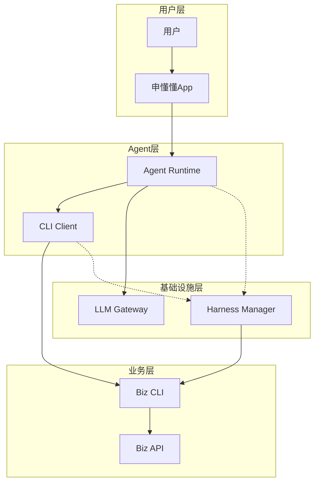
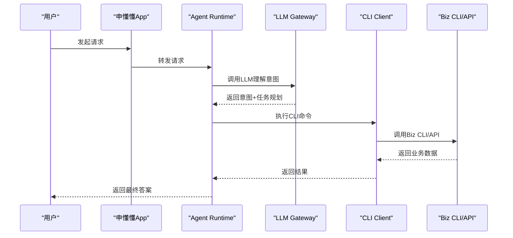
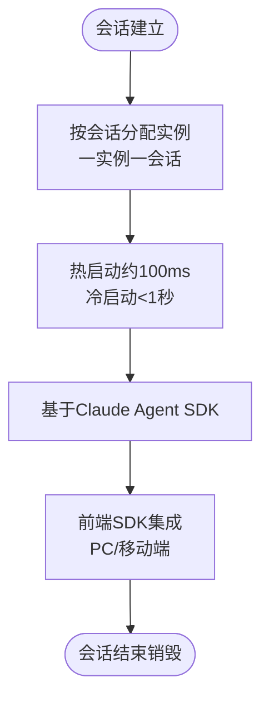
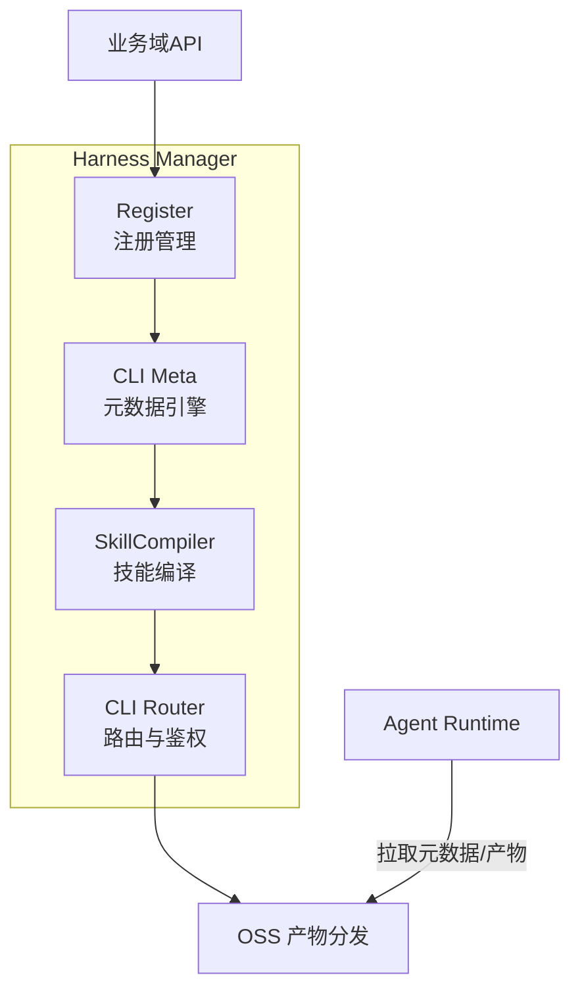
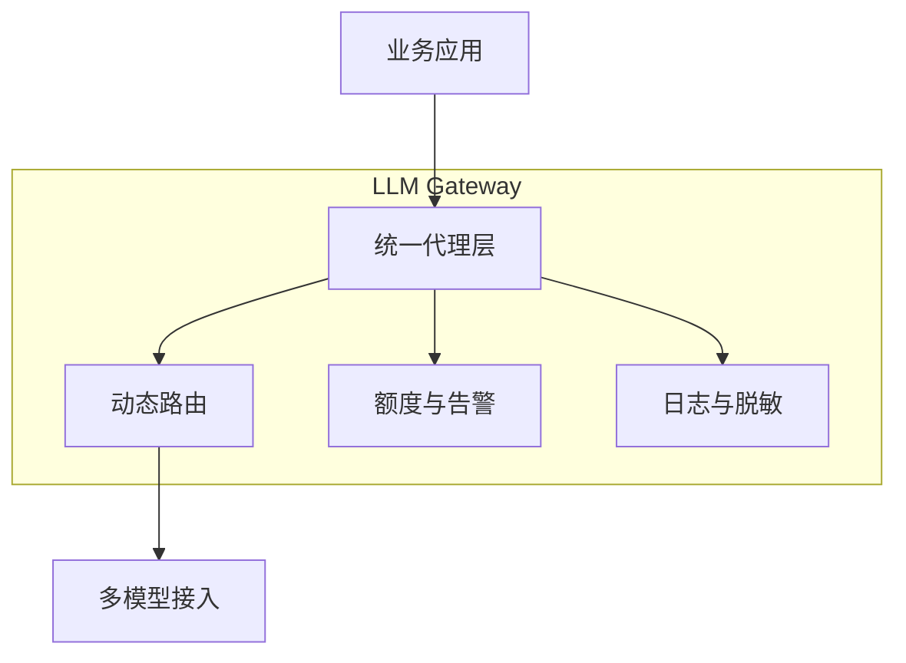
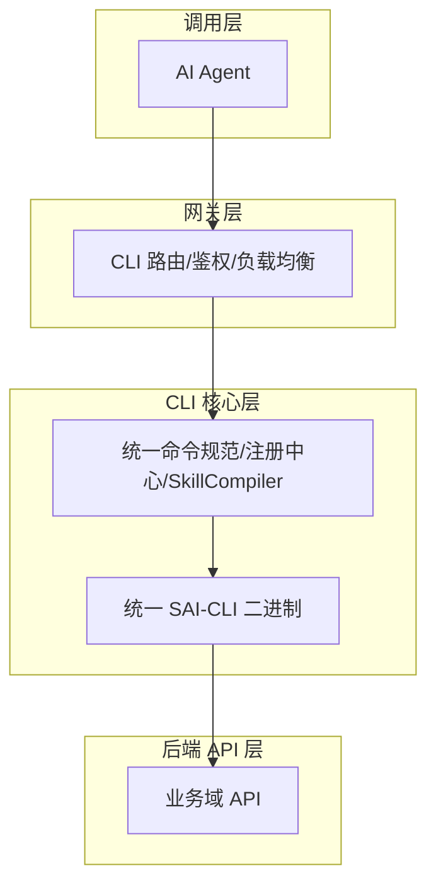
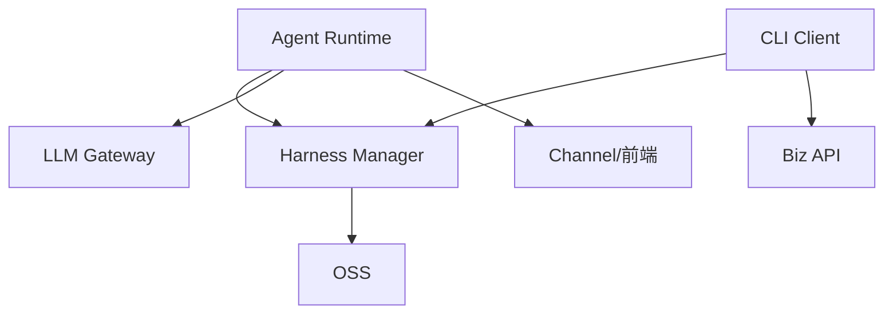

# 技术愿景与价值

<cite>
**本文档引用的文件**
- [SAI CLI 架构设计文档 v1.2](file://plan/SAI_CLI_设计文档_v1.2.md)
- [Agent Runtime 方案](file://plan/Agent-Runtime方案.md)
- [LLM Gateway 建设方案](file://plan/LLM-Gateway建设方案.md)
- [SAI 项目日报 | 2026-04-22 最终版](file://project/SAI-daily-report-2026-04-22-final.md)
- [Agent Runtime 方案 Review](file://notes/zhaobomin/Agent-Runtime方案review.md)
- [4.20 早会记录](file://project/standup/2026-04-20-zhaobomin.md)
- [Sai 整体架构设计文档](file://project/standup/Sai整体架构设计.md)
- [LLM Gateway 一期功能规划](file://plan/LLM-Gateway一期功能规划.md)
- [LLM Gateway 热门开源项目对比](file://plan/LLM Gateway 热门开源项目对比.md)
</cite>

## 目录
1. [引言](#引言)
2. [项目结构](#项目结构)
3. [核心组件](#核心组件)
4. [架构总览](#架构总览)
5. [详细组件分析](#详细组件分析)
6. [依赖分析](#依赖分析)
7. [性能考量](#性能考量)
8. [故障排查指南](#故障排查指南)
9. [结论](#结论)
10. [附录](#附录)

## 引言
SAI 智能体平台面向企业级 AI 应用，旨在通过统一的 AI 入口、标准化的业务封装与智能化决策支持，加速企业数字化转型。平台以“意图理解 + 业务执行”的双链路协同为核心，结合 LLM 网关的成本与安全治理、Harness Manager 的控制面分发能力、Agent Runtime 的 Serverless 执行环境以及 CLI 的标准化封装，构建可扩展、可演进、可治理的企业 AI 基础设施。

SAI 的技术愿景与价值体现在：
- 技术愿景：打造“统一 AI 入口 + 标准化业务封装 + 智能化决策支持”的企业级 AI 智能体平台，实现业务系统与 AI 的解耦与高效协同。
- 长远目标：以模块化、可插拔、可治理的架构为基础，持续扩展业务域覆盖与智能能力，支撑企业从“工具化”走向“智能化”。

## 项目结构
SAI 项目围绕五大模块协同运作：Agent Runtime、Harness Manager、Channel、LLM Gateway、CLI API。各模块职责清晰、边界明确，通过统一协议与控制面分发实现松耦合协作。

图表来源
- [Sai 整体架构设计文档:19-65](file://project/standup/Sai整体架构设计.md#L19-L65)

章节来源
- [Sai 整体架构设计文档:1-277](file://project/standup/Sai整体架构设计.md#L1-L277)
- [4.20 早会记录:1-84](file://project/standup/2026-04-20-zhaobomin.md#L1-L84)

## 核心组件
- Agent Runtime：提供意图理解、会话管理、CLI 调用与执行能力，采用 Serverless（AgentRun）实现用户隔离与热启动，保障低延迟与高弹性。
- Harness Manager：控制面服务，负责知识库、Skills 与 CLI 的注册、编译与分发，统一元数据与产物管理，支撑 Agent 与 CLI 的动态拉取。
- LLM Gateway：统一 LLM 代理与治理，提供模型路由、成本控制、额度告警、密钥管理与安全审计，确保企业级 AI 使用的可控与合规。
- Channel：前端接入与交互适配，负责将用户输入转化为 Agent 请求，并呈现最终结果。
- CLI API：业务域后端 API 的统一封装与标准化，提供结构化输出与统一鉴权，实现“零侵入”的业务接入。

章节来源
- [Sai 整体架构设计文档:142-151](file://project/standup/Sai整体架构设计.md#L142-L151)
- [Agent Runtime 方案:1-60](file://plan/Agent-Runtime方案.md#L1-L60)
- [LLM Gateway 建设方案:1-109](file://plan/LLM-Gateway建设方案.md#L1-L109)
- [SAI CLI 架构设计文档 v1.2:29-75](file://plan/SAI_CLI_设计文档_v1.2.md#L29-L75)

## 架构总览
SAI 采用“意图理解链路 + 业务执行链路”的双链路设计：
- 意图理解链路：用户 → App → Agent → LLM Gateway → LLM，完成自然语言到任务规划的转换。
- 业务执行链路：Agent → CLI Client → Biz CLI → Biz API，完成结构化命令到业务数据的闭环。

图表来源
- [Sai 整体架构设计文档:115-138](file://project/standup/Sai整体架构设计.md#L115-L138)

章节来源
- [Sai 整体架构设计文档:108-138](file://project/standup/Sai整体架构设计.md#L108-L138)

## 详细组件分析

### Agent Runtime（Serverless 执行与隔离）
- 用户隔离：基于 AgentRun 的 Serverless 实例，按会话分配，一实例一会话，确保执行环境隔离与安全。
- 热启动性能：冷启动 <1 秒，热启动约 100 毫秒，满足通用 Agent 调用的即时性要求。
- 技术选型：基于 Claude Agent SDK 构建通用 Agent，当前已跑通；建议增加 SDK 抽象层以降低耦合风险。
- 前端对接：与申懂懂 App 的前端 SDK 集成，支持 PC/移动端交互；需尽快对齐交互协议与验收标准。

图表来源
- [Agent Runtime 方案:4-13](file://plan/Agent-Runtime方案.md#L4-L13)
- [Agent Runtime 方案 Review:9-15](file://notes/zhaobomin/Agent-Runtime方案review.md#L9-L15)

章节来源
- [Agent Runtime 方案:1-60](file://plan/Agent-Runtime方案.md#L1-L60)
- [Agent Runtime 方案 Review:1-55](file://notes/zhaobomin/Agent-Runtime方案review.md#L1-L55)

### Harness Manager（控制面与分发）
- 职责边界：统一构建与维护 SAI-CLI，提供 API 注册中心、SkillCompiler、CLI 路由与鉴权、元数据与产物管理。
- 注册与分发：业务域仅提供 API 描述，Harness Manager 负责注册、编译与分发，Agent 通过元数据搜索与产物拉取完成动态装配。
- 安全与鉴权：支持 PoP Token（分阶段实施）与 AK/SK 签名，满足企业级安全与审计要求。

图表来源
- [SAI CLI 架构设计文档 v1.2:545-591](file://plan/SAI_CLI_设计文档_v1.2.md#L545-L591)

章节来源
- [SAI CLI 架构设计文档 v1.2:545-591](file://plan/SAI_CLI_设计文档_v1.2.md#L545-L591)

### LLM Gateway（统一代理与治理）
- 统一代理：向下接入多家模型（Qwen、OpenAI、Claude、Gemini），向上统一 OpenAI 格式 API，实现零成本切换与跨模型管理。
- 成本与预算：按环境与应用等级动态路由，支持额度池、告警与熔断，实现精细化成本控制。
- 安全与审计：密钥托管、白名单访问、请求日志与隐私脱敏，满足企业安全与合规要求。
- 一期目标：4 月底上线网关与个人令牌，5 月中旬打通 DevOps 审批与前端管理页面。

图表来源
- [LLM Gateway 建设方案:15-76](file://plan/LLM-Gateway建设方案.md#L15-L76)
- [LLM Gateway 一期功能规划:1-23](file://plan/LLM-Gateway一期功能规划.md#L1-L23)

章节来源
- [LLM Gateway 建设方案:1-109](file://plan/LLM-Gateway建设方案.md#L1-L109)
- [LLM Gateway 一期功能规划:1-23](file://plan/LLM-Gateway一期功能规划.md#L1-L23)
- [LLM Gateway 热门开源项目对比:1-22](file://plan/LLM Gateway 热门开源项目对比.md#L1-L22)

### CLI 与 SAI-CLI（统一入口与标准化封装）
- 四层分层架构：调用层（统一 AI Agent）、网关层（路由/鉴权/负载均衡）、CLI 核心层（统一命令规范/注册中心/SkillCompiler）、后端 API 层（业务域 API）。
- 统一规范：命令格式、参数/输出 JSON、结构化错误输出；9 维 Tag 体系支持语义理解、参数构造、消歧与结果解读。
- 自动化与可测试：AI 自动生成元数据与 Tag，Dry-Run 支持写操作预演，接口抽象确保单元测试可执行。

图表来源
- [SAI CLI 架构设计文档 v1.2:29-64](file://plan/SAI_CLI_设计文档_v1.2.md#L29-L64)

章节来源
- [SAI CLI 架构设计文档 v1.2:29-350](file://plan/SAI_CLI_设计文档_v1.2.md#L29-L350)

### Channel（前端接入与交互）
- 职责：将用户输入转化为 Agent 请求，承载前端 SDK 集成，支持 PC/移动端。
- 风险：与 Agent 的交互协议尚未对齐，需尽快明确接口定义与验收标准，避免对接返工。

章节来源
- [Sai 整体架构设计文档:142-151](file://project/standup/Sai整体架构设计.md#L142-L151)
- [Agent Runtime 方案 Review:32-43](file://notes/zhaobomin/Agent-Runtime方案review.md#L32-L43)

## 依赖分析
SAI 的模块间依赖以“控制面 + 数据面”分离为原则，Agent Runtime 与 Channel 通过协议对接，Harness Manager 作为控制面提供元数据与产物分发，LLM Gateway 与 CLI API 分别支撑意图理解与业务执行。

图表来源
- [Sai 整体架构设计文档:154-170](file://project/standup/Sai整体架构设计.md#L154-L170)

章节来源
- [Sai 整体架构设计文档:154-170](file://project/standup/Sai整体架构设计.md#L154-L170)

## 性能考量
- 启动性能：Agent Runtime 热启动约 100ms、冷启动 <1 秒，满足即时响应需求。
- 调用链路：意图理解链路与业务执行链路解耦，避免相互阻塞；CLI 调用采用统一二进制与注册中心，减少解析与路由开销。
- 可扩展性：模块化设计支持按域增量扩展；Harness Manager 的注册与分发机制支持多域命令集统一打包与按需拉取。
- 可观测性：LLM Gateway 提供请求日志、成本追踪与告警；Harness Manager 支持元数据与产物的版本化管理与审计。

章节来源
- [Agent Runtime 方案:4-13](file://plan/Agent-Runtime方案.md#L4-L13)
- [LLM Gateway 建设方案:56-65](file://plan/LLM-Gateway建设方案.md#L56-L65)
- [SAI CLI 架构设计文档 v1.2:545-591](file://plan/SAI_CLI_设计文档_v1.2.md#L545-L591)

## 故障排查指南
- LLM Gateway 熔断：意图理解链路中断时，Agent 返回固定提示，业务执行链路不受影响。
- HM 不可用：Agent 使用本地缓存的 Skill/CLI 定义，降级为无知识检索模式。
- OSS 不可用：Agent 使用本地缓存版本运行，日志告警通知 HM 团队。
- Biz API 超时/失败：CLI Client 单次重试（≤3s），失败后向用户说明具体接口不可用。
- Agent Runtime 实例崩溃：Serverless 平台自动重建实例，用户需重新发起会话。

章节来源
- [Sai 整体架构设计文档:236-245](file://project/standup/Sai整体架构设计.md#L236-L245)

## 结论
SAI 智能体平台以“统一 AI 入口 + 标准化业务封装 + 智能化决策支持”为核心价值主张，通过清晰的模块边界、可扩展的架构设计与完善的治理能力，为企业数字化转型提供稳定、安全、高效的 AI 基础设施。面向技术决策者，建议优先完成控制面接口对齐与前端交互协议确认，确保模块间协作顺畅；面向企业领导层，SAI 的统一代理与成本控制、零侵入业务封装与可扩展性，将带来显著的投资回报与业务价值。

## 附录

### 技术路线图（面向技术决策者）
- 短期（4 月）：完成 LLM Gateway 4 月底上线与个人令牌管理；Agent Runtime 与 Channel 的接口对齐；Harness Manager 的注册与分发闭环验证。
- 中期（5 月）：DevOps 审批流与前端管理页面上线；LLM Gateway 全量推广；Harness Manager 支持多域 CLI 接入。
- 长期（Q3+）：扩展业务域覆盖与智能能力；完善知识库与技能体系；强化安全与合规能力。

章节来源
- [LLM Gateway 一期功能规划:1-23](file://plan/LLM-Gateway一期功能规划.md#L1-L23)
- [SAI 项目日报 | 2026-04-22 最终版:58-64](file://project/SAI-daily-report-2026-04-22-final.md#L58-L64)

### 业务价值与 ROI（面向企业领导层）
- 降低研发与运维成本：统一 LLM 代理与密钥管理，减少重复投入与维护成本。
- 提升业务效率：标准化 CLI 封装与意图理解链路，缩短从问题到结果的路径。
- 增强安全与合规：集中密钥托管、白名单访问与审计日志，满足企业安全要求。
- 可扩展与可持续：模块化设计与控制面分发机制，支持业务域持续扩展与能力演进。

章节来源
- [LLM Gateway 建设方案:67-76](file://plan/LLM-Gateway建设方案.md#L67-L76)
- [SAI CLI 架构设计文档 v1.2:516-541](file://plan/SAI_CLI_设计文档_v1.2.md#L516-L541)