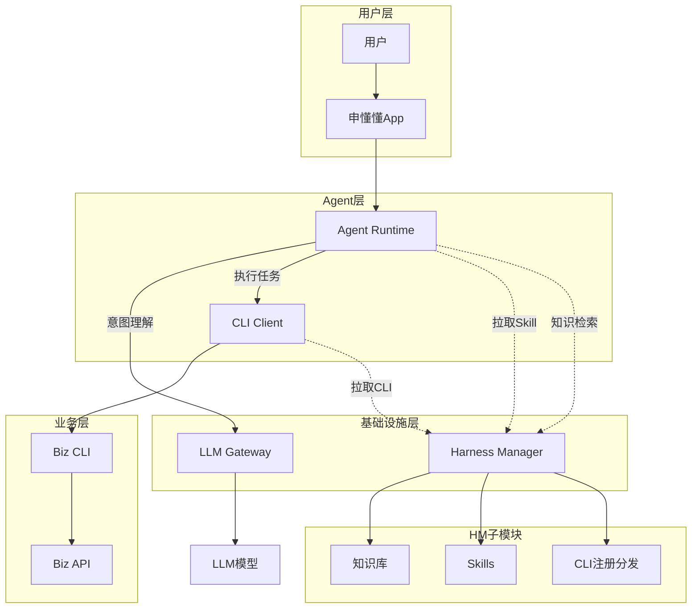
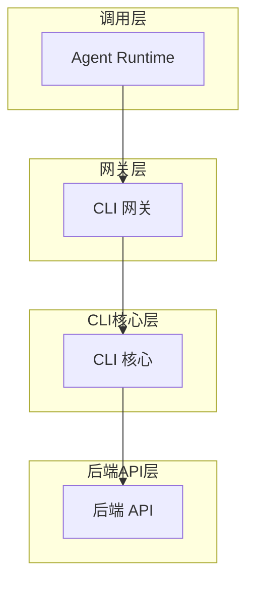
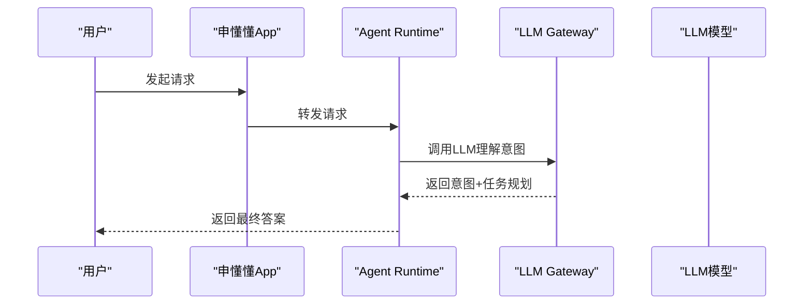
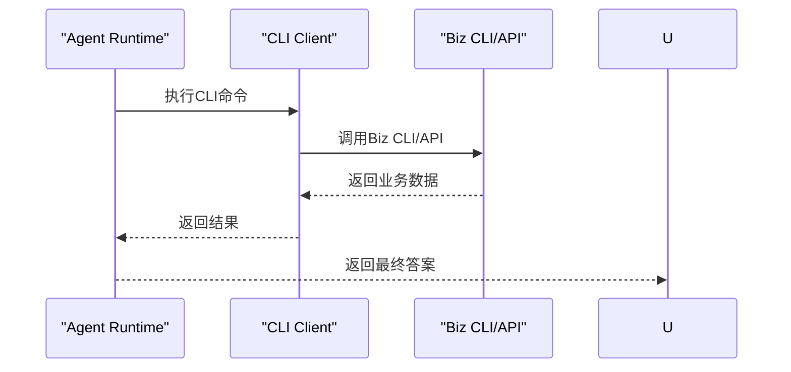
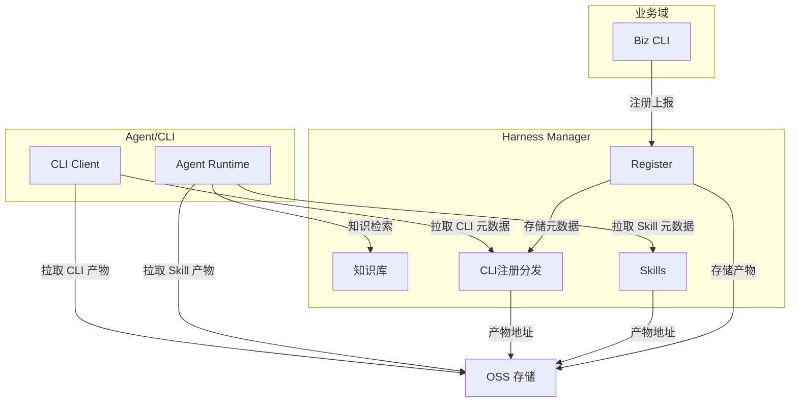
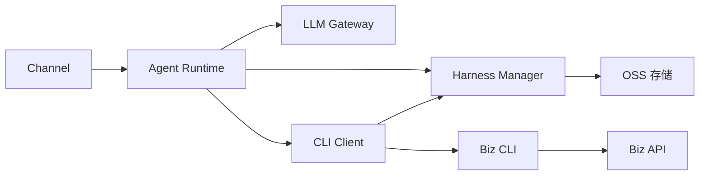

# 核心架构概览

<cite>
**本文引用的文件**
- [Sai整体架构设计.md](file://project/standup/Sai整体架构设计.md)
- [SAI_CLI_设计文档_v1.2.md](file://plan/SAI_CLI_设计文档_v1.2.md)
- [Agent-Runtime方案.md](file://plan/Agent-Runtime方案.md)
- [LLM-Gateway建设方案.md](file://plan/LLM-Gateway建设方案.md)
- [LLM-Gateway一期功能规划.md](file://plan/LLM-Gateway一期功能规划.md)
- [CLI 架构与规范对焦.md](file://plan/CLI 架构与规范对焦.md)
- [cross-module-design-review-2026-04-24.md](file://notes/zhaobomin/cross-module-design-review-2026-04-24.md)
- [SAI-daily-report-2026-04-22-final.md](file://project/SAI-daily-report-2026-04-22-final.md)
</cite>

## 目录
1. [引言](#引言)
2. [项目结构](#项目结构)
3. [核心组件](#核心组件)
4. [架构总览](#架构总览)
5. [详细组件分析](#详细组件分析)
6. [依赖关系分析](#依赖关系分析)
7. [性能考量](#性能考量)
8. [故障排查指南](#故障排查指南)
9. [结论](#结论)
10. [附录](#附录)

## 引言
本文件面向SAI智能体平台的开发者与架构师，提供系统架构的全局视角与设计决策依据。文档聚焦以下目标：
- 明确SAI的整体架构理念与分层职责：用户层、Agent层、基础设施层、业务层
- 通过架构图与序列图，系统化阐述两条核心链路：意图理解链路与业务执行链路
- 深入解析Harness Manager作为控制面服务的设计思路与数据流
- 为后续开发与集成提供可追溯的接口契约与依赖矩阵

## 项目结构
SAI项目采用“四层分层架构”与“控制面/数据面分离”的设计思想：
- 用户层：用户与前端应用（如申懂懂App）发起请求
- Agent层：Agent Runtime负责意图理解、任务规划与CLI调用
- 基础设施层：LLM Gateway提供统一的LLM代理与成本控制；Harness Manager作为控制面，负责Skills与CLI的注册、分发与检索
- 业务层：各业务域的CLI与API，零侵入对接

图表来源
- [Sai整体架构设计.md:19-65](file://project/standup/Sai整体架构设计.md#L19-L65)

章节来源
- [Sai整体架构设计.md:17-65](file://project/standup/Sai整体架构设计.md#L17-L65)

## 核心组件
- Agent Runtime：负责会话管理、意图理解、任务规划与CLI调用，支持Serverless冷启动与热启动，具备与CLI Client的本地调用能力
- LLM Gateway：统一代理与路由，提供OpenAI格式API、Token管理、额度告警与熔断、模型优先级调度
- Harness Manager：控制面服务，负责Skills与CLI的注册、元数据管理、产物分发（OSS）、知识检索
- Channel（前端接入）：负责用户交互与会话透传，支撑Agent Runtime的前端SDK集成
- Biz CLI/Biz API：各业务域的CLI与后端API，零侵入对接，统一通过CLI网关路由与鉴权

章节来源
- [Sai整体架构设计.md:142-151](file://project/standup/Sai整体架构设计.md#L142-L151)
- [Agent-Runtime方案.md:4-13](file://plan/Agent-Runtime方案.md#L4-L13)
- [LLM-Gateway建设方案.md:15-26](file://plan/LLM-Gateway建设方案.md#L15-L26)
- [SAI_CLI_设计文档_v1.2.md:323-382](file://plan/SAI_CLI_设计文档_v1.2.md#L323-L382)

## 架构总览
SAI采用“调用层-网关层-CLI核心层-后端API层”的四层架构，强调“调用链路解耦、每层只依赖下一层接口契约”。控制面Harness Manager通过元数据与产物分发，支撑Agent Runtime与CLI Client的动态装配与运行。

图表来源
- [SAI_CLI_设计文档_v1.2.md:19-53](file://plan/SAI_CLI_设计文档_v1.2.md#L19-L53)

章节来源
- [SAI_CLI_设计文档_v1.2.md:19-53](file://plan/SAI_CLI_设计文档_v1.2.md#L19-L53)

## 详细组件分析

### 意图理解链路（用户 → Agent → LLM Gateway → LLM）
该链路由用户通过前端应用发起请求，经Agent Runtime进行意图理解与任务规划，再由LLM Gateway统一调用底层LLM模型，返回结构化结果。

图表来源
- [Sai整体架构设计.md:115-138](file://project/standup/Sai整体架构设计.md#L115-L138)

章节来源
- [Sai整体架构设计.md:108-138](file://project/standup/Sai整体架构设计.md#L108-L138)

### 业务执行链路（Agent → CLI Client → Biz CLI → Biz API）
该链路由Agent Runtime根据任务规划调用CLI Client，CLI Client通过CLI网关路由到对应业务CLI，最终调用后端API并返回结果。

图表来源
- [Sai整体架构设计.md:115-138](file://project/standup/Sai整体架构设计.md#L115-L138)

章节来源
- [Sai整体架构设计.md:108-138](file://project/standup/Sai整体架构设计.md#L108-L138)

### Harness Manager 控制面数据流
Harness Manager作为控制面，承担Skills与CLI的注册、元数据管理与产物分发（OSS），并提供知识检索能力。Agent Runtime与CLI Client通过元数据与OSS产物实现动态装配。

图表来源
- [Sai整体架构设计.md:67-106](file://project/standup/Sai整体架构设计.md#L67-L106)

章节来源
- [Sai整体架构设计.md:67-106](file://project/standup/Sai整体架构设计.md#L67-L106)

### Agent Runtime 与 CLI Client 的职责与交互
- Agent Runtime：负责会话管理、意图理解、任务规划与CLI调用；支持Serverless冷启动与热启动；通过本地调用CLI Client执行命令
- CLI Client：负责与业务CLI的HTTP调用、鉴权与路由；与Harness Manager交互以拉取CLI定义与产物

章节来源
- [Agent-Runtime方案.md:4-13](file://plan/Agent-Runtime方案.md#L4-L13)
- [SAI_CLI_设计文档_v1.2.md:356-382](file://plan/SAI_CLI_设计文档_v1.2.md#L356-L382)

### LLM Gateway 的统一代理与成本控制
- 统一代理：向下支持多模型（含国内Qwen系列），向上统一OpenAI格式API
- 成本控制：额度池、阈值告警（80%/90%/100%）、熔断降级
- 安全与审计：密钥白名单、访问控制、日志拦截与隐私脱敏

章节来源
- [LLM-Gateway建设方案.md:27-65](file://plan/LLM-Gateway建设方案.md#L27-L65)
- [LLM-Gateway一期功能规划.md:3-11](file://plan/LLM-Gateway一期功能规划.md#L3-L11)

### CLI 网关与业务域CLI的对接
- CLI网关能力：元数据生成（AI自动生成Tag）、发布通知、路由转发、权限校验
- 业务域CLI规范：统一Golang开发、OSS挂载部署、鉴权机制（配置文件/参数注入）、更新发布流程

章节来源
- [CLI 架构与规范对焦.md:7-22](file://plan/CLI 架构与规范对焦.md#L7-L22)
- [SAI_CLI_设计文档_v1.2.md:323-354](file://plan/SAI_CLI_设计文档_v1.2.md#L323-L354)

## 依赖关系分析
模块间接口依赖矩阵（摘录）：
- Agent Runtime → LLM Gateway：HTTP/ OpenAI格式，Bearer Token
- Channel → Agent Runtime：会话接口（get_session/send_request），用户Token透传
- Agent Runtime → HM：Skill拉取（元数据+OSS产物），知识检索
- CLI Client → HM：CLI拉取（元数据+OSS产物）
- 业务域CLI → HM：CLI注册上报
- Agent Runtime → CLI Client：本地调用
- CLI Client → Biz CLI：HTTP
- Biz CLI → Biz API：HTTP/RPC

图表来源
- [Sai整体架构设计.md:154-170](file://project/standup/Sai整体架构设计.md#L154-L170)

章节来源
- [Sai整体架构设计.md:154-170](file://project/standup/Sai整体架构设计.md#L154-L170)

## 性能考量
- 冷启动与热启动：Agent Runtime冷启动<1秒、热启动<200ms，满足端到端低时延体验
- 网关吞吐：支持≥5个个人用户并发使用，模型路由与优先级调度保障高可用
- 分发与缓存：Skills与CLI通过OSS分发，Agent本地缓存以降低依赖HM的时延与故障影响
- 降级策略：LLM Gateway熔断不影响业务执行链路；HM不可用时Agent使用本地缓存继续运行

章节来源
- [Sai整体架构设计.md:224-245](file://project/standup/Sai整体架构设计.md#L224-L245)
- [Agent-Runtime方案.md:4-13](file://plan/Agent-Runtime方案.md#L4-L13)

## 故障排查指南
常见故障场景与降级策略：
- HM不可用：Agent使用本地缓存的Skill/CLI定义，知识检索降级
- LLM Gateway熔断：意图理解链路中断，Agent返回固定提示，业务执行链路不受影响
- Biz API超时/失败：CLI Client单次重试（≤3s），失败后向用户说明接口不可用
- OSS不可用：Agent使用本地缓存版本运行，日志告警通知HM团队
- Agent Runtime实例崩溃：Serverless平台自动重建，用户需重新发起会话

章节来源
- [Sai整体架构设计.md:236-245](file://project/standup/Sai整体架构设计.md#L236-L245)

## 结论
SAI通过“四层架构+控制面分发”的设计，实现了用户层、Agent层、基础设施层与业务层的清晰解耦与高效协同。Harness Manager作为控制面，以元数据与OSS产物为核心，支撑Skills与CLI的动态装配与运行。两条核心链路（意图理解与业务执行）在协议统一、鉴权一致与可观测性的基础上，提供了可扩展、可降级、可灰度的系统能力。建议在后续开发中：
- 明确并固化接口契约与依赖矩阵
- 加快Harness Manager与Agent Runtime的对接与联调
- 持续优化冷启动与热启动性能，完善前端SDK与会话协议
- 强化安全与审计能力，完善逃生与熔断策略

## 附录
- 项目进展与风险跟踪：SAI项目在4/20-4/22期间完成多项关键方案与基建落地，后续将聚焦接口契约落地与1期交付节奏
- 跨模块设计对焦：对齐Tag生成方式、冷启动方案与Harness Manager在Agent Runtime中的依赖关系

章节来源
- [SAI-daily-report-2026-04-22-final.md:1-77](file://project/SAI-daily-report-2026-04-22-final.md#L1-L77)
- [cross-module-design-review-2026-04-24.md:138-170](file://notes/zhaobomin/cross-module-design-review-2026-04-24.md#L138-L170)