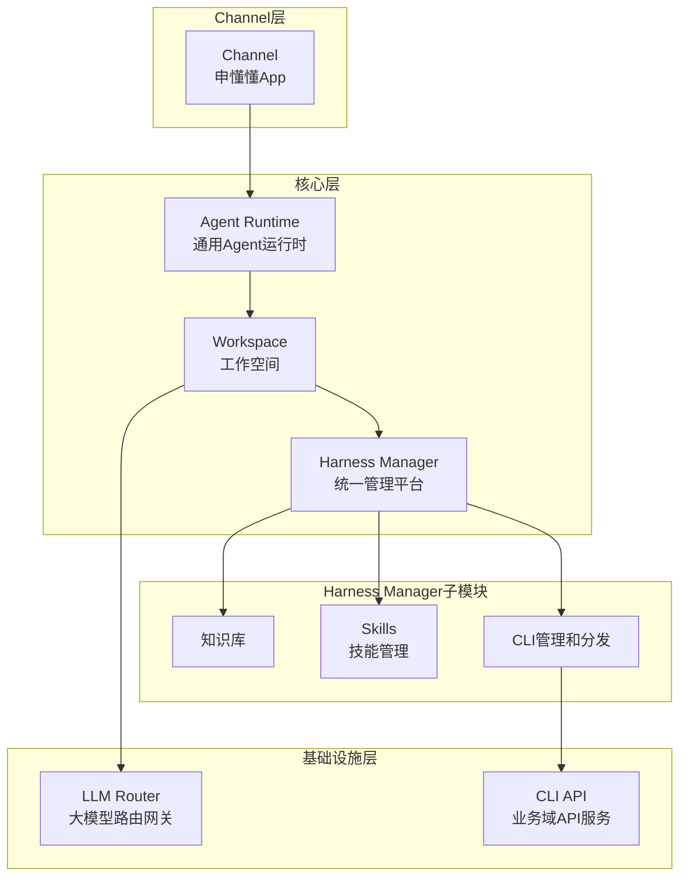
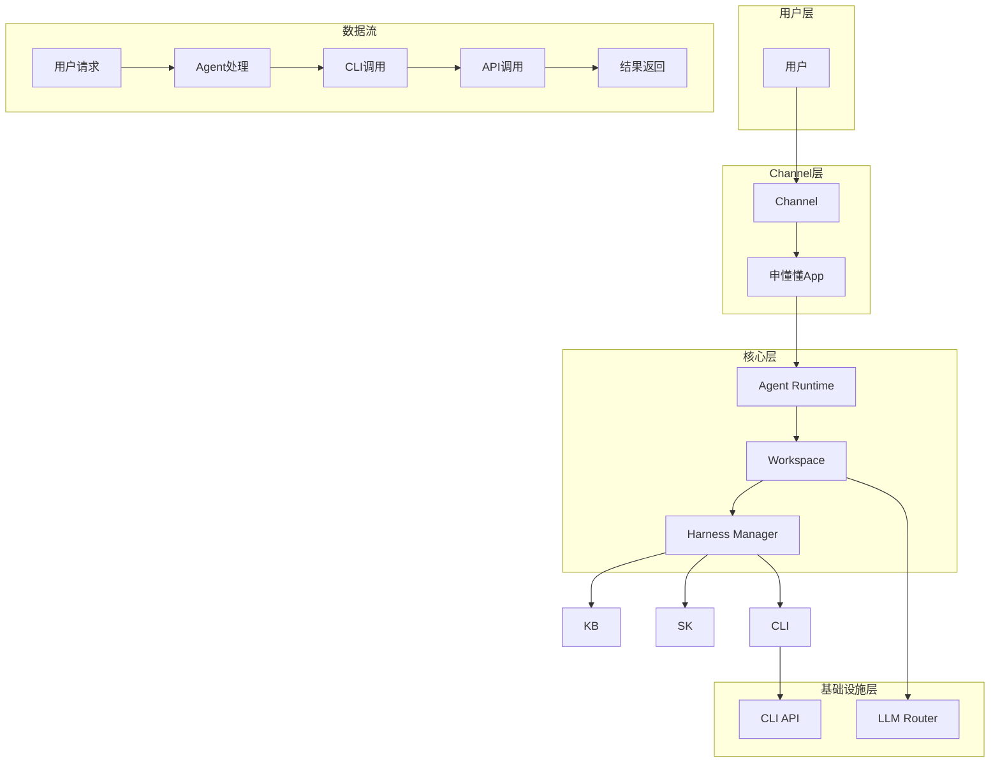
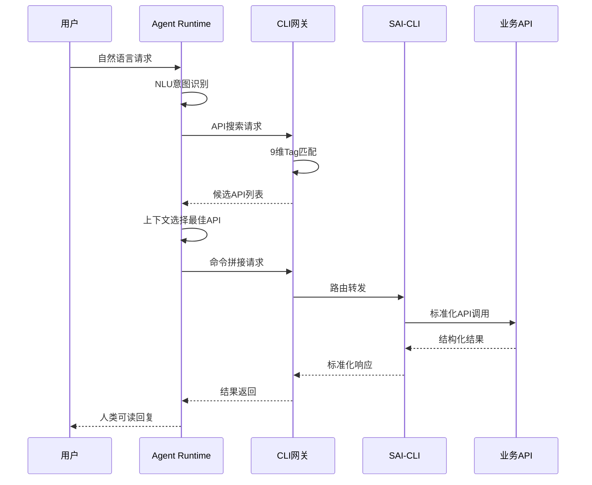
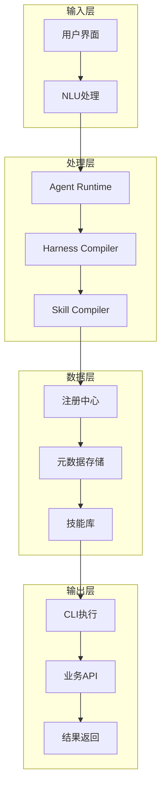

# SAI智能体平台模块职责分工

<cite>
**本文档引用的文件**
- [Agent-Runtime方案.md](file://plan/Agent-Runtime方案.md)
- [LLM-Gateway建设方案.md](file://plan/LLM-Gateway建设方案.md)
- [LLM-Gateway一期功能规划.md](file://plan/LLM-Gateway一期功能规划.md)
- [CLI架构与规范对焦.md](file://plan/CLI 架构与规范对焦.md)
- [SAI_CLI_设计文档_v1.0.md](file://plan/SAI_CLI_设计文档_v1.0.md)
- [SAI_CLI_设计文档_v1.2.md](file://plan/SAI_CLI_设计文档_v1.2.md)
- [Agent-Runtime方案review.md](file://notes/zhaobomin/Agent-Runtime方案review.md)
- [LLM-Gateway方案review.md](file://notes/zhaobomin/LLM-Gateway方案review.md)
- [SAI项目日报-2026-04-22-final.md](file://project/SAI-daily-report-2026-04-22-final.md)
- [4.20早会记录.md](file://project/standup/2026-04-20-zhaobomin.md)
- [项目管理方案v1.0.md](file://project/项目管理方案v1.0.md)
</cite>

## 目录
1. [项目概述](#项目概述)
2. [模块架构总览](#模块架构总览)
3. [核心模块职责详解](#核心模块职责详解)
4. [模块协作关系](#模块协作关系)
5. [接口依赖关系](#接口依赖关系)
6. [数据流转机制](#数据流转机制)
7. [验收标准与里程碑](#验收标准与里程碑)
8. [风险管理](#风险管理)
9. [团队协作指南](#团队协作指南)
10. [总结](#总结)

## 项目概述

SAI智能体平台是一个面向企业级的AI智能体解决方案，旨在通过统一的架构设计实现多业务域的智能化服务。该项目采用分层架构，包含Channel层、核心层和基础设施层三大层次，通过Agent Runtime、LLM Gateway、Harness Manager、Channel和Biz CLI五大核心模块协同工作。

项目采用Git驱动的管理模式，建立了6个专门的代码仓库，实现了代码提交、文档同步和日报制度的标准化流程。

## 模块架构总览



**图表来源**
- [4.20早会记录.md:5-40](file://project/standup/2026-04-20-zhaobomin.md#L5-L40)

**章节来源**
- [4.20早会记录.md:1-84](file://project/standup/2026-04-20-zhaobomin.md#L1-L84)
- [项目管理方案v1.0.md:21-49](file://project/项目管理方案v1.0.md#L21-L49)

## 核心模块职责详解

### Agent Runtime（Agent运行时）

#### 核心职责
- **用户隔离与实例管理**：基于AgentRun（serverless）实现，按session_id动态分配Agent实例，确保一实例一session
- **技能隔离**：通过Docker文件系统挂载实现，支持OSS挂载和Linux管道命令
- **通用Agent构建**：基于Claude Agent SDK构建，支持用户日志记录
- **前端SDK支持**：提供通用页面SDK，支持PC和移动端项目

#### 技术特性
- **热启动性能**：冷启动<1秒，热启动100ms级
- **隔离机制**：用户执行环境隔离，基于session_id分配实例
- **兼容性设计**：考虑ACP协议支持，向前兼容

#### 负责人与团队
- **负责人**：奕杭
- **团队规模**：核心开发团队
- **技术栈**：Claude Agent SDK + Docker容器化

**章节来源**
- [Agent-Runtime方案.md:1-60](file://plan/Agent-Runtime方案.md#L1-L60)
- [Agent-Runtime方案review.md:9-15](file://notes/zhaobomin/Agent-Runtime方案review.md#L9-L15)

### LLM Gateway（大模型网关）

#### 核心职责
- **统一API标准**：向下支持接入千问、OpenAI、Claude等主流大模型，向上统一暴露OpenAI格式API
- **成本控制与预算管理**：实现额度预警熔断机制，支持80%/90%/100%三级告警
- **安全与审计**：提供Key访问白名单、请求日志拦截、隐私数据脱敏
- **流量降级**：基于环境与等级的智能路由，实现测试/生产环境的差异化模型选择

#### 技术架构
- **LiteLLM为核心**：基于开源项目LiteLLM搭建企业级大模型网关
- **DevOps集成**：与DevOps平台对接，实现资源申请自动化
- **多模型支持**：覆盖国内几乎所有模型，验证可接入Qwen系列

#### 负责人与团队
- **负责人**：老徐（徐春辉）
- **团队规模**：LLM Router + Workspace团队
- **技术栈**：Python + React + RDS + Redis

**章节来源**
- [LLM-Gateway建设方案.md:15-109](file://plan/LLM-Gateway建设方案.md#L15-L109)
- [LLM-Gateway方案review.md:9-16](file://notes/zhaobomin/LLM-Gateway方案review.md#L9-L16)

### Harness Manager（统一管理平台）

#### 核心职责
- **知识库管理**：统一管理各业务域的知识资源
- **Skills管理**：提供技能的统一注册、编译和分发
- **CLI管理与分发**：作为SAI-CLI的唯一构建和维护方，统一打包各域命令集

#### 技术特性
- **统一CLI构建**：将三个业务域API封装为单一CLI二进制文件
- **9维Tag体系**：提供D1-D9维度的深度标签，支持语义理解、参数构造、消歧防误判
- **SkillCompiler**：将注册元数据编译为Agent可读的Tool定义

#### 负责人与团队
- **负责人**：隋云
- **团队规模**：Harness Manager核心团队
- **技术栈**：Golang + AI元数据生成

**章节来源**
- [SAI_CLI_设计文档_v1.2.md:545-591](file://plan/SAI_CLI_设计文档_v1.2.md#L545-L591)

### Channel（通道层）

#### 核心职责
- **用户界面集成**：主要负责申懂懂App的AI智能体集成
- **输入输出层设计**：提供统一的输入框调研与交互规则定义
- **产品框架调研**：完成通义千问、豆包、Kimi等竞品深度调研

#### 负责人与团队
- **负责人**：弘宇
- **团队规模**：Channel团队
- **技术栈**：前端技术栈

**章节来源**
- [SAI项目日报-2026-04-22-final.md:28-36](file://project/SAI-daily-report-2026-04-22-final.md#L28-L36)

### Biz CLI（业务CLI）

#### 核心职责
- **API描述提供**：为Harness Manager提供API的原始描述
- **无需发现机制**：由Harness Manager的CLI管理和分发模块负责发现机制
- **统一开发语言**：采用Golang开发，确保跨平台兼容性

#### 技术特性
- **零改造原则**：业务域只需提供后端API，无需改造前端GUI
- **统一规范**：遵循SAI CLI统一命令规范和协议
- **安全机制**：支持PoP Token + ECDSA签名的安全方案

#### 负责人与团队
- **负责人**：凌雪
- **团队规模**：CLI API团队
- **技术栈**：Golang + AI元数据生成

**章节来源**
- [CLI架构与规范对焦.md:14-21](file://plan/CLI 架构与规范对焦.md#L14-L21)
- [SAI_CLI_设计文档_v1.2.md:80-92](file://plan/SAI_CLI_设计文档_v1.2.md#L80-L92)

## 模块协作关系

### 依赖关系图



**图表来源**
- [4.20早会记录.md:5-40](file://project/standup/2026-04-20-zhaobomin.md#L5-L40)

### 协作流程

1. **用户交互流程**：用户通过申懂懂App与Agent进行交互
2. **Agent处理流程**：Agent Runtime接收用户请求，进行意图识别和命令生成
3. **CLI调用流程**：Harness Manager统一管理CLI，提供标准化的命令调用
4. **API调用流程**：业务域API提供后端服务，实现具体业务功能
5. **结果返回流程**：通过LLM Gateway进行统一的API标准和安全控制

**章节来源**
- [SAI_CLI_设计文档_v1.2.md:29-75](file://plan/SAI_CLI_设计文档_v1.2.md#L29-L75)

## 接口依赖关系

### 核心接口定义



**图表来源**
- [SAI_CLI_设计文档_v1.2.md:250-288](file://plan/SAI_CLI_设计文档_v1.2.md#L250-L288)

### 接口规范

#### Agent与CLI网关接口
- **API搜索接口**：`POST /api/v1/sai/cli/search`
- **元数据生成接口**：`POST /api/v1/sai/cli/metadata/generate`
- **发布通知接口**：`POST /api/v1/sai/cli/publish`

#### Harness Manager内部接口
- **Register模块**：API注册管理接口
- **CLI Meta模块**：元数据引擎接口
- **SkillCompiler模块**：技能编译接口

**章节来源**
- [SAI_CLI_设计文档_v1.2.md:605-632](file://plan/SAI_CLI_设计文档_v1.2.md#L605-L632)

## 数据流转机制

### 数据流架构



**图表来源**
- [SAI_CLI_设计文档_v1.2.md:225-249](file://plan/SAI_CLI_设计文档_v1.2.md#L225-L249)

### 数据流转特点

1. **标准化协议**：所有HTTP调用及CLI入参/出参统一使用JSON格式
2. **分层解耦**：调用链路为Agent → 网关 → SAI-CLI → API，层层解耦
3. **结构化输出**：错误输出同样遵循JSON约定，包含type、code、message、hint字段
4. **安全控制**：通过PoP Token + ECDSA签名实现环境绑定的安全控制

**章节来源**
- [SAI_CLI_设计文档_v1.2.md:149-175](file://plan/SAI_CLI_设计文档_v1.2.md#L149-L175)

## 验收标准与里程碑

### 一期交付内容

#### LLM Gateway 430目标
| 功能模块 | 交付内容 | 验收标准 | 时间节点 |
|---------|---------|---------|---------|
| 个人令牌申请 | 自动化申请流程 | 完成审批流，支持1个月额度分配 | 4月20-24 |
| 令牌管理 | 个人/管理员视角 | 支持启用/禁用、扩容、用量详情 | 4月20-24 |
| 监控告警 | 告警规则配置 | 80%/90%/100%三级告警 | 4月20-24 |
| LiteLLM网关配置 | 全局告警配置 | 网关不可用告警推送 | 4月20-24 |
| 测试验证 | 功能测试 | 通过所有核心功能测试 | 4月25-27 |

#### CLI模块
| 任务 | 交付内容 | 验收标准 | 时间节点 |
|------|---------|---------|---------|
| 运营第一个CLI demo | SAI CLI设计文档v1.0 | 160+ CLI需求项梳理 | 4月21 |
| 通用Agent代码review | CLI登录态一致 | Agent前端网关框架完成 | 4月21 |
| 一期交付CLI和tag | 20+ CLI开发完成 | 跑通完整调用链路 | 4月29 |

### 二期规划
- **DevOps融合**：4月30-5月15完成
- **全量推广**：5月15-5月30开始全域推广

**章节来源**
- [LLM-Gateway一期功能规划.md:1-23](file://plan/LLM-Gateway一期功能规划.md#L1-L23)
- [SAI项目日报-2026-04-22-final.md:29-42](file://project/SAI-daily-report-2026-04-22-final.md#L29-L42)

## 风险管理

### 主要风险识别

```mermaid
mindmap
root((项目风险))
技术风险
LLM网关4/30上线
时间紧张
前后文矛盾
逃生方案不明确
CLI职责边界
方案落地延迟
详细设计阻碍
运营风险
4/30上线压力
人员协调
质量控制
安全风险
数据脱敏缺口
Prompt注入风险
审计日志缺失
```

### 风险应对措施

| 风险类型 | 风险描述 | 应对措施 | 责任人 |
|---------|---------|---------|--------|
| 技术风险 | LLM网关4/30上线时间紧张 | 聚焦最小可用功能，确保准时上线 | 徐春辉 |
| 运营风险 | CLI职责边界方案落地延迟 | 尽快落实详细方案设计 | 隋云/凌雪/头鸽 |
| 安全风险 | 数据脱敏方案有缺口 | 高敏场景脱敏改为默认开启 | 全体团队 |
| 质量风险 | 前后文矛盾问题 | 全文统一技术方案，明确LiteLLM使用 | 技术委员会 |

**章节来源**
- [LLM-Gateway方案review.md:21-52](file://notes/zhaobomin/LLM-Gateway方案review.md#L21-L52)
- [SAI项目日报-2026-04-22-final.md:67-77](file://project/SAI-daily-report-2026-04-22-final.md#L67-L77)

## 团队协作指南

### Git管理规范

#### 仓库划分
- **channel**：Channel团队（弘宇）
- **agent-runtime**：Agent Runtime团队（奕杭）
- **harness-manager**：Harness Manager团队（隋云）
- **llm-router**：LLM Router + Workspace团队（老徐）
- **cli-api**：CLI API团队（凌雪）
- **docs**：公共文档库

#### 提交规范
1. **提交信息格式**：`[类型] 简要说明`
   - `feat`：新功能
   - `fix`：修复
   - `docs`：文档
   - `refactor`：重构
   - `test`：测试

2. **文档同步要求**：任何影响API接口、模块交互方式或新增功能使用的代码变更，必须在同一天内同步到docs仓库

3. **每日提交**：每位成员每个工作日至少有一次Git提交

### 日报制度
- **提交时间**：每天下班前提交
- **格式要求**：记录当天做了什么，可用AI辅助生成
- **查看方式**：通过Git查看项目进展

**章节来源**
- [项目管理方案v1.0.md:21-87](file://project/项目管理方案v1.0.md#L21-L87)
- [项目管理方案v1.0.md:137-147](file://project/项目管理方案v1.0.md#L137-L147)

## 总结

SAI智能体平台通过清晰的模块职责分工和协作机制，构建了一个面向企业级的AI智能体解决方案。五大核心模块各司其职，既保持独立性又实现深度协作：

1. **Agent Runtime**专注于用户隔离和通用Agent构建
2. **LLM Gateway**提供统一的大模型访问和成本控制
3. **Harness Manager**实现CLI的统一管理和技能编译
4. **Channel**负责用户界面集成和产品框架
5. **Biz CLI**提供标准化的业务API服务

通过Git驱动的管理模式和标准化的接口规范，项目实现了高效的团队协作和透明的进度管理。一期交付计划明确了各模块的关键里程碑，为项目的成功实施奠定了坚实基础。