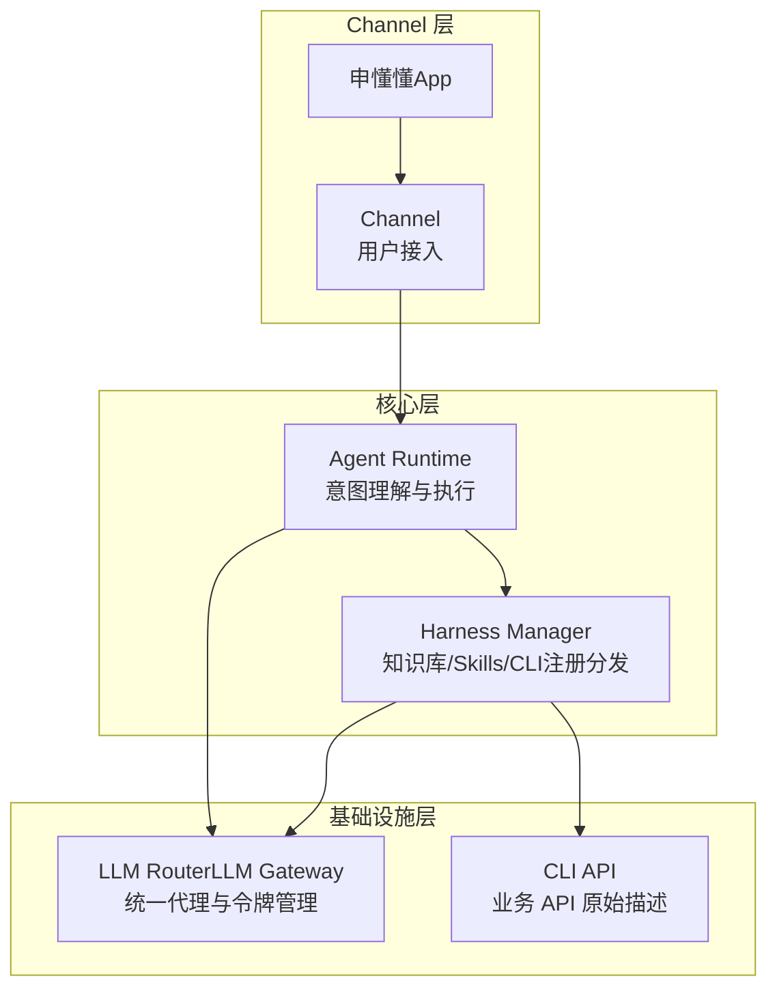
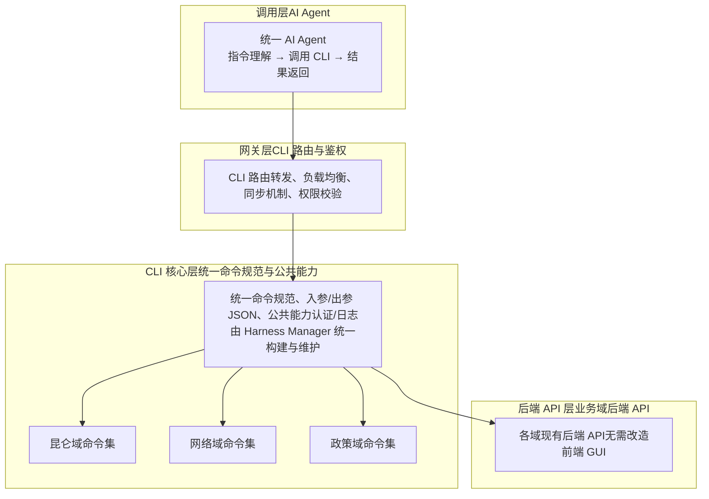
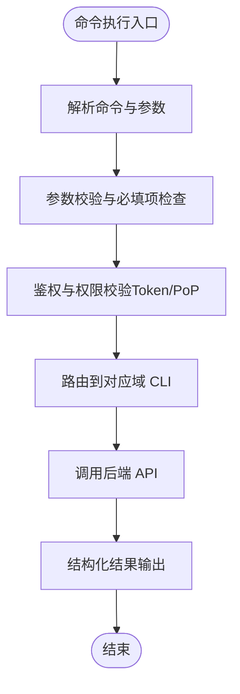
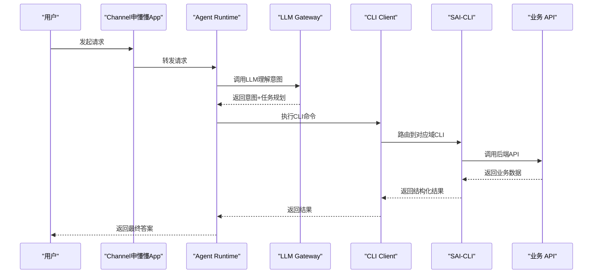
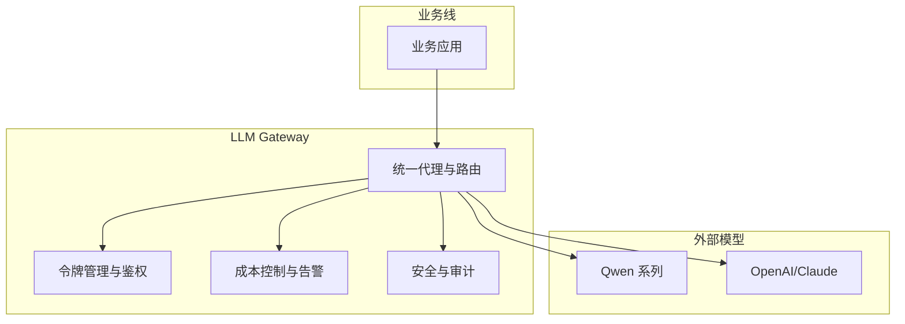
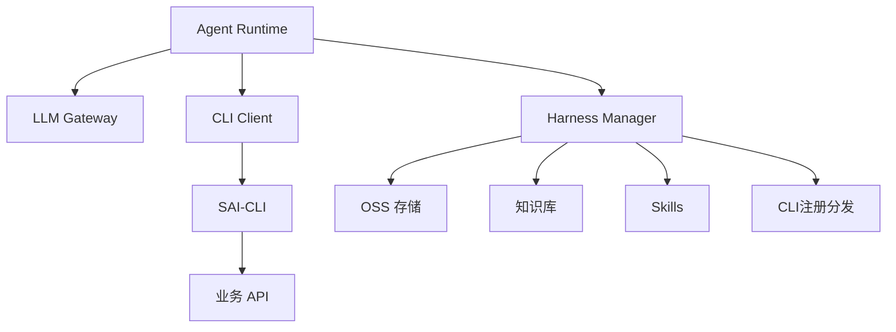

# 项目概述

<cite>
**本文引用的文件**
- [SAI CLI 架构设计文档 v1.0](file://plan/SAI_CLI_设计文档_v1.0.md)
- [SAI CLI 架构设计文档 v1.2](file://plan/SAI_CLI_设计文档_v1.2.md)
- [Sai整体架构设计](file://project/standup/Sai整体架构设计.md)
- [项目管理方案v1.0](file://project/项目管理方案v1.0.md)
- [SAI 项目日报 | 项目待办和风险跟踪](file://project/SAI-daily-report-2026-04-22-final.md)
- [LLM-Gateway建设方案](file://plan/LLM-Gateway建设方案.md)
- [Agent-Runtime方案](file://plan/Agent-Runtime方案.md)
- [CLI 架构与规范对焦](file://plan/CLI 架构与规范对焦.md)
- [README](file://README.md)
</cite>

## 目录
1. [简介](#简介)
2. [项目结构](#项目结构)
3. [核心组件](#核心组件)
4. [架构总览](#架构总览)
5. [详细组件分析](#详细组件分析)
6. [依赖关系分析](#依赖关系分析)
7. [性能考量](#性能考量)
8. [故障排查指南](#故障排查指南)
9. [结论](#结论)
10. [附录](#附录)

## 简介
SAI（申通 AI 智能体平台）旨在通过 CLI 封装企业内部业务能力，使 Agent 能够以标准化方式调用各业务系统，实现业务智能化与自动化。项目以“极致专注、精益求精”的精神打磨技术，追求在复杂业务场景中的最优决策与长期价值沉淀。

- 业务目标：将运营域、网络域、政策域等业务能力以 CLI 形式统一接入，Agent 通过意图理解与命令编排完成端到端业务闭环。
- 技术愿景：构建“意图理解链路 + 业务执行链路”的双链路架构，以分层解耦、协议统一、可测试性与安全鉴权为核心设计原则，支撑大规模业务场景的稳定扩展。
- 关键价值：降低 Agent 与业务系统的耦合度，提升跨域协作效率，保障安全与可观测性，同时为未来多域扩展与能力沉淀奠定基础。

章节来源
- [Sai整体架构设计.md:9-13](file://project/standup/Sai整体架构设计.md#L9-L13)

## 项目结构
SAI 项目采用三层架构与五个团队代码库协同，配合公共文档库，形成“Channel 层 → 核心层 → 基础设施层”的清晰分层与职责边界：

- Channel 层：负责用户接入与前端交互（如申懂懂 App），承载用户输入与 Agent 结果展示。
- 核心层：包含 Agent Runtime、Harness Manager，负责意图理解、技能与 CLI 的注册分发、以及 Agent 的执行与隔离。
- 基础设施层：包含 LLM Router（LLM Gateway）、CLI API，提供统一的 LLM 路由与令牌管理、以及业务 API 的原始描述与 CLI 能力封装。



图表来源
- [README.md:11-41](file://README.md#L11-L41)
- [项目管理方案v1.0.md:23-49](file://project/项目管理方案v1.0.md#L23-L49)

章节来源
- [README.md:9-41](file://README.md#L9-L41)
- [项目管理方案v1.0.md:13-49](file://project/项目管理方案v1.0.md#L13-L49)

## 核心组件
SAI 的核心组件围绕“意图理解链路”和“业务执行链路”展开，辅以 Harness Manager 的控制面能力与 LLM Gateway 的基础设施支撑。

- 意图理解链路
  - 用户通过 Channel（如申懂懂 App）发起请求，Agent Runtime 调用 LLM Gateway 的统一 OpenAI 格式接口，完成意图理解与任务规划。
- 业务执行链路
  - Agent Runtime 通过 CLI Client 调用 SAI-CLI，SAI-CLI 将命令路由到对应业务域 CLI，最终调用后端 API 获取业务数据并返回结果。
- 控制面（Harness Manager）
  - 提供知识库、Skills 管理、CLI 注册与分发能力，支撑 Agent 拉取技能与 CLI 定义，实现资源的集中管理与分发。
- 基础设施（LLM Gateway）
  - 统一代理与路由、令牌管理、成本控制与告警、安全与审计，支撑多模型接入与预算治理。

章节来源
- [Sai整体架构设计.md:108-138](file://project/standup/Sai整体架构设计.md#L108-L138)
- [Sai整体架构设计.md:142-151](file://project/standup/Sai整体架构设计.md#L142-L151)
- [LLM-Gateway建设方案.md:15-26](file://plan/LLM-Gateway建设方案.md#L15-L26)

## 架构总览
SAI 采用四层分层架构，实现 Agent 与各业务域后端服务的标准化接入，确保调用链路清晰、职责边界明确、可独立演进与部署。



图表来源
- [SAI CLI 架构设计文档 v1.2:29-64](file://plan/SAI_CLI_设计文档_v1.2.md#L29-L64)

章节来源
- [SAI CLI 架构设计文档 v1.2:29-75](file://plan/SAI_CLI_设计文档_v1.2.md#L29-L75)

## 详细组件分析

### CLI 设计原则与规范
SAI-CLI 的设计强调“GUI 零改造、架构解耦、协议统一、统一命令规范、可被 Agent 调用、结构化错误输出、开发语言统一、Tag 自动化生成、安全与鉴权、可测试性与 Dry-Run”。这些原则共同确保 CLI 的可维护性、可测试性与安全性。

- 命令规范
  - 统一命令格式为 {product} {module} {action} [params]，支持 get/list/create/update/delete 等动作。
  - 各域命令示例涵盖时效查询、订单查询、规则查询等典型场景。
- Tag 体系（v1.2）
  - 采用 9 维 Tag（D1-D9）：路由与分类组（D1/D2/D4）、NLU 理解组（D5/D7/D8）、执行与展示组（D3/D6/D9），提升语义理解与参数构造的准确性。
- 安全与鉴权
  - 采用 PoP Token（一期 Bearer Token，二期引入 PoP 签名 + ECDSA），支持多种 Token 获取方式与配置文件持久化。
- 可测试性与 Dry-Run
  - 写操作命令支持 --dry-run，返回将要执行的操作描述，便于 Agent 与人工在执行前确认影响范围。



图表来源
- [SAI CLI 架构设计文档 v1.2:115-147](file://plan/SAI_CLI_设计文档_v1.2.md#L115-L147)
- [SAI CLI 架构设计文档 v1.2:394-471](file://plan/SAI CLI 架构设计文档_v1.2.md#L394-L471)

章节来源
- [SAI CLI 架构设计文档 v1.2:115-147](file://plan/SAI_CLI_设计文档_v1.2.md#L115-L147)
- [SAI CLI 架构设计文档 v1.2:151-289](file://plan/SAI_CLI_设计文档_v1.2.md#L151-L289)
- [SAI CLI 架构设计文档 v1.2:394-471](file://plan/SAI_CLI_设计文档_v1.2.md#L394-L471)

### Agent Runtime 与 CLI Client
- 用户隔离与热启动
  - 基于 Serverless 的 Agent 实例按会话分配，实现用户执行环境隔离；冷启动 <1s，热启动 <200ms，满足通用 Agent 调用性能要求。
- Skill 与 CLI 分发
  - 通过 OSS 挂载实现 Skill 与 CLI 的分发；若云侧挂载受限，提供 Agent 层文件权限实现的备选方案。
- 与 CLI 的对接
  - Agent 通过 CLI Client 调用 SAI-CLI，SAI-CLI 再路由到业务域 CLI，最终调用后端 API 获取数据。



图表来源
- [Sai整体架构设计.md:115-138](file://project/standup/Sai整体架构设计.md#L115-L138)
- [Agent-Runtime方案.md:4-13](file://plan/Agent-Runtime方案.md#L4-L13)

章节来源
- [Agent-Runtime方案.md:4-13](file://plan/Agent-Runtime方案.md#L4-L13)
- [Sai整体架构设计.md:115-138](file://project/standup/Sai整体架构设计.md#L115-L138)

### Harness Manager（控制面）
- 职责边界
  - 作为 SAI-CLI 的唯一构建与维护方，负责将各业务域 API 统一封装为单一 CLI 二进制文件；不参与业务执行链路，只做资源分发与管理。
- 核心模块
  - Register（API 注册管理）、CLI Meta（元数据引擎）、SkillCompiler（将注册元数据编译为 Agent 可读 Tool 定义）、CLI Router（路由与鉴权）、CLI Invoke（可选调用代理）。
- 发布与分发
  - 业务域提供 API 接口与描述文档，Harness Manager 更新 CLI 代码并打包为统一二进制，上传至 OSS，调用网关“发布通知”接口同步命令清单。

```mermaid
flowchart TB
subgraph "业务域"
BIZ["提供API接口与描述文档"]
end
subgraph "Harness Manager"
REG["Register注册管理"]
META["CLI Meta元数据引擎"]
SC["SkillCompiler技能编译"]
ROUTER["CLI Router路由与鉴权"]
INVOKE["CLI Invoke可选调用代理"]
end
subgraph "OSS"
OSS["统一产物存储"]
end
BIZ --> REG
REG --> META
REG --> SC
SC --> OSS
ROUTER --> OSS
INVOKE --> OSS
```

图表来源
- [Sai整体架构设计.md:173-194](file://project/standup/Sai整体架构设计.md#L173-L194)
- [SAI CLI 架构设计文档 v1.2:545-591](file://plan/SAI_CLI_设计文档_v1.2.md#L545-L591)

章节来源
- [Sai整体架构设计.md:173-194](file://project/standup/Sai整体架构设计.md#L173-L194)
- [SAI CLI 架构设计文档 v1.2:545-591](file://plan/SAI_CLI_设计文档_v1.2.md#L545-L591)

### LLM Gateway（基础设施）
- 统一代理与路由
  - 统一 OpenAI 格式 API，向下接入多家模型，向上提供统一标准 SDK，实现零成本切换与无缝对接。
- 成本控制与预算治理
  - 支持按环境与应用等级的路由策略、额度预警与熔断机制，结合 DevOps 平台实现审批即用与超额即断。
- 安全与审计
  - 网关统一托管密钥、虚拟 Token 生成与轮转、访问白名单、请求日志拦截与隐私数据脱敏，保障安全与合规。



图表来源
- [LLM-Gateway建设方案.md:15-26](file://plan/LLM-Gateway建设方案.md#L15-L26)
- [LLM-Gateway建设方案.md:27-76](file://plan/LLM-Gateway建设方案.md#L27-L76)

章节来源
- [LLM-Gateway建设方案.md:15-76](file://plan/LLM-Gateway建设方案.md#L15-L76)

## 依赖关系分析
SAI 的模块间接口依赖矩阵体现了“意图理解链路”和“业务执行链路”的关键交互，以及控制面与基础设施的支撑关系。

- 意图理解链路
  - Agent Runtime → LLM Gateway：统一 OpenAI 格式调用，实现意图理解与任务规划。
- 业务执行链路
  - Agent Runtime → CLI Client：本地调用执行 CLI 命令。
  - CLI Client → Biz CLI：HTTP 路由到对应域 CLI。
  - Biz CLI → Biz API：HTTP/RPC 调用业务 API。
- 控制面支撑
  - Agent Runtime → HM：拉取 Skill 元数据与产物（OSS）。
  - CLI Client → HM：拉取 CLI 元数据与产物（OSS）。
  - 业务方 → HM：CLI 注册上报（HTTP）。



图表来源
- [Sai整体架构设计.md:154-171](file://project/standup/Sai整体架构设计.md#L154-L171)
- [Sai整体架构设计.md:197-222](file://project/standup/Sai整体架构设计.md#L197-L222)

章节来源
- [Sai整体架构设计.md:154-171](file://project/standup/Sai整体架构设计.md#L154-L171)
- [Sai整体架构设计.md:197-222](file://project/standup/Sai整体架构设计.md#L197-L222)

## 性能考量
- 启动性能
  - Agent Runtime 冷启动 <1s，热启动 <200ms，满足通用 Agent 调用场景的低延迟要求。
- 路由与负载均衡
  - 网关层负责路由转发与负载均衡，结合业务域 CLI 的统一二进制打包，减少跨域调用延迟。
- 可观测性与降级
  - 网关层具备告警与熔断能力，控制面支持本地缓存与降级策略，确保在基础设施异常时仍可维持核心链路稳定。

章节来源
- [Agent-Runtime方案.md:4-13](file://plan/Agent-Runtime方案.md#L4-L13)
- [LLM-Gateway建设方案.md:43-54](file://plan/LLM-Gateway建设方案.md#L43-L54)
- [Sai整体架构设计.md:236-246](file://project/standup/Sai整体架构设计.md#L236-L246)

## 故障排查指南
- 网关层故障
  - LLM Gateway 熔断：意图理解链路中断，Agent 返回固定提示；业务执行链路不受影响。
- 控制面故障
  - Harness Manager 不可用：Agent 使用本地缓存的 Skill/CLI 定义，降级为无知识检索模式。
- 存储层故障
  - OSS 不可用：Agent 使用本地缓存版本运行，日志告警通知控制面团队。
- 业务域故障
  - Biz API 超时/失败：CLI Client 单次重试（≤3s 等待），失败后向用户说明具体接口不可用。
- Agent 实例故障
  - Agent Runtime 实例崩溃：Serverless 平台自动重建实例，用户会话需重新发起。

章节来源
- [Sai整体架构设计.md:236-246](file://project/standup/Sai整体架构设计.md#L236-L246)

## 结论
SAI 通过“意图理解链路 + 业务执行链路”的双链路架构，结合 CLI 统一规范、9 维 Tag 元数据、PoP 鉴权与 LLM Gateway 的统一代理与成本治理，实现了企业内部业务能力的标准化封装与 Agent 的可编程化调用。项目以分层解耦、协议统一、可测试性与安全为设计基石，既满足初学者对概念的理解，也为资深开发者提供了可落地的技术深度与实践路径。

## 附录

### 项目发展历程与里程碑
- 2026-04-20：项目仓库初始化，职责边界敲定（业务域专注 API，Harness Manager 统一 CLI 构建）。
- 2026-04-21：完成 CLI 设计文档 v1.0，梳理 160+ CLI 需求项；LLM Gateway LiteLLM 方案确定；Agent Runtime 与 CLI API 基础框架搭建。
- 2026-04-22：完成 CLI 设计文档 v1.2，明确 9 维 Tag 与 PoP 鉴权方案；Harness Manager 职责与部署方式确定；LLM Gateway 基础设施部署完成。
- 2026-04-23：项目日报制度与 Git 流程规范化，确保文档与代码同步。

章节来源
- [SAI 项目日报 | 项目待办和风险跟踪.md:21-44](file://project/SAI-daily-report-2026-04-22-final.md#L21-L44)
- [CLI 架构与规范对焦.md:1-25](file://plan/CLI 架构与规范对焦.md#L1-L25)
- [LLM-Gateway建设方案.md:95-101](file://plan/LLM-Gateway建设方案.md#L95-L101)

### 未来发展规划
- 一期目标：完成 20+ 高频使用场景的 CLI 开发与部署，跑通 SAI Agent 完整调用链路。
- 二期目标：完善 Skill 分发与 CLI 注册接口定义，扩展业务域覆盖，强化安全与可观测性。
- 长期目标：实现全链路监控与审计、多模型路由与成本优化、跨域能力复用与沉淀，支撑更大规模的业务智能化。

章节来源
- [SAI CLI 架构设计文档 v1.2:518-541](file://plan/SAI_CLI_设计文档_v1.2.md#L518-L541)
- [Sai整体架构设计.md:224-234](file://project/standup/Sai整体架构设计.md#L224-L234)