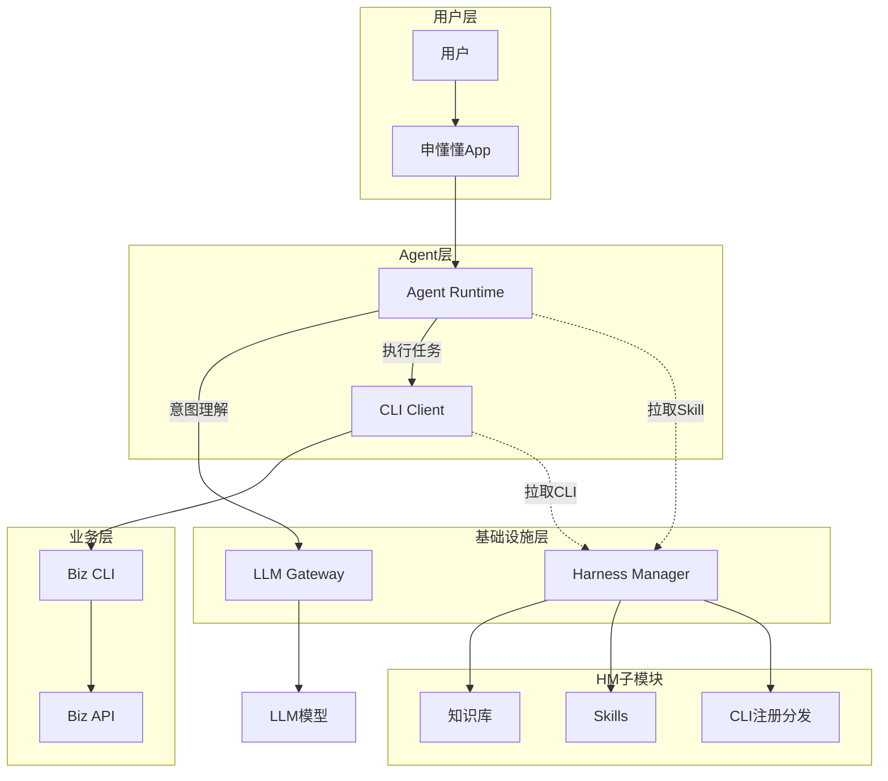
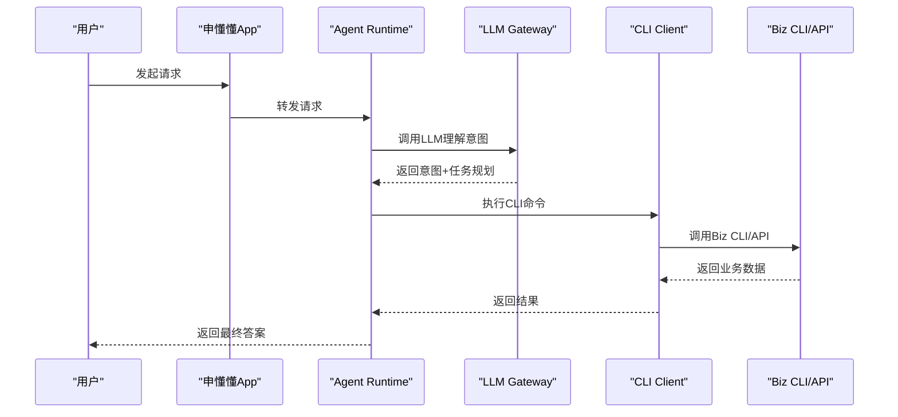
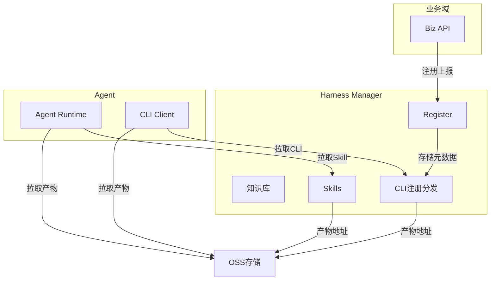
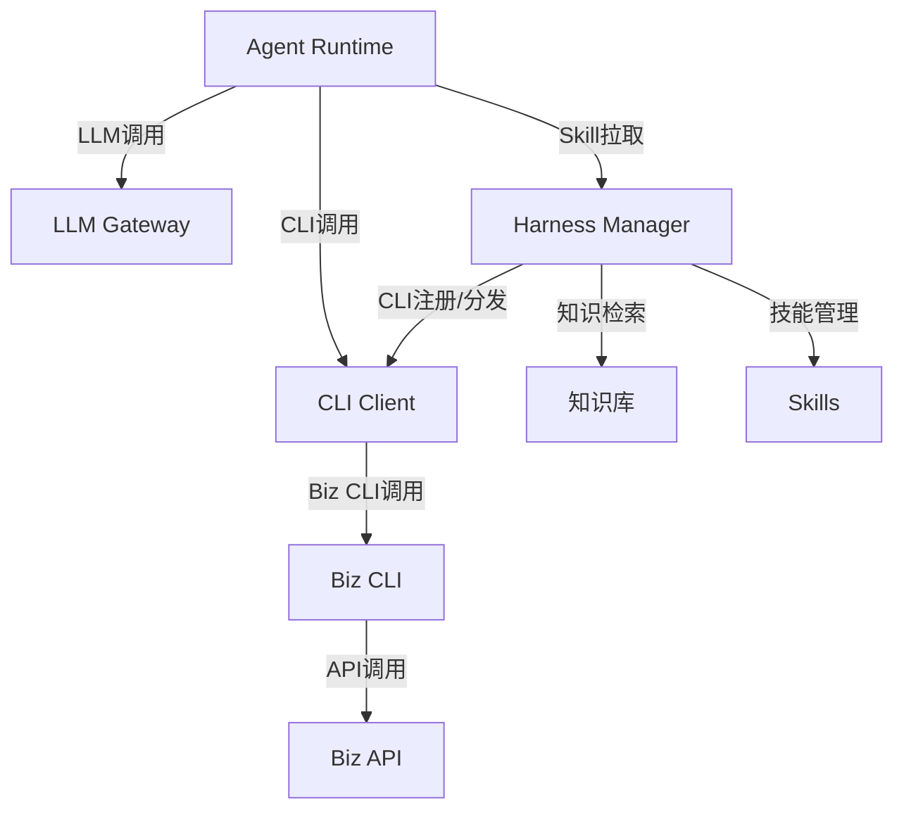

# 项目背景与目标

<cite>
**本文引用的文件**
- [README.md](file://README.md)
- [Sai整体架构设计.md](file://project/standup/Sai整体架构设计.md)
- [SAI_CLI_设计文档_v1.0.md](file://plan/SAI_CLI_设计文档_v1.0.md)
- [SAI_CLI_设计文档_v1.2.md](file://plan/SAI_CLI_设计文档_v1.2.md)
- [SAI-daily-report-2026-04-22-final.md](file://project/SAI-daily-report-2026-04-22-final.md)
- [项目管理方案v1.0.md](file://project/项目管理方案v1.0.md)
- [2026-04-20-zhaobomin.md](file://project/standup/2026-04-20-zhaobomin.md)
</cite>

## 目录
1. [引言](#引言)
2. [项目结构](#项目结构)
3. [核心组件](#核心组件)
4. [架构总览](#架构总览)
5. [详细组件分析](#详细组件分析)
6. [依赖分析](#依赖分析)
7. [性能考虑](#性能考虑)
8. [故障排查指南](#故障排查指南)
9. [结论](#结论)
10. [附录](#附录)

## 引言
本文件面向SAI（申通AI）智能体平台的项目背景与目标，聚焦于申通快递引入AI智能体平台的业务背景、战略考量与项目目标。SAI旨在通过CLI封装企业内部各业务系统的业务能力，使Agent能够以标准化方式调用这些能力，从而实现业务智能化。本文将从项目立项驱动因素、预期解决的业务痛点、为企业带来的业务价值等方面进行系统阐述，并为初学者提供清晰的业务概念理解，为业务人员提供价值洞察。

## 项目结构
SAI项目采用“三层架构、五个团队代码库、一个公共文档库”的组织方式，围绕“用户层-Agent层-基础设施层-业务层”展开，形成从用户交互到业务执行的完整链路。公共文档库（docs）承载各团队的设计文档、接口文档与每日工作记录，确保信息透明与协同高效。

图表来源
- [Sai整体架构设计.md:19-65](file://project/standup/Sai整体架构设计.md#L19-L65)

章节来源
- [README.md:9-41](file://README.md#L9-L41)
- [项目管理方案v1.0.md:21-49](file://project/项目管理方案v1.0.md#L21-L49)

## 核心组件
SAI平台的核心目标是通过CLI封装业务能力，让Agent能够调用企业内部各业务系统，实现业务智能化。围绕这一目标，平台的关键组件包括：

- 用户层：通过申懂懂App与Agent交互，发起业务请求。
- Agent层：负责意图理解与任务规划，协调CLI执行业务动作。
- 基础设施层：提供LLM网关与Harness Manager，分别承担模型路由与控制面能力分发。
- 业务层：封装业务能力的CLI与后端API，提供标准化接口。

章节来源
- [Sai整体架构设计.md:109-138](file://project/standup/Sai整体架构设计.md#L109-L138)
- [Sai整体架构设计.md:142-151](file://project/standup/Sai整体架构设计.md#L142-L151)

## 架构总览
SAI的整体架构由两条核心链路构成：意图理解链路与业务执行链路。意图理解链路由用户请求经App进入Agent，再通过LLM Gateway调用LLM模型完成意图理解与任务规划；业务执行链路由Agent调用CLI Client，进而调用Biz CLI与Biz API完成业务操作。

图表来源
- [Sai整体架构设计.md:115-138](file://project/standup/Sai整体架构设计.md#L115-L138)

章节来源
- [Sai整体架构设计.md:17-65](file://project/standup/Sai整体架构设计.md#L17-L65)

## 详细组件分析

### 业务背景与战略考量
SAI项目源于申通快递在企业级AI智能化转型过程中的系统性需求。通过将Agent与业务系统解耦，SAI实现了“前端零改造、业务域只提供API”的零侵入接入模式，既降低了业务域的开发负担，又保证了Agent与业务能力的强耦合与高可用。

- 零侵入接入：业务域仅提供API接口，无需改造前端GUI，CLI由Harness Manager统一开发与维护，确保业务域专注于自身能力演进。
- 分层解耦：Agent→网关→SAI-CLI→API的调用链路，每一层只依赖下一层的接口契约，实现独立演进与测试。
- 标准化协议：统一使用JSON格式的入参/出参，确保Agent与CLI之间的结构化交互，便于错误处理与结果解读。

章节来源
- [SAI_CLI_设计文档_v1.0.md:59-74](file://plan/SAI_CLI_设计文档_v1.0.md#L59-L74)
- [SAI_CLI_设计文档_v1.2.md:81-106](file://plan/SAI_CLI_设计文档_v1.2.md#L81-L106)

### 项目立项驱动因素
SAI项目的立项主要驱动因素包括：
- 业务智能化转型：通过Agent与CLI的标准化封装，提升业务决策与执行效率。
- 降低开发成本：业务域无需重复开发CLI工具，Harness Manager统一构建与维护，减少重复投入。
- 提升协作效率：通过公共文档库与Git流程，确保跨团队信息同步与进度透明。

章节来源
- [SAI-daily-report-2026-04-22-final.md:21-44](file://project/SAI-daily-report-2026-04-22-final.md#L21-L44)
- [项目管理方案v1.0.md:13-17](file://project/项目管理方案v1.0.md#L13-L17)

### 预期解决的业务痛点
SAI旨在解决以下业务痛点：
- 前端改造成本高：通过“GUI零改造”，业务域无需为Agent适配前端界面。
- 能力分散与重复建设：通过Harness Manager统一管理CLI与技能，避免各域重复开发。
- 调用链路复杂与不可控：通过标准化命令规范与结构化错误输出，提升调用稳定性与可观测性。

章节来源
- [SAI_CLI_设计文档_v1.0.md:59-80](file://plan/SAI_CLI_设计文档_v1.0.md#L59-L80)
- [SAI_CLI_设计文档_v1.2.md:149-170](file://plan/SAI_CLI_设计文档_v1.2.md#L149-L170)

### 为申通快递带来的业务价值
SAI平台为企业带来的业务价值体现在：
- 提升运营效率：Agent可自动完成高频查询与操作，减少人工干预。
- 增强决策质量：通过统一的9维Tag体系与NLU Pipeline，提升意图理解与结果解读的准确性。
- 保障安全与合规：通过PoP Token与鉴权机制，实现Token与环境绑定，降低复用风险。

章节来源
- [SAI_CLI_设计文档_v1.2.md:250-288](file://plan/SAI_CLI_设计文档_v1.2.md#L250-L288)
- [SAI_CLI_设计文档_v1.2.md:394-471](file://plan/SAI_CLI_设计文档_v1.2.md#L394-L471)

### CLI设计原则与规范
SAI-CLI的设计原则与规范确保了Agent与业务系统的稳定交互：
- 命令规范：统一的命令格式与参数结构，便于Agent自动拼接与执行。
- 结构化输出：统一的JSON格式输出与错误处理，便于Agent解析与展示。
- 可测试性：通过接口抽象与Dry-Run模式，确保CLI在无真实API环境下仍可测试。

章节来源
- [SAI_CLI_设计文档_v1.0.md:83-126](file://plan/SAI_CLI_设计文档_v1.0.md#L83-L126)
- [SAI_CLI_设计文档_v1.2.md:115-147](file://plan/SAI_CLI_设计文档_v1.2.md#L115-L147)
- [SAI_CLI_设计文档_v1.2.md:474-513](file://plan/SAI_CLI_设计文档_v1.2.md#L474-L513)

### Harness Manager与Agent职责划分
Harness Manager负责CLI注册、元数据管理与分发，Agent负责意图理解与命令执行。两者通过标准化接口与OSS分发机制协同工作，确保Agent可拉取最新CLI定义并执行业务操作。

图表来源
- [Sai整体架构设计.md:69-106](file://project/standup/Sai整体架构设计.md#L69-L106)

章节来源
- [Sai整体架构设计.md:173-195](file://project/standup/Sai整体架构设计.md#L173-L195)
- [Sai整体架构设计.md:603-632](file://project/standup/Sai整体架构设计.md#L603-L632)

## 依赖分析
SAI平台的模块间依赖关系清晰，遵循“控制面不参与调用链路”的原则。Agent与Harness Manager通过HTTP/OSS进行交互，CLI Client与业务CLI通过HTTP进行调用，确保各模块职责明确、耦合度低。

图表来源
- [Sai整体架构设计.md:154-171](file://project/standup/Sai整体架构设计.md#L154-L171)
- [Sai整体架构设计.md:197-221](file://project/standup/Sai整体架构设计.md#L197-L221)

章节来源
- [Sai整体架构设计.md:154-171](file://project/standup/Sai整体架构设计.md#L154-L171)
- [Sai整体架构设计.md:197-221](file://project/standup/Sai整体架构设计.md#L197-L221)

## 性能考虑
SAI平台在性能方面采取多项优化措施：
- Agent冷启动与热启动：目标为冷启动<1s、热启动<200ms，确保用户体验流畅。
- 网关与模型路由：通过LLM Gateway统一代理与路由，支持多模型与并发控制。
- CLI与API调用：通过统一的命令规范与结构化输出，减少解析与转换开销。

章节来源
- [Sai整体架构设计.md:224-233](file://project/standup/Sai整体架构设计.md#L224-L233)
- [Sai整体架构设计.md:261-269](file://project/standup/Sai整体架构设计.md#L261-L269)

## 故障排查指南
SAI平台建立了完善的错误处理与降级矩阵，确保在关键组件失效时仍能维持基本服务能力：
- Harness Manager不可用：Agent使用本地缓存的Skill/CLI定义，降级为无知识检索模式。
- LLM Gateway熔断：Agent返回固定提示，业务执行链路不受影响。
- 业务API超时/失败：CLI Client进行单次重试，失败后向用户说明具体接口不可用。
- OSS不可用：Agent使用本地缓存版本运行，日志告警通知Harness Manager团队。
- Agent Runtime实例崩溃：Serverless平台自动重建实例，用户会话需重新发起。

章节来源
- [Sai整体架构设计.md:236-245](file://project/standup/Sai整体架构设计.md#L236-L245)

## 结论
SAI智能体平台通过CLI封装业务能力，实现Agent与企业内部各业务系统的标准化对接，推动申通快递在企业级AI智能化转型道路上迈出坚实一步。项目以“GUI零改造、业务域只提供API”为核心理念，结合分层解耦、标准化协议与统一鉴权机制，既降低了业务域的开发成本，又提升了Agent的自动化能力与安全性。随着Harness Manager与Agent Runtime的持续完善，SAI将在提升运营效率、增强决策质量与保障安全合规方面为企业创造更大价值。

## 附录
- 项目管理方案：采用“最小约束、核心必做、Git即进度”的管理方式，确保文档与代码同步、每日提交与进度透明。
- 模块职责与接口依赖：明确各模块职责与接口契约，确保跨团队协作顺畅。
- 上线策略与风险应对：针对关键风险制定应对方案，确保平台稳定上线与持续演进。

章节来源
- [项目管理方案v1.0.md:13-175](file://project/项目管理方案v1.0.md#L13-L175)
- [Sai整体架构设计.md:142-151](file://project/standup/Sai整体架构设计.md#L142-L151)
- [Sai整体架构设计.md:248-258](file://project/standup/Sai整体架构设计.md#L248-L258)