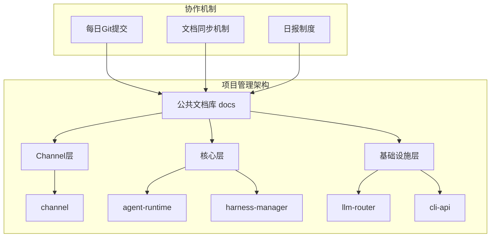
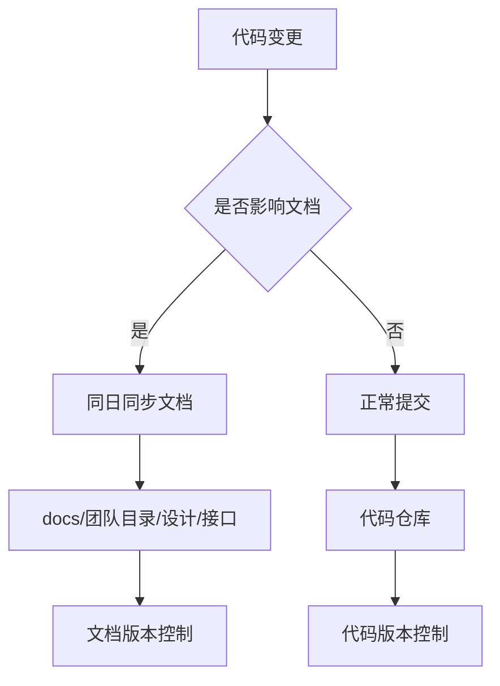
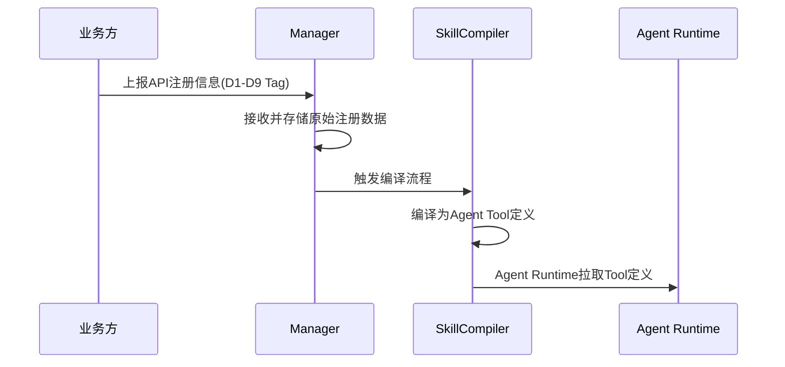
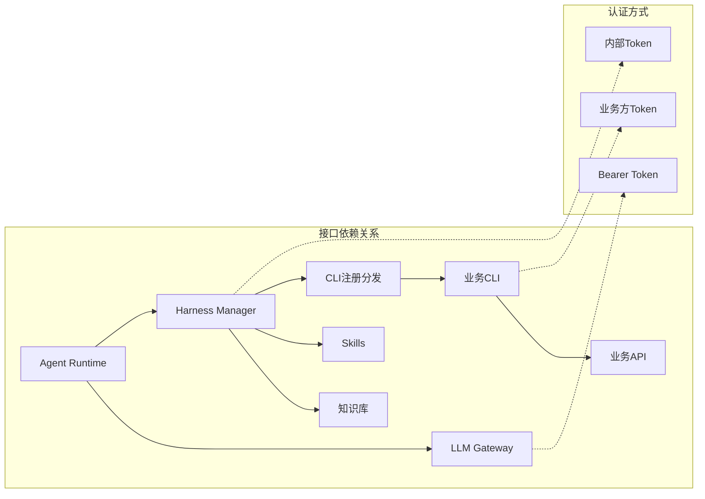
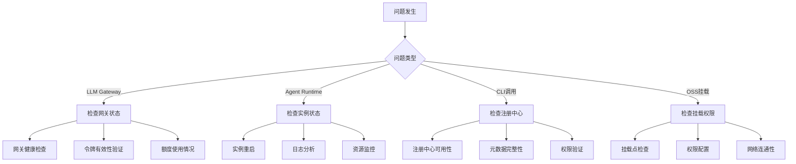
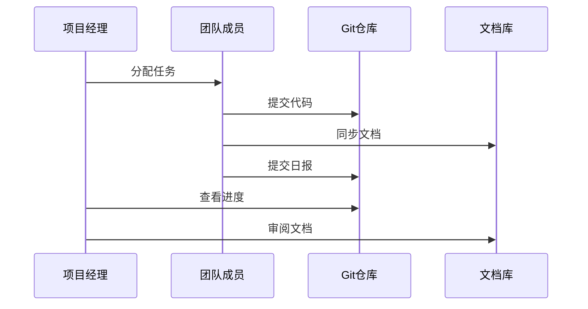
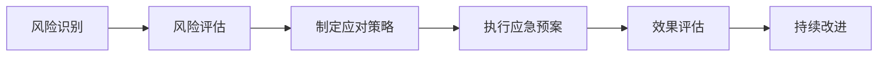

# 项目管理方案

<cite>
**本文引用的文件**
- [项目管理方案v1.0.md](file://project/项目管理方案v1.0.md)
- [SAI 项目日报 | 项目待办和风险跟踪.md](file://project/SAI-daily-report-2026-04-22-final.md)
- [LLM-Gateway建设方案.md](file://plan/LLM-Gateway建设方案.md)
- [Agent-Runtime方案.md](file://plan/Agent-Runtime方案.md)
- [SAI CLI 架构设计文档 v1.2.md](file://plan/SAI_CLI_设计文档_v1.2.md)
- [2026-04-20-zhaobomin.md](file://project/standup/2026-04-20-zhaobomin.md)
- [Sai整体架构设计.md](file://project/standup/Sai整体架构设计.md)
- [Agent-Runtime方案review.md](file://notes/zhaobomin/Agent-Runtime方案review.md)
- [LLM-Gateway方案review.md](file://notes/zhaobomin/LLM-Gateway方案review.md)
- [README.md](file://docs/README.md)
- [config.yaml](file://openspec/config.yaml)
- [2026-04-20 日报示例.md](file://daily/2026-04-20/hongyu.md)
- [2026-04-21 日报示例.md](file://daily/2026-04-21/xuchunhui.md)
</cite>

## 目录
1. [简介](#简介)
2. [项目结构](#项目结构)
3. [核心组件](#核心组件)
4. [架构概览](#架构概览)
5. [详细组件分析](#详细组件分析)
6. [依赖分析](#依赖分析)
7. [性能考虑](#性能考虑)
8. [故障排查指南](#故障排查指南)
9. [结论](#结论)
10. [附录](#附录)

## 简介
本方案面向SAI（申通AI智能体平台）项目全体成员，旨在通过最小约束和核心必做原则，建立以Git为核心的项目管理机制。方案强调"代码提交到Git、文档同步到Git、日报写到Git"三大习惯，确保项目进度透明、协作高效、信息可追溯。

SAI项目采用三层架构、五个团队代码库、一个公共文档库的组织方式，通过标准化的Git提交规范、文档同步机制和日报制度，实现跨团队协作的可视化管理。

## 项目结构
SAI项目采用分布式仓库管理模式，通过6个Git仓库实现模块化协作：



**图表来源**
- [项目管理方案v1.0.md:21-50](file://project/项目管理方案v1.0.md#L21-L50)
- [README.md:9-41](file://docs/README.md#L9-L41)

项目结构特点：
- **分层架构**：Channel层、核心层、基础设施层三级组织
- **模块化管理**：每个团队拥有独立代码仓库
- **文档集中化**：公共文档库统一管理设计文档和日报
- **协作可视化**：通过Git历史记录追踪项目进展

**章节来源**
- [项目管理方案v1.0.md:17-50](file://project/项目管理方案v1.0.md#L17-L50)
- [README.md:9-41](file://docs/README.md#L9-L41)

## 核心组件
SAI项目管理的核心组件包括Git提交规范、文档同步机制和日报制度三大支柱：

### Git提交规范（核心规则）
项目制定了三条核心Git提交规则，确保代码质量和文档同步：

1. **提交信息规范**：采用`[类型] 简要说明`格式，类型包括feat、fix、docs、refactor、test
2. **文档同步要求**：任何影响API接口、模块交互或新增功能的代码变更，必须在同一天内同步更新文档
3. **每日提交约束**：每位成员每个工作日至少有一次Git提交

### 文档同步机制
文档管理采用团队维度组织，各团队在docs仓库中维护自己的设计文档和接口文档：



**图表来源**
- [项目管理方案v1.0.md:74-86](file://project/项目管理方案v1.0.md#L74-L86)

### 日报制度
每日下班前在docs/daily/日期/姓名.md提交日报，内容不限格式，主要记录当日工作内容。日报成为项目进度的直观展示窗口。

**章节来源**
- [项目管理方案v1.0.md:59-146](file://project/项目管理方案v1.0.md#L59-L146)

## 架构概览
SAI项目采用四层分层架构，实现AI Agent与各业务域后端服务的标准化接入：

```mermaid
graph TB
subgraph "调用层"
A[统一AI Agent]
A1[根据用户提问搜索相关API]
A2[结合上下文选择匹配API]
A3[拼接执行命令调用CLI返回结构化结果]
end
subgraph "网关层"
B[CLI路由转发]
B1[负载均衡]
B2[同步机制]
B3[权限校验]
end
subgraph "CLI核心层"
C[统一SAI-CLI二进制文件]
C1[统一命令规范]
C2[API注册中心]
C3[SkillCompiler]
C4[公共能力(认证/日志)]
end
subgraph "后端API层"
D[各域只提供API接口]
D1[无需改造前端GUI]
D2[无需开发CLI代码]
end
A --> B
B --> C
C --> D
```

**图表来源**
- [SAI CLI 架构设计文档 v1.2.md:29-64](file://plan/SAI_CLI_设计文档_v1.2.md#L29-L64)

架构设计原则：
- **GUI零改造**：各业务域只需提供后端API接口
- **架构解耦**：Agent→网关→SAI-CLI→API，层层解耦
- **协议统一**：所有HTTP调用及CLI入参/出参统一使用JSON格式
- **统一命令规范**：{product} {module} {action} [params]格式

**章节来源**
- [SAI CLI 架构设计文档 v1.2.md:69-105](file://plan/SAI_CLI_设计文档_v1.2.md#L69-L105)

## 详细组件分析

### LLM Gateway管理方案
LLM Gateway作为AI服务统一入口，解决多模型管理、成本控制、安全风险等痛点：

#### 核心优势对比
| 维度 | 接入前(痛点) | 接入后(LLM+DevOps) |
|------|-------------|-------------------|
| 接入与研发 | 接口不统一，重复造轮子，切换模型需改代码 | 内部统一API标准，热切换模型 |
| 成本与预算 | 账单分散，无法按域组限额 | 精细化核算，按域组/项目分配额度池 |
| 安全与审计 | 真实Key硬编码极易泄露 | 网关统一托管Key，业务无感轮转 |
| 资源调度 | 不分环境与等级，测试滥用昂贵模型 | 智能动态路由，测试自动降级 |
| 运维流程 | 账号创建全靠人工沟通 | 全流程自动化，钉钉审批 |

#### 项目规划阶段
- **阶段一：网关上线** (4月30日前完成)
  - 上线全公司统一AI调用入口
  - 覆盖个人用户(产技同学)
- **阶段二：DevOps融合** (5月15日前完成)
  - DevOps打通审批流
  - 实现审批即用，超额即断
- **阶段三：全量推广** (5月30开始)
  - 推动全部业务接入
  - 搭建全局监控看板

**章节来源**
- [LLM-Gateway建设方案.md:3-76](file://plan/LLM-Gateway建设方案.md#L3-L76)
- [LLM-Gateway建设方案.md:95-109](file://plan/LLM-Gateway建设方案.md#L95-L109)

### Agent Runtime架构设计
Agent Runtime基于Serverless实现用户隔离和热启动：

#### 用户隔离机制
- **基于AgentRun(Serverless)**实现，按session_id动态分配Agent实例
- **用户执行环境隔离**：一个Agent实例当前只有一个session
- **热启动性能**：冷启动<1秒，热启动100ms

#### Skill隔离方案
- **基于Docker文件目录挂载实现**
- **Workspace与Systemspace分离**：分别对应OSS挂载目录下的子目录
- **个性化挂载备选方案**：若阿里云接口不支持，走Agent层自行实现文件权限

**章节来源**
- [Agent-Runtime方案.md:4-56](file://plan/Agent-Runtime方案.md#L4-L56)

### CLI注册与分发机制
SAI CLI采用统一注册中心和SkillCompiler实现标准化管理：

#### 9维Tag体系
| 组别 | 维度 | 名称 | 用途 |
|------|------|------|------|
| 路由与分类组 | D1 | 指标大类 | 一级路由粗筛 |
| | D2 | API名称 | 二级路由精确定位 |
| | D4 | 指标清单 | 细粒度路由 |
| NLU理解组 | D5 | 指标类型 | count/rate/target |
| | D7 | 触发关键词 | exact+synonym+negative三层匹配 |
| | D8 | 场景意图 | 单点查询/趋势分析/异常监控 |
| 执行与展示组 | D3 | 二级类目 | 对应subCategoryList入参 |
| | D6 | 适用层级 | 网点/分拨/大区 |
| | D9 | 出参映射 | JSON字段到中文含义翻译 |

#### SkillCompiler编译流程


**图表来源**
- [SAI CLI 架构设计文档 v1.2.md:225-249](file://plan/SAI_CLI_设计文档_v1.2.md#L225-L249)

**章节来源**
- [SAI CLI 架构设计文档 v1.2.md:151-288](file://plan/SAI_CLI_设计文档_v1.2.md#L151-L288)

### 风险管理与应急预案
项目建立了完善的风险识别和应急响应机制：

#### 风险矩阵
| 风险 | 严重度 | 应对方案 | 负责人 |
|------|--------|---------|--------|
| Claude Agent SDK强依赖 | 高 | 做SDK抽象层，保留切换能力 | 奕杭 |
| HM Skill/CLI方案未出 | 高 | 4/25前产出接口定义文档 | 隋云 |
| LLM Gateway 4/30 scope偏大 | 中 | 先砍到最小可用：网关跑通+手动发key+基础告警 | 老徐 |
| OSS挂载个性化需求未评估 | 中 | 阿里云接口需求已提交，否则走B方案 | 奕杭 |
| Channel→Agent交互协议未对齐 | 中 | 与弘宇约时间对齐前端集成方案 | 弘宇 |
| LLM Gateway逃生方案未定 | 中 | 准备业务侧fallback直连+Gateway bypass模式 | 老徐 |

#### 降级策略矩阵
| 故障场景 | 影响范围 | 降级策略 | 负责人 |
|----------|---------|---------|--------|
| HM不可用 | Agent无法拉取Skill/CLI；知识检索中断 | Agent本地缓存最近一次定义，降级为无知识检索模式 | 隋云 |
| LLM Gateway熔断 | 意图理解链路完全中断 | Agent返回固定提示，业务执行链路不受影响 | 老徐 |
| Biz API超时/失败 | 单个CLI命令执行失败 | CLI Client单次重试(≤3s)，失败后Agent说明具体接口不可用 | 淩雪 |
| OSS不可用 | Agent无法拉取新Skill/CLI执行包 | Agent使用本地缓存版本运行，日志告警通知HM团队 | 隋云 |
| Agent Runtime实例崩溃 | 单个用户会话中断 | Serverless平台自动重建实例，用户会话需重新发起 | 奕杭 |

**章节来源**
- [Sai整体架构设计.md:236-258](file://project/standup/Sai整体架构设计.md#L236-L258)

## 依赖分析

### 模块间接口依赖矩阵


**图表来源**
- [Sai整体架构设计.md:154-170](file://project/standup/Sai整体架构设计.md#L154-L170)

### 评审与对齐状态
项目建立了完善的接口对齐机制：
- ✅ 已对齐：接口设计已完成，双方已确认
- ⚠ 未写入文档：口头确认但未形成书面契约
- ⚠ 方案未出：提供方方案文档尚未产出

**章节来源**
- [Sai整体架构设计.md:154-170](file://project/standup/Sai整体架构设计.md#L154-L170)

## 性能考虑
SAI项目在性能方面采用了多项优化策略：

### 启动性能优化
- **Agent热启动**：<1秒冷启动，100ms热启动
- **CLI统一二进制**：单一可执行文件，无运行时依赖
- **OSS挂载优化**：Workspace与Systemspace分离，提升Agent拉起时的RT

### 并发与扩展性
- **Serverless架构**：按需分配资源，支持弹性扩缩容
- **多模型路由**：根据环境维度(本地/测试/预发/生产)和应用等级(核心/非核心/边缘)分配不同模型
- **负载均衡**：支持多渠道轮询重试机制

### 监控与告警
- **三级告警机制**：80%/90%/100%额度预警熔断
- **实时监控**：Pod运行状态告警规则，基础设施可观测性管控
- **成本控制**：精细化核算，按域组/项目分配额度池

## 故障排查指南

### 常见问题诊断流程


### 应急响应流程
1. **快速定位**：通过Git提交历史和日报快速定位问题时间点
2. **影响评估**：评估问题影响范围和严重程度
3. **降级执行**：按照降级策略执行，确保核心功能可用
4. **根因分析**：深入分析问题根本原因
5. **修复验证**：修复后进行全面验证
6. **经验总结**：总结经验教训，完善预防措施

**章节来源**
- [Sai整体架构设计.md:236-245](file://project/standup/Sai整体架构设计.md#L236-L245)

## 结论
SAI项目管理方案通过Git驱动的协作机制，实现了项目管理的标准化和可视化。三大核心组件（Git提交规范、文档同步机制、日报制度）相互配合，形成了完整的项目管理体系。

方案的关键优势：
- **最小约束**：通过核心必做规则确保项目管理的有效性
- **Git即进度**：所有项目活动都可通过Git历史记录追踪
- **跨团队协作**：标准化的接口和文档确保团队间高效协作
- **风险可控**：完善的应急预案和降级策略确保项目稳定性

建议项目团队：
1. 严格遵守Git提交规范，确保代码和文档同步更新
2. 按时提交日报，保持项目进度透明
3. 及时响应风险预警，按预案执行应急措施
4. 持续优化工作流程，提升协作效率

## 附录

### 项目管理工具与模板

#### Git提交模板
- 类型：feat/fix/docs/refactor/test
- 格式：`[类型] 简要说明`
- 示例：`feat: 添加Skill热加载能力`

#### 日报模板
- 日期：YYYY-MM-DD
- 内容：当日工作内容、遇到的问题、解决方案、明日计划

#### 需求管理模板
- 需求编号：SAIN-XXX
- 优先级：P0/P1/P2
- 状态：待处理/进行中/已完成
- 关联模块：相关团队和接口

#### 变更控制模板
- 变更类型：功能新增/功能修改/缺陷修复
- 影响范围：涉及的模块和接口
- 风险评估：低/中/高
- 回滚方案：详细的回滚步骤

### 关键流程图

#### 项目管理流程


#### 风险管理流程


**章节来源**
- [项目管理方案v1.0.md:161-175](file://project/项目管理方案v1.0.md#L161-L175)
- [SAI 项目日报 | 项目待办和风险跟踪.md:67-77](file://project/SAI-daily-report-2026-04-22-final.md#L67-L77)