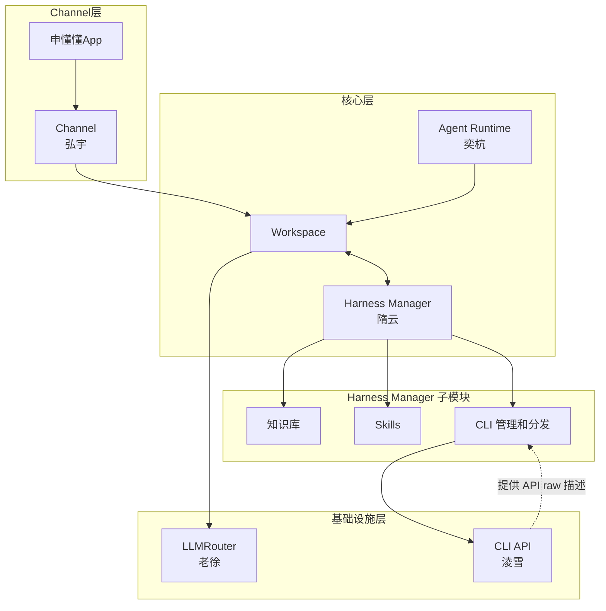

# Sai（STO AI）

> 源自《棋魂》藤原佐为（SAI = STO AI）

Sai 是《棋魂》中千年执着于棋道、追求极致技艺的灵魂象征，代表极致专注、精益求精、追求最优解的精神。

以此为名，寓意项目以极致匠心打磨技术，在复杂场景中持续迭代、追求「神之一手」级的最优决策，沉淀长期价值。

## 模块和分工

## 文档索引

### 方案设计

- [Agent-Runtime方案](plan/Agent-Runtime方案.md)
- [CLI注册上报数据结构与Tag设计](plan/CLI注册上报数据结构与Tag设计.md)
- [harness-manager-cli设计](plan/harness-manager-cli设计.md)
- [LLM-Gateway建设方案](plan/LLM-Gateway建设方案.md)
- [LLM-Gateway一期功能规划](plan/LLM-Gateway一期功能规划.md)

### 方案评审

- [Agent-Runtime方案review](notes/zhaobomin/Agent-Runtime方案review.md)
- [LLM-Gateway方案review](notes/zhaobomin/LLM-Gateway方案review.md)
- [Sai整体架构设计](notes/zhaobomin/Sai整体架构设计.md)

### 日报

**2026-04-20**
- [hongyu](daily/2026-04-20/hongyu.md)
- [lingxue](daily/2026-04-20/lingxue.md)
- [xuchunhui](daily/2026-04-20/xuchunhui.md)
- [yihang](daily/2026-04-20/yihang.md)

### 项目管理

- [项目管理方案v1.0](project/项目管理方案v1.0.md)

**Standup**
- [2026-04-20-zhaobomin](project/standup/2026-04-20-zhaobomin.md)