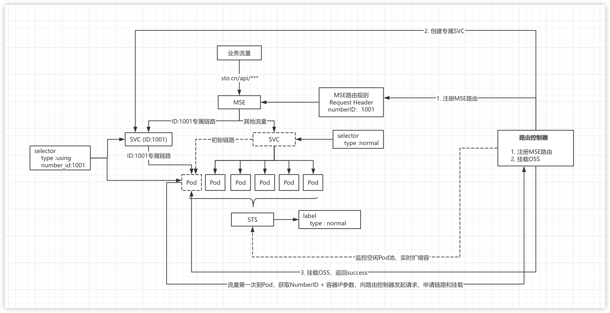
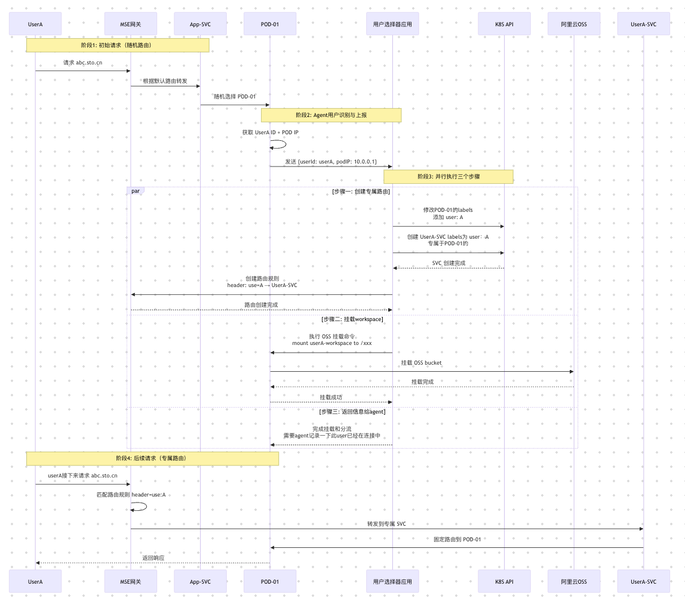

# Agent 设计方案（MSE流量分流）

### 一、描述

业务流量通过域名（sto.cn/api/\*\*\*）进入 MSE（微服务网关），MSE 根据路由规则检查请求头中的 NumberID 进行流量分发。当请求携带 NumberID: 1001 时，流量被路由到专属的 SVC (ID:1001)；其他流量则走默认的 SVC。

底层的 Pod 池由 StatefulSet（STS）统一管理，所有 Pod 默认标记为 `type: normal`，由普通 SVC 通过 selector 选择。当某个客户需要专属链路时，系统会将特定 Pod 的标签切换为 `type: using, number_id: 1001`，使其被专属 SVC 独占。

**路由控制器**是整个架构的调度核心，负责三件事：

1.  **注册 MSE 路由** — 在网关层创建基于 Header 的路由规则，将特定 NumberID 的流量导向专属 SVC。
    
2.  **创建专属 SVC** — 动态创建带有特定 selector 的 Kubernetes Service，绑定到目标 Pod。
    
3.  **挂载 OSS** — 为专属 Pod 挂载客户独立的存储资源。
    

当流量首次到达 Pod 时，Pod 会获取 NumberID 和容器 IP，向路由控制器发起请求，申请链路和 OSS 挂载。控制器完成注册后返回 success，后续该客户的请求即走专属链路。

同时，系统会持续监控空闲 Pod 池，根据使用情况实时扩缩容，确保资源弹性。

### 二、架构图

### 三、时序图

