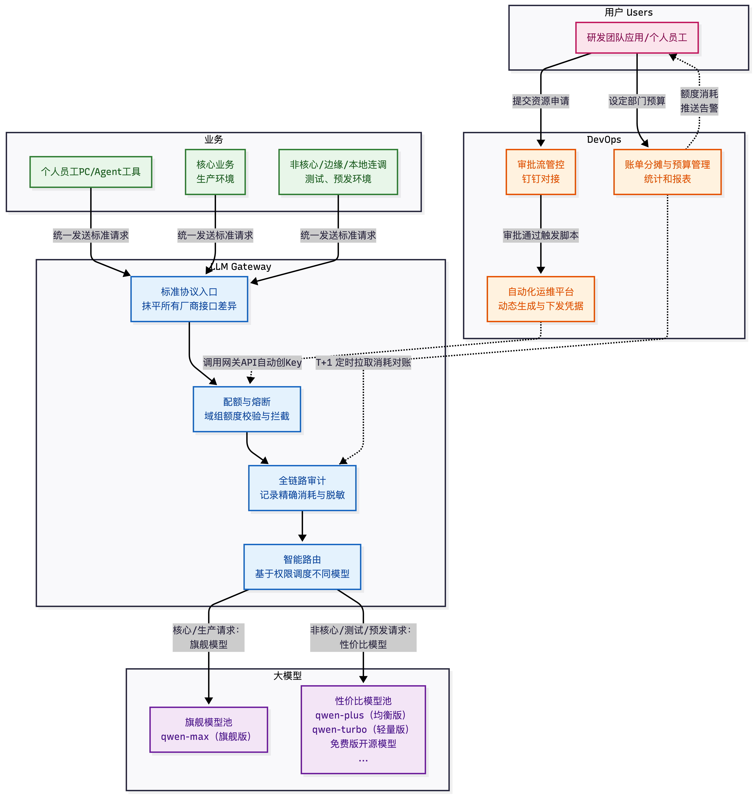

# LLM Gateway 建设方案

## 一、 背景和痛点

##### 多模型缺乏统一管理：不同部门各自申请 OpenAI、Claude、阿里百炼等AI模型，接口规范不一，接入成本高，升级维护难，切换成本高，没有统一管理的平台。

##### 预算和成本难管理： 缺乏统一的预算账单管控和告警，每个AI模型的控制台都不一样，无法清晰统计各域组具体消耗，无法针对特定项目设置额度上限，额度消耗、账单超支无统一的钉钉告警。

##### 安全风险： 密钥分别由开发团队自己在项目配置文件中管理，缺乏轮转机制、日志泄露风险高；隐私数据存在泄密风险，例如项目中把没有脱敏的数据直接丢给大模型

##### 缺乏优先级管控：每个团队都希望用上最好的大模型，token消耗和成本也更高，实际情况可以按照环境维度（本地、测试、预发、生产）、应用等级（核心、非核心、边缘）分配不同的模型

##### 缺乏自动化流程：各类操作全部依赖人工，创建账号、申请资源、创建Key，没有审批流程，这些繁琐重复的工作没有自动化

## 二、 系统架构

使用开源项目**LiteLLM**搭建申通LLM Gateway网关，配合DevOps平台，解决使用大模型面临的统一管理、安全、预算、成本、账单等问题，网关入口限制仅安装虎盾客户端用户、云上应用内网能访问，解决调用时权限问题

### 架构图：

### 时序图：

## 三、 技术方案

#### API 标准化

*   统一代理： 网关作为统一代理层，向下支持接入千问所有版本模型，也支持接入 OpenAI、Claude、Gemini等国际主流大模型。
    
*   无缝切换： 向上对内统一暴露标准的 OpenAI 格式 API。各业务线代码只需对接一套标准 SDK，修改 Base URL 和 Token 即可，零成本切换底层模型。
    

#### DevOps平台密钥分发

*   资源申请自动化： 研发在DevOps发起“AI 资源申请”，填写应用等级、预计并发、所需环境 审批通过后，触发 Webhook 调用 New API 的管理接口，自动创建对应渠道和唯一 Token。
    
*   流水线动态注入（此步骤可选，也可使用Apollo写在配置文件）： 业务代码中禁止硬编码 Key。在 CI/CD 流水线打包部署时，系统根据当前部署环境（测试 / 预发 / 生产），将对应的网关 Token 动态注入为环境变量。
    

#### 流量降级与成本控制

*   环境与等级路由
    
    *   本地 / 测试环境： 强制路由至低成本模型（qwen-turbo轻量版、免费版开源模型）或内部自建的开源本地模型，以降低调试成本。
        
    *   生产环境 (非核心应用)： 路由至性价比模型（qwen-plus均衡版），并设置严格的 TPM/RPM（每分钟 Token / 请求数）上限。
        
    *   生产环境 (核心应用)： 使用最新qwen-max旗舰版强力模型，并配置多渠道轮询重试机制，确保高可用。运维团队定期更新，保证业务使用最新旗舰模型
        
*   额度预警熔断： 针对每个分配出去的 Token 设定独立的资金或 Token 额度池，到达 80% 触发告警，通过钉钉通知推送，到达 100% 自动熔断降级，并可以支持配置不同的告警阈值。
    

#### 日志与安全

*   请求日志拦截： 网关层拦截并记录所有请求的元数据（时间、发起方 IP、Token 归属域组、消耗 Token 数、响应延迟）。
    
*   隐私数据脱敏： 高敏业务可选配脱敏插件，在请求发往公有云大模型前，将隐私数据遮盖或替换。
    
*   key访问白名单：对每个key加白处理，加白的key才能使用
    
*   访问方式：应用通过白名单方式内网访问，用户通过虎盾（VPN）方式访问
    

## 四、 核心优势

| **维度**   | **接入前（当前痛点）**                     | **接入后（LLM + DevOps ）**                                          |
| ---------- | ------------------------------------------ | -------------------------------------------------------------------- |
| 接入与研发 | 接口不统一，重复造轮子，切换模型需改代码   | 内部统一 API 标准，热切换模型，所有项目接入方式统一                  |
| 成本与预算 | 账单分散，无法按域组、按项目限额，极易超支 | 精细化核算，按域组/项目分配额度池，接入钉钉通知，超额预警与自动熔断  |
| 安全与审计 | 真实 Key 硬编码极易泄露，缺乏调用日志      | 网关统一托管 Key，真实key托管在网关，虚拟key生成给业务，业务无感轮转 |
| 资源调度   | 不分环境与等级，测试/边缘业务滥用昂贵模型  | 智能动态路由，测试、本地环境自动降级平替，核心业务使用最强力旗舰模型 |
| 运维流程   | 账号创建、Key 分发全靠人工沟通，效率低下   | 全流程自动化，钉钉流程审批通过自动创建&推送资源                      |

## 五、 开源项目调研对比

[《热门开源网关项目对比》](https://alidocs.dingtalk.com/i/nodes/Obva6QBXJw9wagBrh2m9v9veWn4qY5Pr)

| **评估维度**      | **New API**                                                                                                                                               | **LiteLLM**                                                                                                                                                                                                                                                                      |
| ----------------- | --------------------------------------------------------------------------------------------------------------------------------------------------------- | -------------------------------------------------------------------------------------------------------------------------------------------------------------------------------------------------------------------------------------------------------------------------------- |
| **技术栈&中间件** | Go + React｜RDS + Redis                                                                                                                                   | Python + React｜RDS + Redis                                                                                                                                                                                                                                                      |
| **生产高可用**    | ✅支持docker、ecs、k8s集群部署                                                                                                                             | ✅支持docker、ecs、k8s集群部署                                                                                                                                                                                                                                                    |
| **总结**          | 国内比较流行的AI网关，更多用于中转站，有充值、邀请返现等功能 配置简单、功能简单、维护简单，能满足当下需求                                              | 国际热门AI网关，github 40k+ star 热度No.1，更适合用于企业内部 配置复杂、功能复杂、维护复杂，能满足当下和未来需求                                                                                                                                                              |
| **精细化限流**    | ❌ 不支持单个令牌的 RPM/TPM 限流。支持全局 IP 限制、渠道并发限制。 可以增加网关前置转发自行开发实现                                                     | ✅ 原生支持，基于 Key、User、Team 的双维度限流 (RPM 次数 + TPM 吞吐量)。                                                                                                                                                                                                          |
| **额度重置**      | ❌ 不支持设置重置规则 但提供有API可以重置额度。需要借助DevOps定时任务发起                                                                               | ✅ 原生支持，如创建令牌时设置额度重置规则 budget\_duration = 1m，按自然月自动重置)。                                                                                                                                                                                              |
| **使用量告警**    | ❌仅支持用户级别告警，不支持用户下单个令牌配置告警 告警需要借助Grafana实现，且不支持流量突发告警（5mins内消耗\*\*\*\*token告警）                        | ✅ 支持单个令牌告警，不需要额外接入Grafana即可配置告警规则、抑制规则等                                                                                                                                                                                                            |
| **结算账单**      | ❌ 误差无法避免 LLM设置token单价/倍率/额度，使用对话response的usage计算价格，如果没有usage本地先计算token，再计算价格 分词规则差异小；不支持阶梯计费 | ❌误差无法避免，误差产生原因：[《LLM Gateway计费逻辑》](https://alidocs.dingtalk.com/i/nodes/Gl6Pm2Db8D3x4Yn0h9bxnBPkJxLq0Ee4) LLM设置token单价，使用对话response的usage计算价格，如果没有usage本地先计算token，再计算价格 cl100k\_base分词和阿里云差异较大；不支持阶梯计费 |
| **数据安全**      | ❌ 仅支持敏感词库                                                                                                                                          | ✅ 支持密钥扫描、数据脱敏、提示词注入防御。例如明文AKSK、手机号、身份证号直接传给大模型的行为                                                                                                                                                                                     |
| **模型高可用**    | ✅ 基于优先级的轮询权重分配                                                                                                                                | ✅ 细粒度的故障降级 ( 如 qwen-max 挂了切 qwen-plus)。                                                                                                                                                                                                                             |
| **后台界面**      | ✅ 中文界面，支持用户组隔离                                                                                                                                | ❌ 文档&UI纯英文，不支持中文，功能侧重管理员配置                                                                                                                                                                                                                                  |
| **国内模型支持**  | ✅ 支持国内几乎所有模型，验证可接入Qwen系列模型                                                                                                            | ✅ 支持，验证可接入Qwen-3.5 Qwen3-max                                                                                                                                                                                                                                             |

## 六、项目规划

| **阶段**                    | **核心功能**                                                                                                              | **时间**          |
| --------------------------- | ------------------------------------------------------------------------------------------------------------------------- | ----------------- |
| 阶段一： **网关上线**    | 1.  上线全公司统一AI 调用入口      2.  覆盖个人用户（产技同学）                                                     | 4月30号完成       |
| 阶段二： **DevOps 融合** | 1.  DevOps打通审批流      2.  代码库“真实Key”清零      3.  实现审批即用，超额即断      4.  应用申请维度 | 5月15完成         |
| 阶段三： **全量推广**    | 1.  推动全部业务接入      2.  搭建全局监控看板      3.  清晰展示各域预算、配额、账单、用量                    | 5月30开始全域推广 |

建议：申通百炼账号迁移到申雪，统一一个账号登录，便于治理历史key。

待确认事项：

1.  逃生方案——网关全局限流 > 应用限流 > 单令牌限流
    
2.  用户接入以后是否可以选择模型——可以为单独一个令牌设置不同的模型，多个模型之间负载均衡，可以自由搭配