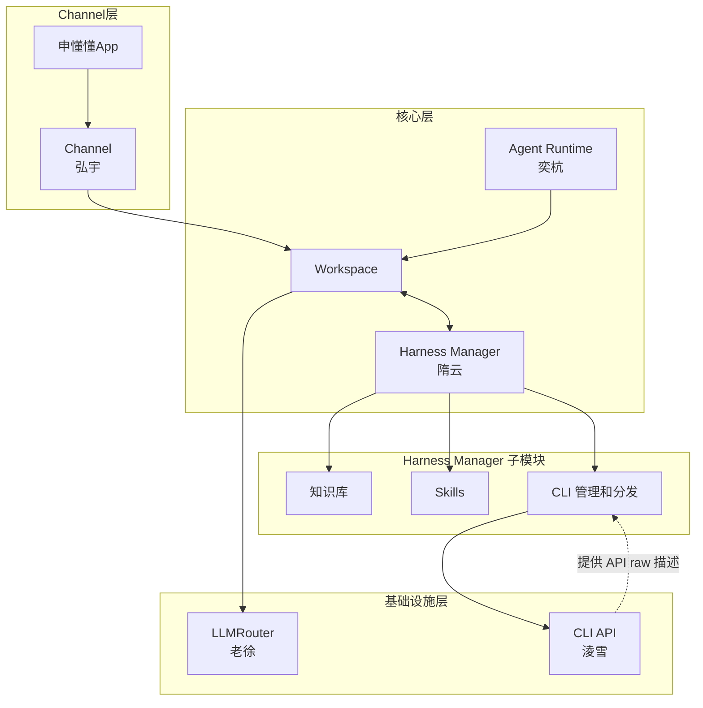

# 4.20 早会记录

## 模块架构图

---

## 沟通事项

1. **重点项目、亲力亲为、节奏拉起来**
2. **分工明确** - 5大模块分工如下：

| 模块                | 负责人 | 职责说明                                        |
| ----------------- | --- | ------------------------------------------- |
| ① Agent Runtime   | 奕杭  | -                                           |
| ② Harness Manager | 隋云  | 知识库、Skills、CLI 管理和分发                        |
| Workspace         | 老徐  | 与 Agent Runtime 和 Harness Manager 交互        |
| ③ Channel         | 弘宇  | 申懂懂App                                      |
| ④ LLMRouter       | 老徐  | -                                           |
| ⑤ CLI API         | 淩雪  | 提供API raw描述，无需考虑发现机制（由Harness的CLI管理和分发模块负责） |

> 备注：不清楚的现场聊清楚

---

## TODO

| 序号  | 事项                                    | 截止时间 |
| --- | ------------------------------------- | ---- |
| 1   | 输出详细方案（模块、一期范围、跟其他模块的交互方式）、人力评估、排期    | 今天   |
| 2   | 建立6个仓库（其中1个放文档），所有人学会用git（账号权限问题咨询老徐） | 今天   |
| 3   | 每天写日报（可用AI辅助）                         | 日常   |
| 4   | 习惯工作中使用AI，所有文档和日报用git管理               | 日常   |

---

## 待跟进

- 仓库权限配置（老徐提供方法）
- 团队git培训

