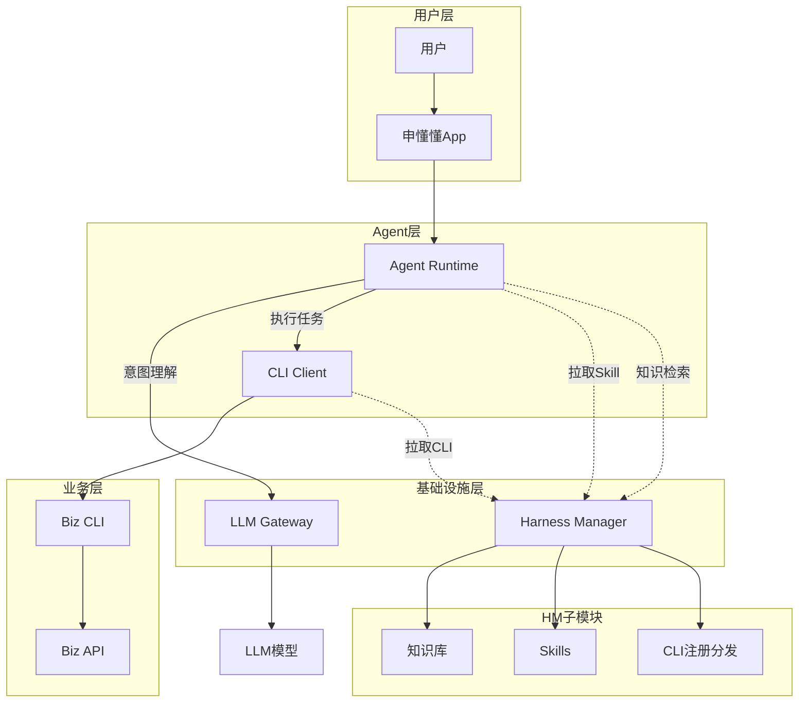
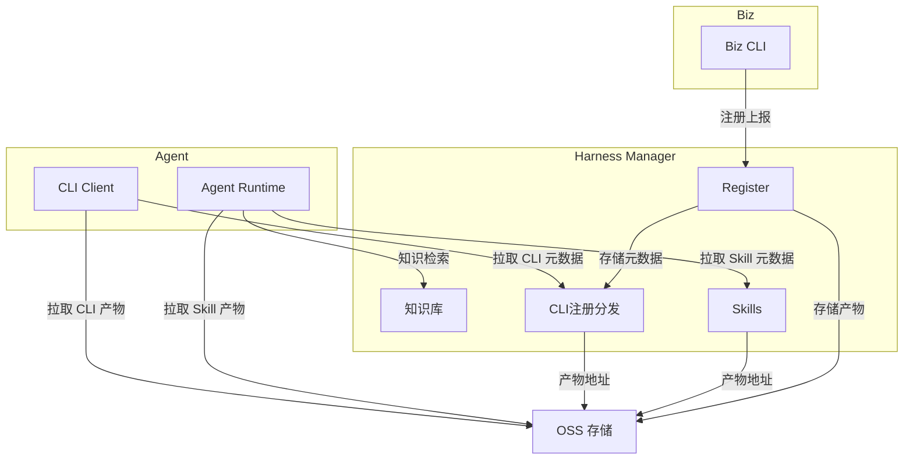
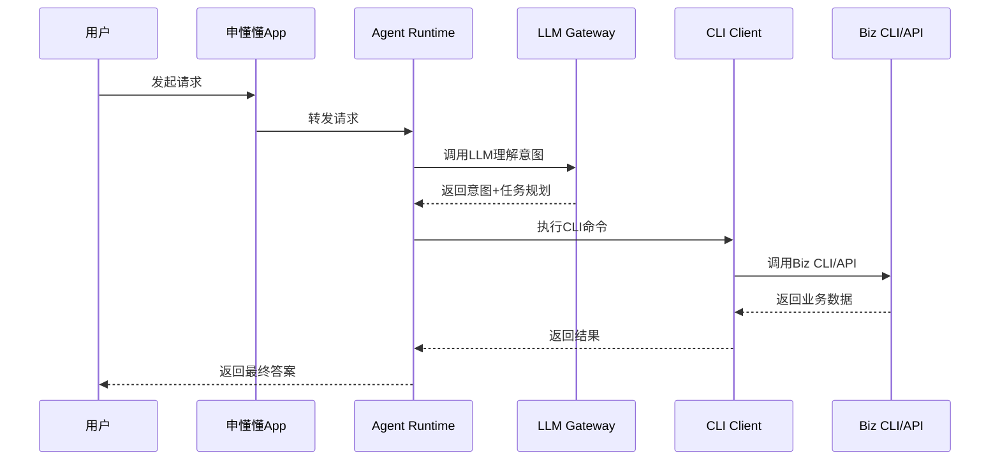

# Sai（STO AI）整体架构设计文档

> 作者：zhaobomin  
> 日期：2026-04-21  
> 状态：设计阶段

---

## 一、项目概述

Sai 是申通快递的企业级 AI 智能体平台，通过 CLI 封装业务能力，让 Agent 能够调用企业内部各业务系统，实现业务智能化。

---

## 二、系统架构

### 2.1 架构总览

### 2.2 HM 数据流详图

HM 作为控制面服务，有三条核心数据流：

### 2.3 核心调用链路

**两条核心链路：**

1. **意图理解链路**：用户 → App → Agent → LLM Gateway → LLM
2. **业务执行链路**：Agent → CLI Client → Biz CLI → Biz API

---

## 三、模块职责

| 模块 | 负责人 | 核心职责 | 一期交付 |
|------|--------|---------|---------|
| **Agent Runtime** | 奕杭 | Agent执行、意图理解、CLI调用 | 通用Agent + CLI Client |
| **LLM Gateway** | 老徐 | LLM统一代理、Token管理、成本控制 | 网关上线 + 个人令牌 |
| **Harness Manager** | 隋云 | 知识库、Skills、CLI注册分发 | 三模块基础能力 |
| **Channel** | 弘宇 | 用户接入、前端交互 | 申懂懂App接入 |
| **Biz CLI** | 淩雪 | 业务能力封装、鉴权、API调用 | CLI demo |

---

## 四、模块间接口依赖矩阵

| 接口 | 调用方 | 提供方 | 接口路径（草案） | 认证方式 | 对齐状态 |
|------|--------|--------|-----------------|---------|---------|
| LLM 调用 | Agent Runtime | LLM Gateway | `POST /v1/chat/completions`（OpenAI 格式） | Bearer Token（Gateway 分配的虚拟 key） | ✅ 已对齐 |
| Agent 会话 | Channel | Agent Runtime | `POST /agent/session` → `get_session` / `send_request` | 用户 Token 透传 | ⚠ 未写入文档 |
| Skill 拉取 | Agent Runtime | HM | `GET /hm/skills/list` + OSS 拉取执行包 | HM 内部 Token | ⚠ 隋云方案未出 |
| CLI 拉取 | CLI Client | HM | `GET /hm/cli/list` + OSS 拉取定义包 | HM 内部 Token | ⚠ 隋云方案未出 |
| CLI 注册 | Biz CLI | HM | `POST /hm/cli/register` | 业务方 Token | ✅ SDK 注解设计完成 |
| 知识检索 | Agent Runtime | HM | `POST /hm/kb/search` | HM 内部 Token | ⚠ 未定义 |
| 前端交互 | 申懂懂 App | Channel | 待定义 | 待定义 | ⚠ 宏宇方案未对齐 |

**对齐状态说明**：
- ✅ 已对齐：接口设计已完成，双方已确认
- ⚠ 未写入文档：口头确认但未形成书面契约
- ⚠ 方案未出：提供方方案文档尚未产出

---

## 五、Harness Manager 子模块

### 5.1 知识库

- 企业知识存储与检索
- Agent可进行知识检索辅助决策

### 5.2 Skills

- Skill注册与管理
- Agent从HM拉取Skill定义

### 5.3 CLI注册分发

- 业务方上报CLI元数据
- 存储CLI到OSS
- Agent从OSS拉取CLI定义

**关键设计**：
- HM不参与调用链路，只做资源分发
- CLI鉴权由Biz CLI自己负责

---

## 六、调用协议

### 6.1 意图理解链路

| 交互 | 协议 | 说明 |
|------|------|------|
| Agent → LLM Gateway | HTTP / OpenAI API | 统一OpenAI格式 |
| Gateway → LLM | HTTP | 模型调用 |

### 6.2 业务执行链路

| 交互 | 协议 | 说明 |
|------|------|------|
| Agent → CLI Client | 本地调用 | CLI命令执行 |
| CLI Client → Biz CLI | HTTP | CLI调用 |
| Biz CLI → Biz API | HTTP/RPC | 业务API调用 |

### 6.3 HM支撑交互

| 交互 | 协议 | 说明 |
|------|------|------|
| Agent → HM | HTTP/OSS | 拉取Skill、知识检索 |
| CLI Client → HM | HTTP/OSS | 拉取CLI定义 |
| 业务方 → HM | HTTP | CLI注册上报 |

---

## 七、一期验收标准

| 模块 | 验收标准 |
|------|---------|
| **Agent Runtime** | ① 支持 ≥3 个 Skill 挂载并执行；② 冷启动 <1s，热启动 <200ms；③ 完成 ≥1 个端到端场景联调（从用户提问到业务数据返回） |
| **LLM Gateway** | ① 支持 qwen 系列模型路由；② 支持 ≥5 个个人用户并发使用；③ 额度 80%/90%/100% 三级告警可触发 |
| **Harness Manager** | ① 完成 CLI 注册上报 + OSS 分发闭环；② 支持 ≥1 个业务 CLI 接入并拉取成功；③ Skill 拉取接口可用 |
| **Channel** | ① 申懂懂 App 可发起请求并收到 Agent 回复；② 完成 Agent SDK 前端集成 demo |
| **Biz CLI** | ① ≥1 个业务 CLI demo 上报 HM 并可被 Agent 调用 |

---

## 八、错误处理与降级矩阵

| 故障场景 | 影响范围 | 降级策略 | 负责人 |
|----------|---------|---------|--------|
| **HM 不可用** | Agent 无法拉取 Skill/CLI；知识检索中断 | Agent 本地缓存最近一次 Skill/CLI 定义，降级为无知识检索模式 | 隋云 |
| **LLM Gateway 熔断** | 意图理解链路完全中断 | Agent 返回固定提示："当前 AI 服务暂时不可用，请稍后重试"；业务执行链路不受影响 | 老徐 |
| **Biz API 超时/失败** | 单个 CLI 命令执行失败 | CLI Client 单次重试（≤3s 等待），失败后 Agent 向用户说明具体接口不可用 | 淩雪 |
| **OSS 不可用** | Agent 无法拉取新 Skill/CLI 执行包 | Agent 使用本地缓存版本运行，日志告警通知 HM 团队 | 隋云 |
| **Agent Runtime 实例崩溃** | 单个用户会话中断 | Serverless 平台自动重建实例，用户会话需重新发起 | 奕杭 |

---

## 九、已知风险与应对

| 风险 | 严重度 | 应对方案 | 负责人 |
|------|--------|---------|--------|
| **Claude Agent SDK 强依赖** | 高 | 做 SDK 抽象层，不直接耦合 Claude SDK；保留切换到其他 Agent SDK 的能力 | 奕杭 |
| **HM Skill/CLI 方案未出** | 高 | 隋云需在 4/25 前产出 Skill 分发和 CLI 注册的接口定义文档，否则 Agent 对接会返工 | 隋云 |
| **LLM Gateway 4/30 scope 偏大** | 中 | 4/30 先砍到最小可用：网关跑通 + 手动发 key + 基础告警，审批流和前端管理页面推到 5/15 | 老徐 |
| **OSS 挂载个性化需求未评估** | 中 | 阿里云个性化挂载接口需求已提交，若 4/30 前无结论则走 Agent 层自行实现文件权限的 B 方案 | 奕杭 |
| **Channel → Agent 交互协议未对齐** | 中 | 需与弘宇约时间对齐 Agent SDK 前端集成方案，否则前端接入会阻塞 | 弘宇 |
| **LLM Gateway 逃生方案未定** | 中 | 至少准备两个方案：① 业务侧 fallback 直连百炼原生 API；② Gateway bypass 模式一键关闭路由规则 | 老徐 |

---

## 十、上线策略

| 模块 | 灰度计划 | 回滚机制 |
|------|---------|---------|
| **Agent Runtime** | 先在 AI 销售助理项目内部灰度验证，验证通过后开放给申懂懂 App | Serverless 实例可秒级销毁重建，旧版本镜像保留在仓库可随时回滚 |
| **LLM Gateway** | 4/30 先面向产技个人用户开放，非生产流量验证；5/15 接入 DevOps 后开放应用级接入 | 网关支持 bypass 模式，一键切换为透传（不路由），业务侧可临时回退到直连百炼 |
| **Harness Manager** | 先接入 1 个业务 CLI demo 验证注册→分发→调用闭环，再逐步开放接入 | HM 为控制面服务，故障时 Agent 使用本地缓存 Skill/CLI 继续运行，不影响业务执行链路 |
| **Channel** | 申懂懂 App 内部测试环境先跑通，再灰度到小范围用户 | 前端回滚为标准版本，Agent 交互通道关闭 |

---

## 十一、参考文档

- [Agent-Runtime方案](../plan/Agent-Runtime方案.md)
- [LLM-Gateway建设方案](../plan/LLM-Gateway建设方案.md)
- [CLI注册上报数据结构与Tag设计](../plan/CLI注册上报数据结构与Tag设计.md)
- [harness-manager-cli设计](../plan/harness-manager-cli设计.md)