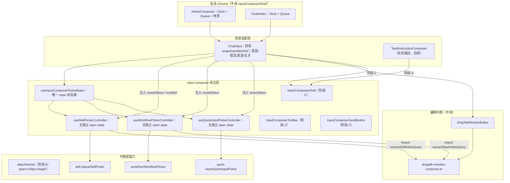

# ChatInput → InputComposer 可组合化重构 — 完整设计

> 状态：**阶段 E — 按需能力库**（2026-08-11）。Core / Body / Voice / EditDraft / AgentPicker 已进 `input-composer`；Chat / Task 各自按需装配。
> 关联场景：首页问答输入、对话页输入、定时任务「任务描述」复用输入框。
> 关联代码：
> - [`src/pages/Chat/ChatInput.tsx`](../src/pages/Chat/ChatInput.tsx)
> - [`src/components/task/TaskInstructionComposer.tsx`](../src/components/task/TaskInstructionComposer.tsx)
> - [`src/components/input-composer/`](../src/components/input-composer/)
> - [`src/components/dingtalk/DingTalkMentionEditor.tsx`](../src/components/dingtalk/DingTalkMentionEditor.tsx)
> - [`src/lib/dingtalk-mention-composer.ts`](../src/lib/dingtalk-mention-composer.ts)
> - [`src/pages/Home/HomeComposer.tsx`](../src/pages/Home/HomeComposer.tsx)

### 修订记录

1. **命名**：公共组合层目录与组件统一为 **`input-composer` / `InputComposer*`**，不再使用 `composer/`。
2. **本阶段优先**：先抽 Skill / Workflow / QuickInput **Picker 控制器**（hooks + Panel），再视需要抽壳 / 工具栏 / 附件。
3. **附件**：对齐 `quick-input/`、`workflow/`、`skill-plaza/`，独立 `attachments/` 目录；源 Picker UI 延后。
4. **内联触发**：`extractSkillInlineQuery` / `extractSlashInlineQuery` **留在编辑内核**；最高回归风险为活路径 **`/` slash**（`*` 打开路径现已注释关闭）。
5. **归属**：`composerSnapshot` / `mentionEditorRef` 归装配层（`ChatInput` / `TaskInstructionComposer`）；互关回调由装配层注入。
6. **边界**：`HomeComposer` ≠ `ChatInput` ≠ `TaskInstructionComposer`；dock / queue / 免责永不进 InputComposer 壳。
7. **壳内已有组件**：`DingTalkMentionPopover` / `VoiceComposerPanel` **已是独立组件，不搬家**；`HomeToolbarIconTooltip` 随工具栏抽到 `input-composer`；提及接线抽为 `useComposerDingTalkMention`（Chat/Task 共用），语音仍留 Chat。
8. **缺陷评审修订**（2026-08-11）：写死 mutex 持有 open 状态、controller 不另造 state；Panel **提到布局分叉外只挂一次**；skill 强制 `mentionPopoverHostRef`；写清 snapshot/Escape 组合；补阶段 B 交接与检查清单；补 `CHAT_EDIT_DRAFT_EVENT` 双份常量风险；修 `workflowPickerRef` 只绑 Panel 根；架构图补 `ChatInput → Shell`；下调阶段 A 瘦身预期；明确 `*`「结构保留」= select/query/consume，不含已删的 plainText sync effect。
9. **阶段 A 落地**（2026-08-11）：新增 `src/components/input-composer/`（mutex + 三 controller + 三 Panel）；`ChatInput` 接入并去掉本地 picker 状态与 Wf/Qi 双份挂载；`ChatInput` 约 2091 → 1859 行。
10. **阶段 B 落地**（2026-08-11）：新增 `src/components/attachments/`（types + AttachmentChips + useAttachmentStager）；`ChatInput` re-export `FileAttachment`；paste/DnD 仍留装配层；`ChatInput` 约 1859 → 1612 行。
11. **阶段 C 落地**（2026-08-11）：新增 `InputComposerShell` / `InputComposerToolbar` / Tooltip / `InputComposerSendButton`；ChatInput 经槽位装配；Mention/Voice 不搬家；home/default 工具栏双份消除；`ChatInput` 约 1612 → 1315 行。
12. **阶段 D 落地**（2026-08-11）：新增 `TaskInstructionComposer`（value↔snapshot 桥接、Enter=换行、可选技能/工作流/快捷输入）；`TaskCreateModal` 任务描述已替换 textarea；附件默认关（cron 暂不落盘）；美化按钮经 `toolbarRight`。
13. **Task ↔ Chat 对齐**（2026-08-11）：`useInputComposerPickers` + `useComposerDingTalkMention` 共用接线；Task 接钉钉 `@`；去掉弹窗独立 `DingTalkRecipientField`；提及暂用 `prepareDingTalkAgentTurnMessage` 写入 `message`，并双写 `dingTalkMentions` 列供 executor；编辑回显 `strip` + `setMentions`。Task **仍无** Agent/模型/语音/发送。
14. **阶段 E — 按需能力库**（2026-08-11）：`input-composer` = 按需能力库（**不要求**双端共用每一块）。落地 `useInputComposerCore`；`useInputComposerVoice` / `useInputComposerEditDraft` / `InputComposerAgentPicker`。**不提供**统一 `InputComposerBody`——Shell/Editor/Panels/Toolbar 由 `ChatInput` / `TaskInstructionComposer` **各自主文件插拔组装**。
15. **阶段 F（另文）**（2026-08-12）：内联混排 Segment 模型、多 skill/workflow 透传、气泡+编辑回显同款 chip——见 [`Composer内联混排-Segment模型与多SkillWorkflow透传.md`](./Composer内联混排-Segment模型与多SkillWorkflow透传.md)（方案定稿，待实现）。原「不改编辑内核」在本需求下作废。

---

## 1. 背景与问题

### 1.1 现状

`ChatInput.tsx` 约 2091 行，是首页 / 对话页问答输入的**装配主体**，同时承载：

- 编辑内核（`DingTalkMentionEditor`）
- 附件：原生对话框 → `/api/files/stage-paths`；粘贴/拖拽 → `/api/files/stage-buffer`；顶部 chips
- `@` 钉钉提及（`DingTalkMentionPopover`）
- 技能 Picker（**工具栏**；`*` 内联打开已注释关闭）、工作流 Picker（`/` slash + 工具栏）、快捷输入 Picker
- Agent 选择器代码仍在，生产硬关（`showAgentPicker = false`）
- 语音（`VoiceComposerPanel`）+ 确认倒计时
- 发送 / 停止 / 排队、Gateway 底栏

**Picker 挂载现状（阶段 A 要对齐）：**

| 组件 | 挂载次数 | 说明 |
|------|----------|------|
| `SkillPicker` | **1 次**（editor 旁） | 不随 home/default 分叉 |
| `WorkflowPicker` | home / default **各 1 次** | 近乎拷贝，阶段 A 合并为 1 |
| `QuickInputPicker` | home / default **各 1 次** | 同上 |
| 工具栏按钮行 | home / default **各 1 套** | 阶段 A **不合并**（留给阶段 C Toolbar） |

**边界澄清：**

| 层 | 职责 | 不包含 |
|----|------|--------|
| `HomeComposer` | 会话 chrome：`ParameterFormDock` + `PendingQueuePanel` + `ChatInput` + 免责 + 可选项目选择 | 不实现编辑器本身 |
| `ChatInput` | 输入框装配（editor / 工具栏 / 语音 / 提及 / 发送 / Picker） | 不负责 dock / queue / 免责 |
| 引擎 / 模型 | 由调用方经 `toolbarInlineSelectors` 注入 | 非 ChatInput 内建 |

生产路径下首页与对话页均为 **home** 布局（`HomeComposer`、`Chat/index` 均传 `composerLayout="home"`）；`composerLayout="default"` 仅是 prop 默认值 / 测试分支。代码内 `composerLayout` 的 JSDoc 仍写「其它页面不传」——**过时**，阶段 A 可顺手改正文注释。

### 1.2 问题

1. **表单场景难复用**：定时任务「任务描述」仍是普通 `<textarea>`，拿不到技能/工作流 token、附件。
2. **加 `mode === 'task'` 不可持续**：2000+ 行再分叉会爆炸。
3. **复制一份 ChatInput 不可维护**。
4. **Picker 逻辑双份拷贝**：home / default 两套布局各挂一份 `WorkflowPicker` / `QuickInputPicker` JSX，状态与 click-outside 全堆在 ChatInput。
5. **附件将升级为可插拔源**：需要独立 `attachments/`，不宜继续堆在 ChatInput。

### 1.3 关键洞察

- 技能 / 工作流 **token 样式**在编辑器插入的 `<span>` 上（`dingtalk-mention-composer.ts` + `surfaces.ts`），复用 `DingTalkMentionEditor` 即可保住样式；**不改编辑内核**。
- 可插拔能力已有目录约定：`components/quick-input/`、`workflow/`、`skill-plaza/`。附件与 InputComposer 组合层应对齐。
- 壳不是「固定挂一个 Editor」：语音会替换编辑区；mention / DnD 也挂在壳上。抽壳须预留槽位（后续阶段）。
- 技能 toolbar 定位依赖 `mentionPopoverRef`（host）与 `skillButtonRef` 算相对坐标——抽 controller 时必须注入 host ref。

---

## 2. 目标

1. 把 `ChatInput` 从「单文件大组件」拆成「**可组合 InputComposer + 可插拔能力 + 场景装配**」。
2. **本阶段（A）**：抽出 Skill / Workflow / QuickInput 的 **controller hooks + Panel**，消除 **Wf/Qi 双份 Panel JSX** 与本地 picker 状态。
   - **瘦身预期（务实）**：去掉三套 open/effect/select 与双份 Panel，大约少数百行量级；**home/default 双套工具栏按钮、语音状态机、附件、发送/Gateway 仍在**，行数不会腰斩。大块压缩在阶段 C。
3. **后续**：`attachments/`、`InputComposerShell` / `InputComposerToolbar` / 发送按钮、任务描述入口。
4. `ChatInput` 对外 props 与行为**向后兼容**；`HomeComposer` / `Chat/index` 等调用方零改动。
5. 公共命名统一：**`InputComposer`**（目录 `input-composer/`）。

### 非目标（明确不做）

- 不改 `DingTalkMentionEditor` / `dingtalk-mention-composer.ts`（含 `extract*Query`）。
- 不改 `useChatInputBindings` 对话语义。
- 本阶段不实现 `TaskCreateModal` 集成、不实现附件源 Picker 新 UI。
- 不动 `WorkflowComposerInput`（工作流列表页平行实现）。
- 不统一 `FileAttachment` 与发送载荷瘦类型（可记债）。
- 不恢复已关闭的 `*` 内联技能打开路径（恢复另开专项）。
  - 「结构保留」= 保留 **mode / inline query / consume / select** 收尾能力；**不含**已删除的 plainText sync effect，也不以完整注释块恢复打开路径。
- Agent picker 保持隐藏，本阶段不抽出（home/default 死代码双份可顺手不管，或阶段 C 随 Toolbar 自然消失）。

---

## 3. 目标架构

### 3.1 分层视图



> 归属约定：
> - `composerSnapshot` / `mentionEditorRef` **归装配层**。
> - **open 状态唯一来源 = mutex**（见 §3.1.1）；controller **不**再 `useState` 一份 open。
> - `ParameterFormDock` / `PendingQueuePanel` / 免责 **永远在 ChatInput 外**。

### 3.1.1 状态所有权（阶段 A 必遵，防双 state）

```text
useInputComposerPickerMutex
  ├── skillPickerOpen / setSkillPickerOpen / skillPickerMode / setSkillPickerMode
  ├── workflowPickerOpen / setWorkflowPickerOpen / workflowPickerSlashOpenRef
  ├── quickInputPickerOpen / setQuickInputPickerOpen
  └── toggleSkillToolbar / toggleWorkflowToolbar / toggleQuickInput / closeAll
        （toggle 内部已关其它；装配层仍可注入额外 closeOthers，如关 dingTalk）

useSkillPickerController({ mutex 字段, mentionEditorRef, plainText, mentionPopoverHostRef, closeOthers? })
  └── 无独立 open state；读写 mutex；负责 style 定位、query、select/consume、click-outside

useWorkflowPickerController({ mutex 字段, mentionEditorRef, plainText, isComposingRef, closeOthers? })
  └── 无独立 open state；负责 slash handleTextInput、snapshot 自动关、select consume/insert

useQuickInputPickerController({ mutex 字段, mentionEditorRef, closeOthers? })
  └── 无独立 open state；负责 click-outside、insert plainText、buttonRef
```

**禁止**：controller 内部再声明 `useState` 表示 open，再与 mutex 同步。

### 3.2 目录规划（完整，分阶段）

```text
# ── 阶段 A（Picker 抽取）────────────────────────────────
src/components/input-composer/
├── use-input-composer-picker-mutex.ts   # 唯一 open 状态源
├── use-skill-picker-controller.ts       # 必收 mentionPopoverHostRef
├── use-workflow-picker-controller.ts    # 含 / slash（最高风险）
├── use-quick-input-picker-controller.ts
├── SkillPickerPanel.tsx                 # 包装现有 SkillPicker；pickerRef 只绑此根
├── WorkflowPickerPanel.tsx              # pickerRef 只绑此根（修复现网双绑）
├── QuickInputPickerPanel.tsx
└── index.ts

# ── 阶段 B ──────────────────────────────────────────────
src/components/attachments/
├── types.ts                             FileAttachment
├── AttachmentChips.tsx                  含 AttachmentPreview / FileIcon / formatFileSize
├── use-attachment-stager.ts             pickFiles + stageBufferFiles + remove/clear*
└── index.ts
# 更后：AttachmentSource / AttachmentSourcePicker / sources/*

# ── 阶段 C：追加到 input-composer/ ──────────────────────
├── input-composer-shell.tsx
├── input-composer-toolbar.tsx
├── input-composer-toolbar-icon-tooltip.tsx
├── input-composer-send-button.tsx

# 已存在，不迁入 input-composer
# src/components/dingtalk/DingTalkMentionPopover.tsx
# src/components/chat/VoiceComposerPanel.tsx

# Chat 专属、可选（不进可复用核心）
# src/pages/Chat/use-chat-voice-composer.ts
# src/pages/Chat/use-chat-dingtalk-mention-host.ts

src/components/task/TaskInstructionComposer.tsx   # 阶段 D
src/pages/Chat/ChatInput.tsx                      # 装配层
src/lib/dingtalk-mention-composer.ts              # 不动
```

### 3.2.0 已有组件能否「一并拆分」

| 对象 | 现状 | 是否抽进 InputComposer | 建议 |
|------|------|------------------------|------|
| `HomeToolbarIconTooltip` | 定义在 `ChatInput.tsx` 局部（~20 行） | **是** | 阶段 C 随 Toolbar 迁入 |
| `DingTalkMentionPopover` | 已在 `components/dingtalk/` | **否（不搬家）** | 阶段 C 经 `mentionPopover` 槽；可选 Chat 专属 host hook |
| `VoiceComposerPanel` / `VoiceTopCrawlWave` | 已在 `components/chat/` | **否（不搬家）** | 阶段 C 经 `editorOrOverlay`；状态机可选抽 `pages/Chat` |
| `FlyToTargetLayer` | 已有独立组件 | **否** | 装配层保留；Qi controller 暴露 `buttonRef` |

原则：**能复用到任务描述的进 `input-composer`；对话专属状态机留在 Chat；已经独立的 UI 只接线不搬文件。**

### 3.2.1 InputComposerShell 槽位（阶段 C 必遵）

| 槽位 / 能力 | 用途 |
|-------------|------|
| `chips` | 顶部 AttachmentChips（阶段 B 产出，阶段 C 填槽） |
| `editorOrOverlay` | Editor；语音时换 VoiceComposerPanel |
| `mentionPopover` | DingTalkMentionPopover |
| `toolbarLeft` | InputComposerToolbar |
| `toolbarRight` | mic / voice cancel / toolbarInlineSelectors / SendButton |
| `onDragOver` / `onDragLeave` / `onDrop` | 拖拽态与 stageBuffer 转发 |
| `flyToTargetRef`（可选） | 快捷输入 FlyToTargetLayer |

另：`VoiceTopCrawlWave` 可作为壳顶可选槽或放在 `editorOrOverlay` 外由装配层并列传入。

### 3.3 附件（阶段 B）：双入口 stager + 与 C 交接

```text
入口 A：dialog → filePaths → /api/files/stage-paths
入口 B：粘贴/拖拽 File[] → /api/files/stage-buffer
         ↓
useAttachmentStager → FileAttachment[] → AttachmentChips
```

**阶段 B 迁出：**

- `FileAttachment`、`formatFileSize`、`FileIcon`、`readFileAsBase64`、`AttachmentPreview` → chips
- `pickFiles`、`stageBufferFiles`、`removeAttachment`、`clearAttachments`、`clearFailedAttachments`

**阶段 B 仍留在 ChatInput（装配）：**

- `handlePaste` / DnD handlers：**事件监听留装配层**，内部只调 `stageBufferFiles`（阶段 C 起也可经 Shell DnD 槽转发同一 stager）
- `canSend` / `allReady` / 发送时带 attachments / 清空
- 失败重试按钮 UI（调 `clearFailed` + `pickFiles`）
- 回形针按钮（阶段 C 进 Toolbar，回调仍接 stager）

**B → C 交接：** 阶段 B 落地后 chips 仍由 ChatInput 直接渲染；阶段 C 把同一 `<AttachmentChips />` 填进 Shell `chips` 槽，**不再**在 ChatInput 内联大段布局。

可插拔源（更后，非 B）：

```ts
type StageInput =
  | { kind: 'paths'; filePaths: string[] }
  | { kind: 'buffers'; files: File[] }
  | { kind: 'remoteRef'; /* 契约待定 */ };

interface AttachmentSource {
  id: string;
  label: string;
  icon: ReactNode;
  open: (ctx: {
    stage: (input: StageInput) => Promise<void>;
    onClose: () => void;
  }) => void | Promise<void>;
}
```

`FileAttachment` 迁移采用 **re-export**：`ChatInput` 继续 `export type { FileAttachment } from '@/components/attachments'`，消费方零改动。

---

## 4. 实施步骤

> 原则：**先抽 Picker（A）→ attachments（B）→ 壳/工具栏（C）→ 任务集成（D）**。每步可编译、行为不变。

### 阶段 A（当前）：InputComposer Picker 抽取

1. 新建 `src/components/input-composer/`。
2. **`useInputComposerPickerMutex`**：作为 **唯一** skill/workflow/quickInput open 状态源（含 `workflowPickerSlashOpenRef`、mode、toggles、`closeAll`）。不含 snapshot / editorRef。
3. **`useSkillPickerController` + `SkillPickerPanel`**：
   - **必收参数**：mutex 字段、`mentionEditorRef`、`plainText`（或 snapshot）、**`mentionPopoverHostRef`**（现 `mentionPopoverRef`）、可选 `closeOthers`。
   - 负责：toolbar 相对定位 style、inline query、select/consume、click-outside。
   - Escape：**不**在 controller 里绑全局键；由 ChatInput `handleKeyDown` 调 `skill.close()` / `consumeInlineOnClose()`（见下方组合约定）。
   - `*` 打开路径不恢复；保留 select/query/consume。
4. **`useWorkflowPickerController` + `WorkflowPickerPanel`**（**最高回归风险**）：
   - `/` → slash 开；`extractSlashInlineQuery`；consume；插 workflow/skill；无 `/` 自动关；toolbar toggle。
   - **`pickerRef` 只绑 Panel/Picker 根节点**（修复现网：同一 ref 曾绑按钮外包 div + Picker，后者覆盖）。
5. **`useQuickInputPickerController` + `QuickInputPickerPanel`**：click-outside、插入正文、暴露 `buttonRef` 给 `FlyToTargetLayer`。
6. 互关：mutex toggle 已关其它 picker；装配层再注入 `closeOthers`（如开 slash 时关 dingTalk mention）。**controller 互不持有。**
7. 收敛 `ChatInput.tsx`：
   - 删除本地三套 picker `useState` / click-outside / 双份 Wf·Qi Panel JSX。
   - **三份 Panel 提到 `isHomeComposer` 布局分叉之外，全文件只挂一次**（与现网 SkillPicker 一致）。
   - 工具栏按钮 **仍留 ChatInput 且 home/default 仍可双份**；只绑 controller/`mutex` 的 `toggle*` / `ref` / `open` 高亮。
   - 顺手修正 `composerLayout` JSDoc。
8. Agent picker 仍留 ChatInput（硬关）。

#### 装配层组合约定（防职责漂移）

```ts
// snapshot：装配层先更新自己的 state，再转发给 workflow（slash 自动关）
const handleComposerSnapshotChange = (snapshot: MentionComposerSnapshot) => {
  setComposerSnapshot(snapshot);
  workflow.onSnapshotChange(snapshot);
};

// Escape：仍在 editor onKeyDown（ChatInput），调用 controller.close
if (e.key === 'Escape' && skill.open) {
  e.preventDefault();
  skill.close(); // 内部按 mode 决定是否 consumeSkillInlineTrigger
  return;
}

// 发送 / editDraft 清空：mutex.closeAll() + 关 dingTalk
```

Controller 返回约定（示意；open 来自 mutex，非本地 state）：

```ts
{
  open: boolean; // 读自 mutex
  mode?: 'inline' | 'toolbar';
  buttonRef: RefObject<HTMLButtonElement>;
  pickerRef: RefObject<HTMLDivElement>; // 只绑 Panel 根
  toggleToolbar: () => void;           // 调 mutex.toggle*
  close: () => void;
  handleTextInput?: (text: string) => void;          // workflow
  onSnapshotChange?: (s: MentionComposerSnapshot) => void; // workflow：仅 slash 自动关，不 setComposerSnapshot
  panelProps: /* 交给 XxxPickerPanel */;
}
```

### 阶段 B（已落地）：attachments/

9. `types.ts` / `AttachmentChips`（含 Preview）/ `use-attachment-stager`（双入口 + remove/clear*）。
10. ChatInput：改用 stager + chips；`export type { FileAttachment } from '@/components/attachments'`。
11. paste/DnD **handlers 留 ChatInput**，只调 `stageBufferFiles`；失败重试按钮留 ChatInput。
12. **不建** SourcePicker（更后）。
13. 交接：chips 仍由 ChatInput 渲染，直到阶段 C 填入 Shell `chips` 槽。

### 阶段 C（已落地）：InputComposer 壳 / 工具栏 + 壳内槽位接线

本阶段落实 §3.2.0 / §3.2.1：抽出可复用壳与工具栏，并把已有独立 UI（提及 Popover、语音 Panel）经**槽位**挂上；对话专属状态机仍留在 Chat。

14. **`InputComposerShell`**（严格按 §3.2.1）
    - 暴露：`chips` / `editorOrOverlay` / `mentionPopover` / `toolbarLeft` / `toolbarRight` / DnD 转发 / 可选顶波 / `flyToTargetRef`。
    - **不内建** Editor、提及、语音实现。

15. **`InputComposerToolbar` + `HomeToolbarIconTooltip`**
    - 能力按钮：附件 / 技能 / 工作流 / 快捷输入；点击只回调。
    - 迁入局部 Tooltip；**合并 home/default 双套按钮 JSX**（此阶段才真正去掉工具栏双份）。
    - **不含** mic / send / 引擎选择器。

16. **`InputComposerSendButton`** → `toolbarRight`。

17. **`DingTalkMentionPopover`（不搬家）** → `mentionPopover` 槽；可选 `use-chat-dingtalk-mention-host.ts`（`pages/Chat`）。

18. **`VoiceComposerPanel` / `VoiceTopCrawlWave`（不搬家）** → `editorOrOverlay` / 顶槽；可选 `use-chat-voice-composer.ts`（`pages/Chat`）。

19. **收敛 `ChatInput` 装配**
    - `toolbarRight`：mic、语音取消、`toolbarInlineSelectors`、SendButton。
    - 槽位：chips（阶段 B）、mention、editor/voice、Picker Panel（阶段 A）。
    - 保留：发送逻辑、Gateway 底栏、失败附件重试、`CHAT_EDIT_DRAFT_EVENT` / `editDraft`、Agent 硬关、互关注入。
    - **瘦身 ≠ 壳变薄**：语音/提及/DnD 只是 DOM 下沉，逻辑仍归装配层。

阶段 C 验收：home Tooltip 样式不变；语音切换；`@` 与 `/`、技能互斥；工具栏不再双份 JSX；Shell 槽位齐全。

### 阶段 D（已落地）：任务描述

20. `TaskInstructionComposer` + 接入 `TaskCreateModal`（Enter=换行；value↔snapshot 桥接；**含钉钉提及**；无语音/发送/Agent/模型）。独立收件人表单已移除；提及暂 bake 进 `message`。

```ts
export interface TaskInstructionComposerProps {
  value: string;
  onChange: (text: string) => void;
  initialMentions?: DingTalkMention[];
  attachments?: FileAttachment[];
  onAttachmentsChange?: (list: FileAttachment[]) => void;
  placeholder?: string;
  disabled?: boolean;
  invalid?: boolean;
  enableAttachments?: boolean; // Modal 当前 false（保存链路未接附件）
  enableSkill?: boolean;
  enableWorkflow?: boolean;
  enableQuickInput?: boolean;
  enableDingTalkMention?: boolean; // 默认 true
  toolbarRight?: ReactNode; // 如 AI 美化
  onSnapshotChange?: (snapshot: MentionComposerSnapshot) => void;
}
```

---

## 5. 影响面与回归

### 5.1 阶段 A 直接影响

| 文件 | 变化 |
|------|------|
| `src/components/input-composer/*` | **新增** |
| `src/pages/Chat/ChatInput.tsx` | 接 mutex/controllers；Panel 只挂一次；删本地 picker 状态与双份 Wf/Qi JSX；工具栏按钮仍双份 |
| `skill-plaza` / `workflow` / `quick-input` 内 Picker | **不搬家** |
| `HomeComposer` / dock / queue | 不动 |

**`FileAttachment` 消费方**（阶段 B 靠 re-export 零改动）：

- `Chat/index.tsx`、`ChatInput.tsx`、`HomeComposer.tsx`、`HomeAssistant.tsx`、`HomeMainConversation.tsx`
- `use-home-chat-entry-send.ts`、`use-chat-input-bindings.ts`、`use-sto-task-subitem-entry.ts`
- `dispatch-chat-send.ts`、`stores/message-queue.ts`

**事件常量（非 FileAttachment，改名须两边一起）：**

- `ChatInput` 导出 `CHAT_EDIT_DRAFT_EVENT`；`HomeAgentHubSurface` 从 ChatInput import。
- `ChatMessage.tsx` 有**本地同名常量副本**——本阶段不改事件名；若日后重命名须两边一起改。

### 5.2 回归清单

**阶段 A 必测：**

- **〔最高风险〕`/` slash 工作流**：打开 → picker → consume → 插 workflow/skill；无 `/` 自动关；与技能/快捷输入互斥。
- 技能**工具栏**：打开 / 插入 / **相对 host 定位** / 点外关闭 / Escape（经 `skill.close()`）。
- 快捷输入：插入、`FlyToTargetLayer` 的 `buttonRef` 不断。
- 发送清空、`editDraft` / `CHAT_EDIT_DRAFT_EVENT` 回填时 `mutex.closeAll()`。
- 全局仅 **一份** Skill/Workflow/QuickInput Panel；click-outside 仍有效（`pickerRef` 只绑 Panel 根）。
- home / default 按钮高亮与行为一致（生产以 home 为主）。

**后续阶段追加：**

- **阶段 B**：对话框 / 粘贴 / 拖拽 / 删除 / 失败重试；re-export 编译通过。
- **阶段 C**：
  - Tooltip 迁入后样式不变；工具栏双份 JSX 消除。
  - Shell 槽位：chips / editor↔voice / mention / toolbar / DnD。
  - `@` 提及与 IME；语音确认流；发送/停止/排队；Gateway disabled。
  - Mention/Voice **文件路径不变**。
- **阶段 D**：Enter=换行；token 样式；接钉钉提及；无语音/发送。
- Agent 保持隐藏；`tsc` / lint 通过。

### 5.3 风险与对策

| 风险 | 对策 |
|------|------|
| `/` slash + 工具栏互斥回归 | 单列 workflow controller；互关由 mutex + 装配层注入 |
| mutex 与 controller 双份 open state | §3.1.1：mutex 唯一来源；controller 禁止本地 open state |
| Panel 仍挂在 home/default 分叉内 | 验收：全文件各 Panel 仅一次挂载 |
| skill 定位丢失 | 强制 `mentionPopoverHostRef` |
| snapshot/Escape 职责漂移 | §4 组合约定：装配层 setSnapshot 再转发；Escape 调 `skill.close()` |
| `workflowPickerRef` 双绑 | 只绑 Panel 根 |
| 阶段 A 瘦身预期过高 | §2：明确工具栏双份留到 C；语音/附件仍在 |
| 误把 `*` 死路径当最高风险 / 误恢复 effect | 以 `/` 为准；结构保留不含 sync effect |
| 抽壳槽位不够 | §3.2.1 |
| 误搬 Mention/Voice 进 input-composer | 只经槽位；状态机留 `pages/Chat` |
| `FileAttachment` 迁移 | re-export |
| `CHAT_EDIT_DRAFT_EVENT` 只改一边 | 影响面写明 ChatMessage 本地副本 |
| 误把 dock/queue 吸入壳 | 边界表写死 |

---

## 6. 任务描述集成要点

- `TaskInstructionComposer` ≠ 缩小版 `HomeComposer`：前者是**表单字段**（受控存储/回显），后者是**会话 chrome**；二者共用 pickers + 钉钉提及接线，不含语音/发送。
- 组合：`InputComposerShell` + `DingTalkMentionEditor` + 精简工具栏（附件/技能/工作流/快捷输入可选）。
- Enter = 换行；不接 `useChatInputBindings`。
- **桥接**：`value`/`onChange`（plainText）+ 可选 `onSnapshotChange`；外部变更（美化/模板）经 `setPlainText` 回写。
- `@` 关闭（收件人由 `DingTalkRecipientField` 承载）。
- 附件能力已具备；`TaskCreateModal` 当前 `enableAttachments={false}`（保存 API 未接附件）。
- 技能 token 不进入 plainText；工作流标签文本会进入 `message`。技能元数据落库若需要可后续扩 `onSnapshotChange` / 保存载荷。

---

## 7. 落地检查清单

### 阶段 A（当前）

- [x] `input-composer/`：mutex（唯一 open 源）/ 三个 controller（无本地 open state）/ 三个 Panel / `index.ts`
- [x] skill controller 接收并使用 `mentionPopoverHostRef`
- [x] `pickerRef` 只绑各 Panel 根；Wf/Qi 不再双份挂载
- [x] ChatInput：`handleComposerSnapshotChange` = setSnapshot + `workflow.onSnapshotChange`；Escape → `skill.close()`
- [x] 工具栏按钮可仍双份；不要求阶段 A 合并
- [ ] `/` slash、工具栏技能定位、快捷输入、互斥、FlyToTarget 回归通过（需手工验证）
- [x] 顺手修正 `composerLayout` JSDoc
- [x] `tsc` / lint 无新增错误（相对本改动）
- [x] 文档状态可改为「阶段 A 已落地」

### 阶段 B（attachments）

- [x] `attachments/types` + `AttachmentChips` + `use-attachment-stager`
- [x] ChatInput re-export `FileAttachment`；消费方零改 import
- [ ] 对话框 / 粘贴 / 拖拽 / 删除 / 失败重试（需手工验证）
- [x] chips 仍由 ChatInput 渲染（待 C 填槽）

### 阶段 C（壳 / 工具栏 / 槽位）

- [x] `InputComposerShell` 槽位齐全（§3.2.1）；`ChatInput` 使用 Shell（非仅 TaskComposer）
- [x] Toolbar + Tooltip 迁出；**home/default 工具栏双份消除**
- [x] SendButton 经 `toolbarRight`；Mention/Voice **未搬家**仅经槽位
- [x] 未抽 Chat 专属 voice/mention hooks（可选，延后）
- [ ] 语音 overlay、`@`、发送/排队、DnD 回归通过（需手工验证）

### 阶段 D（任务描述）

- [x] `TaskInstructionComposer`：Shell + Editor + value 桥接；Enter=换行；钉钉 `@`；无语音/发送
- [x] `useInputComposerPickers` / `useComposerDingTalkMention`：Chat + Task 共用
- [x] `TaskCreateModal`：去掉独立收件人；提及 bake 进 message + 列双写
- [x] 可选技能 / 工作流 / 快捷输入 / 附件开关；Toolbar `show*` 支持
- [x] `TaskCreateModal` 接入；美化经 `toolbarRight`；附件暂关
- [ ] 创建/编辑任务、美化回写、`/` 插工作流、Enter 换行（需手工验证）

### 阶段 E（按需能力库）

- [x] 原则：能力库按需选用，非双端必须共用
- [x] `useInputComposerCore`（状态）；**无**统一 Body——各场景主文件自行组装
- [x] `useInputComposerVoice` / `useInputComposerEditDraft`
- [x] `InputComposerAgentPicker`（合并迁入；旧 ChatAgent* 文件已删）
- [x] `ChatInput` / `TaskInstructionComposer` 各自插拔组装 Shell+Editor+Panels
- [ ] Chat 发送/排队/语音/`@`/`/`；Task `@`/回显/bake（需手工验证）
