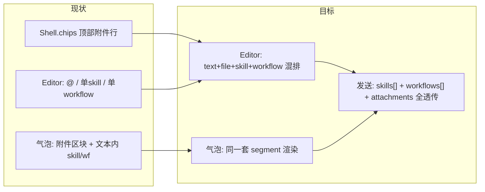

# Composer 内联混排 — Segment 模型 + 多 Skill/Workflow 透传

> 状态：**方案定稿（待实现）**  
> 日期：2026-08-12  
> 前置：[`ChatInput-InputComposer可组合化重构设计.md`](./ChatInput-InputComposer可组合化重构设计.md)（阶段 A–E 已落地）  
> 相关（正交）：[`Composer附件-上传菜单与数据中心选文件.md`](./Composer附件-上传菜单与数据中心选文件.md)（四源菜单，可并行）  
> 关联代码：
> - [`src/lib/dingtalk-mention-composer.ts`](../src/lib/dingtalk-mention-composer.ts)
> - [`src/components/dingtalk/DingTalkMentionEditor.tsx`](../src/components/dingtalk/DingTalkMentionEditor.tsx)
> - [`src/components/input-composer/`](../src/components/input-composer/)
> - [`src/components/attachments/`](../src/components/attachments/)
> - [`src/pages/Chat/ChatInput.tsx`](../src/pages/Chat/ChatInput.tsx)
> - [`src/pages/Chat/ChatMessage.tsx`](../src/pages/Chat/ChatMessage.tsx)
> - [`src/hooks/dispatch-chat-send.ts`](../src/hooks/dispatch-chat-send.ts)
> - [`src/stores/chat/send-actions.ts`](../src/stores/chat/send-actions.ts)

### 修订记录

1. **2026-08-12**：初稿定稿。产品要求：文件与正文 inline 混排；技能/工作流可任意多个并存；消息气泡 + 输入框编辑回显同款 chip；发送全量透传（多 skill + 多 workflow）。
2. **2026-08-12**：锁定「发给模型的数据」bake 规则（Gateway 仍为 text + media；客户端按 segments 组装）。
3. **2026-08-12**：对照 `feat/refactor-scheduled-tasks` 最新代码复扫：InputComposer A–E 已落地；本方案产品缺口未变。
4. **2026-08-12**：明确 file 契约前向兼容——在线文件仍归一成同一 `type: 'file'`；可选 `provenance` 挂在注册表/持久化节点，**不**拆 segment 判别式、**不**改 Gateway bake（见 §4.4）。因下一迭代即做四源菜单，本方案落地时做最小接线位（Toolbar 菜单回调、`stageDataCenterFiles` 签名、统一 `insertAttachment` 出口）。
5. **2026-08-12**：**范围收窄**——本次仅改 **Chat 主输入框**（含对话气泡/编辑回显/发送）；`TaskInstructionComposer` 等其它场景待 Chat 主路径完成后再跟进（见 §1.3 / §1.4）。

---

## 1. 背景与问题

### 1.1 最新代码基线（2026-08-12）

InputComposer **阶段 A–E 已落地**：

- `ChatInput` ≈ **615 行**装配层
- `input-composer/`：Shell / Toolbar / Core / Voice / EditDraft / 三 Picker
- `attachments/`：`AttachmentChips` + `useAttachmentStager`
- `TaskInstructionComposer` 已复用同一套

### 1.2 产品缺口（本方案要解决）

| 目标项 | 现状事实 |
|--------|----------|
| 文件与正文混排 | 仍走 Shell `chips` → `AttachmentChips`；编辑器无 `attachment-token` |
| 技能/工作流任意多个并存 | `MentionComposerSnapshot` 仍 `skill?` + `workflowId?`；`insertSkillSpan` / `insertWorkflowSpan` 仍互删 |
| 气泡 + 输入框同款 chip 回显 | Edit draft 事件可带 workflow，但消息「编辑」只传 text+skill；应用时 `clearAttachments()`；无 `_composerSegments` |
| 发给模型的 bake | 仍单 `skillMeta` / 单 `workflowId` 分流 |

### 1.3 已拍板决策

1. **发送**：多 skill + 多 workflow **全部透传**（改应用内发送契约；Gateway RPC schema 不改，客户端 bake）。
2. **回显范围**：消息气泡 **与** 输入框都要和输入时一样混排（含文件 / 技能 / 工作流 chip）。
3. **保留**：Picker 浮层 mutex（同一时间只开一个 picker）不变——这与内容互斥无关。
4. **范围（本次）**：仅改动 **Chat 主输入框场景**（`ChatInput` + 用户气泡混排 + 编辑回显 + Chat 发送链路）。任务模块（`TaskInstructionComposer` / `TaskCreateModal` 等）及其它非 Chat 主输入框场景，**等 Chat 主路径调整完成后再单独跟进**。

### 1.4 非目标

- 不改 OpenClaw Gateway RPC 增加结构化 skill/workflow 字段（另开专项）。
- 不恢复已关闭的 `*` 内联技能打开路径。
- 附件四源菜单（数据中心选文件）见独立文档，本方案不阻塞、不合并实现。
- 定时任务 cron 附件持久化字段改造不在本次。
- **本次不接线 Task / 其它 Composer 场景**：不改 `TaskInstructionComposer` 的 chips 布局与发送/落库；共享内核若升级，须对 Task **保持可编译、旧行为可用**（见 §6 阶段 2 说明），跟进迭代再切 inline。

---

## 2. 目标

把 Composer 从「正文 + 顶部附件双轨、技能/工作流单值互斥」升级为 **统一有序 Segment 内容模型**（**本次落地范围 = Chat 主输入框 + 气泡/编辑/发送**；Task 等后置）：

1. 添加的文件与正文不分开（光标处 inline chip）。
2. 技能和工作流可任意添加、可并存（不再互斥、不再限一个）。
3. 编辑回显与输入时样式一致，含全部 chip（数据格式可 round-trip）。
4. 发送时多 skill / 多 workflow 全量透传；模型侧收到 bake 后的 text + 媒体附件。

---

## 3. 现状与目标差距



| 点 | 现状 | 目标 |
|----|------|------|
| 文件 | `AttachmentChips` 在 Shell `chips` 槽，与正文分离 | 光标处插入 file token，与正文混排 |
| 技能/工作流 | `insertSkillSpan` / `insertWorkflowSpan` 互删 + snapshot 单值 | 可任意多个、可并存（append，不互斥） |
| 发送 | `skillMeta?` + `workflowId?` 标量；附件旁路数组 | `skillMetas[]` + `workflows[]` + 有序 segments；附件仍 stage，布局进 segments |
| 编辑回显 | 只回 text+skill，并 `clearAttachments()` | 输入框/气泡同一套 chips 混排回填 |

> 原重构文档「不动编辑内核」在本需求下作废；内核是本改造的主战场。

---

## 4. 核心设计：有序 Segment 内容模型

在 `dingtalk-mention-composer.ts` 引入统一序列——**输入、发送本地元数据、气泡、编辑回填的单一真相**。

### 4.1 类型

```ts
type ComposerSegment =
  | { type: 'text'; text: string }
  | { type: 'mention'; mention: DingTalkMention }
  | { type: 'skill'; slug: string; title: string }
  | { type: 'workflow'; id: string; name: string; source?: string }
  | { type: 'file'; attachmentId: string }; // 指向 FileAttachment 注册表

interface MentionComposerSnapshot {
  plainText: string;           // 兼容：由 segments 派生（skill/file 不占字符策略保持一致）
  segments: ComposerSegment[]; // 新主字段
  mentions: DingTalkMention[];
  skills: SkillMeta[];         // 由 segments 派生，替代 skill?
  workflows: Array<{ id: string; name: string; source?: string }>; // 替代 workflowId?
  attachmentIds: string[];     // 由 segments 派生，保序
  isEmpty: boolean;
  // 过渡期可保留 skill?/workflowId? 只读兼容，或一次性改完调用方
}
```

### 4.2 附件双层职责

| 层 | 职责 | 落点 |
|----|------|------|
| **注册表** | stage 状态 / `stagedPath` / preview / error | `useAttachmentStager` → `FileAttachment[]` |
| **布局** | 在正文中的位置与 chip UI | editor DOM：`span.attachment-token[data-attachment-id]` → `segments` |

发送时：walk segments → 组装 gateway 文本 + `attachments`（按出现顺序取 ready）+ `skillMetas[]` + `workflows[]`；本地乐观消息写入 `_composerSegments`（文件节点展开为文件元数据，不依赖易失 `attachmentId`）。

### 4.3 本地消息持久化字段

```ts
// RawMessage 扩展
_composerSegments?: PersistedComposerSegment[]; // file 节点内联 fileName/mime/...，非 attachmentId
_skillMetas?: SkillMeta[];     // 多 skill；旧 _skillMeta 做兼容读取
_attachedFiles?: ...;          // 过渡保留，可由 segments 派生，避免 merge 全挂

// 持久化 file 节点（示意）
type PersistedFileSegment = {
  type: 'file';
  fileName: string;
  mimeType: string;
  fileSize: number;
  preview: string | null;
  filePath?: string;       // 本地 staged / 可重开路径
  /** 可选：来源溯源；缺省 = 本地上传。在线文件下载 stage 后仍写 type:'file' */
  provenance?: FileProvenance;
};

type FileProvenance =
  | { kind: 'local' }
  | { kind: 'data_center'; spaceType: 'drive' | 'qa_artifact' | 'site_shared_artifact'; spaceId?: string | null; entryId: string };
```

### 4.4 在线文件要不要改契约？（定案：布局层不改）

与 [`Composer附件-上传菜单与数据中心选文件.md`](./Composer附件-上传菜单与数据中心选文件.md) 对齐：Chat 发送只认本地 `stagedPath`，在线文件确认后 **download → stage → 同一 `FileAttachment`**。

| 层 | 现在本地文件 | 以后在线文件 | 是否要改本方案契约 |
|----|--------------|--------------|--------------------|
| Composer segment（布局） | `{ type: 'file', attachmentId }` | **相同** | **不改** |
| 注册表 `FileAttachment` | `stagedPath` + status | 仍 `stagedPath`；**可选**加 `provenance?` | 仅加可选字段，判别式不变 |
| 持久化 `_composerSegments` file 节点 | fileName / mime / filePath… | 同上 + 可选 `provenance?` | 仅加可选字段 |
| Gateway bake | file **不写进** message；走 attachments 媒体 | **相同**（仍是 staged 本地路径） | **不改** |

**为什么不现在拆 `type: 'remote_file'` / 把 `entryId` 塞进 segment 主路径？**

1. 发送链路与气泡混排只关心「这里有一个文件 chip + 能 stage 的字节」；来源是 UI/重下细节，不是布局判别式。
2. 四源菜单方案已定：**不**给发送契约强绑 `entryId`，避免 Gateway 依赖远程引用。
3. 若将来 Gateway 支持「远程 URL / entry 直传」，再在 `FileAttachment` 上扩 `remoteRef?` 或第二入口；segment 仍可保持 `type: 'file'`，由注册表决定 stage 还是直传。

**本方案落地时建议（因下一迭代就要做四源菜单，做最小提前布局）**：

| 本迭代要做（接线位） | 本迭代不做（留给四源菜单文档） |
|----------------------|--------------------------------|
| `FileAttachment.provenance?` + 持久化 file 节点同字段（类型占位；本地填 `{ kind: 'local' }` 或省略） | `ComposerAttachMenu` / `DataCenterFilePickerModal` UI |
| stager 暴露稳定入口：`stagePaths` / `stageBufferFiles`，并预留 `stageDataCenterFiles(entries)` 空实现或 TODO 签名 | 真正 download + list spaces + 树多选 |
| 工具栏附件按钮：`onAttach` 改为「打开来源菜单」回调位（本迭代菜单可只有「添加本地文件」一项，或仍直接 `pickFiles`，但 **不要**把 `pickFiles` 写死进 Toolbar） | 四项菜单完整交互、网点共享可见性 |
| stage 成功后统一走 `insertAttachment(att)`（光标插 token）——**所有来源共用这一出口** | 改 Gateway / 远程直传 |

图示四项来源与契约映射（下迭代填满，本迭代只认第一项）：

| 菜单文案 | `provenance` | 进入 Composer 的路径 |
|----------|--------------|----------------------|
| 添加本地文件 | `{ kind: 'local' }` 或缺省 | dialog → `stagePaths` → `insertAttachment` |
| 添加在线文件 | `data_center` + `spaceType: 'drive'` | picker → download → stage → `insertAttachment` |
| 添加我的产物 | `data_center` + `qa_artifact` | 同上 |
| 添加网点共享产物 | `data_center` + `site_shared_artifact` + `spaceId` | 同上 |

**顺序建议**：先完成本文（inline + 多 skill/wf）并留下上表接线位 → 再做四源菜单；菜单确认后只接 `stage* → insertAttachment`，不再动 segment / bake。

不把 `spaceType` / `entryId` 做成 segment 必填字段；不拆 `type: 'remote_file'`。

---

## 5. 发送给模型的数据（已锁定）

Gateway RPC **仍然**是「一段 `message` 文本 + 媒体 attachments」，不新增结构化 skill/workflow 字段到 OpenClaw。客户端按 segments **bake** 成文本；本地 UI 另存 `_composerSegments`。

### 5.1 输入示例（用户在 Composer 看到的）

```text
[漳州客户运费细节.xlsx] 你把这个跟 [华东物流_客户运费明细.xlsx] 进行合并，
用 [中转费率查询] 核对，并执行 [运费合并工作流]
```

对应 segments（示意）：

```ts
[
  { type: 'file', attachmentId: 'a1' },
  { type: 'text', text: ' 你把这个跟 ' },
  { type: 'file', attachmentId: 'a2' },
  { type: 'text', text: ' 进行合并，用 ' },
  { type: 'skill', slug: 'transit-rate', title: '中转费率查询' },
  { type: 'text', text: ' 核对，并执行 ' },
  { type: 'workflow', id: 'wf_123', name: '运费合并工作流', source: 'mine' },
]
```

### 5.2 应用内发送契约（`SendMessageOptions` / 队列）

```ts
{
  text: string,              // → 见下方 gatewayText（或拆 displayText + gatewayText）
  attachments: FileAttachment[], // 按 segments 出现顺序，仅 status===ready
  skillMetas: SkillMeta[],   // 按出现顺序；替代原 skillMeta?
  workflows: Array<{ id: string; name: string; source?: string }>, // 按出现顺序
  dingTalkMentions?: DingTalkMention[],
  // 本地乐观/回填用（不进 Gateway RPC）
  composerSegments?: PersistedComposerSegment[],
}
```

### 5.3 真正发给模型的 Gateway payload

```ts
chat.send({
  message: gatewayText,   // 见下方组装规则
  attachments: [          // 媒体通道；顺序 = segments 中 file 出现序
    { fileName, mimeType, fileSize, stagedPath, preview },
    ...
  ],
  // 无 skillMetas / workflows 结构化字段
})
```

### 5.4 `gatewayText` 组装规则（按 segments 一遍 walk）

| segment | 写入 gatewayText | 旁路 |
|---------|------------------|------|
| `text` / `mention` | 原样拼接（mention 为 `@姓名`） | mentions 数组照旧 |
| `file` | **不写文件名** | push 到 `attachments[]` |
| `skill` | **正文位置不写 title**；收集 `defaultPrompt`，全部按出现序 **前置** 拼到整段文本最前（多 skill 用 `\n\n` 连接）；文末追加多个 `<!-- SClaw-Skill {...} -->` marker | `skillMetas[]` |
| `workflow` + `source==='mine'` | 在该位置写入 `帮我执行 id 为：{id} 的工作流 【{name}】` | `workflows[]` |
| `workflow` 非 mine | 该位置写可见名称（或仅作标签）；**仅第一个**非 mine 走 ParameterFormDock，其余不另开表单 | `workflows[]` |

多 skill 前置公式（兼容现网 `resolveSkillGatewayText`）：

```text
{prompt_1}

{prompt_2}

{body_from_segments}
<!-- SClaw-Skill {"slug":"...","title":"...","userText":"..."} -->
<!-- SClaw-Skill {"slug":"...","title":"..."} -->
```

其中 `body_from_segments` 对上例为：

```text
你把这个跟  进行合并，用  核对，并执行 帮我执行 id 为：wf_123 的工作流 【运费合并工作流】
```

（两个 file chip 不占正文；skill prompt 在最前；workflow 在原位置变成 exec 句。）

### 5.5 用户气泡 / 编辑回填用的本地数据（不发给模型）

```ts
message.content = displayText
// displayText：用户键入的纯文本（file/skill 不占字符；workflow 气泡用 tag 而非 exec 句）
// 或直接只信 _composerSegments 渲染，content 作兜底纯文本

message._composerSegments = [
  { type: 'file', fileName: '漳州客户运费细节.xlsx', mimeType, fileSize, preview, filePath },
  { type: 'text', text: ' 你把这个跟 ' },
  { type: 'file', fileName: '华东物流_客户运费明细.xlsx', /* ... */ },
  { type: 'text', text: ' 进行合并，用 ' },
  { type: 'skill', slug: 'transit-rate', title: '中转费率查询' },
  { type: 'text', text: ' 核对，并执行 ' },
  { type: 'workflow', id: 'wf_123', name: '运费合并工作流', source: 'mine' },
]
message._skillMetas = [{ slug: 'transit-rate', title: '中转费率查询' }]
message._attachedFiles = [ /* 由 file segments 派生，供旧逻辑过渡 */ ]
```

**分层原则**：模型只看 bake 后的 `message` + 文件媒体；chip 布局与多 skill/wf 元数据只活在客户端 `_composerSegments` / `_skillMetas`。

---

## 6. 实施阶段

### 阶段 1 — 编辑内核：多 token + 文件 token（最高优先级）

改 `src/lib/dingtalk-mention-composer.ts` + `DingTalkMentionEditor.tsx`：

1. **去掉内容互斥**：`insertSkillSpan` / `insertWorkflowSpan` 删除对方的 `remove*`；同类型改为 caret 处 append，不再全局清。
2. **serialize 改为数组**：walk DOM 推 `skills[]` / `workflows[]`，产出 `segments`。
3. **新增 attachment token**：`createAttachmentSpan(att)`（图标 + 文件名 + 可删 ×），`insertAttachmentSpan`，serialize 时 `type:'file'`；删除 chip 时回调移除注册表项。
4. **Editor handle 扩展**：`insertAttachment(att)`、`setSegments(segments, attachmentMap)`、`removeAttachmentToken(id)`；`insertSkill` / `insertWorkflow` 语义改为 append。
5. **单测**：扩展 `tests/unit/dingtalk-mention-composer-workflow.test.ts`——多 skill、多 workflow、skill+workflow 并存、file+text 混排、删除 token。

### 阶段 2 — Composer 装配：去掉顶部附件行，改为光标插入（仅 Chat）

**本次只改** `ChatInput.tsx`（及 Chat 侧对 `use-input-composer-core` / Shell 的用法）。**不改** `TaskInstructionComposer.tsx`。

1. Chat：`pickFiles` / `stageBufferFiles` **成功后**在 caret 插入 attachment token。推荐：**先插 staging token，ready 后更新 span 样式**。
2. Chat：Shell `chips` 槽不再挂完整 `AttachmentChips`；`hasChips` 逻辑改为看 editor 内是否有 attachment token / overlay。
3. Chat：粘贴有文件则 stage + 插 token；有纯文本则照旧 `insertPlainText`。
4. Chat：发送清空：`clear()` editor + `clearAttachments()` 注册表。
5. Picker controllers **不必改浮层互斥**；仅确认多次选择会多次 `insert*`。
6. **共享层约束**：若改 `use-input-composer-core` / Shell 默认行为，须用 **opt-in**（如 `inlineAttachments?: boolean`，Chat 开、Task 关）或保留旧 chips 路径，避免 Task 在未跟进前行为被带崩。内核 `segments` / 多 skill 可先落地，Task 侧继续读兼容字段（如 `skill?` ← `skills[0]`）即可。

> 跟进项（非本次）：`TaskInstructionComposer` 切同一套 inline + 可选四源菜单接线。

### 阶段 3 — 发送契约：多 skill + 多 workflow 全透传

改 `dispatch-chat-send.ts`、`send-actions.ts`、`optimistic-turn.ts`、`message-queue.ts`、相关 types：

1. `SendMessageOptions`：`skillMeta?` → `skillMetas?: SkillMeta[]`。
2. `workflows?: Array<{ id; name; source? }>`；**取消**「有 workflowId 就整段改写成单句 exec」与 skill 分支互斥分流。
3. **Gateway 文本组装**：严格按 §5——skill prompts 前置、file 走媒体、workflow(mine) 原位换成 exec 句、文末多 marker。
4. 乐观消息：写入 `_composerSegments` + `_skillMetas` + `_attachedFiles`。
5. `user-message-merge.ts` / skill cache：从单 `_skillMeta` 升级为多 skill 匹配，或优先用 segments 比对。

**说明**：OpenClaw gateway **不**改 RPC schema；「全透传」= 应用内 `skillMetas[]` / `workflows[]` / `segments` 全保留，客户端 bake 进现有 `message` + attachments。

### 阶段 4 — 气泡混排渲染

改 `ChatMessage.tsx` 用户气泡：

1. 新增 `UserComposerSegmentsContent`：按 `_composerSegments` 渲染 text / SkillMessageTag / WorkflowTag / FileChip（样式对齐输入框 chip）。
2. **去掉**用户消息「附件整块在气泡上方 + 文本气泡内仅 skill/wf」的分叉布局（至少对有 `_composerSegments` 的新消息）。
3. **兼容旧消息**：无 segments 时，由 `content` + `_skillMeta` + `_attachedFiles` + workflow regex **合成**一段 segments 再走同一渲染器。

### 阶段 5 — 编辑回填 Round-trip

改 `use-input-composer-edit-draft.ts`、`ChatMessage.tsx` `editAgain`、`Chat/index.tsx`：

1. `ChatEditDraftEventDetail` / `editDraft` 扩展为携带 `segments`（及附件元数据）。
2. 应用 draft：`setSegments(...)`；默认：**编辑回填携带 `filePath` / `stagedPath`，能复用则 ready，否则标 error 提示重选**。
3. 删除 `onAfterApply` 里无脑 `clearAttachments()` 与「只回 text+skill」；改为用 draft 重建注册表。
4. 统一 `CHAT_EDIT_DRAFT_EVENT` 常量，消除 ChatMessage 本地副本风险。

---

## 7. 关键文件（按层）

| 层 | 路径 | 本次 |
|----|------|------|
| 内核 | `dingtalk-mention-composer.ts`、`DingTalkMentionEditor.tsx` | 改（共享，注意 Task 兼容） |
| 附件 UI | `AttachmentChips` / 可选 `AttachmentInlineChip` | Chat 用 inline；Task 仍可暂用旧 chips |
| 装配 | **`ChatInput.tsx`**、`use-input-composer-core`（opt-in）、`input-composer-shell` | **仅 Chat 接线** |
| 装配（延后） | `TaskInstructionComposer.tsx` | **本次不动** |
| 发送 | `dispatch-chat-send.ts`、`send-actions.ts`、`optimistic-turn.ts`、`types.ts`、`message-queue.ts` | 改（Chat 发送路径） |
| 展示/编辑 | `ChatMessage.tsx`、`use-input-composer-edit-draft.ts`、`Chat/index.tsx` | 改 |
| 测试 | `tests/unit/dingtalk-mention-composer*.ts` + 发送组装单测 | 改 |
| 文档 | 本文 | 已定稿 |

**可复用落点（不必再拆 ChatInput）**：

- 内核：`dingtalk-mention-composer.ts` + `DingTalkMentionEditor`
- 装配（本次）：`ChatInput.tsx` + Core/Shell 的 Chat opt-in
- 发送：`dispatch-chat-send.ts`、`send-actions.ts`、`optimistic-turn.ts`
- 回显：`ChatMessage.tsx`、`use-input-composer-edit-draft.ts`

---

## 8. 风险与对策

| 风险 | 对策 |
|------|------|
| 改内核回归 `/` slash、`@`、IME | 阶段 1 单测 + 手工清单：slash 插 wf、@、多 skill、粘贴文件 |
| 用户消息 merge 依赖单 `_skillMeta` | 阶段 3 同步改 merge；旧字段兼容读取 |
| 历史消息无位置信息 | 合成 segments，不强求旧消息混排位置正确 |
| 编辑回填附件路径失效 | chip 可显，发送前校验 ready；失败提示重选 |
| 多 workflow「参数表单」模板路径 | mine 全透传按序 bake；**非 mine 仍只激活第一个模板表单**，其余当文本标签（避免 dock 多表单爆炸） |
| 共享内核影响 Task | Core/Shell **opt-in**；snapshot 保留 `skill?`/`workflowId?` 兼容派生；本次不改 Task 装配 |
| Task / 其它场景跟进滞后 | 接受短暂双轨（Chat inline、Task 顶部 chips）；Chat 验通后再切 Task |

---

## 9. 实施顺序与验收

### 9.1 顺序

1. 阶段 1 内核（可先不接 UI）→ 单测绿  
2. 阶段 2 **仅 Chat** 装配 → 主输入框可见「文件与正文混排」  
3. 阶段 3 发送 → 多 skill/wf 实际发出  
4. 阶段 4 气泡 → 展示与输入一致  
5. 阶段 5 编辑 → 回填含全部 chips  
6. （跟进，非本次）Task 等场景切同一套 inline  

### 9.2 验收标准

- [ ] **Chat 主输入框**：添加本地文件出现在光标处，可与汉字穿插；删 × 同时移注册表项  
- [ ] **Chat**：可连续插入多个技能、多个工作流，彼此不清除  
- [ ] **Chat**：发送后气泡内联样式与输入一致  
- [ ] **Chat**：「编辑」后输入框还原同一混排；可再发送（附件 ready 时）  
- [ ] Picker 浮层仍互斥；`/` 与工具栏行为不回归  
- [ ] Gateway 文本符合 §5 bake 规则（skill prompt 前置、file 走媒体、workflow exec 原位）  
- [ ] 旧消息（无 `_composerSegments`）气泡不崩，可合成展示  
- [ ] **Task 任务描述**：行为与改前一致（仍可用；不要求本次已 inline）  

### 9.3 检查清单

- [ ] `MentionComposerSnapshot.segments` + `skills[]` / `workflows[]`
- [ ] `insertSkillSpan` / `insertWorkflowSpan` 不再互删
- [ ] `attachment-token` 插入 / 序列化 / 删除
- [ ] Chat：Shell 顶部 `AttachmentChips` 主路径移除（Task 可暂留）
- [ ] `SendMessageOptions.skillMetas` / `workflows`
- [ ] `_composerSegments` 写入乐观消息
- [ ] `UserComposerSegmentsContent` 气泡渲染
- [ ] edit draft 携带 segments 并完整回填
- [ ] `CHAT_EDIT_DRAFT_EVENT` 常量统一
- [ ] **未改** `TaskInstructionComposer` 装配（或仅被动兼容）
- [ ] 单测 + Chat 手工回归通过
