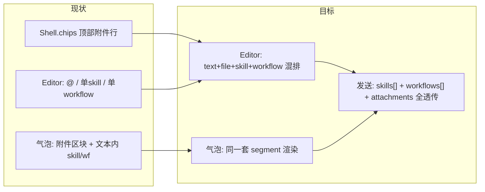

# Composer 内联混排 — Segment 模型 + 多 Skill/Workflow 透传

> 状态：**Chat 主路径 UI/契约已落地**；**阶段 6（模型位置语义 bake）已落地（待手工验收）**；Task / 四源菜单后置  
> 日期：2026-08-12  
> 范围：**仅 Chat 主输入框**（`ChatInput` + 用户气泡 + 编辑回显 + Chat 发送）；Task 等场景后置  
> 前置：[`ChatInput-InputComposer可组合化重构设计.md`](./ChatInput-InputComposer可组合化重构设计.md)（阶段 A–E 已落地）  
> 后续相关：[`Composer附件-上传菜单与数据中心选文件.md`](./Composer附件-上传菜单与数据中心选文件.md)（四源菜单；**依赖**本文留下的 `insertAttachment` / `provenance` / Toolbar 菜单回调位，不与本文并行改同一装配）  
> 跟进修复：[`Composer三处样式一致-乐观更新与回显配对.md`](./Composer三处样式一致-乐观更新与回显配对.md)（乐观/回显双气泡、钉钉 @ 三态样式；**依赖**本文 `_composerSegments`）  
> 关联代码：
> - [`src/lib/dingtalk-mention-composer.ts`](../src/lib/dingtalk-mention-composer.ts)
> - [`src/components/dingtalk/DingTalkMentionEditor.tsx`](../src/components/dingtalk/DingTalkMentionEditor.tsx)
> - [`src/lib/composer-gateway-text.ts`](../src/lib/composer-gateway-text.ts) ← **阶段 6 主改点**
> - [`src/components/input-composer/`](../src/components/input-composer/)
> - [`src/components/attachments/`](../src/components/attachments/)
> - [`src/pages/Chat/ChatInput.tsx`](../src/pages/Chat/ChatInput.tsx)
> - [`src/pages/Chat/ChatMessage.tsx`](../src/pages/Chat/ChatMessage.tsx)
> - [`src/hooks/dispatch-chat-send.ts`](../src/hooks/dispatch-chat-send.ts)
> - [`src/stores/chat/send-actions.ts`](../src/stores/chat/send-actions.ts)

### 修订记录

1. **2026-08-12**：初稿定稿。产品要求：文件与正文 inline 混排；技能/工作流可任意多个并存；消息气泡 + 输入框编辑回显同款 chip；发送全量透传（多 skill + 多 workflow）。
2. **2026-08-12**：锁定「发给模型的数据」bake 规则（Gateway 仍为 text + media；客户端按 segments 组装）。
3. **2026-08-12**：对照 `feat/refactor-scheduled-tasks` 最新代码复扫：InputComposer A–E 已落地；本方案产品缺口未变。
4. **2026-08-12**：明确 file 契约前向兼容——在线文件仍归一成同一 `type: 'file'`；可选 `provenance` 挂在注册表/持久化节点，**不**拆 segment 判别式、**不**改 Gateway bake（见 §4.4）。因下一迭代即做四源菜单，本方案落地时做最小接线位（Toolbar 菜单回调、`stageDataCenterFiles` 签名、统一 `insertAttachment` 出口）。
5. **2026-08-12**：**范围收窄**——本次仅改 **Chat 主输入框**（含对话气泡/编辑回显/发送）；`TaskInstructionComposer` 等其它场景待 Chat 主路径完成后再跟进（见 §1.3 / §1.4）。
6. **2026-08-12**：全文复核——修正「四源菜单可并行」为依赖后续；阶段 1 强制保留 `skill?`/`workflowId?` 兼容派生；验收补齐接线位与 Home→ChatInput 在范围内说明。
7. **2026-08-12**：**Chat 主路径已落地**（阶段 1–5）：内核 segments、Chat inline 附件、`buildComposerGatewayPayload`、气泡混排、编辑回填；Task 仍顶部 chips / `inlineAttachments: false`。
8. **2026-08-12**：**拍板「B：模型也要位置语义」**——`gatewayText` 在 file/skill 原位写入占位符（工作流保持原位 exec 句）；**媒体通道不变**（file 仍走 `attachments`/`media`）；UI 气泡仍只信 `_composerSegments`，`displayText` 不加占位。新增 **阶段 6**（见 §5 / §6）。
9. **2026-08-12**：**阶段 6 已落地**——`composer-gateway-text.ts` 原位 `[文件:]` / `[技能:]`，`]` 转义，单测覆盖 §5.1 示例。
10. **2026-08-12**：跟进缺陷另文跟踪——工作流执行中双用户气泡、钉钉 @ 乐观/回显/编辑三态不一致；见 [`Composer三处样式一致-乐观更新与回显配对.md`](./Composer三处样式一致-乐观更新与回显配对.md)。
11. **2026-08-12**：三处样式一致 **A–D 已落地**（共享气泡渲染 + 配对/回写/清乐观/编辑禁脏占位）；Task 装配仍后置。

---

## 1. 背景与问题

### 1.1 最新代码基线（2026-08-12）

InputComposer **阶段 A–E 已落地**：

- `ChatInput` ≈ **615 行**装配层
- `input-composer/`：Shell / Toolbar / Core / Voice / EditDraft / 三 Picker
- `attachments/`：`AttachmentChips` + `useAttachmentStager`
- `TaskInstructionComposer` 已复用同一套

### 1.2 产品缺口（本方案要解决）

| 目标项 | 现状事实 |
|--------|----------|
| 文件与正文混排 | 仍走 Shell `chips` → `AttachmentChips`；编辑器无 `attachment-token` |
| 技能/工作流任意多个并存 | `MentionComposerSnapshot` 仍 `skill?` + `workflowId?`；`insertSkillSpan` / `insertWorkflowSpan` 仍互删 |
| 气泡 + 输入框同款 chip 回显 | Edit draft 事件可带 workflow，但消息「编辑」只传 text+skill；应用时 `clearAttachments()`；无 `_composerSegments` |
| 发给模型的 bake | 仍单 `skillMeta` / 单 `workflowId` 分流 |

### 1.3 已拍板决策

1. **发送**：多 skill + 多 workflow **全部透传**（改应用内发送契约；Gateway RPC schema 不改，客户端 bake）。
2. **回显范围**：消息气泡 **与** 输入框都要和输入时一样混排（含文件 / 技能 / 工作流 chip）。
3. **保留**：Picker 浮层 mutex（同一时间只开一个 picker）不变——这与内容互斥无关。
4. **范围（本次）**：仅改动 **Chat 主输入框场景**（`ChatInput` + 用户气泡混排 + 编辑回显 + Chat 发送链路）。任务模块（`TaskInstructionComposer` / `TaskCreateModal` 等）及其它非 Chat 主输入框场景，**等 Chat 主路径调整完成后再单独跟进**。
5. **模型位置语义（B）**：发给模型的 `gatewayText` 必须在 segments **原位**保留 file / skill / workflow 的可解析引用；**不能**只靠「文末 media 列表 + 技能 prompt 前置」让模型猜位置。文件**仍必须**走独立 `media`/`attachments` 通道（Agent 拿真实文件的既有契约），占位符只补位置语义，不替代媒体投递。

### 1.4 非目标

- 不改 OpenClaw Gateway RPC 增加结构化 skill/workflow 字段（另开专项）。
- 不恢复已关闭的 `*` 内联技能打开路径。
- 附件四源菜单（数据中心选文件）见独立文档；**本迭代不实现菜单 UI**，只留 §4.4 接线位；完整菜单在 Chat inline 之后做。
- 定时任务 cron 附件持久化字段改造不在本次。
- **本次不接线 Task / 其它 Composer 场景**：不改 `TaskInstructionComposer` 的 chips 布局与发送/落库；共享内核若升级，须对 Task **保持可编译、旧行为可用**（见 §6 阶段 2 说明），跟进迭代再切 inline。
- **阶段 6 不做**：改 `openclaw-adapter` / 去掉文末 `[media attached:…]`、把占位泄漏进气泡 `content`、改 Gateway schema。
- **在范围内**：首页 / 对话页凡挂载 `ChatInput` / `HomeComposer→ChatInput` 的主问答输入（同一装配）。

---

## 2. 目标

把 Composer 从「正文 + 顶部附件双轨、技能/工作流单值互斥」升级为 **统一有序 Segment 内容模型**（**本次落地范围 = Chat 主输入框 + 气泡/编辑/发送**；Task 等后置）：

1. 添加的文件与正文不分开（光标处 inline chip）。
2. 技能和工作流可任意添加、可并存（不再互斥、不再限一个）。
3. 编辑回显与输入时样式一致，含全部 chip（数据格式可 round-trip）。
4. 发送时多 skill / 多 workflow 全量透传；模型侧收到 bake 后的 text（**含 file/skill/workflow 原位语义**）+ 媒体附件。

---

## 3. 现状与目标差距



| 点 | 现状 | 目标（本次 = Chat） |
|----|------|------|
| 文件 | `AttachmentChips` 在 Shell `chips` 槽，与正文分离 | Chat：光标处插入 file token；Task：暂留顶部 chips |
| 技能/工作流 | `insertSkillSpan` / `insertWorkflowSpan` 互删 + snapshot 单值 | 内核改为可多选并存；Chat 发送走 `skillMetas[]`/`workflows[]` |
| 发送 | `skillMeta?` + `workflowId?` 标量；附件旁路数组 | Chat：`skillMetas[]` + `workflows[]` + segments bake（**阶段 6**：body 原位占位） |
| 编辑回显 | 只回 text+skill，并 `clearAttachments()` | Chat：输入框/气泡同一套 chips 混排回填 |

> 原重构文档「不动编辑内核」在本需求下作废；内核是本改造的主战场。Task 装配本次不切，靠兼容字段 + opt-in 度过双轨期。

---

## 4. 核心设计：有序 Segment 内容模型

在 `dingtalk-mention-composer.ts` 引入统一序列——**输入、发送本地元数据、气泡、编辑回填的单一真相**。

### 4.1 类型

```ts
type ComposerSegment =
  | { type: 'text'; text: string }
  | { type: 'mention'; mention: DingTalkMention }
  | { type: 'skill'; slug: string; title: string }
  | { type: 'workflow'; id: string; name: string; source?: string }
  | { type: 'file'; attachmentId: string }; // 指向 FileAttachment 注册表

interface MentionComposerSnapshot {
  plainText: string;           // 兼容：由 segments 派生（skill/file 不占字符策略保持一致）
  segments: ComposerSegment[]; // 新主字段
  mentions: DingTalkMention[];
  skills: SkillMeta[];         // 由 segments 派生
  workflows: Array<{ id: string; name: string; source?: string }>;
  attachmentIds: string[];     // 由 segments 派生，保序
  isEmpty: boolean;
  /** @deprecated 兼容 Task / 旧调用方：等价 skills[0] */
  skill?: SkillMeta;
  /** @deprecated 兼容：skills[0] 对应 offset */
  skillOffset?: number;
  /** @deprecated 兼容：等价 workflows[0] */
  workflowId?: string;
  workflowName?: string;
  workflowSource?: string;
}
```

> **必须保留**上表 deprecated 派生字段，直到 Task 等场景完成跟进；Chat 新代码只读 `segments` / `skills` / `workflows`。

### 4.2 附件双层职责

| 层 | 职责 | 落点 |
|----|------|------|
| **注册表** | stage 状态 / `stagedPath` / preview / error | `useAttachmentStager` → `FileAttachment[]` |
| **布局** | 在正文中的位置与 chip UI | editor DOM：`span.attachment-token[data-attachment-id]` → `segments` |

发送时：walk segments → 组装 gateway 文本 + `attachments`（按出现顺序取 ready）+ `skillMetas[]` + `workflows[]`；本地乐观消息写入 `_composerSegments`（文件节点展开为文件元数据，不依赖易失 `attachmentId`）。

### 4.3 本地消息持久化字段

```ts
// RawMessage 扩展
_composerSegments?: PersistedComposerSegment[]; // file 节点内联 fileName/mime/...，非 attachmentId
_skillMetas?: SkillMeta[];     // 多 skill；旧 _skillMeta 做兼容读取
_attachedFiles?: ...;          // 过渡保留，可由 segments 派生，避免 merge 全挂

// 持久化 file 节点（示意）
type PersistedFileSegment = {
  type: 'file';
  fileName: string;
  mimeType: string;
  fileSize: number;
  preview: string | null;
  filePath?: string;       // 本地 staged / 可重开路径
  /** 可选：来源溯源；缺省 = 本地上传。在线文件下载 stage 后仍写 type:'file' */
  provenance?: FileProvenance;
};

type FileProvenance =
  | { kind: 'local' }
  | { kind: 'data_center'; spaceType: 'drive' | 'qa_artifact' | 'site_shared_artifact'; spaceId?: string | null; entryId: string };
```

### 4.4 在线文件要不要改契约？（定案：布局层不改）

与 [`Composer附件-上传菜单与数据中心选文件.md`](./Composer附件-上传菜单与数据中心选文件.md) 对齐：Chat 发送只认本地 `stagedPath`，在线文件确认后 **download → stage → 同一 `FileAttachment`**。

| 层 | 现在本地文件 | 以后在线文件 | 是否要改本方案契约 |
|----|--------------|--------------|--------------------|
| Composer segment（布局） | `{ type: 'file', attachmentId }` | **相同** | **不改** |
| 注册表 `FileAttachment` | `stagedPath` + status | 仍 `stagedPath`；**可选**加 `provenance?` | 仅加可选字段，判别式不变 |
| 持久化 `_composerSegments` file 节点 | fileName / mime / filePath… | 同上 + 可选 `provenance?` | 仅加可选字段 |
| Gateway bake | 原位 `[文件: name]` + **仍走** attachments 媒体 | **相同**（仍是 staged 本地路径；占位用 fileName） | 布局契约不改；正文占位见 §5.4 |

**为什么不现在拆 `type: 'remote_file'` / 把 `entryId` 塞进 segment 主路径？**

1. 发送链路与气泡混排只关心「这里有一个文件 chip + 能 stage 的字节」；来源是 UI/重下细节，不是布局判别式。
2. 四源菜单方案已定：**不**给发送契约强绑 `entryId`，避免 Gateway 依赖远程引用。
3. 若将来 Gateway 支持「远程 URL / entry 直传」，再在 `FileAttachment` 上扩 `remoteRef?` 或第二入口；segment 仍可保持 `type: 'file'`，由注册表决定 stage 还是直传。

**本方案落地时建议（因下一迭代就要做四源菜单，做最小提前布局）**：

| 本迭代要做（接线位） | 本迭代不做（留给四源菜单文档） |
|----------------------|--------------------------------|
| `FileAttachment.provenance?` + 持久化 file 节点同字段（类型占位；本地填 `{ kind: 'local' }` 或省略） | `ComposerAttachMenu` / `DataCenterFilePickerModal` UI |
| stager 暴露稳定入口：`stagePaths` / `stageBufferFiles`，并预留 `stageDataCenterFiles(entries)` 空实现或 TODO 签名 | 真正 download + list spaces + 树多选 |
| 工具栏附件按钮：`onAttach` 改为「打开来源菜单」回调位（本迭代菜单可只有「添加本地文件」一项，或仍直接 `pickFiles`，但 **不要**把 `pickFiles` 写死进 Toolbar） | 四项菜单完整交互、网点共享可见性 |
| stage 成功后统一走 `insertAttachment(att)`（光标插 token）——**所有来源共用这一出口** | 改 Gateway / 远程直传 |

图示四项来源与契约映射（下迭代填满，本迭代只认第一项）：

| 菜单文案 | `provenance` | 进入 Composer 的路径 |
|----------|--------------|----------------------|
| 添加本地文件 | `{ kind: 'local' }` 或缺省 | dialog → `stagePaths` → `insertAttachment` |
| 添加在线文件 | `data_center` + `spaceType: 'drive'` | picker → download → stage → `insertAttachment` |
| 添加我的产物 | `data_center` + `qa_artifact` | 同上 |
| 添加网点共享产物 | `data_center` + `site_shared_artifact` + `spaceId` | 同上 |

**顺序建议**：先完成本文（inline + 多 skill/wf）并留下上表接线位 → 再做四源菜单；菜单确认后只接 `stage* → insertAttachment`，不再动 segment / bake。

不把 `spaceType` / `entryId` 做成 segment 必填字段；不拆 `type: 'remote_file'`。

---

## 5. 发送给模型的数据（已锁定 · 含位置语义 B）

Gateway RPC **仍然**是「一段 `message` 文本 + 媒体 attachments」，不新增结构化 skill/workflow 字段到 OpenClaw。客户端按 segments **bake** 成文本；本地 UI 另存 `_composerSegments`。

**阶段 1–5 已落地缺口**：UI 混排正确，但 `gatewayText` 对 `file`/`skill` 在原位写空串 → 模型看不到「这个文件 / 这个技能」插在哪一句。  
**阶段 6 修正**：原位写入稳定占位符，同时 **保留** media 通道与 skill prompt 前置。

### 5.1 输入示例（用户在 Composer 看到的）

```text
帮我将这个文件 [漳州客户运费细节.xlsx] 和 [华东物流_客户运费明细.xlsx] 内容组合，
使用这个技能 [中转费率查询] 生成一个 html，然后在执行这个 [运费合并工作流]
```

对应 segments（示意）：

```ts
[
  { type: 'text', text: '帮我将这个文件 ' },
  { type: 'file', attachmentId: 'a1' },
  { type: 'text', text: ' 和 ' },
  { type: 'file', attachmentId: 'a2' },
  { type: 'text', text: ' 内容组合，使用这个技能 ' },
  { type: 'skill', slug: 'transit-rate', title: '中转费率查询' },
  { type: 'text', text: ' 生成一个 html，然后在执行这个 ' },
  { type: 'workflow', id: 'wf_123', name: '运费合并工作流', source: 'mine' },
]
```

### 5.2 应用内发送契约（`SendMessageOptions` / 队列）

```ts
{
  text: string,              // → 见下方 gatewayText（或拆 displayText + gatewayText）
  attachments: FileAttachment[], // 按 segments 出现顺序，仅 status===ready
  skillMetas: SkillMeta[],   // 按出现顺序；替代原 skillMeta?
  workflows: Array<{ id: string; name: string; source?: string }>, // 按出现顺序
  dingTalkMentions?: DingTalkMention[],
  // 本地乐观/回填用（不进 Gateway RPC）
  composerSegments?: PersistedComposerSegment[],
}
```

### 5.3 真正发给模型的 Gateway payload

```ts
chat.send({
  message: gatewayText,   // 见下方组装规则（含原位占位）
  attachments: [          // 媒体通道；顺序 = segments 中 file 出现序（不变）
    { fileName, mimeType, fileSize, stagedPath, preview },
    ...
  ],
  // 无 skillMetas / workflows 结构化字段
})
```

下游 StoClaw adapter 仍会把 `attachments` 变成 `[media attached: <path> (mime) | …]`（常追加在文末）并处理图片多模态——**阶段 6 不改这条投递链**。正文占位解决「指哪」；media 解决「给文件」。

### 5.4 `gatewayText` 组装规则（按 segments 一遍 walk）

#### 5.4.1 原位占位文案（锁定）

| segment | 写入 body 的原位字符串 | 说明 |
|---------|------------------------|------|
| `text` / `mention` | 原样 / `@姓名` | 不变 |
| `file`（ready） | `[文件: {fileName}]` | `fileName` 取注册表；缺省时用 `未知文件` |
| `file`（未 ready / 找不到） | **跳过该 segment**（不写占位、不入 attachments） | 发送前 `canSend` 仍应挡住未 ready |
| `skill` | `[技能: {title}]` | `title` 为空则退回 `slug` |
| `workflow` + `source==='mine'` | `帮我执行 id 为：{id} 的工作流 【{name}】` | 与现网一致 |
| `workflow` 非 mine | `{name}`（可见名称） | **仅第一个**非 mine 走 ParameterFormDock |

占位格式刻意用半角方括号 + 中文前缀，便于模型与日志肉眼识别；**不**把 stagedPath / mime 写进占位（路径仍只走 media）。

#### 5.4.2 旁路（不变）

| segment | 旁路 |
|---------|------|
| `file` | push 到 `attachments[]`（按出现序，仅 ready） |
| `skill` | 收集 `defaultPrompt` → 全部按出现序 **前置**；文末追加 `<!-- SClaw-Skill {...} -->`；`skillMetas[]` |
| `workflow` | `workflows[]`（本地） |

#### 5.4.3 整段公式

```text
{prompt_1}

{prompt_2}

{body_from_segments_with_placeholders}
<!-- SClaw-Skill {"slug":"...","title":"...","userText":"..."} -->
<!-- SClaw-Skill {"slug":"...","title":"..."} -->
```

其中 `body_from_segments_with_placeholders` 对 §5.1 示例为：

```text
帮我将这个文件 [文件: 漳州客户运费细节.xlsx] 和 [文件: 华东物流_客户运费明细.xlsx] 内容组合，使用这个技能 [技能: 中转费率查询] 生成一个 html，然后在执行这个 帮我执行 id 为：wf_123 的工作流 【运费合并工作流】
```

（对比阶段 1–5 旧规则：file/skill 原位为空 → 句子断裂；现原位可指代。）

#### 5.4.4 `displayText` / marker `userText`（刻意不加占位）

- **`displayText`**：仍只拼接用户键入的 `text`/`mention`（file/skill/workflow **不占** display 字符）。气泡与编辑回显 **只信** `_composerSegments` 画 chip。
- **`<!-- SClaw-Skill -->` 的 `userText`**：继续用上述 `displayText`（首个 skill marker），**不**改成带 `[文件:]` / `[技能:]` 的 gateway body，避免 transcript 与气泡纯文本分叉变脏。
- **乐观消息 `content`**：继续用 `displayText`，不把 gateway 占位写进气泡正文。

#### 5.4.5 与文末 `[media attached:…]` 的关系

| 通道 | 职责 |
|------|------|
| 正文 `[文件: name]` | 告诉模型「这句话里的这个文件是谁」 |
| `attachments` → adapter `[media attached: path…]` | 告诉运行时「文件在磁盘/workspace 的哪」 |

允许短暂并存（位置语义 + 路径投递）。**本阶段不改** adapter 去重逻辑；若后续发现模型被双引用干扰，再单开「占位与 media 行对齐/去重」专项。

### 5.5 用户气泡 / 编辑回填用的本地数据（不发给模型）

```ts
message.content = displayText
// displayText：用户键入的纯文本（file/skill/workflow 不占字符）
// 气泡只信 _composerSegments 渲染 chip

message._composerSegments = [
  { type: 'text', text: '帮我将这个文件 ' },
  { type: 'file', fileName: '漳州客户运费细节.xlsx', mimeType, fileSize, preview, filePath },
  { type: 'text', text: ' 和 ' },
  { type: 'file', fileName: '华东物流_客户运费明细.xlsx', /* ... */ },
  { type: 'text', text: ' 内容组合，使用这个技能 ' },
  { type: 'skill', slug: 'transit-rate', title: '中转费率查询' },
  { type: 'text', text: ' 生成一个 html，然后在执行这个 ' },
  { type: 'workflow', id: 'wf_123', name: '运费合并工作流', source: 'mine' },
]
message._skillMetas = [{ slug: 'transit-rate', title: '中转费率查询' }]
message._attachedFiles = [ /* 由 file segments 派生，供旧逻辑过渡 */ ]
```

**分层原则**：

- **模型**：bake 后的 `gatewayText`（含原位占位 + skill prompt 前置 + markers）+ 文件媒体。
- **UI**：`_composerSegments` / `_skillMetas` / `_attachedFiles`；**不**把 gateway 占位当气泡文案。

---

## 6. 实施阶段

### 阶段 1 — 编辑内核：多 token + 文件 token（最高优先级）

改 `src/lib/dingtalk-mention-composer.ts` + `DingTalkMentionEditor.tsx`：

1. **去掉内容互斥**：`insertSkillSpan` / `insertWorkflowSpan` 删除对方的 `remove*`；同类型改为 caret 处 append，不再全局清。
2. **serialize 改为数组**：walk DOM 推 `skills[]` / `workflows[]`，产出 `segments`；并 **派生** 旧字段 `skill`/`skillOffset`/`workflowId`/`workflowName`/`workflowSource`（取首个），保证 Task 未跟进前可编译、可读。
3. **新增 attachment token**：`createAttachmentSpan(att)`（图标 + 文件名 + 可删 ×），`insertAttachmentSpan`，serialize 时 `type:'file'`；删除 chip 时回调移除注册表项。
4. **Editor handle 扩展**：`insertAttachment(att)`、`setSegments(segments, attachmentMap)`、`removeAttachmentToken(id)`；`insertSkill` / `insertWorkflow` 语义改为 append。
5. **单测**：扩展 `tests/unit/dingtalk-mention-composer-workflow.test.ts`——多 skill、多 workflow、skill+workflow 并存、file+text 混排、删除 token、兼容字段派生。
6. **注意**：去掉互斥后，Task 若仍走旧 UI，也可能插入多个 token；属可接受双轨副作用，不在本次修 Task 发送。

### 阶段 2 — Composer 装配：去掉顶部附件行，改为光标插入（仅 Chat）

**本次只改** `ChatInput.tsx`（及 Chat 侧对 `use-input-composer-core` / Shell 的用法）。**不改** `TaskInstructionComposer.tsx`。

1. Chat：`pickFiles` / `stageBufferFiles` **成功后**在 caret 插入 attachment token。推荐：**先插 staging token，ready 后更新 span 样式**。
2. Chat：Shell `chips` 槽不再挂完整 `AttachmentChips`；`hasChips` 逻辑改为看 editor 内是否有 attachment token / overlay。
3. Chat：粘贴有文件则 stage + 插 token；有纯文本则照旧 `insertPlainText`。
4. Chat：发送清空：`clear()` editor + `clearAttachments()` 注册表。
5. Picker controllers **不必改浮层互斥**；仅确认多次选择会多次 `insert*`。
6. **共享层约束**：若改 `use-input-composer-core` / Shell 默认行为，须用 **opt-in**（如 `inlineAttachments?: boolean`，Chat 开、Task 关）或保留旧 chips 路径，避免 Task 在未跟进前行为被带崩。内核 `segments` / 多 skill 可先落地，Task 侧继续读兼容字段（如 `skill?` ← `skills[0]`）即可。

> 跟进项（非本次）：`TaskInstructionComposer` 切同一套 inline + 可选四源菜单接线。

### 阶段 3 — 发送契约：多 skill + 多 workflow 全透传

改 `dispatch-chat-send.ts`、`send-actions.ts`、`optimistic-turn.ts`、`message-queue.ts`、相关 types：

1. `SendMessageOptions`：`skillMeta?` → `skillMetas?: SkillMeta[]`。
2. `workflows?: Array<{ id; name; source? }>`；**取消**「有 workflowId 就整段改写成单句 exec」与 skill 分支互斥分流。
3. **Gateway 文本组装**：严格按 §5（阶段 6 起含原位占位）——skill prompts 前置、file 走媒体、workflow(mine) 原位换成 exec 句、文末多 marker。
4. 乐观消息：写入 `_composerSegments` + `_skillMetas` + `_attachedFiles`。
5. `user-message-merge.ts` / skill cache：从单 `_skillMeta` 升级为多 skill 匹配，或优先用 segments 比对。

**说明**：OpenClaw gateway **不**改 RPC schema；「全透传」= 应用内 `skillMetas[]` / `workflows[]` / `segments` 全保留，客户端 bake 进现有 `message` + attachments。

> 阶段 3 落地时 file/skill 原位仍为空（旧 §5）；**位置语义以阶段 6 为准**。

### 阶段 4 — 气泡混排渲染

改 `ChatMessage.tsx` 用户气泡：

1. 新增 `UserComposerSegmentsContent`：按 `_composerSegments` 渲染 text / SkillMessageTag / WorkflowTag / FileChip（样式对齐输入框 chip）。
2. **去掉**用户消息「附件整块在气泡上方 + 文本气泡内仅 skill/wf」的分叉布局（至少对有 `_composerSegments` 的新消息）。
3. **兼容旧消息**：无 segments 时，由 `content` + `_skillMeta` + `_attachedFiles` + workflow regex **合成**一段 segments 再走同一渲染器。

### 阶段 5 — 编辑回填 Round-trip

改 `use-input-composer-edit-draft.ts`、`ChatMessage.tsx` `editAgain`、`Chat/index.tsx`：

1. `ChatEditDraftEventDetail` / `editDraft` 扩展为携带 `segments`（及附件元数据）。
2. 应用 draft：`setSegments(...)`；默认：**编辑回填携带 `filePath` / `stagedPath`，能复用则 ready，否则标 error 提示重选**。
3. 删除 `onAfterApply` 里无脑 `clearAttachments()` 与「只回 text+skill」；改为用 draft 重建注册表。
4. 统一 `CHAT_EDIT_DRAFT_EVENT` 常量，消除 ChatMessage 本地副本风险。

### 阶段 6 — 模型位置语义 bake（已落地）

> **范围**：只改发给模型的 `gatewayText` 组装；**不改** UI 气泡、编辑回填、Gateway RPC schema、media 投递链。

改 `src/lib/composer-gateway-text.ts` + `tests/unit/composer-gateway-text.test.ts`（必要时微调 `[USER-QUESTION]` 日志字段，便于对照 body）：

1. **`gatewayBodyPartForSegment('file')`**：由空串改为 `[文件: {fileName}]`；`fileName` 从 `readyById` 取；找不到 ready 则该 segment 不写 body、不入 attachments（与现「跳过」一致）。
2. **`gatewayBodyPartForSegment('skill')`**：由空串改为 `[技能: {title || slug}]`；**仍**收集 prompt 前置 + 文末 marker（行为叠加，不是二选一）。
3. **`displayPartForSegment`**：file/skill/workflow **继续返回空**——`displayText` / marker `userText` / 乐观 `content` 不加占位。
4. **workflow**：保持现有原位 exec / 名称规则，不改。
5. **单测**：用 §5.1 示例断言 `gatewayText` 含原位 `[文件: …]` / `[技能: …]` / workflow exec；断言 `attachments` 顺序与 file 出现序一致；断言 `displayText` **不含**方括号占位；断言 skill prompt 仍在最前、marker 仍在文末。
6. **非目标**：不改 `openclaw-adapter` 文末 `[media attached:…]`；不改气泡渲染；不改 Task。

**验收口头标准**：模型读到的 body 应可读成「帮我将这个文件 [文件: A] 和 [文件: B] … 使用这个技能 [技能: X] … 执行 … 工作流」，同时仍能通过 media 打开真实文件。

---

## 7. 关键文件（按层）

| 层 | 路径 | 本次 |
|----|------|------|
| 内核 | `dingtalk-mention-composer.ts`、`DingTalkMentionEditor.tsx` | 改（共享，注意 Task 兼容） |
| 附件 UI | `AttachmentChips` / 可选 `AttachmentInlineChip` | Chat 用 inline；Task 仍可暂用旧 chips |
| 装配 | **`ChatInput.tsx`**、`use-input-composer-core`（opt-in）、`input-composer-shell` | **仅 Chat 接线** |
| 装配（延后） | `TaskInstructionComposer.tsx` | **本次不动** |
| 发送 | `composer-gateway-text.ts`、`dispatch-chat-send.ts`、`send-actions.ts`、`optimistic-turn.ts`、`types.ts`、`message-queue.ts` | 改（Chat 发送路径；**阶段 6 主改** `composer-gateway-text.ts`） |
| 展示/编辑 | `ChatMessage.tsx`、`use-input-composer-edit-draft.ts`、`Chat/index.tsx` | 改（阶段 4–5 已完成；阶段 6 **不动**） |
| 测试 | `tests/unit/dingtalk-mention-composer*.ts` + `composer-gateway-text.test.ts` | 改（阶段 6 扩 bake 单测） |
| 文档 | 本文 | 阶段 6 规则已写入 §5 / §6 |

**可复用落点（不必再拆 ChatInput）**：

- 内核：`dingtalk-mention-composer.ts` + `DingTalkMentionEditor`
- 装配（本次）：`ChatInput.tsx` + Core/Shell 的 Chat opt-in
- 发送：`composer-gateway-text.ts`、`dispatch-chat-send.ts`、`send-actions.ts`、`optimistic-turn.ts`
- 回显：`ChatMessage.tsx`、`use-input-composer-edit-draft.ts`

---

## 8. 风险与对策

| 风险 | 对策 |
|------|------|
| 改内核回归 `/` slash、`@`、IME | 阶段 1 单测 + 手工清单：slash 插 wf、@、多 skill、粘贴文件 |
| 用户消息 merge 依赖单 `_skillMeta` | 阶段 3 同步改 merge；旧字段兼容读取 |
| 历史消息无位置信息 | 合成 segments，不强求旧消息混排位置正确 |
| 编辑回填附件路径失效 | chip 可显，发送前校验 ready；失败提示重选 |
| 多 workflow「参数表单」模板路径 | mine 全透传按序 bake；**非 mine 仍只激活第一个模板表单**，其余当文本标签（避免 dock 多表单爆炸） |
| 共享内核影响 Task | Core/Shell **opt-in**；snapshot 保留 `skill?`/`workflowId?` 兼容派生；本次不改 Task 装配 |
| Task / 其它场景跟进滞后 | 接受短暂双轨（Chat inline、Task 顶部 chips）；Chat 验通后再切 Task |
| 正文 `[文件:]` 与文末 `[media attached:]` 双引用 | 阶段 6 **接受并存**；占位只含 fileName、不含 path；若模型混淆再开 adapter 去重专项 |
| 占位泄漏进气泡 `content` | `displayText` 明确不加占位；气泡只渲染 `_composerSegments`；单测锁死 |
| 文件名含 `]` 破坏占位 | bake 时对 `fileName` / skill `title` 做最小转义（如 `]` → `］` 或截断），单测覆盖 |

---

## 9. 实施顺序与验收

### 9.1 顺序

1. 阶段 1 内核（可先不接 UI）→ 单测绿 ✅  
2. 阶段 2 **仅 Chat** 装配 → 主输入框可见「文件与正文混排」 ✅  
3. 阶段 3 发送 → 多 skill/wf 实际发出 ✅（原位占位见阶段 6）  
4. 阶段 4 气泡 → 展示与输入一致 ✅  
5. 阶段 5 编辑 → 回填含全部 chips ✅  
6. **阶段 6** → `gatewayText` 原位 `[文件:]` / `[技能:]` + 保留 media / skill 前置 ✅  
7. （跟进，非本次）Task 等场景切同一套 inline  

### 9.2 验收标准

- [x] **Chat 主输入框**：添加本地文件出现在光标处，可与汉字穿插；删 × 同时移注册表项  
- [x] **Chat**：可连续插入多个技能、多个工作流，彼此不清除  
- [x] **Chat**：发送后气泡内联样式与输入一致  
- [x] **Chat**：「编辑」后输入框还原同一混排；可再发送（附件 ready 时）  
- [x] Picker 浮层仍互斥；`/` 与工具栏行为不回归（实现完成；手工回归见下）  
- [x] Gateway 文本符合 **§5.4 位置语义**（file/skill 原位占位、skill prompt 前置、file 仍走媒体、workflow exec 原位）— 单测已锁；手工见下  
- [x] 旧消息（无 `_composerSegments`）气泡不崩，可合成展示  
- [x] **Task 任务描述**：行为与改前一致（仍可用；不要求本次已 inline）  
- [ ] 手工：发送含「文件 A + 文件 B + 技能 + 工作流」的混排句，日志 `gatewayText` 可读出位置关系，且模型能处理两个附件  

### 9.3 检查清单

- [x] `MentionComposerSnapshot.segments` + `skills[]` / `workflows[]`
- [x] **兼容派生**：`skill?` / `skillOffset?` / `workflowId?` 等仍可用（Task 不崩）
- [x] `insertSkillSpan` / `insertWorkflowSpan` 不再互删
- [x] `attachment-token` 插入 / 序列化 / 删除
- [x] Chat：Shell 顶部 `AttachmentChips` 主路径移除（Task 可暂留）
- [x] Chat opt-in：`inlineAttachments`（或等价）仅 Chat 开启
- [x] 接线位：`FileAttachment.provenance?`、`stageDataCenterFiles` 签名、Toolbar `onAttach` 不写死 `pickFiles`
- [x] `SendMessageOptions.skillMetas` / `workflows`
- [x] `_composerSegments` 写入乐观消息
- [x] `UserComposerSegmentsContent` 气泡渲染
- [x] edit draft 携带 segments 并完整回填
- [x] `CHAT_EDIT_DRAFT_EVENT` 常量统一
- [x] **未改** `TaskInstructionComposer` 装配（或仅被动兼容）
- [ ] 首页 / 对话页主输入（均走 `ChatInput`）手工回归通过
- [x] 单测（composer kernel + gateway bake）通过（阶段 1–5）
- [x] **阶段 6**：`gatewayBodyPartForSegment` file/skill 原位占位
- [x] **阶段 6**：`displayText` / marker `userText` 仍无占位
- [x] **阶段 6**：`composer-gateway-text.test.ts` 覆盖 §5.1 示例
- [x] **阶段 6**：文件名含 `]` 的转义或安全处理