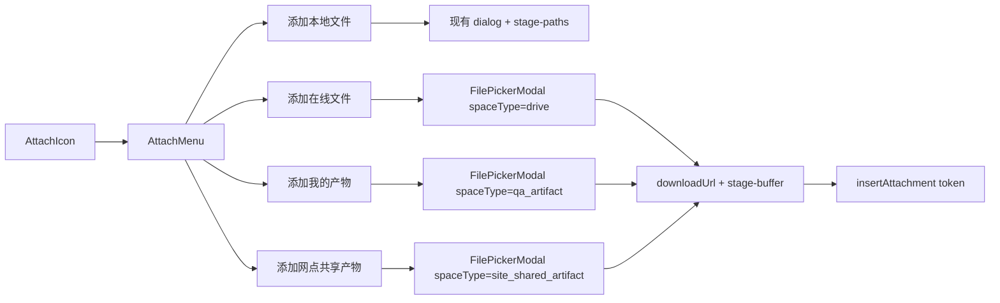

# Composer 附件：上传菜单 + 数据中心选文件

> 状态：**Chat 主路径已实现**；Task 装配后置  
> 日期：2026-08-13  
> 相关：
> - [`src/components/attachments/`](../src/components/attachments/)
> - [`src/components/input-composer/`](../src/components/input-composer/)
> - [`src/pages/Chat/ChatInput.tsx`](../src/pages/Chat/ChatInput.tsx)
> - [`src/components/task/TaskInstructionComposer.tsx`](../src/components/task/TaskInstructionComposer.tsx)
> - [`src/pages/DataCenter/`](../src/pages/DataCenter/)
> - [`src/lib/data-center-api.ts`](../src/lib/data-center-api.ts)

---

## 1. 背景与目标

Composer 附件按钮从「直接选本地文件」升级为「四项来源菜单」，支持从数据中心选择文件。

目标：把「从多种来源添加附件」做成底层公共能力；**优先接 Chat**（依赖内联方案已落地），Task 可随后跟进。

### 1.1 本次做

- 点击附件图标 → 四项来源菜单（对齐设计稿）
- 三类数据中心选文件弹窗（树 + 搜索 + 多选文件）
- 确认后 download → 现有 `/api/files/stage-buffer` → `FileAttachment`，经 **`insertAttachment` 插入光标处**（不再挂顶部 chips）
- Chat 输入框优先支持；任务描述 Composer **后置**
- 写入可选 `provenance`（`drive` / `qa_artifact` / `site_shared_artifact`），供溯源；发送仍只认 `stagedPath`
- 文件 chip 视觉统一：设计稿 SVG 类型图标 + `#F0F2F5` 容器 + max 280px + 中间省略（输入 token / 气泡一致）

### 1.2 本次不做

- 技能 bake / 任务侧技能落库
- 任务 cron 附件持久化字段改造
- 扩展 Gateway 远程直传（不改发送链路：仍 download → stage）
- **重做 inline 混排 / segment 模型**
- Task 四源菜单接线（后置）

### 1.3 与内联方案的交接

内联方案已预留：`provenance?`、`stageDataCenterFiles` 签名、Toolbar `onAttach` 回调位、统一 `insertAttachment`。本菜单迭代只填菜单 + 弹窗 + download/stage，**不再改** segment / Gateway bake。

---

## 2. 交互

### 2.1 流程



### 2.2 菜单项与数据中心映射

| 菜单文案 | 数据中心对应 | API `spaceType` | `spaceId` |
|----------|--------------|-----------------|-----------|
| 添加本地文件 | 本机文件对话框 | — | — |
| 添加在线文件 | 数据中心 / 我的文件 / 上传文件 | `drive` | 通常 `null` |
| 添加我的产物 | 数据中心 / 我的产物 | `qa_artifact` | `null` |
| 添加网点共享产物 | 数据中心 / 我的产物 / 网点共享产物 | `site_shared_artifact` | **必填**（`getDataCenterSpaces`） |

- 「添加网点共享产物」仅站点用户可见（`isSiteUser`，与 DataCenter 一致）。
- 弹窗标题随来源变化；顶栏搜索；树形展开文件夹；**仅文件可勾选**；底栏取消 / 确认。

### 2.3 UI 注意点

- 菜单：白底圆角、轻阴影、hover 灰底（对齐设计稿）
- 弹窗挂 portal / document，避免被 Task modal、composer overflow 裁切
- 附件图标 `onMouseDown` 继续 `preventDefault`，避免抢编辑器焦点
- 网点共享无 `spaceId` 时：打开前拉 spaces；失败 toast，不打开空树
- 文件 chip：`h-[26px]` / `rounded-[6px]` / `bg-[#F0F2F5]` / `gap-2` / `p-1` / `max-w-[280px]`；文字 12px `#1D2129`；过长中间省略；多文件靠 inline 换行

---

## 3. 架构落点（公共能力）

| 文件 | 职责 |
|------|------|
| `src/components/attachments/ComposerAttachMenu.tsx` | 锚点旁浮层菜单（四项） |
| `src/components/data-center-file-picker/` | **公用**选文件弹窗：只传 `type`；内置 list / spaces；样式固化 |
| `src/components/attachments/use-composer-attach-source.ts` | 菜单 open、打开哪种 picker、确认后 stage |
| `src/components/attachments/use-attachment-stager.ts` | `stageDataCenterFiles(entries)` |
| `src/components/attachments/file-type-icon.ts` | 类型图标映射 + 中间省略 + chip 表面 class |

列表数据复用（**现成**，内置进公用弹窗，不新增）：

- `listDataCenterEntries`
- `getDataCenterSpaces`（仅 `site_shared_artifact`）
- `getDataCenterDownloadUrl`（stage 阶段）

调用示例：

```tsx
<DataCenterFilePickerModal
  open={open}
  type="drive" // | 'qa_artifact' | 'site_shared_artifact'
  onClose={...}
  onConfirm={(files) => {
    // files[i].stagedPath 已是本地 outbound 路径（确认时组件内 download+stage）
  }}
/>
```

确认时内置：`getDataCenterDownloadUrl` → fetch → `/api/files/stage-buffer`。

树展开策略参考 `SaveArtifactDialog`（按 parent 懒加载），勾选对象为 **file**，文件夹只负责展开。

---

## 4. 选中后如何变成附件（定案）

Chat 发送只认本地 `stagedPath`，因此确认后：

1. 对每个选中 `entryId` 调现成 `getDataCenterDownloadUrl`
2. 拉取 `tempUrl` 字节 → 现有 `/api/files/stage-buffer`
3. 写入 `FileAttachment`（`status: 'ready'` + `provenance`），经 `onAttachmentUpsert` → `insertAttachment`

**不**新增 host stage API；**不**给发送契约强绑 `entryId`；溯源走可选 `provenance`。

---

## 5. 工具栏与场景接线

### 5.1 `InputComposerToolbar`

- 附件按钮打开 **菜单**（不再直接选本地文件）
- 提供 `attachButtonRef` 作为菜单锚点

### 5.2 装配层

- **ChatInput**：已挂 `ComposerAttachMenu` + `DataCenterFilePickerModal` + `useComposerAttachSource`
- **TaskInstructionComposer**：后置（仍直接 `pickFiles` + 顶部 chips）

---

## 6. 实现检查清单

- [x] `ComposerAttachMenu` + Chat 工具栏改为打开菜单
- [x] `DataCenterFilePickerModal` 公用组件（`type` 驱动；内置 list/spaces）
- [x] stager：`getDataCenterDownloadUrl → stage-buffer → FileAttachment`
- [x] 非站点用户隐藏「网点共享产物」
- [x] Chat：三类来源确认后 inline token 可发送
- [x] 文件 chip 设计稿样式（输入 / 气泡）
- [ ] Task：四源菜单接线（后置）
- [x] 技能相关逻辑零改动

---

## 7. 验收

1. Chat：点附件 → 见菜单（非站点用户无「网点共享」）
2. 本地文件：行为与现网一致（插入光标处）
3. 三类弹窗：能搜、展开文件夹、多选文件、确认后 inline chip 出现
4. Chat 带数据中心附件可正常发送
5. 技能选择/落库行为与改前一致
6. 输入框 / 气泡文件 chip 图标与样式一致
