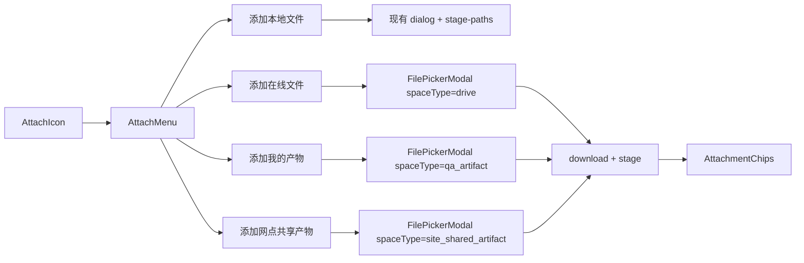

# Composer 附件：上传菜单 + 数据中心选文件

> 状态：方案定稿（待实现）  
> 日期：2026-08-11  
> 相关：
> - [`src/components/attachments/`](../src/components/attachments/)
> - [`src/components/input-composer/`](../src/components/input-composer/)
> - [`src/pages/Chat/ChatInput.tsx`](../src/pages/Chat/ChatInput.tsx)
> - [`src/components/task/TaskInstructionComposer.tsx`](../src/components/task/TaskInstructionComposer.tsx)
> - [`src/pages/DataCenter/`](../src/pages/DataCenter/)
> - [`src/lib/data-center-api.ts`](../src/lib/data-center-api.ts)

---

## 1. 背景与目标

当前 Composer 附件按钮直接调本地 `dialog:open` → `/api/files/stage-paths`，无法从数据中心选文件。

目标：把「从多种来源添加附件」做成 **Chat / 任务共用的底层公共能力**。

### 1.1 本次做

- 点击附件图标 → 四项来源菜单（对齐设计稿）
- 三类数据中心选文件弹窗（树 + 搜索 + 多选文件）
- 确认后下载并 stage 成现有 `FileAttachment`，经 **`insertAttachment` 插入光标处**（依赖 [`Composer内联混排-Segment模型与多SkillWorkflow透传.md`](./Composer内联混排-Segment模型与多SkillWorkflow透传.md) 已落地的 inline token；不再挂顶部 chips）
- Chat 输入框与任务描述 Composer 同时支持
- 写入可选 `provenance`（`drive` / `qa_artifact` / `site_shared_artifact`），供溯源；发送仍只认 `stagedPath`

### 1.2 本次不做

- 技能 bake / 任务侧技能落库
- 任务 cron 附件持久化字段改造（本次只让任务弹窗能选到并挂在 composer 上，与 Chat 同一套 stage 模型）
- 扩展 Gateway 远程直传（不改发送链路：仍 download → stage）
- **重做 inline 混排 / segment 模型**（须先完成本文依赖的内联方案；本菜单只接已有 `insertAttachment` 出口）

### 1.3 与内联方案的交接

内联方案迭代应已预留：`provenance?`、`stageDataCenterFiles` 签名、Toolbar `onAttach` 菜单回调位、统一 `insertAttachment`。本菜单迭代只填菜单 + 弹窗 + download/stage，**不再改** segment / Gateway bake。

---

## 2. 交互

### 2.1 流程

### 2.2 菜单项与数据中心映射

| 菜单文案 | 数据中心对应 | API `spaceType` | `spaceId` |
|----------|--------------|-----------------|-----------|
| 添加本地文件 | 本机文件对话框 | — | — |
| 添加在线文件 | 数据中心 / 我的文件 / 上传文件 | `drive` | 通常 `null` |
| 添加我的产物 | 数据中心 / 我的产物 | `qa_artifact` | `null` |
| 添加网点共享产物 | 数据中心 / 我的产物 / 网点共享产物 | `site_shared_artifact` | **必填**（`getDataCenterSpaces`） |

- 「添加网点共享产物」仅站点用户可见（`isSiteUser`，与 DataCenter 一致）。
- 弹窗标题随来源变化；顶栏搜索；树形展开文件夹；**仅文件可勾选**；底栏取消 / 确认。

### 2.3 UI 注意点

- 菜单：白底圆角、轻阴影、hover 灰底（对齐设计稿）
- 弹窗挂 portal / document，避免被 Task modal、composer overflow 裁切
- 附件图标 `onMouseDown` 继续 `preventDefault`，避免抢编辑器焦点
- 网点共享无 `spaceId` 时：打开前拉 spaces；失败 toast，不打开空树

---

## 3. 架构落点（公共能力）

新建共享模块放在 `attachments` 旁，**不**拖进 DataCenter 页面目录：

| 文件 | 职责 |
|------|------|
| `src/components/attachments/ComposerAttachMenu.tsx` | 锚点旁浮层菜单（四项） |
| `src/components/attachments/DataCenterFilePickerModal.tsx` | 通用选文件弹窗（树 / 搜索 / 多选） |
| `src/components/attachments/use-composer-attach-source.ts` | 菜单 open、打开哪种 picker、确认后 stage |
| 扩展 `src/components/attachments/use-attachment-stager.ts` | 新增 `stageDataCenterFiles(entries)` |

列表数据复用：

- `listDataCenterEntries`
- `getDataCenterSpaces`
- `getDataCenterDownloadUrl`

树展开策略参考 `SaveArtifactDialog`（按 parent 懒加载），勾选对象改为 **file**，文件夹只负责展开。

---

## 4. 选中后如何变成附件（定案）

Chat 发送只认本地 `stagedPath`，因此确认后：

1. 对每个选中 `entryId` 调 `getDataCenterDownloadUrl`
2. 经 Electron / host 把 tempUrl 落到可 stage 的本地路径，或 buffer → `/api/files/stage-buffer`  
   - 优先复用现有 stage API  
   - 必要时在 `electron/api/routes/files.ts` 增加「URL → stage」小接口
3. 写入 `FileAttachment`（`status: 'ready'`），走现有 chips  
   - Chat：`onSend(..., attachments, ...)`  
   - Task：composer 本地 chips（与 Chat 同模型）

**不**给 `FileAttachment` 增加 `entryId` / `spaceType` 字段，避免改 gateway 发送链路。

---

## 5. 工具栏与场景接线

### 5.1 `InputComposerToolbar`

当前 `onAttach` 直接 `pickFiles`。改为：

- 附件按钮打开 **菜单**（不再直接选本地文件）
- 由装配层使用 `useComposerAttachSource`（或等价回调）处理菜单项

### 5.2 装配层

`ChatInput.tsx` 与 `TaskInstructionComposer.tsx`：

- 挂载 `ComposerAttachMenu` + `DataCenterFilePickerModal`（按来源切换 `spaceType`）
- 本地项 → 现有 `pickFiles`
- 弹窗确认 → `stageDataCenterFiles`

---

## 6. 实现检查清单

- [ ] `ComposerAttachMenu` + 工具栏改为打开菜单
- [ ] `DataCenterFilePickerModal`（`drive` / `qa_artifact` / `site_shared_artifact`）
- [ ] stager：`download → stage → FileAttachment`
- [ ] `ChatInput` 与 `TaskInstructionComposer` 共用接线
- [ ] 非站点用户隐藏「网点共享产物」
- [ ] Chat：三类来源确认后 chips 可发送
- [ ] 任务：三类来源确认后 chips 可见（cron 持久化不在本次）
- [ ] 技能相关逻辑零改动

---

## 7. 验收

1. Chat / 任务：点附件 → 见菜单（非站点用户无「网点共享」）
2. 本地文件：行为与现网一致
3. 三类弹窗：能搜、展开文件夹、多选文件、确认后 chips 出现
4. Chat 带数据中心附件可正常发送
5. 技能选择/落库行为与改前一致
