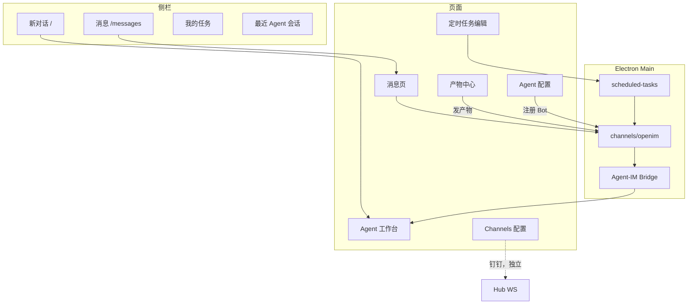
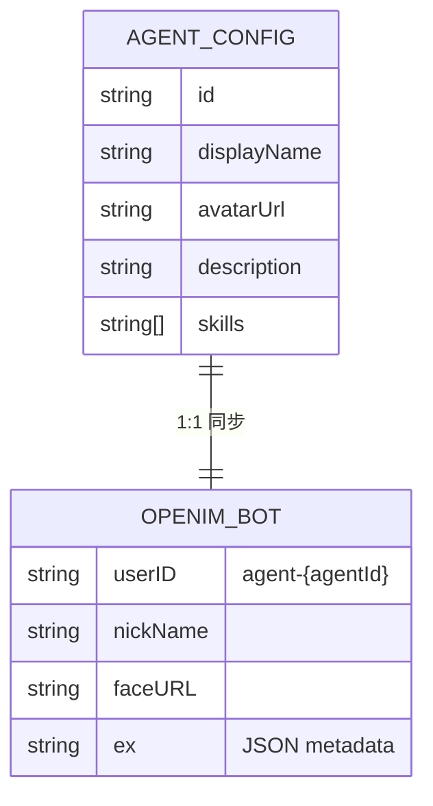
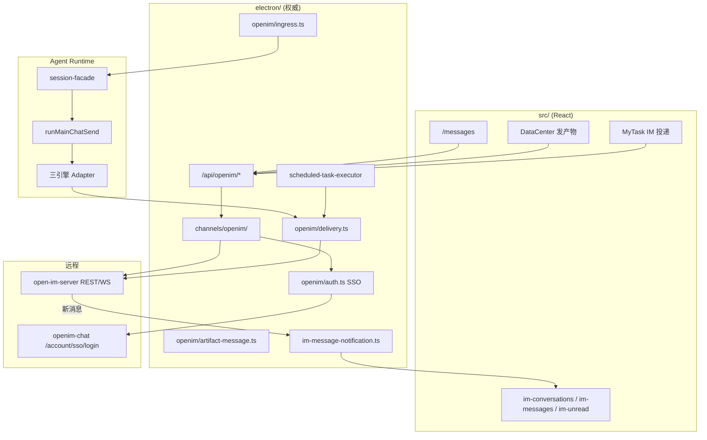
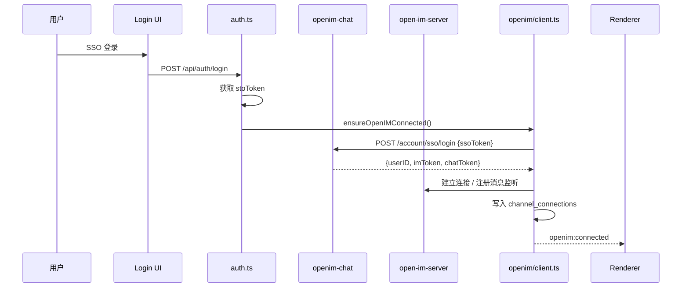
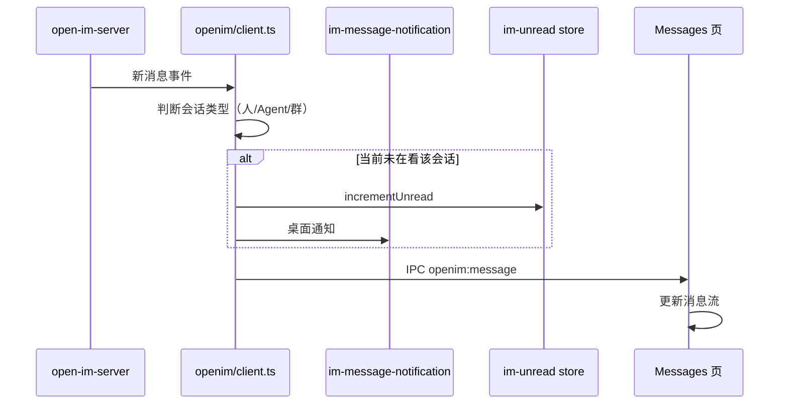
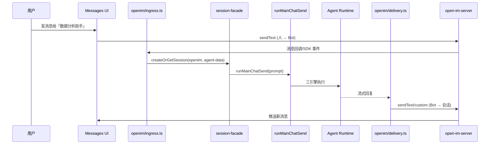
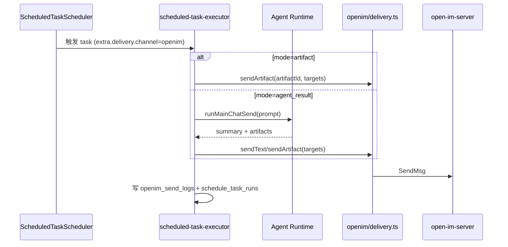

# SClaw OpenIM 集成方案 — UI 与技术设计

> **一句话**：把 OpenIM 作为 SClaw 的统一消息入口；Agent 以「数字员工」身份出现在 IM 联系人中，人可像 @ 同事一样 @ 数字员工，并随时在群聊中介入。
>
> **关联文档**：[定时任务架构设计.md](./定时任务架构设计.md)、[钉钉通知优化方案.md](./钉钉通知优化方案.md)、[agent-extension-architecture.md](./agent-extension-architecture.md)、[sto-design.md](./sto-design.md)
>
> **OpenIM 代码库**：`/Users/wenpeng/aiwork2/openim`（`open-im-server`、`chat`、`openim-sdk-core`）

---

## 1. 背景与目标

### 1.1 背景

SClaw（sto-claw）是申通内部的桌面 AI Agent 客户端，当前具备：

- **Agent 工作台**（`/`）：三引擎对话（OpenClaw / Claude / Pi）、工作流、技能、产物中心
- **钉钉 Channel**：通过 SClaw Hub WS 实现「钉钉消息 → Agent 回复」的双向桥接
- **定时任务**（`/my-tasks`）：Cron 调度 → Agent 执行 → 通过 `dws send` 发钉钉

现有缺口：

| 能力 | 现状 | 缺口 |
|------|------|------|
| 人 ↔ 人 IM | 无 | 需要原生单聊/群聊 |
| Agent 作为 IM 参与者 | 仅钉钉 Channel | 需要 OpenIM 内数字员工身份 |
| 产物投递到 IM | 主要上传钉盘/钉钉分享 | 需要 IM 内发产物卡片 |
| 定时发 IM | 仅钉钉收件人 | 需要 OpenIM 投递通道 |
| 统一消息入口 | Agent 会话在侧栏「最近」 | 需要独立「消息」入口 |

OpenIM 栈（`open-im-server` + `chat`）提供 IM 核心能力；`chat` 服务负责用户注册/登录，`open-im-server` 负责消息/群/Token。

### 1.2 目标

**第一期（MVP）**：

1. **单聊 / 群聊**：人 ↔ 人 IM 基础能力
2. **发送产物**：从 DataCenter / 聊天窗把 Agent 产物发到 IM
3. **Agent 定时发 IM**：复用 `schedule_tasks` 调度，新增 OpenIM 投递
4. **数字员工联系人**：Agent 在 IM 联系人列表中作为「数字员工」出现，可单聊

**产品愿景（分期）**：

- IM 是**统一消息入口**（真人 + 数字员工 + 群）
- 「新对话」降级为 **Agent 高级工作台**（复杂任务、工作流设计、浏览器自动化）
- 人可随时在 IM 群聊中介入 Agent 协作

### 1.3 非目标（第一期不做）

- Agent ↔ Agent 自主协作编排
- 外部钉钉/企微与 OpenIM 会话合并
- IM 消息全文搜索
- 云端离线定时（仍依赖桌面端在线，与现有钉钉定时一致）
- 替换现有钉钉 Channel（并行存在）

---

## 2. 产品定位与核心原则

### 2.1 产品定位

```
SClaw = Agent 工作台 + 统一 IM

IM（消息）          →  日常沟通、@数字员工、收汇报、发产物
Agent 工作台（新对话） →  复杂任务、工作流、多步产物编辑
```

### 2.2 核心原则

| 原则 | 说明 |
|------|------|
| **IM 为默认入口** | 侧栏「消息」与「新对话」并列；日常交互优先在 IM 完成 |
| **数字员工是一等公民** | 每个 Agent 有独立 OpenIM Bot 身份，出现在联系人「数字员工」分区 |
| **不混用未读模型** | IM 未读用 `im-unread` store；Agent 会话未读仍用 `session-unread` |
| **Main 是权威** | OpenIM 连接、发消息、定时投递在 Electron Main；Renderer 只调 Host API |
| **复用 Channel 模式** | OpenIM 入站/出站仿钉钉 `ingress.ts` / `delivery.ts` / `session-facade.ts` |
| **复用定时任务** | 不新建调度系统；在 `ScheduleTask.extra.delivery` 扩展 OpenIM 投递 |
| **人随时可介入** | 群聊中发消息即介入；不需要独立「接管」状态机（第一期） |

### 2.3 与钉钉 Channel 的关系

| 维度 | 钉钉 Channel | OpenIM |
|------|-------------|--------|
| 入口 | Channels 配置页 | 侧栏「消息」 |
| 连接 | SClaw Hub WS（远程） | OpenIM REST / SDK（直连） |
| Agent 触发 | Hub 入站 → ingress | OpenIM 回调 / SDK 收消息 → ingress |
| 出站 | Hub delta/finalize | OpenIM SendMsg API |
| 身份 | 钉钉用户 | OpenIM userID（SSO 工号映射） |
| 数字员工 | 无独立 IM 身份 | Notification Account / Bot |

**并行存在，互不影响。**

---

## 3. 信息架构

### 3.1 侧栏导航（修订）

```
┌─────────────────────────┐
│  SClaw Logo      [折叠]  │
├─────────────────────────┤
│  ✚ 新对话               │  → /           Agent 工作台
│  💬 消息            (12) │  → /messages   ★ IM 统一入口
│  ⏱ 我的任务              │  → /my-tasks
│  🔧 技能·连接器           │  → /skills
│  ⊞ 应用广场              │  → /more-apps
│  📊 我的数据              │  → /models
│  📁 产物中心              │  → /data-center
│  📖 学习中心              │  → /learning-center
├─────────────────────────┤
│  项目 ▾                  │  ← 不变
│  最近 ▾                  │  ← Agent 会话（逐步弱化为工作台入口）
│    ├ 🤖 数据分析...       │
│    └ ...                 │
├─────────────────────────┤
│  [账号] [设置]            │
└─────────────────────────┘
```

**改动点**：

- `Sidebar.tsx` → `primaryNav` 数组在「新对话」后插入「消息」项
- `sidebar-primary-nav.ts` → 注册 `/messages`
- 侧栏收起时：💬 图标 + 右上角数字角标

### 3.2 路由

| 路由 | 页面 | 说明 |
|------|------|------|
| `/messages` | 消息首页 | 双栏：左列表 + 右空状态 |
| `/messages/:conversationId` | 打开指定会话 | 深链、通知跳转 |
| `/messages?tab=contacts` | 联系人 Tab | 可选 query 参数 |
| `/` | Agent 工作台 | 不变；数字员工会话可「打开工作台」深链到此 |

### 3.3 与现有模块关系



---

## 4. 完整 UI 设计

> 视觉遵循 [sto-design.md](./sto-design.md)：Brand-6 `#FF6F00` 主色；未读角标用 Red-6；数字员工头像用 Blue-6 或专用 🤖 样式。

### 4.1 消息页整体布局（Split Layout）

使用现有 `content-header-context` 的 `split` 模式，左栏固定 280px。

```
┌──────────────────────────────────────────────────────────────────────────┐
│ ContentHeader: 消息                                    [🔍 搜索] [+]    │
├──────────────────┬───────────────────────────────────────────────────────┤
│ [会话] [联系人]   │                                                       │
│                  │  （未选中会话 → 空状态，见 4.6）                          │
│ 🔍 搜索会话...    │                                                       │
│                  │                                                       │
│ ── 置顶 ──       │                                                       │
│ 📌 销售群     12 │                                                       │
│                  │                                                       │
│ ── 最近 ──       │                                                       │
│ ● 张三         3 │                                                       │
│ ● 数据分析助手  1 │                                                       │
│   李四           │                                                       │
│   报告写作助手    │                                                       │
│                  │                                                       │
│                  │                                                       │
└──────────────────┴───────────────────────────────────────────────────────┘
```

**ContentHeader 右侧操作**：

- 🔍 搜索（第一期：联系人/会话名；第二期：消息全文）
- ＋ 发起聊天 / 创建群组

### 4.2 会话 Tab — 会话列表行

```
┌────────────────────────────────────────┐
│ [头像]  张三                      10:32 │
│         今天的数据出来了吗？        (3) │
├────────────────────────────────────────┤
│ [🤖]   数据分析助手               09:15 │
│         华东区同比+12%              (1) │
├────────────────────────────────────────┤
│ [👥]   销售群                     昨天  │
│         张三: @你 看一下报表       (12) │
└────────────────────────────────────────┘
```

**每行元素**：

| 元素 | 规则 |
|------|------|
| 头像 | 真人：默认头像；数字员工：🤖 + Agent 自定义 avatar；群：👥 |
| 名称 | 会话显示名 |
| 摘要 | 最后一条消息，截断 20 字 |
| 时间 | 今天 HH:mm / 昨天 / MM-DD |
| 未读 | >0 显示数字；>99 显示 99+；免打扰仅灰点 |
| 标识 | 数字员工行左侧可选「数字员工」小标签 |

**排序**：置顶 > 未读 > 时间倒序

**选中态**：复用 `sidebarRecentSessionActiveClass` 类似高亮

### 4.3 联系人 Tab — 三分区

```
┌──────────────────┐
│ [会话] [联系人]   │
│                  │
│ 🔍 搜索姓名/工号  │
│                  │
│ ── 数字员工 ────  │
│ [🤖] 数据分析助手  │
│      在线 · 销售分析│
│ [🤖] 报告写作助手  │
│      执行中...     │
│ [🤖] 流程审批助手  │
│      离线          │
│                  │
│ ── 同事 ────────  │
│ [👤] 张三         │
│      华东销售      │
│ [👤] 李四         │
│      数据中心      │
│                  │
│ ── 群组 ────────  │
│ [👥] 销售群 (28)  │
│ [👥] 项目A群 (5)  │
│                  │
│ [+ 发起群聊]      │
└──────────────────┘
```

**点击行为**：

| 对象 | 行为 |
|------|------|
| 数字员工 | 打开与该 Bot 的单聊会话（无则创建） |
| 同事 | 打开单聊（无则创建） |
| 群组 | 打开群聊 |

**数字员工详情（hover 或右键）**：

```
┌─────────────────────────────┐
│  🤖 数据分析助手              │
│  在线                        │
│  擅长：销售数据分析、报表生成  │
│  #数据分析  #报表  #SQL      │
│  [发消息]  [打开工作台]       │
└─────────────────────────────┘
```

「打开工作台」→ `navigate('/?sessionKey=...')` 跳到 Agent 页并绑定 session。

### 4.4 聊天窗

```
┌─────────────────────────────────────────────────────────────────┐
│ ← 张三                                    [📞] [📹] [⋯ 更多]   │
├─────────────────────────────────────────────────────────────────┤
│                                                                 │
│                    2026-03-07 10:30                             │
│                                                                 │
│  ┌──────────────────────┐                                       │
│  │ 今天的数据出来了吗？    │  张三                     10:32     │
│  └──────────────────────┘                                       │
│                                                                 │
│                                       ┌──────────────────────┐  │
│                           10:35  你  │ [产物卡片]            │  │
│                                       │ 📊 上海销售周报       │  │
│                                       │ Excel · 2.3MB         │  │
│                                       │ [预览] [下载]         │  │
│                                       └──────────────────────┘  │
│                                                                 │
│  ┌─ 🤖 数据分析助手 ─────────────────┐                          │
│  │ ▶ 思考中...（可折叠）               │  10:36                  │
│  └──────────────────────────────────┘                          │
│                                                                 │
│  ┌──────────────────────┐                                       │
│  │ 华东区同比+12%，详见   │  🤖 数据分析助手           10:37     │
│  │ 上方报告。             │                                       │
│  └──────────────────────┘                                       │
│                                                                 │
├─────────────────────────────────────────────────────────────────┤
│ [📎] [📦 发产物] [🤖 交给Agent]    输入消息...          [发送] │
└─────────────────────────────────────────────────────────────────┘
```

**ComposeBar 按钮（分期）**：

| 按钮 | 第一期 | 说明 |
|------|--------|------|
| 📎 附件 | ✅ | 发文件 |
| 📦 发产物 | ✅ | 弹窗选 DataCenter 产物 |
| 🤖 交给 Agent | ⏳ 1b | 把当前会话上下文交给数字员工（群聊 @ 已有则隐藏） |

**群聊额外**：输入框支持 `@` 提及；被 @ 的数字员工触发 Agent 执行。

### 4.5 产物卡片（IM 自定义消息）

```
┌─────────────────────────────────────┐
│ 📊 上海销售周报                      │
│ Excel · 2.3MB                        │
│ 来自 SClaw 产物中心                   │
│                    [预览]  [下载]    │
└─────────────────────────────────────┘
```

- OpenIM `contentType`：自定义（如 `110`）
- `customElem.data`：`{ "type": "sclaw_artifact_card", "artifactId", "title", "fileName", "fileSize", "previewUrl", "downloadUrl" }`
- 样式：卡片边框 Grey-4；主操作 Brand-6

### 4.6 空状态（未选中会话）

```
┌─────────────────────────────────────────┐
│                                         │
│              💬                         │
│         选择会话开始聊天                  │
│                                         │
│   [发起聊天]  [创建群组]  [找数字员工]    │
│                                         │
└─────────────────────────────────────────┘
```

### 4.7 定时任务 UI 扩展（MyTask）

在现有任务编辑 Modal 增加「IM 投递」区块：

```
┌─────────────────────────────────────────┐
│ 任务名: 每日销售日报                      │
│ Cron:   0 9 * * 1-5                       │
│ 执行:   ○ 直接发产物  ● Agent 生成后发送   │
│                                         │
│ ── IM 投递（可选）──                      │
│ ☑ 发送到 IM                              │
│ 收件人:                                  │
│   · 销售群 (group_456)          [×]      │
│   · 张总 (user_789)             [×]      │
│   [+ 添加 IM 收件人]                     │
│                                         │
│ 产物:   [上海销售周报 ▼]  （直接发产物时）  │
│                                         │
│ ── 钉钉投递（可选，保留）──               │
│ ...                                     │
└─────────────────────────────────────────┘
```

**IM 收件人选择器**：复用 Composer 的 mention 交互模式，数据源改为 OpenIM 会话/联系人。

### 4.8 通知交互

#### 4.8.1 侧栏角标

```
💬 消息    [12]
```

- 数据源：`im-unread.totalUnread`
- >99 显示 `99+`
- 侧栏收起时：图标右上角小红点 + 数字

#### 4.8.2 桌面通知

| 场景 | 标题 | 内容 |
|------|------|------|
| 单聊 | 张三 | 消息摘要前 50 字 |
| 群 @我 | 销售群 · @你 | 发送者: 摘要 |
| 群普通 | 销售群 | 张三: 摘要 |
| 数字员工 | 数据分析助手 | 消息摘要 |
| 文件 | 李四 | [文件] report.xlsx |

**点击通知** → `navigate(/messages/:conversationId)`（仿 `ChatResultNotificationNavigator`）

#### 4.8.3 应用内 Toast（可选）

窗口前台但不在 `/messages` 时：

```
💬 张三: 今天的数据出来了吗？    [查看]
```

3 秒自动消失，用现有 `sonner`。

#### 4.8.4 免打扰规则（第一期）

| 条件 | 行为 |
|------|------|
| 正在看该会话 | 不通知，仅更新消息流 |
| 窗口前台 + 在消息页 + 该会话已选中 | 不通知 |
| 其余 | 桌面通知 + 角标 +1 |

#### 4.8.5 设置项（Settings → 通知）

```
□ IM 消息桌面通知          [默认开]
□ IM 消息应用内提示          [默认开]
□ 通知声音                  [默认关]
```

---

## 5. 数字员工模型

### 5.1 Agent ↔ OpenIM Bot 映射



**注册时机**：Agent 创建/更新时（`/api/agents` 或 Agents 配置页保存）

```typescript
// 伪代码
async function syncAgentToOpenIM(agent: AgentConfig) {
  await openimAdmin.addNotificationAccount({
    userID: `agent-${agent.id}`,
    nickName: agent.displayName,
    faceURL: agent.avatarUrl,
    ex: JSON.stringify({
      type: 'digital_employee',
      agentId: agent.id,
      skills: agent.skills,
      description: agent.description,
    }),
  });
}
```

**OpenIM 侧**：使用 `AddNotificationAccount` API（chat 包已有 `imapi.Caller.AddNotificationAccount`）。

### 5.2 数字员工状态

| 状态 | 展示 | 判定 |
|------|------|------|
| 在线 | 绿点 + 「在线」 | Bot 默认在线 |
| 执行中 | 黄点 + 「执行中...」 | 该 Agent 有 active Chat Run |
| 离线 | 灰点 + 「离线」 | Agent 被禁用或 Gateway 不可用 |

状态由 Main 聚合：`ChatRuntimeSupervisor` active runs + Agent 配置。

### 5.3 单聊数字员工

```
用户 → IM 单聊「数据分析助手」
  → OpenIM 消息到达 Main（SDK 回调 / Webhook）
  → ingress.handleOpenIMInbound({ peerId: 'agent-data', ... })
  → session-facade.createOrGetSession({ channelType: 'openim', peerId: 'agent-data' })
  → runMainChatSend()
  → Agent 流式回复
  → delivery.sendOpenIMReply()（以 agent-data userID 发回）
```

### 5.4 群聊 @ 数字员工

```
销售群消息: "@数据分析助手 查华东数据"
  → 解析 @列表
  → 命中 agent-data → 触发 Agent
  → Agent 回复发在群内（sender = agent-data）
  → 其他人可见完整对话
```

**人介入**：用户在同一群直接发消息即可；Agent 收到新消息后会中断当前 run 并重新理解上下文（复用现有 Channel 入站队列 `enqueuePeer`）。

### 5.5 sessionKey 规则

扩展现有 `session-key.ts`：

```
agent:{agentId}:openim:{peerId}:{timestamp}:{nonce}
```

- 单聊数字员工：`peerId = agent-{agentId}`
- 群聊：`peerId = group-{groupId}`

`PlatformChannelType` 扩展：`'dingtalk' | 'mobile' | 'openim'`

---

## 6. 自定义 IM 消息类型

OpenIM 自定义消息 `customElem`，`data` 为 JSON 字符串。

| type | 展示 | 用途 | 第一期 |
|------|------|------|--------|
| `sclaw_artifact_card` | 产物卡片 | 文件/报告投递 | ✅ |
| `sclaw_agent_thinking` | 灰色折叠条 | Agent 推理过程 | 1b |
| `sclaw_agent_tool` | 工具调用卡片 | 「正在查询销售库...」 | 1b |
| `sclaw_agent_result` | 结构化结果卡片 | 指标/table 快照 | 2 |
| `sclaw_agent_handoff` | 系统提示 | Agent A → B 交接 | 3 |
| `sclaw_agent_approval` | 审批卡片 | [确认] [取消] | 3 |
| `text` / `file` | OpenIM 原生 | 普通消息 | ✅ |

**示例 — 产物卡片 payload**：

```json
{
  "type": "sclaw_artifact_card",
  "artifactId": "art_001",
  "title": "上海销售周报",
  "fileName": "report.xlsx",
  "fileSize": 2411724,
  "mimeType": "application/vnd.openxmlformats-officedocument.spreadsheetml.sheet",
  "previewUrl": "stoclaw://preview/art_001",
  "downloadUrl": "stoclaw://download/art_001",
  "sourceType": "chat_artifact",
  "createdAt": "2026-03-07T10:35:00Z"
}
```

**示例 — Agent 思考折叠**：

```json
{
  "type": "sclaw_agent_thinking",
  "collapsed": true,
  "content": "正在分析华东区销售数据，需要关联上周口径..."
}
```

---

## 7. 技术架构

### 7.1 整体架构



### 7.2 与钉钉 Channel 对照

| 层 | 钉钉 | OpenIM |
|----|------|--------|
| 连接 | `hub-client.ts` (WS) | `openim/client.ts` (REST + 长轮询/SDK) |
| 入站 | `ingress.ts` | `openim/ingress.ts` |
| 出站 | `delivery.ts` | `openim/delivery.ts` |
| 会话 | `session-facade.ts` | 同文件，加 `channelType: 'openim'` |
| 绑定 | `channel_connections` + Hub | `channel_connections` + SSO token |
| API | `/api/channels/hub/*` | `/api/openim/*` |

---

## 8. 模块拆分与文件落点

### 8.1 Electron Main — 新建

```
electron/channels/openim/
├── client.ts              # OpenIM 连接管理、token 刷新
├── auth.ts                # STO SSO → chat /account/sso/login → imToken
├── conversation.ts        # 会话列表、历史消息拉取
├── delivery.ts            # 出站：文本/文件/自定义消息
├── ingress.ts             # 入站：IM 消息 → session-facade → Agent
├── artifact-message.ts    # 产物 → sclaw_artifact_card
├── types.ts               # OpenIM 类型定义
├── startup.ts             # 登录后 ensureOpenIMConnected()
└── notification.ts        # 新消息 → 桌面通知

electron/services/
└── im-message-notification.ts   # 通知聚合（可选与 openim/notification 合并）

electron/api/routes/
└── openim.ts              # Host API 路由

electron/db/models/tables/
└── openim-send-log-table.ts     # 可选：发送日志

electron/db/migrations/
└── 00xx-openim-integration.ts   # channel_connections 扩展 + openim_send_logs
```

### 8.2 Electron Main — 修改

| 文件 | 改动 |
|------|------|
| `electron/api/server.ts` | 注册 `openim` routes |
| `electron/api/routes/auth.ts` | 登录后 `ensureOpenIMConnected()` |
| `electron/channels/session-key.ts` | `PlatformChannelType` 加 `'openim'` |
| `electron/channels/session-facade.ts` | 支持 `channelType: 'openim'` |
| `electron/scheduled-tasks/scheduled-task-executor.ts` | 完成后 `deliverToOpenIM()` |
| `electron/db/models/tables/channel-connection-table.ts` | `channel_type` 加 `'openim'` |

### 8.3 Renderer — 新建

```
src/pages/Messages/
├── index.tsx                    # 路由入口，split layout
├── conversation-list.tsx        # 会话 Tab 列表
├── contact-list.tsx             # 联系人 Tab（数字员工/同事/群）
├── digital-employee-row.tsx     # 数字员工行 + 详情 popover
├── message-panel.tsx            # 聊天窗
├── message-bubble.tsx           # 气泡（text/file/custom）
├── compose-bar.tsx              # 输入区
├── send-artifact-dialog.tsx     # 发产物弹窗
├── create-group-dialog.tsx      # 建群
├── im-recipient-picker.tsx      # 定时任务 IM 收件人选择
└── empty-state.tsx

src/stores/
├── im-conversations.ts
├── im-messages.ts
└── im-unread.ts                   # 独立于 session-unread

src/components/layout/
└── sidebar-im-nav-badge.tsx       # 侧栏消息角标
```

### 8.4 Renderer — 修改

| 文件 | 改动 |
|------|------|
| `src/components/layout/Sidebar.tsx` | primaryNav 加「消息」 |
| `src/lib/sidebar-primary-nav.ts` | 注册 `/messages` |
| `src/App.tsx` | 路由 `/messages/*` |
| `src/pages/DataCenter/` | 产物卡片加「发到 IM」 |
| `src/pages/MyTask/components/TaskCreateModal.tsx` | IM 投递区块 |
| `src/i18n/locales/zh/common.json` | 文案 |

### 8.5 OpenIM 侧（openim 仓库）

| 文件 | 改动 |
|------|------|
| `chat/internal/rpc/chat/login.go` | 新增 `SSOLogin`（STO SSO） |
| `chat/internal/api/chat/chat.go` | 新增 `/account/sso/login` |
| `chat/pkg/sso/` | SSO Provider 实现 |
| `chat/internal/api/chat/start.go` | 注册路由 |

---

## 9. 数据模型

### 9.1 SQLite — channel_connections（扩展）

已有表，新增 `channel_type = 'openim'`：

```sql
-- channel_connections 已有，extra 字段存 OpenIM 凭证
-- extra_json 示例:
{
  "userID": "user_001",
  "imToken": "...",
  "chatToken": "...",
  "expiresAt": "2026-03-08T10:00:00Z"
}
```

### 9.2 SQLite — openim_send_logs（新建，可选）

```sql
CREATE TABLE openim_send_logs (
  id TEXT PRIMARY KEY,
  user_id TEXT NOT NULL,           -- 发送者 OpenIM userID
  artifact_id TEXT,                -- 关联 artifact_save_records
  schedule_task_id TEXT,           -- 定时任务触发时有值
  schedule_run_id TEXT,
  target_type TEXT NOT NULL,       -- single | group
  target_id TEXT NOT NULL,
  message_type TEXT NOT NULL,      -- text | file | sclaw_artifact_card
  status TEXT NOT NULL,            -- succeeded | failed
  error TEXT,
  sent_at TEXT NOT NULL,
  created_at TEXT NOT NULL
);

CREATE INDEX idx_openim_send_logs_task ON openim_send_logs(schedule_task_id);
CREATE INDEX idx_openim_send_logs_artifact ON openim_send_logs(artifact_id);
```

### 9.3 ScheduleTask.extra.delivery

沿用 `extra_json` 真源模式（与 `composerSegments` 一致）：

```typescript
interface ScheduleTaskIMDelivery {
  channel: 'openim';
  targets: Array<{
    type: 'single' | 'group';
    id: string;
    name: string;  // 展示用
  }>;
  mode: 'artifact' | 'agent_result';
  artifactId?: string;  // mode=artifact 时
}

// 写入 ScheduleTask.extra
{
  "composerSegments": [...],
  "delivery": {
    "channel": "openim",
    "targets": [
      { "type": "group", "id": "group_456", "name": "销售群" }
    ],
    "mode": "agent_result"
  }
}
```

### 9.4 im-unread Store（Renderer，localStorage persist）

```typescript
interface IMUnreadState {
  totalUnread: number;
  conversationUnread: Record<string, number>;  // conversationID → count
  mutedConversations: Record<string, true>;    // 免打扰
  incrementUnread: (conversationId: string, count?: number) => void;
  markConversationRead: (conversationId: string) => void;
  setMuted: (conversationId: string, muted: boolean) => void;
}
```

持久化 key：`stoclaw:im-unread`（仿 `stoclaw:session-unread`）

### 9.5 产物索引（已有，不新建）

复用 `artifact_save_records`：

| 字段 | 用途 |
|------|------|
| `source_type` | chat_artifact / workflow_artifact / scheduled_task_artifact |
| `local_path` | 发文件消息 |
| `target_uri` | 卡片链接 |
| `data_center_entry_id` | DataCenter 关联 |

---

## 10. Host API 清单

### 10.1 连接与认证

| 方法 | 路径 | 说明 |
|------|------|------|
| GET | `/api/openim/status` | 连接状态、userID、token 过期时间 |
| POST | `/api/openim/connect` | 手动重连（SSO 换 token） |
| POST | `/api/openim/disconnect` | 登出时断开 |

### 10.2 会话与消息

| 方法 | 路径 | 说明 |
|------|------|------|
| GET | `/api/openim/conversations` | 会话列表 |
| GET | `/api/openim/messages?conversationId=&before=&limit=` | 历史消息 |
| POST | `/api/openim/send/text` | 发文本 |
| POST | `/api/openim/send/file` | 发文件 |
| POST | `/api/openim/send/artifact` | 发产物卡片 |

**POST /api/openim/send/text**：

```json
{
  "target": { "type": "single", "id": "user_123" },
  "content": "你好"
}
```

**POST /api/openim/send/artifact**：

```json
{
  "target": { "type": "group", "id": "group_456" },
  "artifactId": "art_001"
}
```

### 10.3 联系人与群组

| 方法 | 路径 | 说明 |
|------|------|------|
| GET | `/api/openim/contacts` | 数字员工 + 同事 + 群 |
| GET | `/api/openim/contacts/search?q=` | 搜索 |
| POST | `/api/openim/groups/create` | 建群 |
| POST | `/api/openim/groups/invite` | 邀请成员（含数字员工 Bot） |

**GET /api/openim/contacts** 响应：

```json
{
  "digitalEmployees": [
    {
      "userID": "agent-data",
      "name": "数据分析助手",
      "avatarUrl": "...",
      "status": "online",
      "skills": ["数据分析", "报表"],
      "description": "擅长销售数据分析"
    }
  ],
  "colleagues": [...],
  "groups": [...]
}
```

### 10.4 数字员工同步

| 方法 | 路径 | 说明 |
|------|------|------|
| POST | `/api/openim/agents/sync` | 同步所有 Agent → OpenIM Bot |
| POST | `/api/openim/agents/sync/:agentId` | 同步单个 Agent |

### 10.5 内部 / 事件

| 方法 | 路径 | 说明 |
|------|------|------|
| — | IPC `openim:message` | Main → Renderer 新消息推送 |
| — | IPC `openim:unread` | 未读数变更 |

---

## 11. 核心流程

### 11.1 登录与连接



### 11.2 收消息（人 ↔ 人）



### 11.3 发消息（人 → 人）

```
Renderer ComposeBar → POST /api/openim/send/text
  → delivery.sendText()
  → OpenIM REST SendMsg
  → 成功 → 更新 im-messages store
```

### 11.4 数字员工单聊（人 → Agent）



### 11.5 群聊 @ 数字员工

```
群消息到达 ingress
  → 解析 content 中 @列表
  → 命中 agent-{id} → 触发 runMainChatSend
  → Agent 回复 sendGroupMsg (sender=bot)
  → 群内所有人可见
```

### 11.6 定时发 IM



### 11.7 发产物

```
DataCenter「发到 IM」/ 聊天窗「发产物」
  → POST /api/openim/send/artifact
  → 读 artifact_save_records.local_path
  → artifact-message.ts 构建 sclaw_artifact_card
  → delivery.sendCustomMessage()
  → 写 openim_send_logs
```

---

## 12. 与现有模块集成点

### 12.1 auth（`electron/api/routes/auth.ts`）

| 时机 | 动作 |
|------|------|
| 登录成功 | `ensureOpenIMConnected()` |
| 登出 | `disconnectOpenIM()`，清 channel_connections |
| 切号 | 重连 OpenIM（新 userID） |

SSO 映射：`STO user.code`（工号）→ OpenIM `account` → JIT 注册

### 12.2 scheduled-tasks

| 点 | 改动 |
|----|------|
| `ScheduleTask.extra.delivery` | 新增 OpenIM 投递配置 |
| `scheduled-task-executor.ts` | 任务完成后调 `deliverToOpenIM()` |
| `TaskCreateModal.tsx` | UI：IM 收件人选择 |
| `shared/scheduled-task-extra.ts` | 类型定义 |

与钉钉投递**并行**：同一任务可同时配 IM + 钉钉收件人。

### 12.3 data-center

| 点 | 改动 |
|----|------|
| 产物卡片 | 加「发到 IM」按钮 |
| `send-artifact-dialog.tsx` | 选会话 → 调 `/api/openim/send/artifact` |
| `artifact_save_records` | 发送成功后可选回写 `target_uri` |

### 12.4 agents（`/agents` 配置页）

| 点 | 改动 |
|----|------|
| Agent 保存 | 调 `/api/openim/agents/sync/:agentId` |
| Agent 列表 | 展示 OpenIM Bot 同步状态 |
| Agent 删除 | 调 OpenIM 禁用 Bot（可选） |

### 12.5 channels（`/channels` 配置页）

**第一期不改 UI**。OpenIM 连接由 SSO 自动完成，不像钉钉需要 Hub 绑定。

第二期可选：在 Channels 页加 OpenIM 卡片（连接状态、重新授权）。

### 12.6 通知体系

| 现有 | IM 新增 |
|------|---------|
| `chat-result-notification.ts` | `im-message-notification.ts` |
| `session-unread` store | `im-unread` store（独立） |
| `ChatResultNotificationNavigator` | `IMNotificationNavigator`（跳转 /messages） |

### 12.7 Agent Extensions（第二期）

可选新增 `sto-openim-send` 扩展，让 Agent 在对话中主动发 IM：

```
electron/agent-extensions/extensions/sto-openim-send/
├── manifest.ts
├── command.ts          # openim_send 工具
└── host-capability.ts  # 调 /api/openim/send/*
```

---

## 13. 分期实施计划

### Phase 1a — IM 基础（人 ↔ 人）【~1 周】

| 项 | 交付 |
|----|------|
| openim-chat SSO 登录 | `/account/sso/login` |
| `electron/channels/openim/auth.ts` + `client.ts` | SSO 换 token、连接 |
| Host API | status / conversations / messages / send/text / send/file |
| `/messages` 页面 | 双栏、会话列表、聊天窗、ComposeBar |
| 侧栏「消息」入口 | primaryNav + 路由 |
| 登录集成 | auth.ts 登录后 connect |

**验收**：两人可单聊、建群、发文本和文件。

### Phase 1b — 数字员工单聊【~1 周】

| 项 | 交付 |
|----|------|
| Agent → OpenIM Bot 同步 | `/api/openim/agents/sync` |
| `openim/ingress.ts` + `delivery.ts` | IM 消息触发 Agent |
| `session-key.ts` 扩展 | `channelType: 'openim'` |
| 联系人 Tab「数字员工」分区 | contact-list.tsx |
| 自定义消息 | `sclaw_agent_thinking`、`sclaw_agent_tool` |
| `im-unread` + 桌面通知 | 角标 + 通知 + 跳转 |

**验收**：用户点「数据分析助手」发消息，Agent 在 IM 内流式回复。

### Phase 1c — 产物 + 定时发 IM【~1 周】

| 项 | 交付 |
|----|------|
| `sclaw_artifact_card` | artifact-message.ts |
| DataCenter「发到 IM」 | send-artifact-dialog |
| `ScheduleTask.extra.delivery` | 模型 + executor 投递 |
| MyTask IM 收件人 UI | im-recipient-picker |
| `openim_send_logs` | 发送日志 |

**验收**：产物可发到 IM；定时任务每天 9 点把日报发到销售群。

### Phase 2 — 群聊 @ 数字员工 + 增强【~1.5 周】

| 项 | 交付 |
|----|------|
| 群聊 @ 解析 | ingress 解析 @agent |
| 群会话列表 | 混合群（人+Bot）展示 |
| `sto-openim-send` Agent 工具 | Agent 主动发 IM |
| 置顶 / 免打扰 | 会话设置 |
| 设置页通知选项 | Settings 扩展 |

### Phase 3 — 统一与弱化【~1 周】

| 项 | 交付 |
|----|------|
| 侧栏「最近」Agent 会话 | 可选同步到 IM 列表 |
| 「打开工作台」深链 | 数字员工 → Agent 页 |
| IM 内搜索 | 会话名 + 联系人 |
| 云端离线定时 | memory-center worker（可选） |

### 里程碑总览

```
Week 1   ─── 1a: 人↔人 IM 基础
Week 2   ─── 1b: 数字员工单聊
Week 3   ─── 1c: 产物 + 定时发 IM  ← MVP 完成
Week 4-5 ─── 2: 群@ + 增强
Week 6   ─── 3: 统一入口
```

---

## 14. 风险与决策记录

### 14.1 技术风险

| 风险 | 影响 | 缓解 |
|------|------|------|
| OpenIM SDK 在 Electron 兼容性 | 连接不稳定 | 第一期用 REST API 发消息；长连接可后补 WASM SDK |
| SSO token 过期 | IM 断连 | token 刷新机制；过期前主动 renew |
| 桌面端离线时定时任务不执行 | 漏发 | 与现有钉钉一致；Phase 3 可选云端 worker |
| Agent 回复延迟 | IM 体验差 | 流式推送 `sclaw_agent_thinking` 占位；delivery 节流（仿钉钉 MIN_PUSH_INTERVAL_MS） |
| 群聊 @ 解析准确性 | 误触发 Agent | 精确匹配 Bot userID；send-guard 防滥用 |

### 14.2 产品风险

| 风险 | 缓解 |
|------|------|
| IM 与 Agent 会话混淆 | 严格分区：IM 在「消息」，Agent 在「新对话/最近」；图标 🤖/👤 区分 |
| 数字员工过多占满联系人 | 分区 + 搜索；常用置顶 |
| 用户不知「新对话」和「消息」区别 |  onboarding 提示；数字员工详情「打开工作台」 |

### 14.3 决策记录（ADR）

| # | 决策 | 理由 | 日期 |
|---|------|------|------|
| D1 | IM 入口放 primaryNav 第二项 | 高频、可发现、可挂角标 | 2026-03-07 |
| D2 | 联系人不放侧栏，放消息页 Tab | 侧栏已过载（项目+最近+导航） | 2026-03-07 |
| D3 | IM 未读独立 store | 与 Agent session-unread 语义不同 | 2026-03-07 |
| D4 | Agent = OpenIM Notification Account | 原生 @、群成员、发消息 | 2026-03-07 |
| D5 | 复用钉钉 Channel 模式 | ingress/delivery/session-facade 已验证 | 2026-03-07 |
| D6 | 定时任务不新建调度 | schedule_tasks 已成熟 | 2026-03-07 |
| D7 | Main 进程 REST 先发消息 | 与 sto-claw 权威架构一致 | 2026-03-07 |
| D8 | 「新对话」保留为工作台 | 复杂任务需要专用 UI | 2026-03-07 |
| D9 | 第一期不做 IM 触发 Agent 的群 @ | 1b 先做数字员工单聊；群 @ 放 Phase 2 | 2026-03-07 |
| D10 | SSO 工号映射 OpenIM account | 与申通账号体系一致 | 2026-03-07 |

---

## 附录 A：组件复用清单

| 现有组件/模式 | IM 复用方式 |
|--------------|------------|
| `ContentHeader` | 聊天窗顶部 |
| `split layout` | 消息页双栏 |
| `sonner` toast | 应用内 IM 提示 |
| `ConfirmDialog` | 删会话确认 |
| `ChatResultNotificationNavigator` | IM 通知跳转 |
| `sidebarUnreadDotClass` | 样式 token（store 独立） |
| `TaskCreateModal` Composer | IM 收件人选择交互 |
| `dingtalk-send-guard` | 仿建 `openim-send-guard`（Phase 2） |
| `session-facade.ts` | 直接扩展 channelType |
| `artifact_save_records` | 产物索引 |

## 附录 B：i18n 键（建议）

```json
{
  "sidebar.messages": "消息",
  "im.conversations": "会话",
  "im.contacts": "联系人",
  "im.digitalEmployees": "数字员工",
  "im.colleagues": "同事",
  "im.groups": "群组",
  "im.sendArtifact": "发产物",
  "im.createGroup": "创建群组",
  "im.emptyState": "选择会话开始聊天",
  "im.notification.title": "新消息",
  "im.openWorkbench": "打开工作台"
}
```

## 附录 C：openim-chat SSO 接口（需在 openim 仓库实现）

```
POST /account/sso/login
Request:
{
  "ssoToken": "...",
  "ssoProvider": "sto",
  "platform": 5,
  "deviceID": "..."
}
Response:
{
  "userID": "...",
  "chatToken": "...",
  "imToken": "..."   // API 层再换
}
```

---

*文档版本：v1.0 · 2026-03-07 · 作者：SClaw 架构组*
