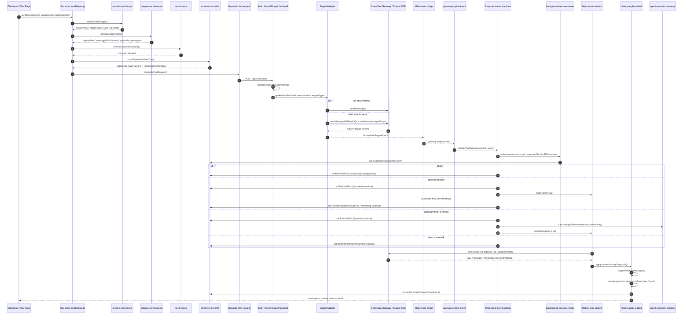
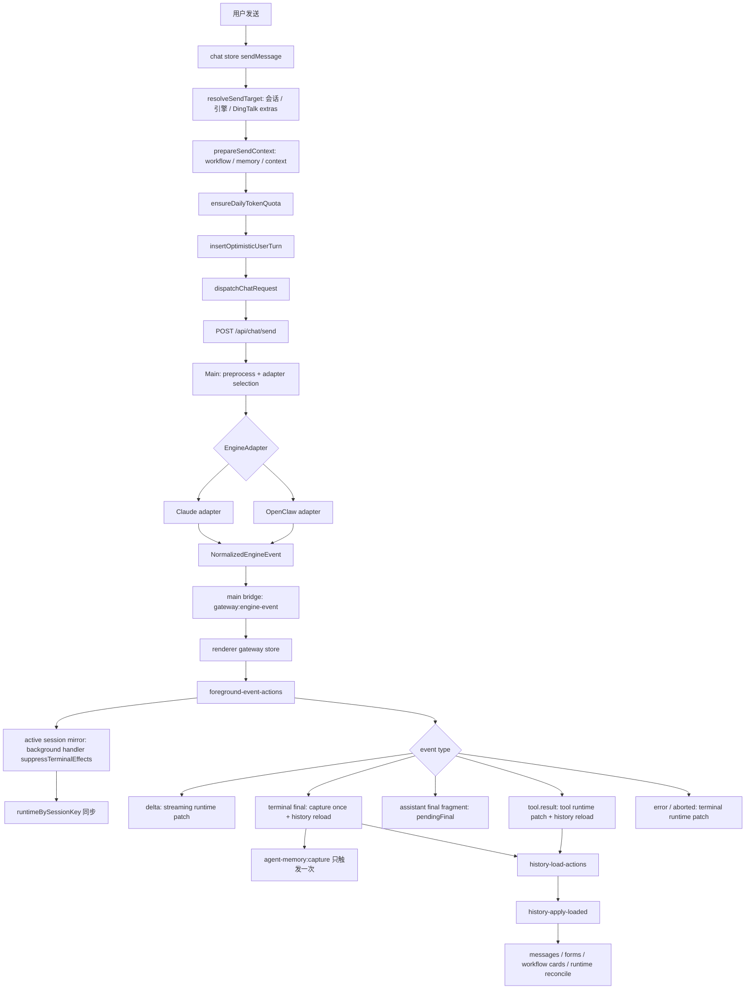

# StoClaw 聊天链路重构实施方案

> 目标：针对聊天链路中的运行时状态双写、完成态判定分散、发送链路职责过重、OpenClaw/Claude 多引擎边界泄漏等问题，给出一套可以分阶段立即实施的重构方案。

## 一、核心目标

当前聊天链路的问题不是单点 bug，而是状态和职责边界没有收敛：

- Renderer store 同时承担 UI 状态、业务编排、prompt/context 组装、传输调用和引擎差异判断。
- `ChatState` 顶层运行时字段与 `runtimeBySessionKey` 存在镜像双写。
- `sendMessage`、`handleChatEvent`、`loadHistory` 都在做状态机和补偿逻辑。
- OpenClaw 和 Claude 虽然有 `EngineAdapter`，但 renderer 仍然需要知道不同引擎的完成态和上下文注入差异。

目标架构应收敛为：

```text
ChatInput
  -> dispatchChatSend：只处理 UI 快捷入口
  -> chatStore.sendMessage：只发起一个 send turn
  -> ChatRuntimeController：统一管理 turn/runtime
  -> Main Chat Orchestrator：统一 send/history/abort/media
  -> EngineAdapter：适配 OpenClaw Gateway / Claude SDK
  -> renderer：只消费标准事件和历史快照
```

## 二、实施原则

1. 不做一次性大重写，按 P0/P1/P2/P3 分阶段落地。
2. 每个阶段都必须保持外部行为不变，并能单独回归。
3. 优先消除结构性风险：先收状态，再收完成态，再收发送链路，最后收引擎协议。
4. 新增统一入口时，先保留旧接口兼容，迁移完成后再删除。

## 三、P0：消除运行时状态双写

### 问题

`ChatState` 同时保存两份运行时状态：

- 顶层字段：`sending`、`activeRunId`、`streamingMessage`、`pendingFinal`、`optimisticUserMessage`、`error` 等。
- 会话缓存：`runtimeBySessionKey[sessionKey]`。

这会导致每个状态变更点都要双写。一旦某条路径只写了其中一份，切换会话、后台运行、历史恢复时就可能出现 spinner 卡住、消息丢失、错误状态残留。

### 方案

新增统一运行时写入口：

```text
src/stores/chat/runtime-controller.ts
```

建议 API：

```ts
export function getCurrentRuntime(state: ChatState): SessionRuntimeState;

export function setRuntimePatch(
  set: ChatSet,
  get: ChatGet,
  sessionKey: string,
  patch: Partial<SessionRuntimeState>,
): void;

export function clearRuntime(
  set: ChatSet,
  get: ChatGet,
  sessionKey: string,
): void;
```

短期仍保留顶层字段，但所有写入必须通过 `setRuntimePatch`。该函数内部负责：

- 更新 `runtimeBySessionKey[sessionKey]`。
- 如果 `sessionKey === currentSessionKey`，同步更新顶层镜像字段。

### 第一批替换文件

- `src/stores/chat/send-actions.ts`
- `src/stores/chat/foreground-event-actions.ts`
- `src/stores/chat/background-session-events.ts`
- `src/stores/chat/store.ts`
- `src/stores/gateway.ts`

### 验收标准

- 不再出现同一路径中连续 `set({ sending... })` + `patchSessionRuntimeState(...)` 的手写双写。
- 所有运行时字段修改都经过统一 runtime controller。
- 会话切换后当前 session 的运行态与 `runtimeBySessionKey[currentSessionKey]` 一致。

## 四、P0：统一完成态判定

### 问题

运行完成态目前散落在多处：

- `foreground-event-actions.ts`
- `background-session-events.ts`
- `history-load-actions.ts`
- `run-completion.ts`
- `store.ts`
- `gateway.ts`

OpenClaw 和 Claude 都可能产生多段 assistant final，但不一定代表整轮完成。renderer 需要不断判断某个 `final` 是 fragment 还是 terminal，风险很高。

### 方案

新增统一状态机：

```text
src/stores/chat/turn-state-machine.ts
```

建议类型：

```ts
export type NormalizedTurnEvent =
  | { type: 'started'; runId: string; sessionKey: string }
  | { type: 'delta'; runId: string; sessionKey: string; message?: RawMessage }
  | { type: 'assistant_final'; runId: string; sessionKey: string; message?: RawMessage; phase?: unknown }
  | { type: 'agent_completed'; runId: string; sessionKey: string; runtimeResult?: unknown }
  | { type: 'error'; runId?: string; sessionKey: string; error: string }
  | { type: 'aborted'; runId?: string; sessionKey: string };

export function reduceTurnRuntime(
  runtime: SessionRuntimeState,
  event: NormalizedTurnEvent,
  context: { engineType?: 'openclaw' | 'claude' },
): Partial<SessionRuntimeState>;
```

短期可以先让原有函数委托到新模块：

- `resolveAssistantFinalTerminalState`
- `shouldAutoCompleteClaudeFromHistory`
- OpenClaw `agent.completed` finalization
- Claude runtime result done 判定

### 验收标准

- 完成态判断有唯一入口。
- OpenClaw 中间 assistant final 不会提前清 `sending`。
- Claude assistant final 不会在 runtime result 之前提前结束。
- `error`、`aborted`、`agent_completed` 都通过同一套 reducer 输出 runtime patch。

## 五、P1：拆分 sendMessage

### 问题

`sendMessage` 负责过多职责：

- 参数归一化。
- 会话切换。
- 工作流 hint 注入。
- mem0 记忆检索和注入。
- 配额检查。
- 乐观消息插入。
- 历史轮询和安全超时。
- RPC/HTTP 分支发送。

### 方案

将 `sendMessage` 拆为一组小模块：

```text
src/stores/chat/send/
  resolve-send-target.ts
  prepare-message-context.ts
  quota-check.ts
  optimistic-turn.ts
  send-watchdogs.ts
  dispatch-chat-request.ts
```

`sendMessage` 最终只保留编排：

```ts
const target = resolveSendTarget(...);
const prepared = await prepareMessageContext(...);
await checkQuotaBeforeSend(...);
insertOptimisticTurn(...);
scheduleSendWatchdogs(...);
await dispatchChatRequest(...);
```

`prepareMessageContext` 返回结构化结果：

```ts
interface PreparedMessageContext {
  displayText: string;
  gatewayMessage: string;
  systemPromptAppend?: string;
  engineType?: 'openclaw' | 'claude';
  dingTalkRpcExtras?: Record<string, unknown>;
}
```

### 验收标准

- `sendMessage` 文件长度和分支明显下降。
- 配额失败、RPC 失败、异常失败共用清理函数。
- 工作流、记忆、钉钉 extras 的准备逻辑可独立单测。

## 六、P1：统一发送入口

### 问题

当前纯文本和媒体发送走两条路径：

- 纯文本：`gatewayStore.rpc('chat.send')`
- 附件：曾走独立媒体发送入口，现已统一到 `/api/chat/send`

这会导致参数、错误结构、超时、附件处理、钉钉扩展字段产生分叉。

### 方案

P1 直接收敛到 main/API 统一入口，不做 renderer-only 过渡封装。Renderer 不再根据是否有附件选择不同传输路径，而是统一调用：

```text
POST /api/chat/send
```

请求结构：

```ts
interface ChatSendRequest {
  sessionKey: string;
  message: string;
  idempotencyKey: string;
  deliver?: boolean;
  engineType?: 'openclaw' | 'claude';
  systemPromptAppend?: string;
  media?: Array<{ filePath: string; mimeType: string; fileName: string }>;
  dingTalkMentions?: unknown[];
  dingTalkSendFileIntent?: boolean;
  dingTalkAttachedFiles?: unknown[];
}
```

主进程 `/api/chat/send` 内部根据 `media?.length` 调用：

- `adapter.sendMessage`
- `adapter.sendMessageWithMedia`

主进程负责统一执行：

- `preprocessChatSendParams`
- 引擎解析与 adapter 选择
- 文本/媒体分支
- 钉钉 extras 透传
- 统一响应结构

旧媒体发送入口不再保留；文本、图片、文件和钉钉 extras 全部统一走 `/api/chat/send`。

Renderer 侧只保留一个发送函数：

```ts
export async function dispatchChatRequest(request: ChatSendRequest): Promise<{ runId?: string }> {
  const result = await hostApiFetch<{ success: boolean; result?: { runId?: string }; error?: string }>(
    '/api/chat/send',
    {
      method: 'POST',
      body: JSON.stringify(request),
    },
  );
  if (!result.success) {
    throw new Error(result.error || 'chat.send failed');
  }
  return result.result ?? {};
}
```

### 验收标准

- Renderer 中发送消息只有一个网络/IPC入口。
- 文本、图片、文件、钉钉 extras 都走同一套预处理。
- OpenClaw 和 Claude 都通过同一入口路由到 adapter。
- `send-actions.ts` 中不再直接调用 `useGatewayStore.getState().rpc('chat.send')`。
- `send-actions.ts` 中不再直接调用旧媒体入口，且旧媒体 route 已删除。

## 七、P1：统一 sessionKey 事件映射

### 问题

cron / claude-task 的 run session 到聚合 session 映射逻辑在多个文件重复。

### 方案

新增：

```text
src/stores/chat/session-event-routing.ts
```

建议 API：

```ts
export function mapEventSessionKey(input: {
  eventSessionKey: string | null;
  currentSessionKey: string;
}): string | null;
```

替换：

- `foreground-event-actions.ts` 内事件 sessionKey 映射。
- `gateway.ts` 内 notification completed/started 映射。

### 验收标准

- cron / claude-task 映射规则只有一份。
- base key、dated key、run key 的映射行为保持不变。

## 八、P2：loadHistory 管线化

### 问题

`loadHistory` 同时负责历史加载、乐观消息合并、工具结果过滤、工作流卡片恢复、参数表单恢复、fallback 历史源合并、运行完成推断等逻辑。

### 方案

将 `applyLoadedMessages` 改为显式 pipeline：

```text
src/stores/chat/history-pipeline/
  types.ts
  merge-shrunk-history.ts
  enrich-tool-files.ts
  merge-optimistic-user.ts
  recover-workflow-cards.ts
  recover-parameter-forms.ts
  strip-hidden-context.ts
  derive-session-label.ts
```

统一上下文：

```ts
interface HistoryPipelineContext {
  sessionKey: string;
  rawMessages: RawMessage[];
  currentMessages: RawMessage[];
  runtime: SessionRuntimeState;
  thinkingLevel: string | null;
}
```

每个 step 返回：

```ts
interface HistoryPipelineResult {
  messages: RawMessage[];
  runtimePatch?: Partial<SessionRuntimeState>;
  effects?: Array<() => void | Promise<void>>;
}
```

原则：

- 同步步骤先算完。
- 最后统一 `set({ messages, ... })`。
- 异步副作用放到 `effects`，避免同一次 `loadHistory` 多次覆盖 messages。

### 验收标准

- `loadHistory` 主函数只负责请求历史、执行 pipeline、提交结果。
- enrichment 步骤可单独测试。
- 同一次 history load 内 `messages` 写入次数明显减少。

## 九、P2：统一引擎解析

### 问题

引擎类型解析存在多套逻辑，分布在 UI、store、session runtime 中。

### 方案

新增：

```text
src/lib/chat-engine-resolution.ts
```

唯一入口：

```ts
export function resolveChatEngineType(input: {
  sessionKey: string;
  session?: { engineType?: 'openclaw' | 'claude' };
  agent?: { engineType?: 'openclaw' | 'claude' };
}): 'openclaw' | 'claude';
```

旧函数先保留，但改为调用新函数：

- `src/lib/resolve-chat-session-engine-type.ts`
- `src/stores/chat/store-helpers.ts`
- `src/stores/chat/session-runtime.ts`
- `src/pages/Chat/ChatEngineModelSelectors.tsx`

### 验收标准

- 引擎兜底顺序只有一份定义。
- session、agent、scheduled-task、cron 的特殊规则集中维护。

## 十、P3：标准化多引擎事件协议

### 问题

Claude 目前通过模拟 OpenClaw `chat:message` 事件接入。兼容性好，但语义容易混淆，尤其是 `final` 不一定代表 turn completed。

### 方案

在 main/adapter 层统一输出标准事件：

```ts
type NormalizedEngineEvent =
  | { type: 'turn.started'; runId: string; sessionKey: string }
  | { type: 'message.delta'; runId: string; sessionKey: string; message: RawMessage }
  | { type: 'message.final'; runId: string; sessionKey: string; message: RawMessage; terminal: boolean }
  | { type: 'tool.result'; runId: string; sessionKey: string; message: RawMessage }
  | { type: 'turn.completed'; runId: string; sessionKey: string; runtimeResult?: unknown }
  | { type: 'turn.failed'; runId: string; sessionKey: string; error: string }
  | { type: 'turn.aborted'; runId: string; sessionKey: string };
```

OpenClaw adapter 和 Claude adapter 都负责把各自原始事件转成该协议。Renderer 不再判断 Claude/OpenClaw 的 `final` 语义。

### 验收标准

- renderer 不再依赖引擎差异判断完成态。
- adapter 是唯一处理引擎原始事件语义的地方。
- 新引擎接入只需实现 adapter，不需要修改 renderer 状态机。

## 十一、推荐实施顺序

1. 新增 runtime controller，替换裸双写。
2. 新增 turn state machine，收敛完成态判断。
3. 抽 `mapEventSessionKey`，删除重复 sessionKey 映射。
4. 拆 `sendMessage` 为小模块，保持行为不变。
5. Main/API 增强 `/api/chat/send` 支持文本与媒体，Renderer 统一调用该入口。
6. `loadHistory` pipeline 化。
7. 单一化 engine resolver。
8. Main 层标准化 engine events。

## 十二、回归与验证

每个阶段至少执行：

```bash
pnpm run typecheck
pnpm test
```

如果改动涉及 gateway events、runtime send/receive、delivery 或 fallback，还需要执行：

```bash
pnpm run comms:replay
pnpm run comms:compare
```

人工回归场景：

- OpenClaw 普通问答。
- Claude 普通问答。
- OpenClaw 带图片/文件。
- Claude 带图片/文件。
- 发送后切换 session，再切回来。
- 后台 session 收到回复。
- 工具调用中间态 spinner 不提前结束。
- error 后 15 秒恢复逻辑。
- abort 后不残留 `sending`。
- 工作流参数表单不重复插入。

## 十三、一句话结论

第一轮重构不要追求完全重写，先完成 P0 + P1：统一 runtime 写入口、统一完成态、统一发送入口。这样可以最快降低聊天链路的结构性风险，并为后续 loadHistory 管线化和多引擎协议标准化铺路。

## 十四、当前落地进度

截至本轮改造，已完成以下收敛：

- P0 runtime 写入口：新增 `src/stores/chat/runtime-controller.ts`，运行时状态写入统一经过 controller；裸 `patchSessionRuntimeState` 使用已收敛到底层 controller 和 session-runtime。
- P0 terminal effects：新增 `src/stores/chat/turn-effects.ts`，完成态后的 history reload、visible message finalize、memory capture 通过 effects 执行。
- P0 turn state machine 薄层：新增 `src/stores/chat/turn-state-machine.ts`，OpenClaw/Claude final 是否 terminal 的判断集中到单入口。
- P1 main/API 统一发送入口：renderer 发送统一走 `POST /api/chat/send`；旧媒体兼容入口已删除。
- P1 sendMessage 拆分：新增 `dispatch-chat-request.ts`、`prepare-send-context.ts`、`optimistic-turn.ts`、`send-watchdogs.ts`、`send-quota.ts`，将发送请求、上下文拼装、乐观 turn、轮询/卡死保护、配额检查从主流程中拆出。
- P1 send target 拆分：新增 `resolve-send-target.ts`，将目标 session 切换、engineType 解析和钉钉 extras 构建从 `sendMessage` 主流程中拆出。
- P1 session event routing：新增 `session-event-routing.ts`，cron / Claude task sessionKey 映射集中维护。
- P2 engine resolver：新增 `src/lib/chat-engine-resolution.ts`，旧 resolver 委托到统一解析函数。
- P2 history pipeline 初步拆分：新增 `history-pipeline.ts`，历史消息预处理、展示消息修复、工作流展示块合并、近期 assistant 活动分析已下沉。
- P2 history side effects：新增 `history-side-effects.ts`、`history-workflow-effects.ts`、`history-form-effects.ts`、`history-runtime-completion.ts`，将 session label/activity、缺失预览加载、pending workflow draft 恢复、参数表单本地化、workflow card hydration、历史轮询补完成推断从 `loadHistory` 主流程中拆出。
- P2 history snapshot application：新增 `history-apply-loaded.ts`，`loadHistory` 不再内嵌历史快照应用主体，只负责取数、fallback 合并、工具副作用准备和调用 snapshot application。
- P3 renderer 内部事件规范化第一步：新增 `normalized-chat-event.ts`，前台事件的 state 推断、message/phase/errorMessage 标准字段和 sessionKey 映射集中到 renderer 内部适配层。
- P3 gateway 入口事件规范化：新增 `gateway-event-normalization.ts`，将 Gateway notification/chat message 的原始 payload 统一转成 renderer chat event。
- P3 前台 tool-result final：新增 `foreground-tool-result-final.ts`，将 workflow schema envelope、工具产物图片收集、builtin tool dispatch、参数表单/card 同步从前台 final 分支拆出。
- P3 前台 assistant final：新增 `foreground-assistant-final.ts`，将普通 assistant final 的 terminal 判定、消息去重、pending 图片合并、参数表单追加和 terminal reload effects 从前台事件主分支拆出。
- P3 前台 terminal events：新增 `foreground-terminal-events.ts`，将无消息 final、error grace recovery、aborted 清理从前台事件主分支拆出。
- P3 main/adapter 标准事件第一步：新增 `electron/gateway/normalized-engine-event.ts`，Claude adapter 先产生 `NormalizedEngineEvent` 再转换为旧 `chat:message` payload；OpenClaw gateway chat notification 也通过同一兼容转换器输出；IPC payload 采用 `{ message, engineEvent }` 双轨兼容形态，renderer 事件入口优先消费标准 `engineEvent`。
- P3 纯标准事件通道：新增 `gateway:engine-event` IPC/host event 通道；renderer chat store 已切换为消费 `gateway:engine-event`，不再订阅 `gateway:chat-message` 驱动聊天状态。
- P3 标准工具结果事件：`NormalizedEngineEvent` 已补 `tool.result`，旧 `state: final` + `role: toolresult/tool_result/toolResult` 会归一为工具结果事件，再以兼容 final 形态交给旧 renderer 分支。
- P3 notification 完成态标准化：Gateway `agent` notification 的 started/completed/done/finished/end phase 已先归一为 `turn.started` / `turn.completed`，再执行会话刷新、history reload、后台 runtime finalize 等既有副作用。
- P3 gateway agent 副作用拆分：新增 `src/stores/chat/gateway-agent-events.ts`，将 notification started/completed 后的会话刷新、history 节流加载、完成补偿 timer、后台 unread 标记从 `src/stores/gateway.ts` 移出。
- P3 gateway dedupe 拆分：新增 `src/stores/chat/gateway-event-dedupe.ts`，将 chat/notification 事件去重 key 构造、内容摘要和 TTL 去重状态从 `src/stores/gateway.ts` 移出并补单测。
- P1 renderer IPC 边界补漏：`SkillPlazaHeader` 不再直接调用 `window.electron.ipcRenderer.invoke`，改为走 `src/lib/api-client.ts` 的 `invokeIpc`；`src/` 下直接 IPC 调用仅保留在统一 API client 内。
- 单测覆盖：新增 `gateway-event-normalization.test.ts`、`normalized-chat-event.test.ts`、`history-pipeline.test.ts`、`chat-engine-resolution.test.ts`、`dispatch-chat-request.test.ts`、`resolve-send-target.test.ts`，覆盖 notification/chat message 规范化、缺省 state 推断、cron run session 映射、history toolresult 过滤、重复 user 去重、多引擎解析兜底顺序、统一发送 body 和发送目标解析。

## 十五、最新问答链路交互图

### 端到端时序



### 模块流向



### 当前关键边界

- 发送入口只剩 `POST /api/chat/send`，旧媒体发送入口已删除。
- renderer chat store 只消费 `gateway:engine-event`，旧 `gateway:chat-message` renderer 广播已删除。
- 运行态字段通过 `setRuntimePatch` / `applyRuntimePatch` 同步顶层镜像和 `runtimeBySessionKey`。
- active session 的 background mirror 只负责缓存同步，使用 `suppressTerminalEffects=true`，避免重复 memory capture。
- 同一 active run 的 terminal final 只由 foreground terminal path 触发一次 `agent-memory:capture`。
- `loadHistory` 负责取数；`history-apply-loaded` 负责历史快照应用、表单/卡片恢复和 runtime completion reconcile。

## 十六、剩余未完成项

### 建议继续补强

- `prepare-send-context`、`optimistic-turn`、`history-pipeline` 的窄单测还不够完整，需要补工作流 hint、Claude memory system prompt、乐观消息去重、terminal 推断等场景。
- 旧 `gateway:chat-message` renderer 广播已删除；GatewayManager 内部仍可使用 `chat:message` 作为进程内事件名，外部 renderer 只消费 `gateway:engine-event`。

### 非聊天链路遗留

- 完整 `pnpm run typecheck` 仍存在仓库既有错误，主要集中在 Chat thinking 组件、WorkflowDesigner/reactflow、preview 同步、DingTalk share、若干 unused/类型收窄问题；本轮聊天链路相关文件的定向 typecheck 未新增命中错误。
