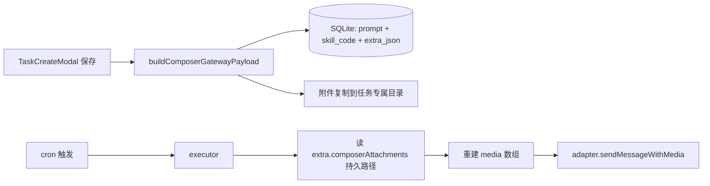
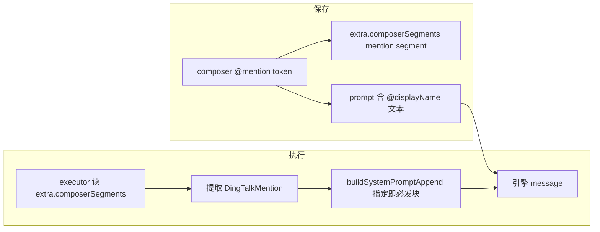

# Task 接入抽离 Composer 与云端同步

> 状态：阶段一已完成（待阶段二）
> 日期：2026-08-13
> 关联：`src/pages/MyTask/components/TaskInstructionComposer.tsx`、`src/pages/MyTask/components/TaskCreateModal.tsx`、`src/pages/Chat/ChatInput.tsx`、`src/components/input-composer/`、`src/components/attachments/`、`src/lib/composer-gateway-text.ts`、`src/lib/dingtalk-mention-composer.ts`、`electron/scheduled-tasks/`、`shared/dingtalk-send/scheduled-task-dingtalk-lift.ts`、`sto-plugin/openclaw/sto-scheduled-task-tool/`、`memory-center/`（云端同步）

---

## 一、缺陷复盘（四次提交）

| 提交 | 实质 | 遗留问题 |
|------|------|----------|
| `a278b1a4` 抽离 | ChatInput 变装配层；能力进 `input-composer`/`attachments`；Task 已有独立装配 | 场景分叉开始 |
| `59eb3aa1` 三处样式 | Chat 走 inline + `buildComposerGatewayPayload`；edit segments | 双 skill 坐标；editDraft prop/事件双通道 |
| `57cb56f9` 切会话/前缀 | 修回显 sanitize | 仍依赖「脏 gateway 文本再洗」 |
| `0de30f22` 四源附件/@偏移 | **仅 Chat** 接菜单；修 file+skill 前导空白 | Task 仍 `pickFiles`+顶部 chips；共享 hook 带 Chat store |

**对 Task 影响最大的缺陷（当前码已存在）：**

1. **附件双路径**：Chat=`useComposerAttachSource`+inline；Task=`pickFiles`+`AttachmentChips`
2. **保存死路径**：Modal 已 `enableAttachments`/skill/workflow，但 `handleSubmit` 只交 `plainText`+mentions，不读 attachments/skillMetas/segments
3. **执行无 media**：`scheduled-task-executor` 用 `adapter.sendMessage`（无 media），`MainChatSendInput` 不含 media 字段，只读 `task.prompt`
4. **共享泄漏**：`use-workflow-picker-controller` 清 `useChatStore` pending workflow——Task 选工作流也碰 Chat store
5. **编辑回填弱**：编辑只 `setPlainText`+mentions，skill/file/workflow token 无法按 Chat 的 segments 还原
6. **收件人双写**：Modal 用 `prepareDingTalkAgentTurnMessage` 注入收件人块到 prompt + 写 `dingtalkRecipients` 列；prompt 不干净

---

## 二、目标形态

### 2.1 Task Composer 对齐 Chat

创建/编辑仍走 `TaskCreateModal` + `TaskInstructionComposer`，按设计文档「各自动装配」：

| 能力 | 决策 |
|------|------|
| 四源附件菜单 + DataCenter 弹窗 | 与 Chat 同套接入 |
| 附件展示 | `inlineAttachments: true`，去掉顶部 chips |
| Enter | 保持 `submitMode: 'newline'` |
| 语音 / Agent / editDraft 事件 | 不接 |
| 表单级工作流下拉锁框 | 保留；与 composer 内 workflow token 并存时锁框优先 |

### 2.2 执行等价于自然对话

定时任务执行发出的消息与自然对话完全一致：文件真实挂载、技能内联、工作流、钉钉提及。

### 2.3 收件人进 segments

收件人完全在 composer @mention token，取消独立 `dingtalkRecipients` 列，prompt 保持干净。

### 2.4 云端同步

我的任务页新增「同步到云端」/「从云端拉取」按钮，将本地 SQLite 任务（含 composer 完整状态）备份/恢复到 memory-center 云端镜像存储。

---

## 三、阶段一：现有代码缺陷整理（准备阶段）

**目标**：把 ChatInput 抽离后散落的缺陷收口，为阶段二任务开发扫清障碍。不引入新功能，只修缺陷 + Task 假可用附件降级。完成后提交推送。

### 1.1 收敛共享泄漏

`src/components/input-composer/use-workflow-picker-controller.ts`：清除 pending workflow 改为可选回调注入。Task 不传回调则不清 Chat store，避免 Task 选工作流误碰 Chat store。

### 1.2 收敛双 skill 坐标

`src/hooks/dispatch-chat-send.ts` / `src/stores/chat/send-actions.ts`：发送链路同时传 `skillMeta`（旧单字段）+ `skillMetas`（新数组），下游 `canSend` / bake 两套判断。统一为 `skillMetas`，`skillMeta` 仅做 deprecated 兼容派生。

> 注：`CHAT_EDIT_DRAFT_EVENT` 双通道（ChatMessage event + ChatInput prop）是 **Chat 专属**缺陷，Task 编辑回填走受控 `value`/`initialMentions` props，不走 event，不影响 Task。本阶段只收敛 skill 坐标，editDraft 双通道留待 Chat 专项。

### 1.3 偏移逻辑收敛

`src/lib/dingtalk-mention-composer.ts`：`serializeMentionEditor` / `findPlainTextBoundary` / `resolveTrimmedSkillOffset` 偏移已对齐（`0de30f22`），补单测锁住「file+skill+mention+text」混合序列偏移一致性。

### 1.4 移动 TaskInstructionComposer 到 MyTask 目录

`src/components/task/TaskInstructionComposer.tsx` 是 MyTask 专用装配组件，从 `src/components/task/` 移到 `src/pages/MyTask/components/`，并更新所有 import 路径。

### 1.5 Task 假可用附件降级

`TaskInstructionComposer` 已 `enableAttachments=true`，但 `TaskCreateModal.handleSubmit` 不读 attachments → 用户能选文件但保存丢失。

阶段一先把 `enableAttachments` 默认值改 `false`（TaskCreateModal 显式传 `enableAttachments={false}`），避免误导。阶段二再开并补齐保存路径。

### 1.6 提交推送

阶段一完成后提交推送，作为阶段二起点。

### 1.7 历史数据迁移：收件人列/prompt 块 → extra.composerSegments

**背景**：去除 `dingtalk_recipients_json` 列、收件人进 `extra.composerSegments` 后，历史任务有三种形态（prompt 内块 / 列有值 / 双写），新 executor 期望 prompt 干净 + 从 extra 读收件人。需一次性迁移。

**迁移脚本**：扩展 [`liftDingTalkRecipientsFromPrompts`](../electron/scheduled-tasks/scheduled-task-service.ts) 或新建脚本（参照 [`lift-scheduled-task-dingtalk-recipients.ts`](../electron/scripts/lift-scheduled-task-dingtalk-recipients.ts)）：

- 扫描全量任务，对每个任务：
  1. 从 `dingtalk_recipients_json` 列 或 prompt 内收件人块解析 `DingTalkMention[]`
  2. 构造 `extra.composerSegments` 的 mention segment（含完整 DingTalkMention）
  3. 剥离 prompt 内收件人块（`stripDingTalkMentionContextForDisplay`），使 prompt 干净
  4. 写回 `extra_json` + `prompt`，清空 `dingtalk_recipients_json` 列
- marker 文件防重跑（参照现有迁移脚本模式）
- 支持 `dryRun` 先预览
- 启动时自动跑一次（或手动触发，视稳定性）

**钉钉提示词内容变更**：不需要改历史数据。`SCHEDULED_TASK_DINGTALK_RULES` / `DINGTALK_SEND_FORMAT_RULES_FOR_SCHEDULED_TASK` 是执行期 `buildSystemPromptAppend` 动态拼接，不存进 prompt，改文本后所有任务下次执行自动用新内容。

---

## 四、阶段二：任务模块开发

**目标**：Task Composer 对齐 Chat 完整能力；保存完整 composer 状态到 SQLite；执行器重建 media 使定时任务执行与自然对话一致；收件人进 segments 取消独立字段；NL 路径对齐；新增云端同步。

### 2.1 TaskInstructionComposer 升级

对齐 `src/pages/Chat/ChatInput.tsx` 附件接线：

- `useInputComposerCore({ inlineAttachments: true, submitMode: 'newline', ... })`
- `useComposerAttachSource({ onPickLocal: pickFiles, onConfirmDataCenter: stageDataCenterFiles })`
- Toolbar `onAttach={attachSource.openAttachMenu}` + `attachButtonRef`
- 挂载 `ComposerAttachMenu` + `DataCenterFilePickerModal`（portal，避免 Modal 裁切）
- `chips={null}`；去掉 `AttachmentChips` 顶部区
- 强化 `onSnapshotChange`（带 attachments 引用），供 Modal 保存使用

### 2.2 TaskCreateModal 保存 bake（收件人进 segments）

**背景**：当前双写——Modal 用 `prepareDingTalkAgentTurnMessage` 把收件人 JSON 块注入 prompt，同时写 `dingtalkRecipients` 列。新方向：收件人完全在 composer @mention token，取消独立字段，prompt 保持干净。

**保存（创建+编辑同一 `handleSubmit`）：**

- 从 composer 取 `segments` + `attachments` + `plainText`
- 调用 `src/lib/composer-gateway-text.ts` 的 `buildComposerGatewayPayload`（复用 Chat 的 `resolveSkillPrompt`）
- `prompt` = `gatewayText`（技能 defaultPrompt 内联 + 文件占位符 + `@displayName` 文本 + 正文）—— 不再 `prepareDingTalkAgentTurnMessage` 包装
- `skillCode` = bake 结果首个 skill slug
- `workflowCode` = 表单下拉优先；下拉空且 segments 含 workflow 时回填
- `extra.composerSegments` = `persistedSegments`（含 file/skill/workflow/mention/text；mention segment 含完整 `DingTalkMention`）
- `extra.composerAttachments` = `[{ fileName, mimeType, persistentPath, provenance }]`
- 不写 `dingtalkRecipients` 列

**移除**：Modal 不再调 `prepareDingTalkAgentTurnMessage`；`src/pages/MyTask/index.tsx` 的 `dingtalkRecipients: input.dingTalkMentions ?? null` 去掉。

### 2.3 附件持久化

保存时把 ready 附件复制到任务专属持久目录：

- 路径：`~/.stoclaw/scheduled-tasks/{taskId}/attachments/{attachmentId}-{fileName}`
- `extra.composerAttachments[].persistentPath` 存此路径
- 编辑保存时：对比新旧附件集，删除不再引用的持久文件，新增的复制
- 本地附件 + 数据中心附件都复制（数据中心附件也下载到本地持久目录，保证 cron 触发时可用）

> **SQLite 字段满足度**：`schedule_tasks` 表现有 `prompt`（gatewayText）/ `skill_code` / `extra_json`（存 composerSegments + composerAttachments）/ `dingtalk_recipients_json`（历史兼容降级读）/ `workflow_code` 全部够用，`extra_json` 是 JSON 字段可存任意结构，**不需要加列或迁移**。

### 2.4 执行器改造（核心，含收件人从 segments 还原）

`electron/scheduled-tasks/scheduled-task-executor.ts` + `electron/services/chat-send-service.ts`：

- `MainChatSendInput` 增加 `media?: Array<{ filePath, mimeType, fileName }>`
- executor 读 `task.extra.composerAttachments`，过滤 `persistentPath` 仍存在的文件，构建 media 数组
- executor 改用 `adapter.sendMessageWithMedia`（有 media 时）/ `adapter.sendMessage`（无 media 时）
- `electron/engines/types.ts` `EngineSendWithMediaParams` 已有 media 字段，adapter 已支持（`openclaw-adapter` / `claude-adapter` 均已实现 `sendMessageWithMedia`）
- `runMainChatSend` 透传 media 到 dispatch

**钉钉收件人还原（关键变更）：**

- `shared/dingtalk-send/scheduled-task-dingtalk-lift.ts` 的 `resolveScheduledTaskDingTalkRecipients` 改 **extra 优先**降级链：
  1. `extra.composerSegments` 的 mention segment → 提取 `DingTalkMention[]`
  2. `task.dingtalkRecipients` 列（历史兼容）
  3. `task.prompt` 内收件人 JSON 块解析（最老历史降级）
- `electron/scheduled-tasks/scheduled-task-service.ts` 的 `buildSystemPromptAppend` 从 extra 提取的 mentions 构造"指定即必发"块（不再依赖 prompt 内块）
- `message = task.prompt`（干净，含 `@displayName` 文本，引擎能看到 @ 谁，但收件人规则由 systemPromptAppend 注入）

### 2.5 编辑回填

`src/pages/MyTask/components/TaskCreateModal.tsx` 编辑模式（`job` 有值）：

- 有 `extra.composerSegments` 时：走 segments 重建（对齐 Chat edit draft 的 `persistedSegmentsToComposer` 路径），mention token 从 segment 还原（含完整 DingTalkMention）
- 用 `extra.composerAttachments` 的 `persistentPath` 重建附件 token（文件仍存在则正常展示，不存在则 error chip）
- 无 `extra.composerSegments` 的历史任务：保持现 strip + mentions 降级（从 `dingtalkRecipients` 列或 prompt 块解析）

### 2.6 NL 自然创建路径对齐

`sto-plugin/openclaw/sto-scheduled-task-tool/index.ts` 的 `create_scheduled_task` 工具当前把 `recipients` 写 `dingtalk_recipients_json` 列。新方向：

- 工具仍接收 `recipients` 参数，但 `host-api-client.ts` 写入时改为存进 `extra.composerSegments` 的 mention segment（与 Modal 保存一致）
- prompt 保持干净（工具已要求"不要塞收件人规则大块"，现状对齐）
- 工具 prompt 文档补充：若用户 @ 了收件人，recipients 传入，系统写入 `extra.composerSegments`（不再写列）
- 历史任务（已有列）由 executor 降级链兼容

### 2.7 客户端测试

阶段二客户端开发完成后，进行全面测试：

- 创建 Task：插文件 + 技能 + 工作流 + @钉钉 → 保存 → 检查 DB（prompt 干净 / skill_code / extra_json 含 composerSegments + composerAttachments）
- 编辑 Task：回填 segments + 附件 token 一致；历史任务降级回填
- 定时触发：cron 到点执行 → 检查 media 真实挂载 / 技能内联 / 钉钉收件人 systemPromptAppend 注入 / 引擎收到干净 prompt
- NL 创建：`create_scheduled_task` 写 extra.composerSegments
- 历史数据迁移：迁移脚本跑后，历史任务 prompt 干净、收件人进 extra

**测试通过后进入阶段三。**

---

## 五、阶段三：云端同步（仅计划，待客户端测试完毕后开发）

> **本阶段仅制定计划，暂不编码。等阶段二客户端任务全部测试完毕后，再进行开发。**

### 3.1 云端 schema（memory-center）

[memory-center](../../memory-center) 新建一张与本地 `schedule_tasks` **同结构**的表（不复用现有知多星 `scheduled_tasks` 表，字段模型不同），加 `owner_user_id` 区分账号：

- alembic 迁移：新建 `schedule_tasks_cloud` 表
  - 与本地 [`schedule_tasks`](../electron/db/migrations/0011-schedule-tasks.ts) 字段一一对应：
    - `id` TEXT PK, `owner_user_id` TEXT NOT NULL（索引）, `name`, `enabled` INT, `cron_expr`, `engine_type`, `prompt`, `agent_id`
    - `workflow_code`, `skill_code`, `dingtalk_recipients_json`, `model`, `provider`, `account_id`, `workspace_path`
    - `my_artifact_folder_path`, `shared_artifact_folder_path`, `permission_profile`, `timeout_sec`
    - `retry_policy_json`, `failure_policy_json`, `extra_json`（存 composerSegments + composerAttachments）
    - `next_run_at`, `last_scheduled_for`, `last_recovered_at`, `cron_expr_snapshot`
    - `created_at`, `updated_at`, `deleted_at`, `version`, `created_by`, `updated_by`
  - 唯一约束：`(owner_user_id, id)`（同账号下 id 唯一）
  - 索引：`owner_user_id`（按账号列出）
- [`schemas/scheduled_task.py`](../../memory-center/src/schemas/scheduled_task.py) 新增：
  - `ScheduleTaskCloudUpsertRequest`：与本地 `ScheduleTask` 同构 + `owner_user_id`
  - `ScheduleTaskCloudResponse`：云端表所有字段
  - `ScheduleTaskCloudListResponse`：`items: list[ScheduleTaskCloudResponse]`

### 3.2 云端路由（memory-center）

`memory-center/src/api/claw_api/v1/scheduled_tasks.py` 新增同步路由（或新文件 `schedule_tasks_cloud.py`）：

- `POST /scheduled-tasks/cloud/batch-upsert`：批量 upsert（一键同步全量，按 `owner_user_id` + `id` 匹配）
- `GET /scheduled-tasks/cloud/list`：列出当前用户所有云端任务
- `POST /scheduled-tasks/cloud/delete`：按 `id` 逻辑删除
- 鉴权复用 `resolve_scheduled_task_owner_user_id`
- service 层新建 `ScheduleTaskCloudService`（`repositories/schedule_task_cloud_repository.py`）
- upsert 语义：`owner_user_id` + `id` 存在则更新（`version` 冲突提示），不存在则插入

### 3.3 客户端同步 UI

`src/pages/MyTask/index.tsx`（或 `TaskToolbar`）新增按钮：

- 「同步到云端」：读本地 SQLite 全量任务 → POST `/scheduled-tasks/cloud/batch-upsert` → 提示成功/失败数
- 「从云端拉取」：GET `/scheduled-tasks/cloud/list` → 本地 upsert（按 `id` 匹配，`version` 冲突提示）
- host-api 调用经 `electron/api/routes/scheduled-tasks.ts` 代理到 memory-center（需在 `electron/main/ipc/host-api-proxy.ts` 增加路由透传）
- 同步状态：loading / 成功 toast / 失败明细
- 拉取时附件持久目录重建：若 `extra.composerAttachments[].persistentPath` 文件不存在，标记 error chip（不阻塞任务保存）

### 2.10 测试与文档

**单测：**

- 阶段一：偏移一致性（file+skill+mention+text 混合）/ skill 坐标统一 / workflow picker 不泄漏
- 阶段二：
  - `TaskInstructionComposer` 附件菜单回调冒烟
  - Modal 保存 payload：prompt 干净（无收件人 JSON 块）/ skillCode / extra.composerSegments（含 mention segment）/ extra.composerAttachments
  - executor 重建 media：有/无附件 / 持久路径失效
  - executor 钉钉收件人还原：extra 优先 / 列降级 / prompt 块降级
  - `resolveScheduledTaskDingTalkRecipients` 降级链
  - NL 工具 `create_scheduled_task` 写 extra.composerSegments
  - 编辑回填：segments 重建（含 mention）/ 历史降级
  - 历史数据迁移脚本：dryRun / 实际迁移 / marker 防重

**文档：**

- `docs/Composer附件-上传菜单与数据中心选文件.md`：勾选 Task 四源菜单；注明执行期 media 重建
- 新建 `docs/定时任务云端同步.md`：表结构 / 路由 / 同步语义 / 冲突策略（阶段三开发时写）
- 更新 NL 工具说明：收件人写 extra.composerSegments

---

## 六、关键文件

**阶段一**

- `src/components/input-composer/use-workflow-picker-controller.ts`
- `src/hooks/dispatch-chat-send.ts`
- `src/stores/chat/send-actions.ts`
- `src/lib/dingtalk-mention-composer.ts`
- `src/components/task/TaskInstructionComposer.tsx` → 移到 `src/pages/MyTask/components/`
- `src/pages/MyTask/components/TaskCreateModal.tsx`

**阶段二 — 客户端 Composer / 保存 / 执行**

- `src/pages/MyTask/components/TaskInstructionComposer.tsx`（阶段一已移动）
- `src/pages/MyTask/components/TaskCreateModal.tsx`
- `src/pages/MyTask/index.tsx`
- `src/lib/composer-gateway-text.ts`
- `electron/scheduled-tasks/scheduled-task-executor.ts`
- `electron/scheduled-tasks/scheduled-task-service.ts`
- `electron/services/chat-send-service.ts`
- `shared/dingtalk-send/scheduled-task-dingtalk-lift.ts`

**阶段二 — NL 自然创建**

- `sto-plugin/openclaw/sto-scheduled-task-tool/index.ts`
- `sto-plugin/openclaw/sto-scheduled-task-tool/host-api-client.ts`

**阶段二 — 客户端同步**

- `src/pages/MyTask/index.tsx`
- `electron/api/routes/scheduled-tasks.ts`
- `electron/main/ipc/host-api-proxy.ts`

**阶段二 — 云端 memory-center**

- `memory-center/src/api/claw_api/v1/scheduled_tasks.py`（新增 cloud 路由）
- `memory-center/src/schemas/scheduled_task.py`（新增 cloud schema）
- `memory-center/alembic/versions/`（新建 `schedule_tasks_cloud` 表迁移）
- `memory-center/src/repositories/schedule_task_cloud_repository.py`（新建）
