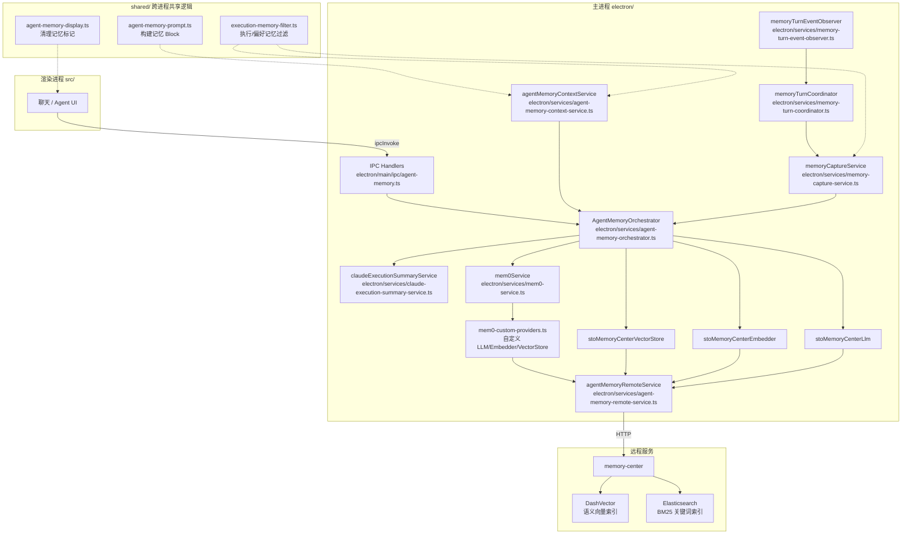
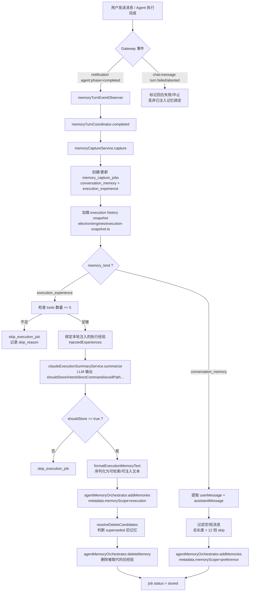
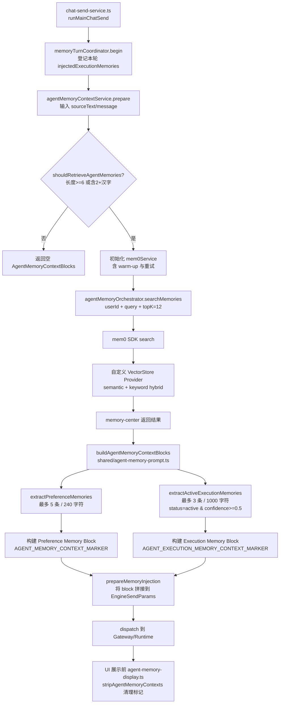
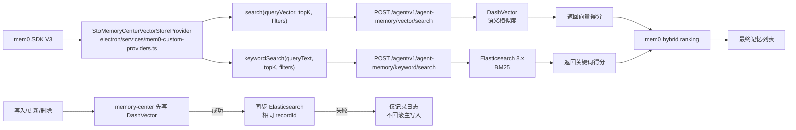

# StoClaw 记忆模块架构设计

> 基于代码与 OpenSpec 文档梳理。记忆模块采用 **mem0 OSS SDK + 自定义远程 Provider** 架构，memories 实际上存储在 STO `memory-center` 后端的 DashVector（语义）和 Elasticsearch（关键词）中。

---

## 一、总体架构图

---

## 二、记忆写入（捕获）流程

记忆在用户一次 Agent 执行结束后写入，分为两种：

- **Conversation Memory**（偏好记忆）：沉淀用户问答偏好、风格、长期目标。
- **Execution Experience**（执行经验）：沉淀工具选择、参数规划、避坑路径。

---

## 三、记忆读取（注入）流程

每次用户发消息时，主进程异步检索相关记忆并注入到本轮发送给 Runtime 的 prompt 中。

---

## 四、执行经验总结子流程

执行经验不是原文存储，而是由 `qwen3.6-plus` 总结成结构化 JSON，再序列化为文本。

```mermaid
flowchart LR
    A["输入：userTask + finalAnswerSummary + tools + injectedExperiences"] --> B["buildSummaryPrompt"]
    B --> C["agentMemoryRemoteService.createChatCompletion<br/>model=qwen3.6-plus"]
    C --> D["parseJsonObjectFromText<br/>解析 JSON"]
    D --> E["ExecutionExperienceSummary"]
    E --> F{"shouldStore?"}
    F -->|false| G["丢弃"]
    F -->|true| H["formatExecutionMemoryText"]
    H --> I["直接执行 / 参数模式 / 避免 / 探索路径 / 适用 / 约束"]
    I --> J["写入 mem0<br/>memoryType=tool_routing_experience"]
    J --> K["candidateAssessments 判断旧经验是否被取代"]
    K --> L["删除 superseded 旧记忆"]
```

---

## 五、混合检索架构（DashVector + Elasticsearch）

这是 `openspec/changes/agent-memory-remote-vectorstore` 的核心设计：语义走 DashVector，关键词走 Elasticsearch，mem0 负责 hybrid ranking。

---

## 六、关键数据表

`electron/db/migrations/0002-memory-capture-jobs.ts`：

| 字段 | 说明 |
|------|------|
| `id` | `conversation_memory:{runId}` / `execution_experience:{runId}` |
| `memory_kind` | `conversation_memory` / `execution_experience` |
| `status` | `pending -> ready -> summarizing -> stored / skipped / retry_wait / failed` |
| `payload_json` | 待处理/已处理的快照与总结结果 |
| `memory_id` | 最终写入 mem0 的记忆 ID |
| `retry_count` | 最大 3 次重试 |

---

## 七、核心设计决策

1. **远程优先**：mem0 SDK 的 LLM、Embedder、VectorStore 全部替换为 STO `memory-center` 远程实现，本地只保留 mem0 的编排逻辑和 SQLite history。
2. **双通道混合检索**：语义检索走 DashVector，关键词检索走 Elasticsearch，失败后自动降级为语义检索。
3. **执行经验生命周期**：新经验写入时会评估本轮注入的旧经验，对 `supersedes` 的旧路径执行删除，避免记忆膨胀。
4. **写入弱一致性**：Elasticsearch 作为 secondary index，同步失败只记录日志，不影响 DashVector 主写入成功。
5. **隔离性**：所有检索按 `user_id` / `app_id` / `collectionName` 隔离，服务端以认证用户为权威作用域。

---

## 八、关键文件索引

| 职责 | 文件路径 |
|------|----------|
| 统一编排入口 | `electron/services/agent-memory-orchestrator.ts` |
| mem0 SDK 封装 | `electron/services/mem0-service.ts` |
| 自定义远程 Provider | `electron/services/mem0-custom-providers.ts` |
| memory-center HTTP 客户端 | `electron/services/agent-memory-remote-service.ts` |
| 上下文检索服务 | `electron/services/agent-memory-context-service.ts` |
| 记忆捕获服务 | `electron/services/memory-capture-service.ts` |
| 回合协调器 | `electron/services/memory-turn-coordinator.ts` |
| 回合事件观察器 | `electron/services/memory-turn-event-observer.ts` |
| 执行经验总结 | `electron/services/claude-execution-summary-service.ts` |
| IPC 入口 | `electron/main/ipc/agent-memory.ts` |
| 提示词构建 | `shared/agent-memory-prompt.ts` |
| 记忆过滤 | `shared/execution-memory-filter.ts` |
| 记忆标记清理 | `shared/agent-memory-display.ts` |
| 聊天发送编排 | `electron/services/chat-send-service.ts` |
| 数据表迁移 | `electron/db/migrations/0002-memory-capture-jobs.ts` |
| OpenSpec 设计 | `openspec/changes/agent-memory-remote-vectorstore/design.md` |
