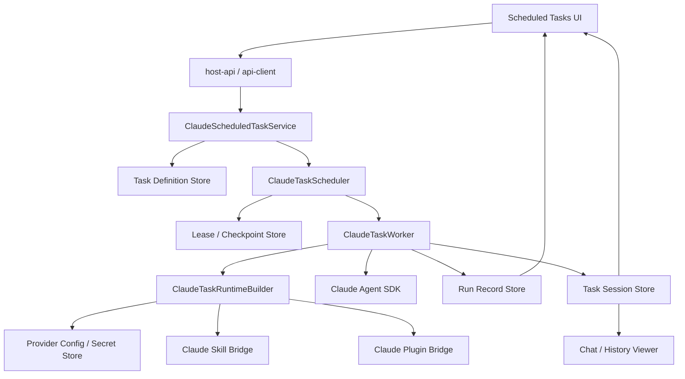

# Claude 本地定时任务运行环境设计

## 1. 目标

为 StoClaw 设计一套仅依赖 **Claude 引擎** 的定时任务运行环境，满足以下要求：

- 定时任务独立在 StoClaw 本地运行
- 不依赖当前 `openclaw gateway`
- 不复用 OpenClaw cron、session、provider runtime 假设
- 即使后续 OpenClaw 引擎完全移除，Claude 定时任务仍可继续工作
- 与现有 Claude 会话、技能、插件、Provider 配置能力尽量复用

## 2. 设计原则

### 2.1 宿主管理

Claude 定时任务由 StoClaw Main 进程托管，不把调度权交给外部网关或云端服务。

### 2.2 运行隔离

定时任务执行和聊天会话执行共用 Claude 能力装配逻辑，但不共用运行状态，不把聊天中的临时上下文直接带入任务。

### 2.3 本地持久化

任务定义、执行记录、会话索引、调度 checkpoint 都保存在 StoClaw 本地目录，支持重启恢复。

### 2.4 引擎单一化

定时任务模型从一开始就以 `claude` 为唯一执行引擎，不再引入 `openclawGatewayUrl`、`dialogSessionKey` 一类历史字段。

### 2.5 安全边界明确

无人值守执行必须有权限档位、超时、重试、并发限制和失败熔断。

## 3. 适用范围

本设计覆盖：

- Claude 本地定时任务定义
- 本地 cron 调度
- Claude 任务执行器
- 运行结果持久化
- UI 管理入口
- 失败恢复与可观测性

本设计不覆盖：

- 云端托管执行
- OpenClaw 兼容层
- 多引擎统一调度器

## 4. 总体架构



## 5. 核心模块

### 5.1 ClaudeScheduledTaskService

职责：

- 任务 CRUD
- 参数校验
- readiness 检查
- 手动触发
- 启停任务

它是 Renderer 可见的唯一任务服务入口。

建议位置：

- `electron/services/claude-scheduled-task-service.ts`

### 5.2 ClaudeTaskScheduler

职责：

- 加载已启用任务
- 根据 cron 表达式计算下次执行时间
- 周期性 tick
- 恢复重启前未完成或错过的任务
- 管理 lease，避免重复执行

建议位置：

- `electron/services/claude-task-scheduler.ts`

### 5.3 ClaudeTaskWorker

职责：

- 执行单个任务
- 组装运行时上下文
- 调用 Claude SDK
- 控制超时、重试、取消
- 回写执行结果

建议位置：

- `electron/services/claude-task-worker.ts`

### 5.4 ClaudeTaskRuntimeBuilder

职责：

- 解析 agent 绑定的 workspace
- 解析 provider account、API key、model
- 同步 Claude skills
- 注入 Claude plugins / hooks / system prompt
- 构造任务执行专用 env 和 runtime options

建议位置：

- `electron/services/claude-task-runtime-builder.ts`

这个模块应尽量复用当前 Claude 代码中的已有能力：

- `electron/engines/claude-adapter.ts`
- `electron/engines/claude-runtime-extensions.ts`
- `electron/services/claude-skill-bridge.ts`
- `electron/services/claude-plugin-bridge.ts`

但复用的是“运行时装配逻辑”，不是聊天发送逻辑。

### 5.5 Task Session Store

职责：

- 保存任务摘要结果
- 保存单次执行会话索引
- 支持任务历史查看

建议位置：

- `electron/services/claude-task-session-store.ts`

## 6. 本地存储设计

建议全部存放在 StoClaw 本地数据目录下，例如：

```text
{stoclawDataDir}/claude-scheduled-tasks/
  definitions.json
  scheduler-state.json
  leases.json
  runs/
    {taskId}.jsonl
  sessions/
    {taskId}/
      summary.jsonl
      run-index.json
      runs/
        {runId}.jsonl
```

### 6.1 definitions.json

保存任务定义。

### 6.2 scheduler-state.json

保存调度器状态：

- 上次 tick 时间
- 每个任务的 nextRunAt
- 最近一次补偿窗口

### 6.3 leases.json

保存任务执行锁：

- `taskId`
- `runId`
- `leaseUntil`

防止应用恢复后重复触发同一个任务窗口。

### 6.4 runs/{taskId}.jsonl

保存任务级别的执行记录摘要，适合任务中心列表读取。

### 6.5 sessions/{taskId}/summary.jsonl

保存任务摘要会话，适合在任务详情中快速查看每次执行结论。

### 6.6 sessions/{taskId}/runs/{runId}.jsonl

保存单次执行的完整会话内容，适合打开查看详细输出、工具调用、错误信息。

## 7. 数据模型

### 7.1 任务定义

```ts
type ClaudeScheduledTaskDefinition = {
  id: string;
  name: string;
  enabled: boolean;
  cronExpr: string;
  promptTemplate: string;
  agentId: string;
  workspacePath: string;
  providerAccountId?: string;
  model?: string;
  permissionProfile: "readonly-safe" | "workspace-write" | "dangerous-bypass";
  timeoutSec: number;
  retryPolicy: {
    maxAttempts: number;
    backoffSec: number;
  };
  failurePolicy: {
    pauseAfterConsecutiveFailures: number;
  };
  createdAt: string;
  updatedAt: string;
};
```

### 7.2 执行记录

```ts
type ClaudeScheduledTaskRunRecord = {
  runId: string;
  taskId: string;
  status: "queued" | "running" | "succeeded" | "failed" | "timed_out" | "cancelled";
  triggerSource: "manual" | "schedule" | "recovery";
  scheduledFor: string;
  startedAt?: string;
  completedAt?: string;
  attempt: number;
  idempotencyKey: string;
  sessionKey: string;
  summary?: string;
  error?: string;
  runtimeResult?: {
    stopReason?: string | null;
    isError?: boolean;
    durationMs?: number;
  };
  runtimeSnapshot: {
    workspacePath: string;
    providerAccountId?: string;
    model?: string;
    permissionProfile: string;
    pluginPaths: string[];
  };
};
```

## 8. 调度模型

### 8.1 基本策略

调度器由 Main 进程启动后常驻运行：

- 启动时读取全部启用任务
- 计算每个任务的 `nextRunAt`
- 每隔固定周期进行一次 due-check
- 对到期任务下发给 worker

### 8.2 触发来源

支持三类触发：

- `manual`: 用户手动点击“立即运行”
- `schedule`: 正常 cron 到点
- `recovery`: 应用重启或唤醒后的补偿执行

### 8.3 去重策略

同一个任务在同一个调度窗口只允许生成一个有效 run。

幂等键建议为：

```text
{taskId}:{scheduledFor}:{attempt}
```

### 8.4 重启恢复

应用启动时：

1. 读取 `scheduler-state.json`
2. 检查上次运行时间到当前时间是否存在漏执行窗口
3. 根据策略决定是否补跑

建议默认策略：

- 仅补最近一次 missed run
- 不无限追补历史窗口

这样更稳，避免用户长时间离线后瞬间触发很多任务。

## 9. Claude 执行模型

### 9.1 执行方式

每次任务执行使用独立 Claude 会话，不长期 `resume` 同一个 session。

原因：

- 定时任务强调稳定和可复现
- 避免上下文无限增长
- 避免上一次任务输出污染下一次任务

### 9.2 输入组装

Worker 最终传入 Claude SDK 的 prompt 建议由三部分组成：

1. 系统约束
2. 任务模板
3. 本次执行上下文

示例：

```text
[System Task Guard]
你正在作为 StoClaw 的后台定时任务执行器运行...

[Task Template]
请生成今日销售波动分析...

[Runtime Context]
当前时间: ...
任务ID: ...
运行模式: scheduled
```

### 9.3 运行时装配

每次执行前完成：

- 解析 provider account
- 注入 `ANTHROPIC_API_KEY` / base URL
- 注入 model
- 同步 Claude 技能
- 挂载 Claude plugins
- 注入 hooks
- 生成 task-scoped working env

### 9.4 输出处理

执行完成后输出分两层保存：

- 摘要：适合任务列表和任务详情
- 完整 transcript：适合打开会话深看

## 10. 权限与安全

### 10.1 权限档位

建议任务配置支持三档：

- `readonly-safe`
  只允许读取 workspace，不允许修改文件，不允许危险工具

- `workspace-write`
  允许在任务指定 workspace 内写入文件

- `dangerous-bypass`
  开发者模式专用，允许高权限工具执行

默认值应为：

```text
readonly-safe
```

### 10.2 超时

每个任务必须设置超时，例如默认：

```text
300 秒
```

超时后：

- 中止 Claude 执行
- 将 run 标记为 `timed_out`
- 写入错误说明

### 10.3 并发限制

建议：

- 单个任务同一时间只允许 1 个 active run
- 同一 agent 下同时运行的 Claude 定时任务数量可设置上限，例如 2

### 10.4 连续失败熔断

若同一任务连续失败达到阈值，例如 3 次：

- 自动暂停任务
- UI 显示“因连续失败已暂停”

## 11. 与现有 Claude 体系的关系

### 11.1 可以复用的部分

- Provider store / secret store
- Claude runtime extensions
- Claude skill bridge
- Claude plugin bridge
- Agent workspace 配置
- Claude session registry 的部分元数据逻辑

### 11.2 不应复用的部分

- Chat store 的 optimistic message 逻辑
- 面向聊天交互的 send pipeline
- 任何 OpenClaw Gateway RPC 依赖
- 现有 OpenClaw 风格的 cron session key 约定

## 12. 会话设计

建议采用两层会话模型。

### 12.1 任务摘要会话

每个任务一个摘要会话：

```text
claude-task:{taskId}
```

用于：

- 快速浏览历史执行结论
- 任务详情页展示

### 12.2 单次执行会话

每次执行一个独立会话：

```text
claude-task-run:{taskId}:{runId}
```

用于：

- 详细查看某次任务执行过程
- 排查工具调用和错误

## 13. Renderer 侧设计

任务 UI 需要新增以下字段：

- 执行引擎：固定 Claude
- 任务名称
- Prompt 模板
- 计划时间
- 绑定 Agent
- Workspace
- Provider / Model
- 权限档位
- 超时设置
- 重试策略

任务列表建议展示：

- 名称
- 下次执行时间
- 最近一次执行状态
- 最近一次摘要
- 启用/暂停
- 手动运行
- 查看记录

任务详情建议展示：

- 最近执行列表
- 每次执行状态
- 持续时间
- 错误原因
- 打开对应 run 会话

## 14. 失败恢复与可观测性

每次运行记录以下字段：

- `scheduledFor`
- `startedAt`
- `completedAt`
- `durationMs`
- `status`
- `attempt`
- `error`
- `stopReason`
- `model`
- `providerAccountId`

建议日志前缀统一为：

```text
[claude-task]
```

示例：

- `[claude-task] scheduler tick`
- `[claude-task] dispatch task=... run=...`
- `[claude-task] timeout task=... run=...`

## 15. 实施建议

建议分三阶段落地。

### Phase 1: 最小可运行

- 定义本地存储模型
- 新建 scheduler 和 worker
- 支持手动 trigger Claude 任务
- 支持结果持久化

### Phase 2: 自动调度

- 支持 cron 到点执行
- 支持重启恢复
- 支持超时、重试、熔断

### Phase 3: 完整 UI 与历史

- 接入任务中心 UI
- 支持 run 列表、详情、会话打开
- 支持 readiness 检查和错误提示

## 16. 结论

Claude 定时任务应该被设计成 StoClaw 自己的本地能力，而不是 OpenClaw cron 的替代分支。

最合适的方向是：

- **Main 进程本地调度**
- **Claude 独立执行器**
- **本地持久化任务与运行记录**
- **与聊天会话解耦、与 Claude runtime 装配逻辑复用**

这样即使未来完全移除 OpenClaw，引擎侧也不会影响 Claude 定时任务继续独立运行。
