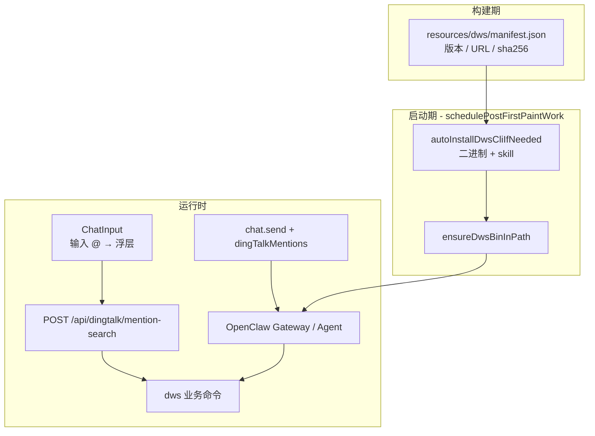

# StoClaw 钉钉 Workspace CLI（dws）集成技术方案

| 项 | 内容 |
|----|------|
| 状态 | 草案（待评审 / 实施） |
| 版本 | 1.0 |
| 日期 | 2026-06-03 |
| 相关仓库 | `sto-claw` |
| **Spec Kit** | [specs/011-dingtalk-dws-integration](../../specs/011-dingtalk-dws-integration/spec.md) |
| 官方文档 | [DingTalk CLI — 让 AI 真正帮你在钉钉里干活](https://open.dingtalk.com/document/development/dingtalk-cli-performing-tasks-within) |
| 开源 CLI | [dingtalk-workspace-cli](https://github.com/DingTalk-Real-AI/dingtalk-workspace-cli)（命令名 `dws`） |

---

## 1. 背景与目标

### 1.1 背景

钉钉开放平台推出 **DingTalk Workspace CLI（`dws`）**，将通讯录、群聊、日历、待办、审批、AI 表格、文档、听记等能力暴露为命令行接口，并配套 **Agent Skills**（`SKILL.md`），供 Cursor / Claude / OpenClaw 等 Agent 调用。

StoClaw 基于 **OpenClaw Gateway** 运行主对话 Agent，已具备：

- 启动后安装 **openclaw CLI**、**sai-cli**（在线二进制 + PATH）的模式；
- 输入框 **工具栏 `@` 按钮** 选择其他 **Agent**（`targetAgentId`）；
- 通道配置中对 **钉钉** 的 UI 与 `ensureDingTalkPluginInstalled()` 调用。

当前 **bundled 钉钉 OpenClaw 插件（`@soimy/dingtalk`） intentionally 不启用**（见 §8）。本方案以 **dws + 输入框钉钉 @ + Phase 1 发送** 为主路径，在 StoClaw 内实现「像钉钉一样 @ 人/群并让 Agent 在钉钉里干活」。

### 1.2 目标

1. **安装 / 升级**：用户安装或升级 StoClaw 后，在首屏之后自动安装/更新 `dws` 及配套 **skill**（原子事务，版本一致）。
2. **授权**：设置页 / 通道页引导完成 `dws auth login`（企业需开通 CLI 访问）。
3. **输入体验**：输入框内输入 **`@`** 弹出联系人/群搜索（方案 A）；工具栏 **`@` 按钮** 仍仅选 **Agent**（保持现状）。
4. **发送语义**：用户发送时附带 **`dingTalkMentions` 结构化收件人**，由 **Agent 调 dws 发送**（Phase 1），避免重复搜人。
5. **安全**：CLI 安装/升级仅 **Main 进程**；Gateway 内 Agent **禁止** `dws upgrade` 等自升级行为。

### 1.3 非目标（Out of Scope）

- **不恢复 bundled `@soimy/dingtalk` 插件**（直至 OpenClaw 升级满足 peer，见 §8）。
- **不实现 Phase 2 Main 直发**（可作为后续增强）。
- **不在 Renderer 直接 spawn dws**（统一 Main + host-api）。
- **不替代钉钉客户端 UI**（无内嵌钉钉 IM 窗口）。

---

## 2. 产品决策汇总（已确认）

| 决策项 | 结论 |
|--------|------|
| CLI 选型 | `dingtalk-workspace-cli`，可执行文件 `dws` |
| 安装时机 | 应用已安装；**首次/每次启动、首屏渲染后**下载/更新（非安装包解压瞬间） |
| skill 策略 | 与二进制 **同版本、同一次升级事务** 安装；默认 **`mono`** 模式（`dws skill setup --mode mono`） |
| 输入 `@` | **仅钉钉** 联系人/群（打字触发浮层） |
| 工具栏 `@` | **仅 Agent**（点击按钮，现有 `pickerOpen` / `targetAgentId`） |
| 发送方式 | **Phase 1**：附带 `dingTalkMentions`，由 **Agent + dws skill** 执行发送 |
| bundled 钉钉插件 | **本阶段不打开** |

---

## 3. 架构总览



### 3.1 与现有组件关系

| 组件 | 关系 |
|------|------|
| **openclaw CLI** | 独立；Gateway 管理用 |
| **sai-cli** | 参考实现（在线二进制、PATH、`electron/utils/sai-cli.ts`） |
| **uv** | 构建期内嵌；与 dws 无关 |
| **`@soimy/dingtalk` 插件** | 本方案不启用；通道 UI 可保留但需降级提示 |
| **dws** | 办公自动化、@ 收件人、Agent 发钉钉消息 |

---

## 4. dws 安装与升级

### 4.1 安装路径与 PATH

| 平台 | 二进制路径 |
|------|------------|
| macOS / Linux | `~/.stoclaw/bin/dws` |
| Windows | `~/.stoclaw/bin/dws.exe` |

- 解析顺序：`~/.stoclaw/bin/dws` → 系统 PATH 中已有 `dws`。
- **必须** 更新 **Main 与 Gateway 子进程** 的 `PATH`（与 `sai-cli` 相同策略：当前进程 + 用户注册表 / shell rc）。

### 4.2 构建期：manifest（不强制内嵌全量二进制）

**脚本**：`scripts/download-dws-manifest.mjs`（待建）

**产物**：`resources/dws/manifest.json`，经 `electron-builder.yml` `extraResources` 打入安装包。

**示例结构**：

```json
{
  "dwsVersion": "1.0.32",
  "skillMode": "mono",
  "skillsRevision": "1.0.32",
  "platforms": {
    "darwin-arm64": {
      "url": "https://github.com/.../releases/download/v1.0.32/dws-darwin-arm64",
      "sha256": "..."
    }
  }
}
```

**package.json scripts（建议）**：

```json
"dws:manifest": "zx scripts/download-dws-manifest.mjs"
```

在 `package` / `build` 链中于 `uv:download` 之后执行（仅生成 manifest，控制安装包体积）。可选后续：OSS 镜像 URL 字段。

### 4.3 运行时：安装 / 升级事务

**模块**：`electron/utils/dws-cli.ts`（待建）

**入口**：`autoInstallDwsCliIfNeeded()`，在 `electron/main/index.ts` 的 `schedulePostFirstPaintWork` 中调用（与 `autoInstallSaiCliIfNeeded` 并列）。

**流程（原子）**：

```text
1. 读取 resources/dws/manifest.json → bundledVersion
2. 读取 ~/.stoclaw/dws/manifest.json → localVersion（无则视为未安装）
3. 若 localVersion >= bundledVersion 且二进制存在 → 仅 ensureDwsBinInPath，结束
4. Prepare：下载平台二进制 → 校验 sha256 → 写入临时文件
5. Apply：替换 ~/.stoclaw/bin/dws → chmod 755（非 Windows）
6. Skill：dws skill setup --mode mono（非交互，失败则整事务失败）
7. 写 ~/.stoclaw/dws/manifest.json（version, skillMode, skillsRevision, installedAt）
8. ensureDwsBinInPath；可选 webContents.send('dws:cli-installed')
```

**失败策略**：任一步失败 **不更新** 本地 manifest 版本号；日志 + 可选 `dws:cli-install-failed` 事件；保留上一版二进制（若存在）。

**应用升级 StoClaw**：新版本携带更高 `bundledVersion` → 下次启动走步骤 3–8。

**禁止使用**：官方 `curl | install.sh` 在 Electron 内非交互安装（难控版本、代理、TTY）。

**macOS**：若 spawn 报隔离错误，尝试 `xattr -d com.apple.quarantine` on binary。

### 4.4 与 sai-cli 的差异

| 项 | sai-cli | dws |
|----|---------|-----|
| 下载源 | STO `/api/v1/cli/update` | GitHub Releases（manifest pin） |
| skill | 无 | **必须** 同步 `dws skill setup` |
| 自升级 | Agent 可 update（Gateway 放行） | Agent **禁止** upgrade |

---

## 5. 授权与设置

### 5.1 用户授权

- 命令：`dws auth login`（浏览器 OAuth）；无 GUI：`dws auth login --device`。
- **Main** 通过 IPC / host-api 触发 spawn，可复用现有 `browserOAuthManager` 打开浏览器。
- 凭证由 dws 管理（Keychain 等），StoClaw **不持久化** refresh token 到自有 store。

### 5.2 企业前置

- 开发者后台 → CLI 访问管理 → 开启。
- 组织未开通时，@ 浮层 / 设置页展示明确文案与申请指引。

### 5.3 设置页（建议）

- dws 版本、安装状态、上次升级时间。
- 「登录钉钉」「检查登录状态」（`dws auth status --format json`）。
- 「检查 dws 更新」（调 Main `installOrUpdateDwsCli`，非 Agent）。

---

## 6. 输入框 `@` 提及（方案 A）

### 6.1 交互规则

| 入口 | 行为 |
|------|------|
| **输入 `@`** | 打开 **钉钉** 提及浮层（`DingTalkMentionPopover`） |
| **点击工具栏 `@` 按钮** | 打开 **Agent** 列表（现有逻辑，不变） |

两套 state 独立：`dingTalkMentionOpen` + `dingTalkMentions[]` vs `pickerOpen` + `targetAgentId`。

### 6.2 浮层行为

1. **触发**：`onChange` 检测光标前 `@([^\s@]*)$`；IME 在 `compositionEnd` 后再检测。
2. **搜索**：防抖 250ms → `POST /api/dingtalk/mention-search`。
3. **列表**：联系人 + 群/会话；展示主标题、副标题（部门/人数）；键盘 ↑↓ Enter Esc。
4. **选中**：替换 `@query` 为 `@显示名`；维护 `DingTalkMention`；输入框上方 **Chip** 可删除。
5. **降级**：未安装 dws / 未登录 → 引导设置页；弱网 → 可选「最近 @」本地缓存（`electron-store`）。

### 6.3 dws 搜索命令（只读白名单）

Main 进程 `mention-search` 仅允许：

| 类型 | dws 方向（以 pin 版本 `dws --help` 为准） |
|------|------------------------------------------|
| 联系人 | `dws contact user search --query "<q>" --format json` |
| 群/会话 | `dws chat search` / `search-common` / `list-top-conversations` 等 |

并行请求 + 合并排序；超时建议 8s；`limit` 默认 20。

### 6.4 涉及文件（前端）

| 文件 | 变更 |
|------|------|
| `src/pages/Chat/ChatInput.tsx` | 集成 @ 检测、Chip、与 Agent picker 并存 |
| `src/components/dingtalk/DingTalkMentionPopover.tsx` | 新建 |
| `src/hooks/useDingTalkMention.ts` | 新建（防抖、键盘、状态） |
| `src/lib/host-api.ts` | 暴露 `dingtalk.mentionSearch` |
| `src/types/dingtalk-mention.ts` | 新建类型 |

**范围建议（V1）**：主 **Chat** 页必做；`TaskSubitemChatSurface` / `Home` / `Sprite` 是否同步在产品上单独勾选，避免行为不一致。

---

## 7. API 与 IPC

### 7.1 HTTP（host-api）

**`POST /api/dingtalk/mention-search`**

请求：

```json
{
  "query": "李",
  "limit": 20,
  "types": ["user", "conversation"]
}
```

响应：

```json
{
  "items": [
    {
      "type": "user",
      "id": "userid",
      "title": "李峥",
      "subtitle": "技术部",
      "avatar": null,
      "corpId": "optional"
    },
    {
      "type": "group",
      "id": "openConversationId",
      "title": "项目群",
      "subtitle": "45人"
    }
  ]
}
```

错误：`503` + `{ "needsAuth": true }` / `{ "needsInstall": true }`。

**路由文件**：`electron/api/routes/dingtalk.ts`（待建），注册到 host-api server。

### 7.2 IPC（hostapi 统一入口）

在 `electron/main/ipc-handlers.ts` 增加命名空间 `dws`（或 `dingtalk`）：

| action | 说明 |
|--------|------|
| `checkInstalled` | 版本、路径 |
| `install` / `update` | 仅 Main，调 `installOrUpdateDwsCli` |
| `authStatus` | `dws auth status` |
| `authLogin` | `dws auth login` |
| `mentionSearch` | 同 HTTP（内部复用） |

Renderer **禁止** 直接 `ipc` spawn；仅 `host-api` / `api-client`。

---

## 8. bundled 钉钉插件（本阶段不启用）

### 8.1 现状

| 项 | 值 |
|----|-----|
| StoClaw OpenClaw | `2026.3.22`（`package.json`） |
| `@soimy/dingtalk` peer | `openclaw >= 2026.3.28` |
| `package.json` 依赖 | **无** `@soimy/dingtalk` |
| 打包脚本 | `bundle-openclaw-plugins.mjs` / `after-pack.cjs` 中 **已注释** |
| 启动安装 | `plugin-install.ts` `ALL_BUNDLED_PLUGINS` **已注释** |

### 8.2 本方案决策

- **不恢复** bundled 钉钉插件，**不** 在本阶段升级 OpenClaw 仅为插件兼容。
- `channels.ts` 中 `ensureDingTalkPluginInstalled()` 可保留调用，但需在 UI 提示：**「钉钉通道插件暂未随本版本提供，请使用钉钉 CLI 能力或等待后续版本」**（产品文案待定）。
- 办公场景（@ 人、发消息、表格、日历）由 **dws** 承担。

### 8.3 后续若启用插件

1. 升级 `openclaw` 至 `>= 2026.3.28` 并全量回归 Gateway。
2. 添加 `@soimy/dingtalk@^3.6.4`，取消打包/启动列表注释。
3. 与 dws 分工：插件 = 通道收发；dws = 工作区 API。

---

## 9. 消息发送（Phase 1）

### 9.1 原则

- 用户通过输入 `@` 已选定 **准确收件人**（含 `userId` / `openConversationId`）。
- 发送时若消息已附带 `dingTalkMentions` 结构化块，**禁止 Agent 对块内收件人重复** `contact user search`；对话中用户另行要求搜人（无该块时）**允许** Agent 调 dws 只读搜人命令。
- 发送类操作前 **预览/确认**（对话确认或 `dws --dry-run`），符合钉钉 CLI 安全设计。

### 9.2 发送 payload

`ChatInput` → `onSend` → Gateway RPC 扩展字段：

```ts
interface SendMessagePayload {
  text: string;
  attachments?: FileAttachment[];
  targetAgentId?: string | null;      // 仅工具栏 @ Agent
  dingTalkMentions?: DingTalkMention[]; // 输入 @ 钉钉
}

interface DingTalkMention {
  type: 'user' | 'group';
  displayName: string;
  userId?: string;
  openConversationId?: string;
  corpId?: string;
}
```

**全链路**：`Chat/index.tsx` → store / RPC → Gateway 会话消息体须携带 `dingTalkMentions`，避免仅前端持有。

### 9.3 Agent 侧约束（系统提示 / 上下文块）

在会话或单条消息附加 **系统说明**（对用户不可见或折叠）：

1. 若存在 `dingTalkMentions`，**不得**对同名用户执行 `dws contact user search`。
2. 正文「本次生成的内容」从 **当前会话上下文** 提取。
3. 使用 dws skill 中对应发送子命令（如 `dws chat message send ...`），参数以 `dingTalkMentions` 的 id 为准。
4. 发送前向用户确认或使用 `--dry-run` 预览。
5. 使用 `--yes` 跳过交互（Agent 场景）；`--format json` 解析结果。

### 9.4 用户可见流程示例

```text
用户：帮我把本次生成的内容发给 @李峥
      （已通过 @ 选中李峥，chip 展示）

Agent：将向 李峥 发送以下内容摘要：… 是否确认？

用户：确认

Agent：调用 dws 发送 → 回复「已通过钉钉发送」或错误原因
```

### 9.5 Phase 2（可选，不在 V1）

- 设置页或消息旁「确认发送到钉钉」→ **Main** 直接 `dws ... send --yes`。
- 仅适用于意图明确、单一收件人场景。

---

## 10. 安全

### 10.1 安装 / 升级

| 主体 | 允许 |
|------|------|
| Electron Main | `installOrUpdateDwsCli`、下载 manifest 资产、`dws skill setup` |
| Gateway Agent | **禁止** `dws upgrade` / `dws install` / `npm install -g dingtalk-workspace-cli` |

扩展 `electron/gateway/process-launcher.ts` preload：

- `BLOCKED_BINARIES` 增加 `dws` / `dws.exe`。
- 对 `dws`：允许业务子命令；拦截 `upgrade`、`install` 参数。
- 可选 URL 黑名单：GitHub dingtalk-workspace-cli install 脚本。

### 10.2 mention-search

- 仅 Main 调用；参数白名单；禁止任意拼接子命令。
- 日志脱敏 userId / token。

### 10.3 文档红线

更新：

- `resources/context/AGENTS.stoclaw.md`
- `resources/context/TOOLS.stoclaw.md`

明确：允许 Agent 使用 dws **业务命令**；禁止 `dws upgrade`；与 sai-cli 策略区分书写。

### 10.4 审计（建议）

- Main 记录：mention-search、install、auth 事件（无消息正文或可选采样）。

---

## 11. 实现阶段与任务拆分

### Phase 0 — 准备（0.5d）

- [ ] 确认 GitHub Release 各平台 asset 命名与 sha256 来源。
- [ ] 确认是否需 OSS 镜像（国内网络）。
- [ ] 功能开关：`settings.dingTalkDwsEnabled`（默认 true）。

### Phase 1 — dws 运行时（3–4d）

- [ ] `scripts/download-dws-manifest.mjs`
- [ ] `resources/dws/manifest.json` + `electron-builder` extraResources
- [ ] `electron/utils/dws-cli.ts`（安装、PATH、spawn 封装）
- [ ] `main/index.ts` 接入 `autoInstallDwsCliIfNeeded`
- [ ] Gateway preload 安全扩展
- [ ] IPC：`dws.checkInstalled` / `install` / `authStatus` / `authLogin`
- [ ] 设置页：版本、登录、检查更新

### Phase 2 — @ 提及 UI（3–5d）

- [ ] `POST /api/dingtalk/mention-search`
- [ ] `DingTalkMentionPopover` + `ChatInput` 集成（方案 A）
- [ ] 最近提及缓存、未登录/未安装降级 UI
- [ ] i18n（`chat` namespace）

### Phase 3 — 发送链路（2d）

- [ ] `dingTalkMentions` 全链路透传
- [ ] Agent 系统提示 / 上下文块
- [ ] 通道页 / 设置页文案（插件未 bundled 说明）

### Phase 4 — 文档与验收（1d）

- [ ] README 摘要（安装、登录、@ 使用）
- [ ] 验收用例 §12 执行

**预估合计**：约 9–12 人日（1 名熟悉 sto-claw 的全栈）。

---

## 12. 测试验收

| # | 场景 | 预期 |
|---|------|------|
| 1 | 新装 StoClaw，首启等待维护任务完成 | `~/.stoclaw/bin/dws --version` 成功；skill 目录存在且与版本一致 |
| 2 | 升级 StoClaw（manifest 中 dws 版本升高） | 二进制与 skill 同步更新；失败不 bump 本地 manifest |
| 3 | 未 `dws auth login`，输入 `@` | 浮层引导登录，不崩溃 |
| 4 | 已登录，`@李` 搜索 | 返回人/群列表；选中后 Chip 正确 |
| 5 | 工具栏 `@` 按钮 | 仅 Agent 列表，与输入 `@` 无冲突 |
| 6 | 发送带 `dingTalkMentions` | Agent 不再 search 同名；确认后可发送或明确失败原因 |
| 7 | Gateway 内 Agent 执行 `dws upgrade` | 被 preload 拦截 |
| 8 | 配置钉钉通道 | 插件缺失时有友好提示；dws 能力仍可用 |
| 9 | macOS / Windows / Linux 各 1 | 安装、PATH、spawn 正常 |

---

## 13. 风险与依赖

| 风险 | 缓解 |
|------|------|
| GitHub Releases 不可达 | OSS 镜像 manifest；可选构建期内嵌 fallback 二进制 |
| 企业未开 CLI | 明确管理员指引 |
| dws 命令随版本变更 | manifest pin + 升级后回归 mention-search |
| Gateway PATH 未含 dws | 与 sai-cli 相同，启动后写 PATH |
| Agent 忽略 mentions 仍搜人 | 系统提示 + 后续评测 skill |
| 多组织 / corpId 不一致 | mention 带 corpId，发送前校验 auth 组织 |
| bundled 插件与 dws 概念混淆 | 设置页与文档区分「通道插件」与「CLI」 |

**外部依赖**：

- 钉钉开放平台 CLI 访问、应用权限。
- `dingtalk-workspace-cli` GitHub Releases 可用性。

---

## 14. 文件清单（实施参考）

| 路径 | 操作 |
|------|------|
| `scripts/download-dws-manifest.mjs` | 新建 |
| `resources/dws/manifest.json` | 生成物 |
| `electron/utils/dws-cli.ts` | 新建 |
| `electron/api/routes/dingtalk.ts` | 新建 |
| `electron/main/index.ts` | 修改：启动安装 |
| `electron/main/ipc-handlers.ts` | 修改：dws IPC |
| `electron/gateway/process-launcher.ts` | 修改：安全黑名单 |
| `electron-builder.yml` | 修改：extraResources dws |
| `package.json` | 修改：dws:manifest script |
| `src/pages/Chat/ChatInput.tsx` | 修改 |
| `src/components/dingtalk/*` | 新建 |
| `src/types/dingtalk-mention.ts` | 新建 |
| `src/lib/host-api.ts` | 修改 |
| `resources/context/AGENTS.stoclaw.md` | 修改 |
| `resources/context/TOOLS.stoclaw.md` | 修改 |
| `electron/api/routes/channels.ts` | 可选：插件缺失提示 |
| `scripts/bundle-openclaw-plugins.mjs` | **保持 dingtalk 注释** |
| `electron/utils/plugin-install.ts` | **保持 dingtalk 注释** |

---

## 15. 参考资料

- [钉钉 CLI 官方文档](https://open.dingtalk.com/document/development/dingtalk-cli-performing-tasks-within)
- [dingtalk-workspace-cli GitHub](https://github.com/DingTalk-Real-AI/dingtalk-workspace-cli)
- npm `@soimy/dingtalk` peerDependencies：`openclaw >= 2026.3.28`（本方案不启用）
- StoClaw 现有参考：`electron/utils/sai-cli.ts`、`electron/utils/openclaw-cli.ts`、`src/pages/Chat/ChatInput.tsx`

---

## 修订记录

| 版本 | 日期 | 说明 |
|------|------|------|
| 1.0 | 2026-06-03 | 初稿：dws 集成、方案 A @、Phase 1 发送、bundled 插件不启用 |
