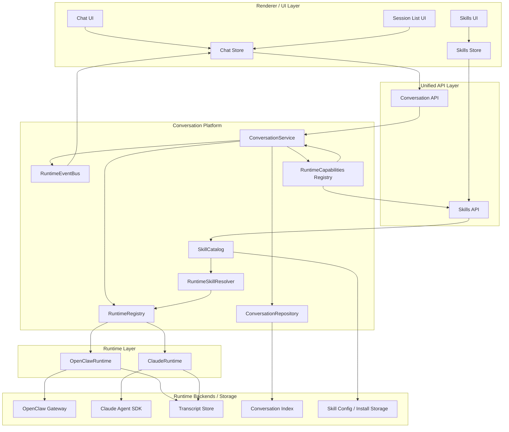

# OpenClaw / Claude SDK 双引擎改造方案

> 版本：v0.1
> 状态：设计草案，可继续迭代
> 目标：为 StoClaw 的 `openclaw + Claude SDK` 双引擎问答、会话、技能链路建立统一平台层，降低耦合与状态分裂

---

## 0. 当前进度

截至 2026-06-09，Phase 1 已完成第一批落地，当前状态如下：

### 已完成

1. 已补充最小可用的 session-engine 元数据入口

- 新增 `electron/engines/session-engine.ts`
- 提供 `resolveSessionEngineType()`、`rememberSessionEngineType()`、`getAgentIdFromSessionKey()`
- 开始将 `sessionKey -> engineType` 从“临时推导”转为“可记忆元数据”

2. 已将主链路切到“优先按会话引擎路由”

- `electron/engines/manager.ts` 已改为优先基于 session 元数据选择 adapter
- `electron/api/routes/sessions.ts` 的 session model / delete 已接入 session-engine 解析
- 会话列表聚合时会同步记忆 OpenClaw / Claude session 的 engineType

3. 已去掉前端切换会话时反写 agent 默认引擎的副作用

- `src/stores/chat/session-actions.ts` 不再在 `switchSession()` / `loadSessions()` / `deleteSession()` 中反向修改 agent `engineType`
- 会话切换现在只切会话，不再隐式修改 agent 配置

4. 已在前端关键请求里显式透传 session engineType

- chat history
- session delete
- session model sync

涉及文件包括：

- `src/stores/chat/session-actions.ts`
- `src/stores/chat.ts`
- `src/pages/Chat/ChatToolbar.tsx`
- `src/lib/sync-workspace-default-to-chat.ts`

5. 已补充并通过第一阶段相关单测

已通过：

- `tests/unit/chat-session-actions.test.ts`
- `tests/unit/chat-history-actions.test.ts`

执行命令：

```bash
pnpm test -- tests/unit/chat-session-actions.test.ts tests/unit/chat-history-actions.test.ts
```

### 当前未完成

1. 还没有引入真正独立的 `Conversation` repository

当前仍是在现有 `engine-sessions.json` 基础上做最小增强，目标是先稳定 `session -> engineType`，尚未完成完整的会话平台层抽象。

2. `src/stores/chat.ts` 与模块化 `src/stores/chat/*` 仍并存

当前第一阶段已经同步修正了两套实现的关键行为，但整体仍存在双实现并存的历史包袱，后续建议继续收敛。

3. 统一 runtime 事件总线尚未开始

当前问答链路仍然维持：

- OpenClaw 偏事件驱动
- Claude 偏历史合并 / 轮询补偿

这一部分属于 Phase 2。

4. 技能平台改造尚未开始

Claude skill bridge 仍是运行时实现主路径，SkillCatalog / RuntimeSkillResolver 尚未落地。

### 当前风险

1. 当前 session 元数据层仍是最小增量版本

它已经能支撑“旧会话按自身引擎继续跑”，但还不足以作为最终 Conversation 平台真相源。

2. `pnpm typecheck` 仍未全绿，但剩余问题不是本次 Phase 1 引入

当前残留报错位于：

- `src/components/user-form/UserFormModal.tsx`
- `src/components/user-form/UserFormProvider.tsx`
- `src/pages/Cron/index.tsx`
- `src/pages/ScheduledTasks/components/SchedulePicker.tsx`

这些是仓库内已有的未使用变量问题，不属于本轮双引擎重构新增回归。

### 下一步建议

建议继续按下面顺序推进：

1. 收尾 Phase 1

- 继续把 session 创建时的 engine 固化做完整
- 评估是否将更多 session 入口统一接到 session-engine

2. 开始 Phase 2

- 建立统一 `RuntimeEventBus`
- 为 Claude runtime 输出标准化事件
- 让前端逐步从“轮询补偿”转向“统一事件消费”

---

## 1. 背景

当前 StoClaw 已具备双引擎能力：

- `openclaw` 通过 Gateway 提供会话列表、历史记录、发送消息、流式事件等能力
- `Claude SDK` 通过本地 adapter、session registry、SDK query 和技能 bridge 提供近似能力

现状可以工作，但整体更接近“同一套 UI 上拼接了两套运行时”，而不是一套统一的会话平台。随着后续能力继续演进，复杂度会持续上升，具体体现在：

- 问答链路依赖多处补偿和兜底逻辑
- 会话的引擎归属不稳定，前端会反向修改 agent 默认引擎
- 技能系统是 OpenClaw-first，Claude 侧更多依赖 bridge 镜像
- 多处存在“元数据真相源不唯一”的 split-brain 问题

本文档目标不是立即给出大改代码，而是沉淀一份可持续推进的重构方案，便于今天未完成的工作后续继续接力。

---

## 2. 当前架构的主要不足

## 2.1 会话绑定引擎的规则不稳定

当前某条会话最终走哪个引擎，并不总是由会话本身决定，而是经常退化为“看 agent 当前的 `engineType`”。

典型表现：

- `getAdapterForSession()` 默认通过 `agentId -> engineType` 推导引擎
- 前端在切换会话时会调用 `ensureSessionEngineSelected()`，将 agent 的全局 `engineType` 改成该会话的引擎

这会带来几个问题：

- 查看旧会话会副作用式改变 agent 默认引擎
- 多端或后台任务场景下容易产生不可预期的引擎切换
- “agent 默认引擎”和“会话实际引擎”语义混淆

---

## 2.2 会话元数据没有单一真相源

当前不同引擎、不同业务路径维护了多套会话状态：

- OpenClaw 会话列表和历史来自 Gateway
- Claude 会话列表来自 `engine-sessions.json`
- Claude 运行中消息额外保存在 `liveClaudeMessages`
- 云端/定时任务会直接写入 session transcript
- 前端又维护 `sessionLabels`、`sessionLastActivity` 等补充状态

这意味着以下信息并不总是来自同一处：

- 标题
- 更新时间
- 运行中状态
- 历史消息
- 删除状态

短期可以靠合并和兜底维持可用，但长期会明显增加维护成本。

---

## 2.3 EngineAdapter 抽象过薄

当前 `EngineAdapter` 只统一了很薄的一层接口：

- `listSessions`
- `getHistory`
- `sendMessage`
- `sendMessageWithMedia`
- `abortRun`

但真正关键的业务能力并未全部下沉到 adapter：

- session delete 仍在 route 层按引擎分叉
- session model override 仍在 route 层按引擎分叉
- 媒体发送已统一到 `/api/chat/send`，route 层仍需继续关注 session model/delete 等其他能力是否按引擎分叉

这说明“统一抽象”只覆盖了部分 happy path，没有真正包住差异。后续再增加能力或引擎时，路由和 store 层会继续膨胀。

---

## 2.4 问答事件模型不统一

OpenClaw 侧主要依赖 Gateway 的流式事件；Claude 侧则更多依赖：

- SDK query 消费
- `liveClaudeMessages` 内存缓存
- 前端安全超时 + 历史轮询 + 最终 reload

这导致前端承担了过多运行时补偿逻辑：

- optimistic user message
- history poll
- stuck timeout
- error recovery grace
- final/history 合并

从职责上讲，这些本应是运行时层统一处理的事情，而不是 UI store 来猜和补。

---

## 2.5 技能系统是 OpenClaw-first，Claude 侧不是一等公民

当前技能管理的事实来源更偏向 OpenClaw：

- 技能配置主要在 OpenClaw config 中
- 前端技能页组合 Gateway 状态、本地 config、磁盘扫描
- Claude 发起 query 前才同步技能 bridge 到 Claude 目录

这意味着 Claude 技能能力具备以下不足：

- 技能状态缺乏独立可观测性
- 技能同步具有发送时滞后性
- 技能冲突处理主要依赖目录复制和 marker 判断
- 前端无法清晰知道某技能对哪个引擎真正可用

---

## 2.6 技能与消息兼容更多依赖文本启发式

Claude 侧存在 `isSkillReplayText()`、`shouldHideClaudeUserMessage()` 这样的兼容逻辑，通过特定文本模式隐藏技能回放和合成消息。

这说明双引擎之间的技能/消息协议没有在结构化层面打通，而是靠展示层补丁维持一致性。

风险包括：

- SDK 输出格式变化时容易失效
- 历史解析逻辑脆弱
- 标题生成、消息过滤、工具回放展示不稳定

---

## 2.7 附件能力没有显式能力声明

虽然 UI 层都是“发送附件”，但双引擎附件语义并不一致：

- OpenClaw：可走 OSS、可拼接文件引用、可 base64 图片附件
- Claude：通过 prompt preamble + `additionalDirectories` 暴露上下文

现在这些差异被压在实现细节里，没有成为显式 capability。这会影响：

- 可预期性
- 技能调用体验
- 安全边界
- 调试与问题定位

---

## 3. 改造目标

本次改造的核心目标不是继续修补双引擎差异，而是把它们收敛为“同一平台下的不同 runtime”。

具体目标：

1. 建立统一的会话领域模型
2. 让会话显式绑定引擎，不再由 agent 当前配置反推
3. 建立统一的 runtime 事件总线，减少前端补偿逻辑
4. 将技能升级为平台级能力，而不是 OpenClaw 配置附属品
5. 为附件、工具、流式能力建立显式 capability 描述
6. 为后续继续引入新引擎保留扩展空间

---

## 4. 目标架构

## 4.1 统一领域模型

建议引入以下平台层模型：

### AgentProfile

描述 agent 的静态配置：

- `agentId`
- `name`
- `workspacePath`
- `defaultEngineType`
- `defaultSkillSet`
- `preferredModelPolicy`

说明：

- `defaultEngineType` 仅影响“新会话默认使用哪个引擎”
- 不再用于推导旧会话实际运行时

### Conversation

描述一条真实会话：

- `conversationId`
- `sessionKey`
- `agentId`
- `engineType`
- `runtimeSessionId`
- `status`
- `title`
- `createdAt`
- `updatedAt`
- `lastMessageAt`
- `deletedAt`
- `metadata`

关键原则：

- `Conversation.engineType` 是会话真相
- 后续 history/send/delete/abort 都只依据 `Conversation.engineType`
- 会话切换不能修改 agent 默认引擎

### ConversationRun

描述一次发送/执行：

- `runId`
- `conversationId`
- `engineType`
- `state`
- `startedAt`
- `completedAt`
- `error`

用于统一前端“当前发送中/哪次运行/运行完成”的状态来源。

### SkillDescriptor

统一技能元数据：

- `skillId`
- `slug`
- `name`
- `source`
- `version`
- `enabled`
- `scope`
- `configSchema`
- `runtimeCompatibility`
- `installState`

### RuntimeCapabilities

显式表达引擎能力差异：

- `streaming`
- `resumeSession`
- `toolCalling`
- `visionAttachment`
- `externalFileAccess`
- `sessionModelOverride`
- `skillBridgeRequired`

前端和服务层都基于 capability 做兼容，而不是写散落的引擎特判。

---

## 4.2 平台分层

建议新增一层 Conversation Platform：

```text
Renderer
  -> Conversation API
  -> Skills API

Conversation Platform
  -> ConversationService
  -> ConversationRepository
  -> RuntimeEventBus
  -> RuntimeRegistry
  -> SkillCatalog
  -> RuntimeSkillResolver

Runtimes
  -> OpenClawRuntime
  -> ClaudeRuntime
```

职责边界：

- `ConversationService`
  对外提供统一的 send/history/list/delete/abort 接口
- `ConversationRepository`
  维护会话元数据真相源
- `RuntimeEventBus`
  输出统一事件流
- `RuntimeRegistry`
  根据 `engineType` 解析 runtime
- `SkillCatalog`
  管理平台级技能状态
- `RuntimeSkillResolver`
  将平台级技能映射到具体 runtime

---

## 4.3 重构后架构图



图中表达的核心原则：

- 前端只面向统一 API 和统一事件，不直接感知双引擎私有差异
- `ConversationRepository` 维护会话元数据真相源，固定 `conversation -> engineType`
- `RuntimeRegistry` 只负责选 runtime，不负责业务补偿
- `RuntimeEventBus` 统一输出问答、工具、完成、失败等标准事件
- `SkillCatalog + RuntimeSkillResolver` 将技能平台化，避免继续由某一引擎主导

---

## 4.4 统一事件总线

建议定义统一事件模型，前端只消费标准事件：

- `run.started`
- `message.delta`
- `message.completed`
- `tool.started`
- `tool.updated`
- `tool.completed`
- `run.failed`
- `run.aborted`
- `run.completed`

事件至少带以下公共字段：

- `conversationId`
- `sessionKey`
- `runId`
- `engineType`
- `timestamp`
- `payload`

收益：

- OpenClaw 和 Claude 的运行时差异被收敛在 runtime 内部
- 前端不再需要同时维护“事件驱动 + 轮询驱动”两套心智模型
- 可以统一 loading、streaming、tool 状态、error 恢复逻辑

---

## 4.5 统一技能平台

目标是让技能成为平台级能力，而不是某个 runtime 的副产品。

建议拆成两层：

### SkillCatalog

负责：

- 安装/卸载
- 启用/禁用
- 配置读写
- 元数据管理
- 兼容引擎标记

### RuntimeSkillResolver

负责：

- OpenClaw runtime 如何消费技能
- Claude runtime 如何消费技能
- 哪些技能需要 bridge
- 哪些技能存在冲突或不兼容

这样 Claude skill bridge 仍可保留，但它只是 Claude runtime 的一种实现细节，不再承担平台级技能事实来源。

---

## 5. 核心链路改造方案

## 5.1 问答链路

目标链路：

```text
UI sendMessage
  -> ConversationService.sendMessage(conversationId, input)
  -> ConversationRepository 读取 conversation
  -> RuntimeRegistry 获取 runtime
  -> runtime.sendMessage()
  -> RuntimeEventBus 发标准事件
  -> UI 订阅统一事件并更新展示
```

改造重点：

1. 不再让前端推断当前会话应该走哪个引擎
2. Claude runtime 需要输出与 OpenClaw 对齐的标准事件
3. 前端 `loadHistory + poll + fallback` 逻辑逐步降级为兜底，而不是主流程

---

## 5.2 会话链路

目标原则：

- 新建会话时即确定引擎
- 旧会话始终按自身 engineType 运行
- 切换会话不改变 agent 默认引擎
- 删除、标题、活动时间、运行中状态统一由 Conversation Platform 管理

建议：

1. 引入统一 `conversation-index.json` 或等价 repository
2. 将 OpenClaw 和 Claude 现有 registry/session 元数据映射进统一 repository
3. 保留底层 transcript 存储方式，但只能通过 repository/service 访问
4. 前端 session 列表只消费平台聚合结果

---

## 5.3 技能链路

目标原则：

- 技能安装态与运行态分离
- 技能兼容性显式声明
- 技能状态不再只依赖 Gateway
- Claude runtime 的技能加载具备明确状态反馈

建议：

1. 建立统一 `/api/skills/catalog`
2. 建立 `/api/skills/runtime-status?engineType=...`
3. 将 bridge 同步结果纳入 runtime status，而不是只写日志
4. 对技能冲突、bridge 冲突、缺失 manifest 等情况给出结构化状态

---

## 6. 分阶段实施路线

## Phase 1：先稳定会话真相源

目标：

- 先解决“会话绑定引擎不稳定”的核心问题

建议动作：

1. 引入 `Conversation` 元数据层
2. 新建会话时写入 `engineType`
3. 所有 `history/send/abort/delete` 优先通过 conversation 元数据选 runtime
4. 去掉“切换会话自动修改 agent engineType”的行为

阶段收益：

- 降低会话错路由风险
- 明确 agent 默认引擎与会话实际引擎的边界

---

## Phase 2：统一事件模型

目标：

- 让前端只面对一套运行时事件语义

建议动作：

1. 新增 `RuntimeEventBus`
2. OpenClaw runtime 将 Gateway 事件映射为标准事件
3. Claude runtime 将 SDK query 消费结果映射为标准事件
4. 前端改为优先消费标准事件，history poll 退化为兜底

阶段收益：

- 显著降低 chat store 复杂度
- 提升双引擎体验一致性

---

## Phase 3：统一技能平台

目标：

- 技能从 OpenClaw-first 走向平台级治理

建议动作：

1. 引入 SkillCatalog
2. 引入 RuntimeSkillResolver
3. 将 Claude skill bridge 状态纳入 runtime status
4. 前端技能页改为读取统一 catalog 和 runtime status

阶段收益：

- 技能可观测性增强
- 引擎兼容关系更清晰

---

## Phase 4：能力声明与路由收敛

目标：

- 收敛剩余引擎分叉点

建议动作：

1. 为附件、model override、delete、resume 等能力建立 capability 描述
2. 将 route 层的引擎特判逐步下沉到 runtime
3. 将 session model、session delete 等统一为 runtime API

阶段收益：

- 后续继续接入第三种引擎的成本显著下降

---

## 7. 推荐的目录落点

以下只是建议，不要求一次性完成：

```text
electron/
  conversations/
    conversation-service.ts
    conversation-repository.ts
    conversation-types.ts
    runtime-bus.ts
    runtime-registry.ts
    runtimes/
      openclaw-runtime.ts
      claude-runtime.ts
    skills/
      skill-catalog.ts
      runtime-skill-resolver.ts
```

对现有代码的影响方向：

- `electron/engines/*` 逐步演进为 `conversations/runtimes/*`
- `electron/api/routes/gateway.ts`、`sessions.ts` 中的部分分叉逻辑逐步收敛
- `src/stores/chat/*` 的引擎判断和补偿逻辑逐步削薄
- `src/stores/skills.ts` 逐步转向平台级技能读取方式

---

## 8. 风险与注意事项

## 8.1 不能一次性替换所有旧路径

本次改造适合“平台层先引入，旧逻辑逐步迁移”，不适合一次性把全部 chat/session/skill 流程切掉。

建议策略：

- 新平台先接管会话元数据
- 再接管事件
- 最后接管技能平台

---

## 8.2 历史 transcript 不宜立即重构格式

OpenClaw、Claude、云端任务目前已有各自历史存储方式。短期内更适合：

- 统一元数据入口
- 保留底层 transcript 存储
- 通过 adapter/repository 映射访问

这样能降低迁移风险。

---

## 8.3 技能 bridge 仍需保留一段时间

只要 Claude runtime 当前仍依赖 bridge 目录，就不应强行移除 bridge。正确做法是：

- 先让 bridge 从“事实来源”降级为“运行时实现”
- 等 SkillCatalog 和 RuntimeSkillResolver 成熟后，再评估是否进一步替换

---

## 9. 待确认问题

以下问题建议在正式开做前确认：

1. `conversationId` 是否直接复用现有 `sessionKey`，还是引入独立 ID
2. Conversation repository 使用单文件 JSON、分目录索引，还是复用现有配置体系
3. 是否允许同一 agent 长期并存多个不同引擎的活动会话
4. Claude runtime 是否需要补齐更完整的 tool / delta / error 结构化事件
5. 技能 catalog 是否要区分“平台已安装但当前 runtime 不可用”和“当前 runtime 已加载成功”

---

## 10. 建议的近期执行顺序

如果后续继续做，建议按以下顺序推进：

1. 先做会话元数据层，固定 `conversation -> engineType`
2. 去掉切换会话时反写 agent 引擎的行为
3. 为 Claude runtime 增加标准事件输出
4. 将前端 chat store 改成优先消费标准事件
5. 最后再重构技能平台和 capability 模型

---

## 11. 结论

本次双引擎问题的根因，不是“OpenClaw 和 Claude 有差异”本身，而是系统尚未建立真正的引擎无关平台层。

后续改造应坚持一个判断标准：

> 前端不应再关心“这条会话属于 OpenClaw 还是 Claude 的私有流程”，而只应关心“这是一个 Conversation，它正在产生标准化的运行事件”。

当这一点成立时，问答、会话、技能三条核心链路才算真正统一。
