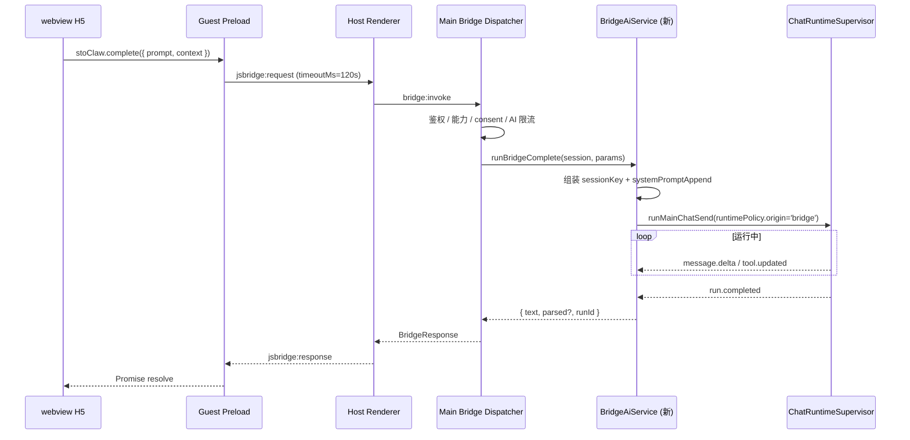

# JSBridge AI 能力扩展设计方案

> 状态：**方案草案（未实施）** · 风险等级：**Tier 3** · 需走 OpenSpec 与技术评审
>
> 目标：让 SClaw webview 内的 `*.sto.cn` H5 页面通过 JSBridge 调用 SClaw 的 AI 引擎，并拿到结果在页面内使用。

---

## 1. 需求与范围

### 1.1 抽象需求

webview 页面把「任务 + 业务数据」交给 SClaw AI，拿到结果后由页面自行使用（回填表单、渲染、二次提交等）。

典型场景：填报页调 AI 做校验与内容优化，把优化后的字段写回表单。

### 1.2 两种调用形态

| 形态 | 说明 | 优先级 |
|------|------|--------|
| **一次性（complete）** | 一次 `await` 拿完整结果 | **P0** |
| **流式（stream）** | 分片推送，页面内打字机 | P1 |

### 1.3 明确不在范围内

- 为单个 webview 微调/训练模型
- Bridge 自动读取或写入业务页面 DOM
- Bridge 代替业务系统做数据查重（数据须由页面或工具提供）

---

## 2. 核心架构决策

### 2.1 结论：由 Main 进程独立完成（不经 Renderer）

**依据（已核对代码）**：

| 事实 | 位置 |
|------|------|
| Main 拥有完整发送链路 | `electron/services/chat-send-service.ts` → `runMainChatSend` |
| Main 拥有 run 生命周期与规范事件 | `chat-runtime-supervisor.ts`（`extends EventEmitter`，`emit('event', CanonicalChatEvent)`） |
| 已有「无 UI 的 agent 执行」先例 | `electron/scheduled-tasks/scheduled-task-executor.ts` |
| `runtimePolicy.ownerId` 可关联一次运行 | `shared/chat-runtime-protocol.ts` |
| 发送落到 Main HTTP 路由 | `electron/api/routes/gateway.ts` → `dispatchChatSendRequest` |

定时任务已经在做「后台发起 agent 运行 → 监听 canonical 事件 → 终态处理」，Bridge AI 与它是**同构问题**，应复用同一模式。

> **与早期口头设想的差异**：先前设想由 Host Renderer 订阅 `subscribeCanonicalChatRuntimeProjection` 做中继。核对代码后改为 Main 主导——Renderer 那层只是投影，Main 才是事实源。
>
> 需要说明的是，**Renderer 本身仍在链路里**：guest preload 通过 `sendToHost` 把请求交给宿主渲染进程，再由它 `bridge:invoke` 到 Main（见 2.2 时序图），承载 webview 的渲染进程必然存活。Main 主导消除的是**对 chat UI 状态的依赖**——不要求聊天页面已挂载、store 已订阅、会话为当前可见会话。这正是「会话不进侧边栏」（5.1）能够成立的前提。

### 2.2 调用链



关键点：`chat.complete` 是**长耗时同步请求**，Main 内部 await 终态后一次性返回，不需要 host action 回渲染进程。

---

## 3. API 契约

### 3.1 `chat.complete`（P0，非流式）

```typescript
interface ChatCompleteParams {
  /** 任务指令（必填） */
  prompt: string;
  /** 业务结构化上下文，由 H5 组装 */
  context?: unknown;
  /** 覆盖应用默认 agent */
  agentId?: string;
  /** 追加技能（受白名单约束） */
  skillSlugs?: string[];
  /** 期望输出格式；json 时 Main 尝试解析 */
  responseFormat?: 'text' | 'json';
  /** 多轮复用；不传则每次独立一次性会话 */
  conversationId?: string;
  /** 默认 120s，上限 180s（见 3.4 超时口径） */
  timeoutMs?: number;
}

interface ChatCompleteResult {
  requestId: string;
  runId: string | null;
  text: string;
  /** responseFormat='json' 且解析成功时存在 */
  parsed?: unknown;
  /** 解析失败原因，parsed 缺失时提供 */
  parseError?: string;
  finishReason: 'completed' | 'timeout' | 'aborted' | 'failed';
}
```

### 3.2 `chat.cancel`（P0）

```typescript
{ requestId: string } -> { ok: boolean }
```

### 3.3 `chat.invokeAgent` + `chat:stream`（P1，流式）

```typescript
// 立即返回
{ requestId: string; sessionKey: string }

// Guest 订阅（复用现有 jsbridge:event → stoClaw.on）
type ChatStreamEvent =
  | { requestId: string; type: 'start' }
  | { requestId: string; type: 'delta'; text: string; seq: number }
  | { requestId: string; type: 'tool'; name: string; status: string }
  | { requestId: string; type: 'done'; text: string }
  | { requestId: string; type: 'error'; code: string; message: string }
  | { requestId: string; type: 'aborted' };
```

流式推送复用 `session-registry.ts` 已有的 `wc.send('jsbridge:event', ...)` 通道，**传输层无需改造**。

### 3.4 超时口径（单一事实源）

超时横跨三层，必须统一，否则会出现「页面已超时但运行仍在跑」（R9）。

| 层 | 现状 | 本方案取值 |
|----|------|-----------|
| Guest preload | 默认 **30s**（`jsbridge-guest-preload-source.ts:54`，`options.timeoutMs \|\| 30000`） | **SDK 必须显式传值覆盖**，30s 对 AI 调用远远不够 |
| Bridge `timeoutMs` | 新增 | 默认 **120s**，上限 **180s** |
| Supervisor `deadlineAt` | 已支持 hard-deadline | `now + timeoutMs`，与上一行同值 |

约束：`deadlineAt <= guest timeout`，且超时时 Main 必须同步 abort，避免运行泄漏。

> 注意 guest preload 的 30s 默认值是既有行为，**不修改**它——由 SDK 在发起 AI 调用时显式传入 `timeoutMs`，避免影响其他普通 invoke。

---

## 4. 应用级 AI Profile

准确性靠配置，不靠模型微调。在应用元数据的 `bridgePolicy` 下扩展 `ai`：

```typescript
interface BridgeAiProfile {
  enabled: boolean;
  agentId?: string;
  /** 应用级角色与输出约束 */
  systemPrompt?: string;
  /** 默认注入技能 */
  skills?: string[];
  /** H5 可追加的技能白名单 */
  allowedSkillSlugs?: string[];
  responseFormat?: 'text' | 'json';
  /** 是否注入 webview 页面上下文（URL/标题/正文摘要） */
  injectPageContext?: boolean;
  memory?: { mode: 'none' | 'app' | 'user-read' };
  session?: { mode: 'ephemeral' | 'conversation'; ttlMs?: number };
  /** AI 调用配额，独立于通用 bridge 限流 */
  quota?: { perMinute: number; concurrent: number };
}
```

默认值（未配置时）：`enabled: false`。**AI 能力必须显式开启**，不随 catalog 绑定自动获得。

### 上下文分层

```
L0 App systemPrompt（配置，Main 注入）
L1 Skill prompts（配置 + 白名单内的调用级追加）
L2 Page context（可选，需 Renderer 协助采集）
L3 H5 context（页面显式传入）
L4 会话历史（仅 conversation 模式）
L5 用户记忆（默认关闭）
```

L0～L3 决定准确性，L4 决定多轮，L5 决定长期个性化。

---

## 5. 会话与隔离

### 5.1 硬性要求：webview 会话不得出现在左侧对话列表

这是产品约束，不是「顺带效果」。**必须显式实现**，原因见下。

#### 现状机制（已核对）

侧边栏隐藏由**渲染进程显示层**统一把关，唯一入口是：

```typescript
// src/lib/sto-task-session.ts
export function isSidebarHiddenChatSessionKey(sessionKey: string): boolean {
  return (
    isHiddenStoTaskSubitemChatSessionKey(sessionKey)
    || isMainAgentChatSessionKey(sessionKey)
    || isSclawBrowserEmbedChatSessionKey(sessionKey)
    || isClaudeScheduledTaskSummarySessionKey(sessionKey)
    || isCronRunSessionKey(sessionKey)
    || isWorkflowOpenClawSessionKey(sessionKey)
  );
}
```

判定方式是**会话 key 前缀匹配**，例如 embed 会话靠 `agent:main:session-embed-app-`。

> **关键结论**：`electron/` 目录下没有任何隐藏相关逻辑（已 grep 确认）。Main 创建的会话会照常进入会话列表与历史，**隐藏完全依赖渲染进程按前缀过滤**。因此新会话若不注册前缀，就会直接出现在左侧列表里。

#### 会话 key 设计（遵循 SClaw 既有分段规范）

```
agent:{agentId}:bridge-ai:{appId}:{conversationId}
```

**key 格式不能由 Bridge 自创。** SClaw 区分会话类别的通行做法是 `agent:{agentId}:{category}:{...}`，由 `parts[2]` 充当类别判别符——`cron`、`scheduled-task`、`dingtalk`、`subagent`、`workflow` 全部遵循此模式：

```52:70:shared/session-type.ts
  // Cron: agent:{agentId}:cron:{jobId}[:...]
  if (trimmedKey.startsWith('agent:')) {
    const parts = trimmedKey.split(':');
    if (parts.length >= 4) {
      if (parts[2] === 'cron') {
```

> **早期稿的错误**：本文档先前提出的 `session-bridge-ai-{appId}--{conversationId}` 照抄的是内嵌浏览器的**例外写法**（`session-embed-app-` 前缀 + `--` 分隔符），把特例当成了通例。它有三个问题:`session-` 命名空间已被普通聊天 key `session-{ts}-{uuid}` 占用（`isTemporaryAgentSessionKey` 以 `/^agent:[^:]+:session-\d+/` 识别）;`--` 是自创分隔符,需要额外折叠规则消歧;前缀正则与既有分段解析风格不一致。

四点必须注意：

1. **必须保留 `agent:{id}:` 前缀** —— Main 侧靠它解析目标 agent。
2. **判定用分段解析** —— 校验 `parts[0] === 'agent'` 且 `parts[2] === 'bridge-ai'`，与 `parseDingTalkSessionKey` 风格一致；不可写死 `agent:main:` 前缀，因为 agentId 由 AI Profile 配置。
3. **全片段必须小写** —— Gateway 会对 sessionKey 小写归一，见下。
4. **模块必须放 `shared/`，不能放 `src/lib/`** —— 见下。

##### 硬约束：Gateway 小写归一

```7:8:electron/message-channel/common/session-key.ts
 * OpenClaw Gateway 会对 sessionKey 做小写归一；peerId 也必须小写，
 * 否则 delivery 监听的 key 与 gateway-event 对不上，钉钉侧收不到回程。
```

`appId` 可能含大写，若不归一会导致 delivery 监听的 key 与 gateway 事件对不上。`agentId` 复用既有 `normalizeAgentId`（本身已 lowercase），`appId` / `conversationId` 按 dingtalk 同样方式将 `:` 替换为 `_` 并小写。

##### 必须同时登记 catalog 分类

`inferSessionCatalogMeta`（`shared/session-type.ts`）是 catalog `session_type` 的**单一事实源**，主渲双端共用，catalog 行创建时**自动**按 key 推断，兜底分支为 `everything else -> chat`。

> **这是早期稿漏掉的缺陷**：不新增 `bridge-ai` 分支，Bridge AI 会话就会被归类成**普通聊天会话**。而 `upsertEngineBinding` 在引擎绑定时会自动补 catalog 行，因此该错误分类是**必然发生**。

处理方式：`CatalogSessionType` 新增 `'bridge_ai'`，`inferSessionCatalogMeta` 增加 `parts[2] === 'bridge-ai'` 分支并回填 `appId`。不复用既有 `'app'`——那表示「内嵌浏览器真实对话」，与程序化一次性调用混为一类会让统计、清理策略与后续 UI 无法区分。

好消息是 `catalog_sessions.session_type` 为 `TEXT NOT NULL DEFAULT 'chat'`、**无 CHECK 约束**（`electron/db/migrations/0008-session-types-and-channels.ts:8`），新增枚举值**不需要数据库迁移**，但须审计 `CatalogSessionType` 的穷举消费点。

##### 为什么放 `shared/`

这是**跨进程**需求：Main（`bridge-ai-service.ts`）负责**构造** key，Renderer 负责**识别** key 来隐藏。而 `electron/` 下没有任何 `@/lib/` 导入（已 grep 确认），Main 无法引用渲染进程模块。

项目里已有完全同构的先例——`isWorkflowOpenClawSessionKey` 正因主/渲染双端都要用，才放在 `shared/`：

```typescript
// electron/services/chat-runtime-supervisor.ts:17
import { isWorkflowOpenClawSessionKey } from '../../shared/workflow-openclaw-session';
// src/lib/sto-task-session.ts:6
import { isWorkflowOpenClawSessionKey } from '../../shared/workflow-openclaw-session';
```

Bridge AI 应照此办理：

```typescript
// shared/bridge-ai-session.ts（新）
const BRIDGE_AI_CATEGORY = 'bridge-ai';

export function isBridgeAiChatSessionKey(sessionKey: string): boolean {
  const parts = sessionKey.trim().split(':');
  return parts.length >= 5 && parts[0] === 'agent' && parts[2] === BRIDGE_AI_CATEGORY;
}

export function createBridgeAiSessionKey(
  agentId: string,
  appId: string,
  conversationId: string,
): string { /* 全片段小写 + 冒号替换 + 长度截断 */ }

export function parseBridgeAiSessionKey(sessionKey: string):
  { agentId: string; appId: string; conversationId: string } | null { /* ... */ }
```

结构与 `parseDingTalkSessionKey` 完全同构（`agent:{agentId}:dingtalk:{peerId}:{ts}:{nonce}`），可直接参照其实现风格。

#### 必须改动的注册点（缺一即泄漏）

| 位置 | 作用 | 不改的后果 |
|------|------|-----------|
| `src/lib/sto-task-session.ts` → `isSidebarHiddenChatSessionKey` | 侧边栏行渲染总闸 | **会话出现在左侧列表** |
| `src/lib/sidebar-recent-order.ts` → `isSidebarRecentChatSessionKey` | 最近会话排序集合 | 进入「最近」顺序并挤占位置 |
| `src/components/layout/Sidebar.tsx:1099` | 消费上述过滤 | 随总闸修复，无需单独改 |
| `src/components/layout/sidebar-projects-section.tsx:128` | 项目分组列表 | 随总闸修复 |
| `src/stores/chat/session-lifecycle-actions.ts:463 / 698` | 最近顺序重建 | 随 recent 过滤修复 |
| `tests/unit/sto-task-session-restore.test.ts` | 既有隐藏用例 | 补 bridge 前缀断言 |

#### 除列表外还需确认的可见性面

隐藏只解决「列表不显示」，以下位置仍可能泄漏，需逐项验证：

- **未读角标 / 活跃度**：`sessionLastActivity`、unread 标记是否会因 bridge run 被 bump
- **会话标题派生**：`normalizeDerivedSessionLabel` 会用首条消息生成标题，即便不显示也会落库
- **历史与 catalog 落库**：bridge 会话是否进入会话历史、数据中心、搜索结果
- **切换语义**：`resolveSendTarget` 在传入显式 `sessionKey` 时不切换可见会话（已确认），但需保证 Bridge 路径始终传显式 key

### 5.2 会话模式

| 模式 | 行为 |
|------|------|
| `ephemeral`（默认） | 每次调用生成新 `conversationId`，终态后清理 |
| `conversation` | H5 传固定 `conversationId`，同页多轮 |

`ephemeral` 模式下建议运行结束后主动清理 transcript，避免隐藏会话无限堆积。

### 5.3 记忆隔离

`ChatRuntimePolicy.origin` 需新增 `'bridge'`：

```typescript
runtimePolicy: {
  origin: 'bridge',
  ownerId: `${appId}:${requestId}`,
  deadlineAt: now + timeoutMs,
}
```

| memory.mode | 行为 |
|-------------|------|
| `none`（默认） | 不读不写记忆 |
| `app` | 读写带 `appId` 标签的记忆 |
| `user-read` | 读用户偏好，不写回 |

### 5.4 生命周期

| 触发 | 动作 |
|------|------|
| webview 关闭 / runtime 注销 | abort 该 guest 全部在途 AI 运行 |
| 页面跳出 sto.cn | 同上（`destroyBridgeSession` 已有钩子） |
| 用户登出 | `destroyAllBridgeSessions` 已有，需补 abort |
| 超时 | `deadlineAt` 触发 `run.interrupted`（supervisor 已支持 hard-deadline） |

---

## 6. 安全模型

| 项 | 方案 |
|----|------|
| Origin | 沿用 `*.sto.cn` |
| 能力 | 新增 `chat.complete` / `chat.cancel` / `chat.invokeAgent`，风险等级 `critical` |
| 授权 | 加入 `CONSENT_CAPABILITIES`，首次调用需用户确认 |
| 限流 | **独立配额**，不复用 `RATE_LIMIT_BY_TIER`（AI 调用成本远高于普通 invoke） |
| 并发 | 每 bridge session 默认 1 个在途运行 |
| 技能越权 | `skillSlugs` 必须在 `allowedSkillSlugs` 白名单内 |
| 数据面 | prompt 可能含 PII，需审计日志（记 appId/用户/长度，**不记原文**） |

---

## 7. 实施拆解

### Phase 1 — 协议与配置（无行为变更）

1. `shared/jsbridge/capabilities.ts`：新增三个 capability + 风险等级 + consent
2. `shared/jsbridge/trust-policy.ts`：`BridgeTrustPolicy` 增加 `ai?: BridgeAiProfile`
3. `shared/chat-runtime-protocol.ts`：`ChatRuntimePolicy.origin` 增加 `'bridge'`
4. `shared/jsbridge/bridge-ai-protocol.ts`（新）：参数/结果/流事件类型

### Phase 2 — Main 核心（P0 闭环）

5. `electron/main/services/jsbridge/bridge-ai-registry.ts`（新）：`requestId → { sessionKey, ownerId, webContentsId, abort }`
6. `electron/main/services/jsbridge/bridge-ai-service.ts`（新）：
   - 组装 `systemPromptAppend`（L0 + L1 + L3）
   - 调 `runMainChatSend`（`deliver: false`）
   - `supervisor.on('event')` 累积 `message.delta`，等终态
   - `responseFormat='json'` 时解析
7. `handlers/chat-ai.ts`（新）+ `dispatcher.ts` 注册
8. AI 独立限流与并发控制
9. **会话隐藏（与 Phase 2 同批交付，不可延后）**：
   - `shared/bridge-ai-session.ts`（新）：key 构造 + sanitize + 正则判定（**放 `shared/`，Main 与 Renderer 共用**）
   - Main 侧用它构造 key，Renderer 侧用它识别
   - 注册进 `isSidebarHiddenChatSessionKey` 与 `isSidebarRecentChatSessionKey`
   - 补 `tests/unit/sto-task-session-restore.test.ts` 断言
   - 验证未读角标、标题派生、历史落库等次要可见面

### Phase 3 — 生命周期与取消

10. `chat.cancel` → `supervisor` abort
11. `destroyBridgeSession` / runtime 注销 → 级联 abort
12. hard-deadline 与 guest 超时对齐
13. `ephemeral` 会话终态后清理，避免隐藏会话堆积

### Phase 4 — SDK 与文档

14. SDK `complete()` / `cancel()`，按 §3.4 显式传 `timeoutMs`（默认 120s）
15. 更新 `packages/claw-bridge-sdk/jsbridge-api.md`
16. 应用方接入指南（如何配 AI Profile）

### Phase 5 — 可选增强

17. 页面上下文注入（需 Renderer 协助）
18. 记忆 `app` / `user-read` 模式
19. 流式 `chat.invokeAgent` + `chat:stream`
20. 设置页展示/撤销 AI 授权

---

## 8. 可行性评估

### 8.1 判定：**可行**，P0 无架构性阻塞

| 维度 | 评估 | 依据 |
|------|------|------|
| 引擎调用 | ✅ 直接复用 | `runMainChatSend` 已被定时任务使用 |
| 等待终态 | ✅ 有先例 | supervisor EventEmitter + `ownerId` 关联 |
| 传输通道 | ✅ 无需改造 | request/response 与 event 通道均已具备 |
| 长耗时 | ✅ 可支持 | guest preload 支持自定义 `timeoutMs` |
| 权限模型 | ✅ 可扩展 | capability + consent + trustTier 已成型 |
| 会话隔离 | ✅ 已支持 | `resolveSendTarget` 明确「显式 sessionKey 不切换可见会话」 |
| 会话不进侧边栏 | ⚠️ 需显式实现 | 机制成熟（前缀过滤），但**默认可见**，必须注册；见 5.1 / R5 |
| 流式推送 | ✅ 通道就绪 | `wc.send('jsbridge:event')` 已在用 |

### 8.2 工作量估计

| Phase | 规模 |
|-------|------|
| Phase 1 协议 | 小 |
| Phase 2 Main 核心 | **中偏大**（本方案主体） |
| Phase 3 生命周期 | 中 |
| Phase 4 SDK/文档 | 小 |
| Phase 5 增强 | 中～大 |

---

## 9. 不足与风险（重点）

### 9.1 架构层面

**R1 — 记忆注入当前是无条件的（中风险）**

`runMainChatSend` 内部无条件调用 `agentMemoryContextService.prepare()` 与 `memoryTurnCoordinator`。要实现 `memory.mode: 'none'`，必须改这条**主链路共用**的函数，会影响主会话与定时任务。

> 缓解：增加可选入参（如 `memory: { skip: true }`）而非改默认行为；变更需回归主会话与定时任务。

**R2 — Skills 解析在渲染进程（中风险）**

`resolveSkillPrompt` 位于 `src/lib/skill-plaza-resolve`，Main 无法直接调用。Main-only 方案需要 Main 侧等价实现或 Host API 路由。

> 缓解：Phase 2 先只支持 `systemPrompt`（L0），Skills 放到独立子任务并先做技术验证。

**R3 — 页面上下文采集依赖渲染进程（低～中风险）**

`sclaw-browser-embed-context-builder` 在 Renderer。Main-only 无法直接拿页面正文摘要。

> 缓解：`injectPageContext` 列为 Phase 5；或由 H5 自己把需要的页面数据放进 `context`。

**R4 — 任意 sessionKey 能否被引擎接受，未验证（中风险）**

`agent:{agentId}:bridge-ai:{appId}:{conversationId}` 是否会被 OpenClaw / Claude 适配器正常建会话，尚未实测。若 agentId 取非 `main` 值，还需确认该 agent 目录在引擎侧已存在；另需确认未绑定 workspace 时 `resolveSessionToolCwd` 回落到 agent 默认目录且 send 不失败。

> 缓解：Phase 2 第一步做最小 spike 验证，再继续。

**R5 — 会话隐藏是渲染层的「默认可见」模型（中风险）**

隐藏依赖渲染进程按前缀过滤，Main 侧无此概念。这意味着：

- **默认行为是「显示」**，忘记注册前缀就会直接泄漏到左侧列表
- 隐藏只覆盖列表行，未读角标、标题派生、历史/搜索落库等仍需逐项确认
- 现有前缀常量把 agent 写死为 `agent:main:`，Bridge AI 支持可配置 agentId 时需改用正则判定

> 缓解：作为 Phase 2 同批交付项；补单测；上线前逐项走查 5.1 列出的可见性面。

**R6 — 幂等与并发约束（低风险，但会影响体验）**

`runIdempotentChatSend` + `supervisor.begin` 对同一 `sessionKey` 的并发发送会判为 replay。多轮模式下用户快速连点会被拒。

> 缓解：ephemeral 模式每次新 sessionKey；conversation 模式在 Bridge 侧排队并返回明确错误码。

### 9.2 产品与体验层面

**R7 — 输出稳定性无法由 Bridge 保证**

模型可能返回非法 JSON、缺字段、夹带 markdown。Bridge 只能「尽力解析 + 返回 `parseError`」。

> 缓解：schema 约束写进 `systemPrompt`；Main 侧一次重试；**H5 必须做校验，关键字段人工确认后再提交**。

**R8 — 长耗时的交互成本**

AI 可能 10～90 秒。H5 需自建 loading、超时、取消 UI；`complete` 期间用户无任何进度感知。

> 缓解：对耗时长的场景建议改用 P1 流式；或先返回 `requestId` 让页面显示进度。

**R9 — 超时链路需三处对齐**

guest preload 默认 30s、Bridge 侧 `timeoutMs`、supervisor `deadlineAt`。任一处不一致会出现「页面已超时但运行仍在跑」。

> 缓解：按 §3.4 统一口径——SDK 显式传 `timeoutMs`（默认 120s / 上限 180s），强制 `deadlineAt <= guest timeout`，超时时同步 abort。

**R10 — 成本与配额**

每次调用是一次完整 agent 运行。缺乏配额时，单个应用可能显著推高 token 成本。

> 缓解：AI Profile 的 `quota` 必须为**必填项**，且设保守默认值。

**R11 — 上下文长度**

大表单 / 大量业务数据可能超上限。Bridge 无法自动裁剪业务语义。

> 缓解：Main 侧设 `context` 字节上限并明确报错；由 H5 负责裁剪或摘要。

### 9.3 安全与合规

**R12 — PII 进入模型 prompt**

填报类数据常含姓名、手机、地址。

> 缓解：consent 文案明确告知；审计只记元数据不记原文；敏感应用由业务侧脱敏后再传。

**R13 — 授权粒度偏粗**

当前 consent 是「能力级 + 应用级」，一次授权长期有效，用户无法按次感知 AI 调用。

> 缓解：Phase 5 增加设置页可查看/撤销；高风险应用可配置为每次确认。

### 9.4 尚未验证的假设

以下需在实施前做 spike，避免方案落地时返工：

1. 引擎是否接受 Bridge 自造的 `sessionKey`（R4）
2. `message.delta` payload 是否足以在 Main 侧拼出完整文本（否则需读 transcript）
3. Main 侧新增 `origin: 'bridge'` 后，记忆与定时任务模块是否有 `origin` 穷举分支需要同步
4. 长时间 IPC invoke（>60s）在 Electron 下的稳定性
5. 隐藏会话是否仍会触发未读角标、标题派生与历史/搜索落库（R5 次要可见面）

---

## 10. 建议

1. **先做 P0 一次性调用**，覆盖填报类主场景；流式放到 P1。
2. **Phase 2 之前先做 spike**，验证 R4 与「Main 侧能否拼出最终文本」两个假设。
3. **记忆默认关闭**，避免第一版就动主链路的记忆逻辑。
4. **Skills 与页面上下文拆为独立子任务**，不阻塞 P0。
5. **配额与 consent 作为上线门槛**，不做「先放开后补」。
6. **「会话不进左侧列表」按功能需求对待**，与 Phase 2 同批交付并补单测；由于默认行为是可见，遗漏即用户可见缺陷。
7. 本方案属 Tier 3，正式实施前需转为 OpenSpec change（`proposal → design → specs → tasks`）并完成技术评审。

---

## 附：涉及文件清单（预估）

| 类型 | 路径 |
|------|------|
| 新增 | `shared/jsbridge/bridge-ai-protocol.ts` |
| 新增 | `electron/main/services/jsbridge/bridge-ai-service.ts` |
| 新增 | `electron/main/services/jsbridge/bridge-ai-registry.ts` |
| 新增 | `electron/main/services/jsbridge/handlers/chat-ai.ts` |
| 新增 | `shared/bridge-ai-session.ts`（会话 key 构造/sanitize/判定，主渲共用） |
| 修改 | `src/lib/sto-task-session.ts`（`isSidebarHiddenChatSessionKey`） |
| 修改 | `src/lib/sidebar-recent-order.ts`（`isSidebarRecentChatSessionKey`） |
| 修改 | `tests/unit/sto-task-session-restore.test.ts` |
| 修改 | `shared/jsbridge/capabilities.ts` |
| 修改 | `shared/jsbridge/trust-policy.ts` |
| 修改 | `shared/chat-runtime-protocol.ts` |
| 修改 | `electron/main/services/jsbridge/dispatcher.ts` |
| 修改 | `electron/main/services/jsbridge/session-registry.ts` |
| 修改（需评审） | `electron/services/chat-send-service.ts` |
| 修改 | `packages/claw-bridge-sdk/src/client.ts` / `types.ts` |
| 修改 | `packages/claw-bridge-sdk/jsbridge-api.md` |
