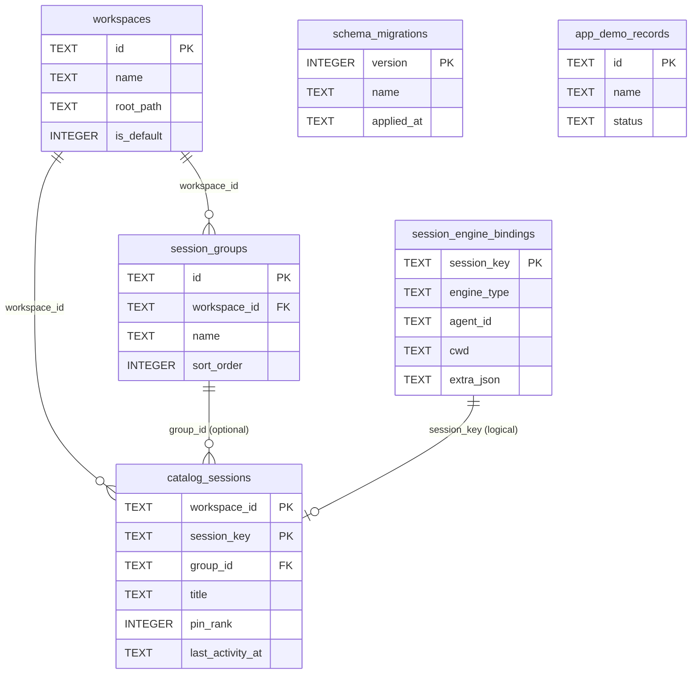

# StoClaw SQLite 表结构文档

`stoclaw.sqlite` 的表级参考：字段、索引、表关系、典型查询。面向需要快速理解本地库结构的开发者。

**实操**（安装、启动、文件路径、GUI 工具）见 [sqlite-dev-guide.md](../sqlite-dev-guide.md)。  
**架构与编码规范**见 [sqlite-local-db-architecture.md](../sqlite-local-db-architecture.md)。

---

## 数据库概览

| 项 | 值 |
|----|-----|
| 文件 | `{userData}/sqlite/stoclaw.sqlite` |
| 当前 schema 版本 | **2**（migration `0001` + `0002`） |
| 访问层 | Main Process → Kysely → `node:sqlite` |
| 外键 | DDL 中声明，`PRAGMA foreign_keys = OFF`（未强制） |

### 表分类

| 表 | 分类 | 说明 |
|----|------|------|
| [schema_migrations](./schema-migrations.md) | 系统 | Migration 执行记录 |
| [app_demo_records](./app-demo-records.md) | 脚手架 | SQLite 能力演示，**与业务无关** |
| [workspaces](./workspaces.md) | **业务** | 用户「项目」 |
| [session_groups](./session-groups.md) | 业务（遗留） | 工作区内自定义分组 |
| [catalog_sessions](./catalog-sessions.md) | **业务** | 会话组织元数据（侧栏） |
| [session_engine_bindings](./session-engine-bindings.md) | **业务** | 多引擎会话绑定 |

共享字段约定见 [_shared-fields.md](./_shared-fields.md)。每张表的 **字段一览**（中文名 + 类型 + 可空 + 说明）与 **字段详解**（含义、写入时机、示例）见各表文档。

---

## 表关系图

逻辑关联说明：

- `catalog_sessions.session_key` ↔ `session_engine_bindings.session_key`：**无数据库外键**，由应用层保证一致
- 一条 `session_engine_bindings` 最多对应一条活跃 `catalog_sessions`（按 `session_key`）
- 同一会话归属哪个项目，看 `catalog_sessions.workspace_id`（`default` = 侧栏「最近」）

详细连表与 JOIN 示例见 [relationships.md](./relationships.md)。

---

## 数据边界（不在 SQLite 里）

| 数据 | 实际存储 |
|------|----------|
| 聊天消息正文 | OpenClaw transcript `.jsonl` |
| 未读红点 | 渲染进程内存 / `localStorage` |
| 发送队列、runtime 状态 | 渲染进程 Zustand |
| API Key / Secret | OS keychain |

---

## 源码索引

| 用途 | 路径 |
|------|------|
| Migration 定义 | `electron/db/migrations/` |
| Kysely 表类型 | `electron/db/models/tables/` |
| 领域模型 | `electron/db/models/domain/` |
| Repository | `electron/db/repositories/` |
| 业务编排 | `electron/services/session-catalog-service.ts` |

新增表时以 migration 为唯一真相来源，勿手改生产库 schema。
