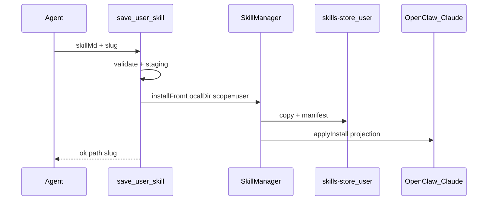

# Agent 会话创建用户技能（专用工具）设计

Date: 2026-07-21

## Summary

会话中由 OpenClaw / Claude 引擎「生成技能」时，当前依赖模型随意 `write` 到 `openclaw/skills` 或 workspace，**不会进入** `~/.stoclaw/skills-store/users/{工号}/skills/`，因此「我的技能」无法可靠管理（删除/启用/投影）。

本设计采用 **专用内置工具 + SkillManager user 作用域落盘**，保证创建路径唯一写入 skills-store；并以 **轻量落点兜底导入** 处理绕过工具的残留写入。提示词仅作辅助，不当保证。

## Product decisions

| 决策 | 选择 |
|------|------|
| 约束强度 | 专用工具为主路径；落点兜底为护栏；提示词辅助 |
| 落盘位置 | 仅 `skills-store/users/{当前工号}/skills/{slug}/`（须已登录且有 `userCode`） |
| manifest `source` | `local`（会话自建）；与广场 `sto-marketplace`、预装白名单区分 |
| 「我的技能」展示 | 现有 `getLocalSkills` 自然扫到；`source` 解析为 `mine`（自建） |
| 未登录 | 工具返回明确错误，不写 global |
| Agent 作用域 | v1 不做 agent-scoped 会话创建；一律当前用户 user scope |
| 更新同 slug | `save_user_skill` 允许覆盖已有 **非预装白名单** user 包（force）；白名单 slug 拒绝 |
| UI toast | v1 不强制前端 toast；工具结果返回路径与 slug 即可 |

## Goals / Non-goals

**Goals**

- OpenClaw 与 Claude 均可调用同一语义的保存工具。
- 成功后包一定在 skills-store user 目录，并投影到两引擎运行目录。
- 「我的技能」可删除/启用/打开文件夹看到该技能。
- 创建为冷路径，不拖慢日常聊天与广场列表。

**Non-goals（v1）**

- 不上报广场 / 不自动发布 marketplace。
- 不实现完整「技能 IDE」或分步向导 UI。
- 不永久禁止通用 `write` 工具（仅兜底导入 + 提示）。
- 不清理历史 `~/.openclaw/workspace/skills` 孤儿（可另开清理任务）。

## Architecture

```text
Agent (OpenClaw Gateway plugin tool | Claude MCP tool)
        │
        ▼
  save_user_skill({ slug, skillMd, assets? })
        │
        ▼
  shared create-user-skill service (Electron Main / plugin host)
        │  validate slug + SKILL.md
        │  staging dir
        ▼
  SkillManager.installFromLocalDir({
    scope: 'user',
    userCode: current,
    source: 'local',
    sourceDir: staging,
    ...
  })
        │
        ├── skills-store/users/{code}/skills/{slug}/   ← SoT
        ├── manifest.json upsert
        └── fanOut → openclaw + claude adapters (projection)
```



## Tool contract

### Name

- Preferred: `save_user_skill`
- Aliases (optional): `create_user_skill` 指向同一实现

### Input

| Field | Type | Required | Notes |
|-------|------|----------|--------|
| `slug` | string | yes | 规范化：小写、`[a-z0-9-]+`；可由 name 推导但须最终合法 |
| `skillMd` | string | yes | 完整 SKILL.md（含 YAML frontmatter） |
| `name` | string | no | 覆盖 frontmatter name（可选） |
| `description` | string | no | 覆盖 frontmatter description |
| `assets` | `{ path: string, content: string, encoding?: 'utf8'\|'base64' }[]` | no | 相对技能根路径；禁止 `..` |
| `force` | boolean | no | 默认 true：覆盖已有同 slug user 包；false 则已存在时报错 |

### Output

```json
{
  "ok": true,
  "slug": "wechat-moments-copywriter",
  "scope": "user",
  "userCode": "1205314",
  "storePath": "~/.stoclaw/skills-store/users/1205314/skills/wechat-moments-copywriter",
  "source": "local"
}
```

错误：`NOT_LOGGED_IN` / `INVALID_SLUG` / `INVALID_SKILL_MD` / `PREINSTALL_PROTECTED` / `ALREADY_EXISTS` / `WRITE_FAILED`。

### Validation

- Frontmatter 须含 `name`、`description`（与现有 upload / `ensureSkillFrontmatter` 对齐）。
- `slug` 不得落在 `readPreinstalledManifestSlugs()` 白名单。
- `assets[].path` 规范化后不得逃逸技能根。

## Dual-engine registration

| Engine | Mechanism | Pattern reference |
|--------|-----------|-------------------|
| OpenClaw | Gateway plugin `api.registerTool` | [`sto-plugin/openclaw/sto-workflow-tool`](sto-plugin/openclaw/sto-workflow-tool/) |
| Claude | MCP server injected in runtime | [`electron/engines/claude-runtime-extensions.ts`](electron/engines/claude-runtime-extensions.ts) + [`sto-plugin/claude/sto-workflow-tool`](sto-plugin/claude/sto-workflow-tool/) |

Shared core: `electron/services/skills/create-user-skill.ts`（纯业务，无 UI）。

插件层只做：解析 args → 调 shared → 返回信封。

## Prompt guidance (assist only)

Update durable context so models prefer the tool:

- [`resources/context/TOOLS.stoclaw.md`](resources/context/TOOLS.stoclaw.md)：新增「创建技能必须用 `save_user_skill`」
- Workspace `AGENTS.md` / bootstrap 模板：禁止把新技能写到 `openclaw/skills` 或 `workspace/skills` 作为唯一落点

## Fallback import (guardrail)

**Trigger (v1, low cost):**

- 会话结束或 Gateway skill batch notify 后 debounce（如 2s）扫描一次：
  - `~/.stoclaw/openclaw/skills/{slug}`（无 `.stoclaw-openclaw-skill-projection.json` 或 marker 标明 unmanaged）
  - `{activeWorkspace}/skills/{slug}`（若存在）
- 发现含 `SKILL.md` 且 manifest 中当前用户无该 slug → `installFromLocalDir(scope:user, source:local)`，可选删除非投影源目录避免双份

**Non-trigger:** 不在每条 chat token 路径上做 watch；不做全盘递归。

## Performance

| Path | Impact |
|------|--------|
| Normal chat | None (tool idle) |
| Tool list size | +1 schema (negligible vs workflow tools) |
| One save call | Staging write + copy + manifest + 1–2 engine projections; same order as plaza install |
| Fallback scan | Rare, bounded dirs, debounce |

No change to plaza list enrichment / `getLocalSkills` hot path.

## Security / tenancy

- Always resolve `userCode` via `getCurrentActiveUserCode()`；禁止调用方传入任意工号覆盖。
- 不写 `skills-store/global`。
- 拒绝预装白名单 slug，避免覆盖系统包。

## Testing

- Unit: slug normalize、frontmatter 校验、assets 路径逃逸、预装拒绝、未登录、覆盖/不覆盖。
- Unit: `installFromLocalDir` 后 manifest user 条目与目录存在（可复用 skills-lifecycle 测试夹具）。
- 手工：OpenClaw / Claude 各调一次工具 → 「我的技能」出现「自建」→ 可删除。

## Open questions (resolved for v1)

| Question | Resolution |
|----------|------------|
| 软约束够不够 | 不够；专用工具 + 兜底 |
| 是否 MCP 给 OpenClaw | 否；OpenClaw 用 registerTool，与平台内置 tools 一致 |
| source 字段 | `local` |

## Follow-ups (out of v1 plan)

- OpenSpec change `agent-save-user-skill`（若需合入主规范）
- 历史 orphan 清理（`.openclaw/workspace/skills`）
- dedupe 预装判断与白名单对齐（已有卸载白名单，迁移 dedupe 仍可另修）
