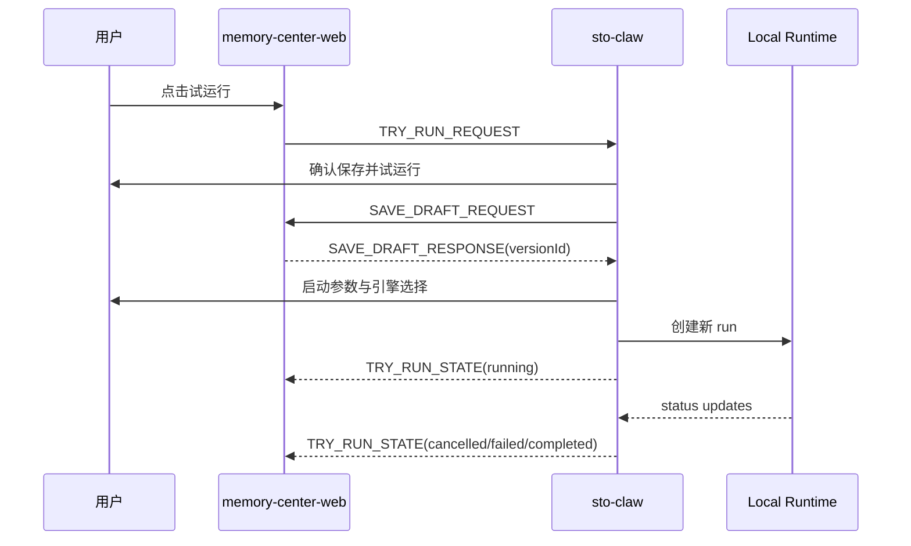

# 工作流试运行体验重构设计

## 背景

StoClaw 已通过 `workflow-embedded-editor-integration` 建立嵌入式工作流编辑器的单顶栏、保存后试运行和安全 iframe bridge。当前试运行结果仍使用旧的 800px 技术型抽屉，且 bridge 只同步 `idle / confirming / saving / preparing / running / error`。本地运行进入取消、失败或完成终态后，Web 顶栏会立即回到 `idle`，无法满足 MasterGo 设计中“画布导航栏状态与试运行弹窗保持一致”的要求。

本设计以 MasterGo 节点 `48:46129` 为视觉依据，聚焦嵌入式编辑器中的本地试运行体验。顶部区域的既有所有权和常规操作布局保持不变。

## 已确认的产品决策

- `sto-claw` 是本地试运行状态的唯一事实来源。
- `memory-center-web` 只展示宿主通过 bridge 同步的试运行状态，不推断本地运行结果。
- `memory-center` 不参与本次 UI 编排，也不修改终态锁。
- “继续运行”保留设计稿文案，但实际创建一个新的完整试运行，不复用已取消的 `runId`，不从断点恢复。
- 已取消的旧运行保持 `CANCELLED`，继续作为历史记录。
- 关闭结果抽屉不取消运行，也不清除顶部运行状态。
- 共享运行详情模式保持现有布局；新视觉只应用于试运行模式，避免影响历史运行详情和完成通知。

## 范围

### 目标

- 将试运行抽屉改为 MasterGo 对应的 500px 紧凑右侧抽屉。
- 支持运行中、运行已取消、运行失败、运行完成四种稳定展示状态。
- 让 Web 顶栏状态徽标与 Host 抽屉消费同一运行状态。
- 保留关闭后后台运行、启动参数、引擎选择、人工审批、补充输入、执行事件和产物查看能力。
- 让取消态的“继续运行”安全复用现有保存后重跑链路并创建新 `runId`。
- 覆盖浅色、深色、键盘焦点、窄窗口和 reduced-motion 行为。

### 非目标

- 不修改 `memory-center` 的运行终态锁、数据库模型或同步 API。
- 不实现同一 `runId` 的取消后恢复，也不复制已完成节点到新运行。
- 不重新设计已完成的工作流顶部区域、版本列表、保存或发布行为。
- 不启用 `memory-center-web` 中遗留的 Web 端 `TestRunDrawer`。
- 不重做本地运行引擎、事件协议、产物持久化或运行历史。

## 项目边界

| 项目 | 本次职责 | 明确不负责 |
|---|---|---|
| `sto-claw` | 本地运行、终态映射、抽屉开关、重跑、bridge 状态发送 | 画布定义编辑和服务端草稿保存 |
| `memory-center-web` | 顶栏状态徽标、bridge 状态接收、试运行入口 | 本地运行结果推断和结果抽屉 |
| `memory-center` | 沿用现有草稿和运行记录服务 | 取消终态回退、断点续跑和 UI 状态 |

## 状态模型

### Bridge 状态

在现有状态上增加三个稳定终态：

```text
idle
confirming
saving
preparing
running
cancelled
failed
completed
error
```

其中：

- `confirming / saving / preparing` 是启动阶段。
- `running` 同时覆盖本地 `pending`、`running`、`waiting_approval` 和 `waiting_input`。
- `cancelled / failed / completed` 是可持续展示的运行终态。
- `error` 仅表示保存、校验或启动阶段的瞬时错误，不等同于运行终态 `failed`。

### 本地状态映射

| 本地状态 | Bridge / 顶栏状态 |
|---|---|
| starting、pending、running | `running` |
| waiting_approval、waiting_input | `running` |
| cancelled | `cancelled` |
| failed、timeout、interrupted | `failed` |
| completed | `completed` |

### 生命周期与可见性分离

运行状态和抽屉可见性是两个独立维度：

- `isDrawerOpen=false` 只关闭抽屉。
- 活跃运行继续执行，Web 顶栏继续显示 `running`。
- 运行终态到达后，即使抽屉关闭，顶栏仍显示对应终态。
- 新试运行进入 `confirming / saving / preparing` 时，前一终态让位于新尝试状态。
- 工作流 ID、iframe 会话或编辑路由切换时，状态重置为 `idle`。

Host 在发送终态后可以释放活动 request ID，以允许下一次请求；Web 必须保留终态作为展示状态，而不是把释放请求误解为 `idle`。

## 交互流程

### 首次试运行



### 关闭抽屉

- 用户关闭抽屉时，Host 只调用 `closeDrawer`。
- Host 不调用试运行确认取消函数，不发送 `idle`，也不清理活动运行。
- 顶栏状态徽标继续展示。
- 重新打开方式沿用现有本地运行历史或完成通知入口；本变更不新增顶部入口。

### 取消后继续运行

1. 当前运行被取消并保持 `CANCELLED`。
2. 抽屉显示“运行已取消”和“继续运行”。
3. 点击“继续运行”进入与“重新运行”相同的嵌入式重跑编排。
4. Web 再次保存最新画布，Host 再次显示启动参数与引擎选择。
5. Host 创建新的 `runId` 并从头执行。
6. 旧运行保持取消，新运行独立进入运行中和最终状态。

该流程不得调用 `resumeWorkflowRun(cancelledRunId)`。

## 抽屉设计

### 视觉验收基准

MasterGo 节点 `48:46129` 及用户确认的五联状态图是抽屉内部样式的验收事实来源。实现不能只复用功能结构后做近似样式，必须逐项对齐以下五个画面：

1. 运行中：提示条 + 运行中状态条 + 展开的执行过程 + 取消运行。
2. 运行已取消：取消状态条 + 展开的执行过程 + 继续运行。
3. 运行失败：失败状态条 + 展开的执行过程 + 重新运行。
4. 运行完成、执行过程收起：完成状态条右侧显示“执行过程”折叠控制，产物面板占据主要内容区 + 重新运行。
5. 运行完成、执行过程展开：独立执行过程卡位于产物卡上方，两块内容保持同一描边、圆角和间距体系 + 重新运行。

视觉 QA 必须把实现截图与这五个画面并排比较，检查尺寸、层级、间距、描边、圆角、字号、图标、滚动条、折叠箭头、产物操作图标和底部按钮，而不能只检查状态文字是否存在。

### 公共结构

- 右侧 Sheet 宽度为 500px，窄窗口下最大宽度为 100vw。
- 标题栏高度 52px，标题为“试运行结果”，右侧保留明确关闭按钮。
- 主内容左右留白 12px，可滚动且不被底部操作栏遮挡。
- 状态行宽 476px、高 42px，展示状态、图标和当前版本。
- 底部操作区高度 60px，固定在抽屉底部，内部使用整行主按钮。
- 抽屉关闭、Esc、遮罩行为继续由现有 Radix/shadcn Sheet 负责。
- 抽屉、状态行、执行过程卡和产物卡使用轻量 1px 语义 Border；内容卡圆角按设计为 10–12px，不使用旧抽屉的大阴影摘要卡。
- Header、Body、Footer 之间使用清晰但克制的分隔线；Footer 为独立白/主题表面，不能随正文滚动。
- Footer 内按钮左右各留 12px，按钮高度 36px、圆角 10px，浅色稿为黑底白字；暗色主题使用等价的高强调主操作 Token，不反转成低对比灰色。

### 运行中

- 顶部展示运行提示条，说明关闭弹窗不会中断运行。
- 状态使用 Brand/运行中语义，视觉校准参考 Brand-6。
- 执行过程按时间顺序纵向展示事件，实时输出允许长文本换行或内部滚动。
- 执行卡填充提示条、状态条和 Footer 之外的剩余高度，滚动发生在卡片内容区；标题行保持固定。
- 底部按钮为“取消运行”。

### 运行已取消

- 状态使用 Warning 语义 Token。
- 保留取消前已产生的执行过程，不退化为只有一条取消说明。
- 取消态不显示运行提示条，执行过程卡向下填充到 Footer 上方。
- 底部按钮为“继续运行”，实际创建新运行。

### 运行失败

- 状态使用 Danger 语义 Token。
- 展示可读错误信息和已产生的执行过程，错误表达不能只依赖红色。
- 失败态不显示运行提示条，执行过程卡保持与取消态相同的布局密度。
- 底部按钮为“重新运行”。

### 运行完成

- 状态使用 Success 语义 Token。
- “执行过程”和“产物名称”使用独立可折叠区块，不使用 Tab。
- 执行过程收起时，折叠入口位于完成状态条右侧，产物卡填充主要内容区；展开后，执行过程成为独立上方卡片，产物卡位于其下。
- 产物继续复用现有名称、类型、打开、下载等能力；空产物时显示明确空态。
- 产物标题行右侧保留设计稿中的放大/打开与下载图标，图标尺寸、间距、禁用和 focus 状态对齐现有视觉体系。
- 底部按钮为“重新运行”。

### 执行过程细节

- 标题“执行过程”左对齐并使用紧凑中等字重，不增加说明副标题。
- 每个事件使用左侧圆点与连续竖线形成时间线；事件标题在左、时间在右，详细内容在下一行缩进对齐。
- 事件、时间和详细输出使用弱文本语义；当前活跃事件可使用 Brand 强调，但不能让所有历史事件都高亮。
- 长实时输出保持原始换行，正文不能横向撑开抽屉；必要时在事件内容内部提供纵向滚动。
- 滚动条沿用项目 Overlay/细滚动条视觉，位置贴近卡片右内边，不使用浏览器默认粗滚动条。

### 等待审批与补充输入

`waiting_approval` 和 `waiting_input` 在顶部仍显示“运行中”。抽屉必须在执行过程区域保留现有审批和 JSON 补充输入控件，不能因视觉重构丢失可恢复运行的操作入口。

## 顶栏状态

本变更不重排或重做已完成的顶部区域，只在现有 Web 顶栏的标题/保存时间区域展示 Host 同步的运行状态徽标：

- `running`：运行中，Brand 语义。
- `cancelled`：运行已取消，Warning 语义。
- `failed`：运行失败，Danger 语义。
- `completed`：运行完成，Success 语义。
- `idle / confirming / saving / preparing / error` 沿用当前入口文案、禁用和反馈逻辑，不伪装为稳定运行终态。

徽标必须同时包含图标和文字，并在浅色与深色主题下使用语义背景、文本和边框 Token。

## 共享组件隔离

`TestRunDrawer` 同时被编辑器试运行、运行详情和完成通知消费。实现必须显式区分：

- `trial`：使用本设计的 500px 试运行视觉。
- `detail`：保留现有运行详情布局和额外操作。

数据适配函数（时间线构建、产物收集、版本格式化）可共享；视图结构和操作区必须按模式隔离。`memory-center-web` 内的旧抽屉不接入嵌入链路。

## 错误与并发

- 同一 iframe 会话最多存在一个启动中的试运行请求或一个活跃本地运行。
- 重复 request ID、迟到消息、错误 workflow ID、错误 nonce、错误 origin/source 必须继续被拒绝。
- 保存或启动错误只产生一次用户反馈，不创建运行，也不回退到旧版本运行。
- 新尝试在创建 run 之前失败时，Host 应结束新请求；Web 不得把瞬时 `error` 当成运行终态。
- 抽屉关闭不得改变 bridge 生命周期。
- 新运行创建成功后，所有状态必须绑定新 `runId`，旧运行的迟到事件不得覆盖当前展示。

## 主题与无障碍

- 几何尺寸以 MasterGo 为准，颜色使用 `docs/sto-design.md` 和当前主题的 Brand、Success、Warning、Danger、Text、Fill、Border Token。
- 不在业务 JSX 中新增 light-only 的 `bg-white` 或散落状态色 hex。
- 深色主题必须覆盖背景、正文、弱文本、边框、状态徽标、hover、focus-visible、disabled 和折叠区状态。
- 状态不能只依赖颜色；必须有图标与文字。
- 关闭、折叠和底部操作必须支持键盘操作与可见焦点。
- 非必要旋转、闪烁和过渡在 `prefers-reduced-motion` 下关闭或缩短。

## 测试策略

### StoClaw

- bridge 类型与校验器接受三个新增终态并拒绝非法状态。
- 编排器从真实 `executionState` 映射运行中、取消、失败和完成。
- 关闭抽屉后不发送 `idle`，运行继续，终态仍能同步。
- 切换 workflow/iframe 会话后旧事件不能污染新页面。
- 取消态“继续运行”调用嵌入式重跑流程、创建新 run，且不调用同 run 续跑。
- 4 类状态对应的 5 个抽屉视觉视图、固定底部操作、折叠区、等待审批和补充输入均有组件测试。
- `detail` 模式保持兼容。

### memory-center-web

- bridge 协议接受并展示新增终态。
- 终态会释放活动请求但保持顶栏展示。
- 新 request 能从旧终态开始，重复或旧 request 不能覆盖当前状态。
- 顶栏状态徽标覆盖浅色、深色、图标、文字、键盘和禁用状态。

### 跨项目验证

- 运行 `pnpm run comms:replay` 与 `pnpm run comms:compare`。
- 分别运行 StoClaw 和 memory-center-web 的类型检查、相关单元测试和 lint。
- 手工覆盖运行中关闭抽屉、取消后继续、失败重跑、完成后查看执行过程/产物、窄窗口、浅色和深色主题。
- 复核三份 README 是否需要更新；仅在行为或接口对用户/集成方可见时修改。

## 风险与缓解

- **[Risk] 关闭抽屉误清理 bridge request** → 抽屉可见性与生命周期分离，关闭处理器不再调用确认取消。
- **[Risk] 旧运行迟到事件覆盖新运行** → 状态同步同时校验当前 request、workflow 会话和 run 身份。
- **[Risk] “继续运行”文案被理解为断点续跑** → 规格明确其行为是保存最新草稿并创建新完整运行；旧运行保持取消。
- **[Risk] 共享抽屉重构影响历史运行详情** → `trial/detail` 显式分支，复用数据适配但隔离视图。
- **[Risk] 设计稿浅色硬编码破坏暗色主题** → 只复刻几何，状态和表面统一使用语义 Token，并把暗色验收列为完成条件。
- **[Risk] 三项目独立发布导致未知终态被旧 Web 拒绝** → 延续现有能力握手和安全忽略策略，StoClaw 与 Web 配套发布；旧组合保持现有状态能力。

## 完成标准

- MasterGo 4 类试运行状态及完成态收起/展开共 5 个视觉视图在 500px 抽屉中可正确呈现。
- 顶栏与抽屉状态在运行中和全部终态保持一致。
- 关闭抽屉不影响运行；取消后继续创建新 run。
- 不修改 `memory-center` 生产代码和终态锁。
- 运行详情模式、人工审批、补充输入、事件和产物能力无回归。
- 相关测试、通信回放、类型检查和浅色/深色人工验收通过。
