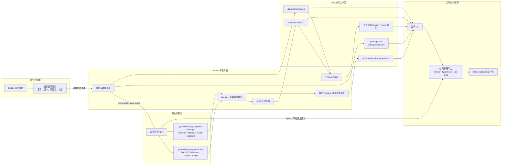
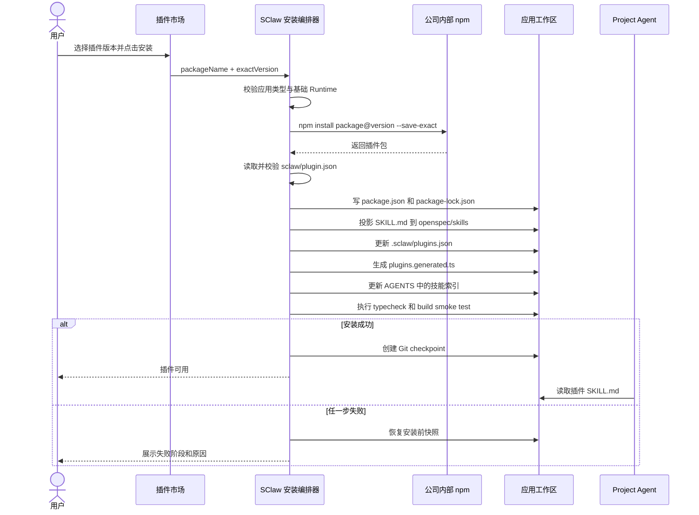
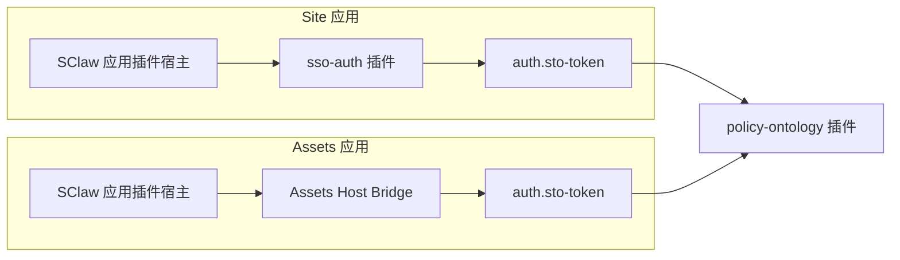

# SClaw 前端应用插件系统设计

**状态：** 第一版方案，待评审  
**日期：** 2026-08-27  
**范围：** 插件安装、应用开发、AI 开发指南、Git 交付与公司部署平台发布。

## 1. 背景

SClaw 当前已经通过应用模板中的 `packages.manifest.json` 支持前端 npm 依赖与 AI Skill 联动安装：安装依赖后，将对应开发技能写入应用的 `openspec/skills/`，并刷新 `.sclaw/AGENTS.md`。

该机制可以继续复用，但它目前更接近“模板内置依赖目录”，还不是完整的前端插件系统，主要缺少以下能力：

1. 插件自身没有统一、可校验的 Manifest 契约。
2. 安装 npm 包后，不能保证插件 Runtime 一定进入 Vite 生产产物。
3. 缺少应用级插件安装记录及 Runtime 静态装配入口。
4. 缺少应用类型、宿主能力和基础 Runtime 的兼容性检查。
5. npm 依赖安装、AI Skill 安装、Runtime 注册和工程验证尚未形成原子事务。

第一期需要跑通以下闭环：

```text
插件市场安装
  → Runtime 与 AI Skill 进入应用工作区
  → Project Agent 根据 SKILL.md 开发应用
  → 应用代码提交公司 Git
  → 公司部署平台安装依赖并执行 Vite 构建
  → 插件 Runtime 随 Site / Assets 应用产物发布
```

## 2. 目标

1. 一个插件使用一个公司内部 npm 包作为不可变制品。
2. 同一 npm 版本同时包含浏览器 Runtime、插件 Manifest、AI Skill、Schema 和示例。
3. SClaw 负责插件发现、兼容性检查、安装编排、Skill 投影和 Runtime 装配。
4. Project Agent 可以通过应用工作区中的 `SKILL.md` 获得插件开发指南。
5. 应用 Git Commit 是发布平台的唯一部署输入。
6. 发布平台使用锁文件恢复精确依赖，稳定生成可复现产物。
7. Site 和 Assets 应用可以声明并校验不同的插件兼容性。

## 3. 非目标

第一期不实现以下能力：

- 插件自动升级和自动迁移。
- 卸载插件后自动清理业务代码。
- 业务团队上传或发布私有插件。
- 运行时从 OSS 或 CDN 动态加载插件代码。
- 插件执行任意 Shell 脚本。
- 插件自带后端服务。
- 插件运行时代码在线热更新。
- 完整的 Backstage Extension Tree 或动态 Module Federation。

## 4. 方案选择

### 4.1 方案对比

| 方案 | Runtime 分发 | AI 开发指南分发 | 优点 | 缺点 |
|---|---|---|---|---|
| 单 npm 插件包 | npm 包 | 同一个 npm 包 | Runtime、Manifest 和 Skill 天然版本一致；安装和构建路径简单 | npm 包会同时包含开发期和运行期资产 |
| npm Runtime + OSS Skill | npm 包 | OSS 压缩包 | AI 资产可独立更新 | 存在两套版本、下载和完整性校验链路，容易漂移 |
| Runtime 源码复制进应用 | 复制源码 | 同时复制 | 应用开发者可以直接修改 | 升级、审计、冲突和问题归属复杂 |

### 4.2 推荐方案

第一期采用“单 npm 插件包 + SClaw 安装编排 + Git 固化”。

插件市场是发现和治理入口，不直接承载浏览器 Runtime。内部 npm 是插件制品的唯一来源，SClaw 将 npm 包中的不同内容分别投影到运行期和开发期：

- Runtime 通过静态 TypeScript 注册文件进入 Vite 模块依赖图。
- AI Skill 投影到应用的 `openspec/skills/`，供 Project Agent 读取。
- Manifest 由 SClaw 读取和校验，不进入浏览器产物。
- Schema 和示例按需提供给 Agent 或开发工具，不直接打入生产 Bundle。

## 5. 总体架构



## 6. 插件包结构

以 `@sto/sclaw-plugin-policy-ontology` 为例：

```text
@sto/sclaw-plugin-policy-ontology@1.0.0
├── package.json
├── README.md
├── dist/
│   ├── runtime.js
│   ├── runtime.d.ts
│   ├── client.js
│   ├── client.d.ts
│   ├── operations.js
│   └── operations.d.ts
└── sclaw/
    ├── plugin.json
    ├── skills/
    │   └── policy-ontology/
    │       ├── SKILL.md
    │       └── references/**
    ├── schemas/**
    └── examples/**
```

建议的 `package.json` 关键字段：

```json
{
  "name": "@sto/sclaw-plugin-policy-ontology",
  "version": "1.0.0",
  "type": "module",
  "files": [
    "dist/**",
    "sclaw/**",
    "README.md"
  ],
  "exports": {
    ".": {
      "types": "./dist/client.d.ts",
      "import": "./dist/client.js"
    },
    "./runtime": {
      "types": "./dist/runtime.d.ts",
      "import": "./dist/runtime.js"
    },
    "./package.json": "./package.json"
  },
  "sclaw": {
    "manifest": "./sclaw/plugin.json"
  }
}
```

约束如下：

1. npm 包必须发布编译后的 ESM 和类型声明，不能要求应用直接编译插件源码。
2. Runtime 入口与普通 SDK 入口分开，避免安装编排器依赖插件内部目录结构。
3. `files` 必须显式包含 `sclaw/**`，保证 Manifest 和 Skill 进入 npm 制品。
4. npm 包版本是插件版本的唯一权威来源。
5. 插件发布后，同一个 npm 版本不得覆盖。

## 7. 插件 Manifest

`sclaw/plugin.json` 描述插件能力，不重复声明 npm 包名和版本：

```json
{
  "schemaVersion": 1,
  "id": "sto.policy-ontology",
  "displayName": "Policy Ontology",
  "description": "为 STO 前端应用提供 Policy Ontology 查询和 Operation 能力。",
  "pageTypes": ["site", "assets"],
  "runtime": {
    "entry": "./runtime",
    "activation": "bootstrap"
  },
  "ai": {
    "skills": [
      {
        "id": "policy-ontology",
        "path": "./skills/policy-ontology"
      }
    ],
    "schemas": "./schemas",
    "examples": "./examples"
  },
  "requires": {
    "hostCapabilities": [
      "auth.sto-token",
      "runtime.environment",
      "runtime.http"
    ]
  }
}
```

### 7.1 字段职责

| 字段 | 说明 |
|---|---|
| `schemaVersion` | Manifest 契约版本 |
| `id` | 稳定插件 ID，不随 npm 包名和版本变化 |
| `displayName` | 插件市场和应用插件列表中的展示名称 |
| `pageTypes` | 插件支持的应用类型 |
| `runtime.entry` | 相对于 npm 包的 Runtime export 入口 |
| `runtime.activation` | 第一期固定为 `bootstrap`，表示应用启动时注册 |
| `ai.skills` | 需要投影到应用工作区的 AI 开发指南 |
| `requires.hostCapabilities` | 插件运行依赖的宿主能力 |

### 7.2 版本来源

插件版本不在 `plugin.json` 中重复维护：

- `package.json.version` 表示发布的插件版本。
- 应用 `package.json` 表示直接依赖要求。
- 应用 `package-lock.json` 表示实际解析版本和完整依赖树。
- 插件目录服务保存可供选择的已审核版本。

SClaw 安装时必须校验 npm 包的名称、版本、Manifest 和插件目录返回的信息一致。

## 8. 应用工作区结构

安装插件后，应用工作区包含：

```text
application/
├── package.json
├── package-lock.json
├── .sclaw/
│   ├── AGENTS.md
│   └── plugins.json
├── openspec/
│   └── skills/
│       └── policy-ontology/
│           ├── SKILL.md
│           └── references/**
└── src/
    └── sclaw/
        ├── bootstrap.ts
        └── plugins.generated.ts
```

其中：

- `.sclaw/plugins.json` 记录插件 ID、npm 包名、启用状态和插件配置。
- `openspec/skills/**` 是从已安装 npm 包投影出的开发期快照。
- `src/sclaw/plugins.generated.ts` 是 SClaw 生成并维护的静态 Runtime 注册文件。
- `src/sclaw/bootstrap.ts` 由应用模板提供，不由单个插件修改。

## 9. Runtime 静态装配

仅执行 `npm install` 不能保证插件 Runtime 进入 Vite 产物。必须建立从应用入口到插件 Runtime 的静态模块依赖链。

SClaw 根据 `.sclaw/plugins.json` 生成：

```ts
// Generated by SClaw. Do not edit manually.
import policyOntologyPlugin from '@sto/sclaw-plugin-policy-ontology/runtime';

export const installedPlugins = [
  policyOntologyPlugin,
];
```

应用模板提供固定启动链路：

```text
main.tsx
  → src/sclaw/bootstrap.ts
    → src/sclaw/plugins.generated.ts
      → @sto/sclaw-plugin-policy-ontology/runtime
```

该链路保证 Vite 在开发和生产构建时都能发现插件 Runtime。`SKILL.md`、Schema 和示例没有被浏览器代码导入，因此不会进入生产 Bundle。

第一期只支持 `bootstrap` 类型的前端插件。普通 npm 工具库仍作为“依赖包”管理，不纳入插件市场，以避免插件与任意 npm 包概念混淆。

## 10. AI Skill 读取方式

插件 Skill 的权威来源是 npm 制品，但 Project Agent 继续沿用应用现有的 OpenSpec Skill 读取机制。

安装时：

1. SClaw 完成 npm 安装。
2. 从 npm 包 `sclaw/plugin.json` 读取 `ai.skills`。
3. 将声明的 Skill 目录复制到 `openspec/skills/<skill-id>/`。
4. 更新 `.sclaw/AGENTS.md` 中的已安装 Skill 索引。
5. 在 `.sclaw/plugins.json` 中记录 Skill 来源。

开发时：

1. Project Agent 从 AGENTS 和插件状态中识别已安装插件。
2. 命中相关开发任务时，完整读取对应 `SKILL.md`。
3. 根据 Skill 中的约束使用插件 API、Operation、Schema 和示例。
4. Skill 只影响开发过程，不进入浏览器运行环境。

投影到工作区的 Skill 视为生成快照，应用开发者不应直接修改。插件升级时由 SClaw 使用新 npm 版本重新生成。

## 11. 安装事务



### 11.1 安装步骤

1. 用户在插件市场选择一个已审核的固定版本。
2. SClaw 校验当前应用 `pageType` 和宿主能力。
3. SClaw 对待修改的工作区文件创建事务快照。
4. 执行 `npm install <package>@<exact-version> --save-exact`。
5. 从安装后的 npm 包读取并校验 `sclaw/plugin.json`。
6. 投影 AI Skill、Schema 和示例。
7. 更新 `.sclaw/plugins.json`。
8. 重新生成 `src/sclaw/plugins.generated.ts`。
9. 刷新 `.sclaw/AGENTS.md` 中的 Skill 索引。
10. 执行 TypeScript 类型检查和 Vite 构建冒烟测试。
11. 全部成功后创建应用 Git checkpoint。

### 11.2 原子性要求

以下内容必须作为一个事务完成：

- `package.json`
- `package-lock.json`
- `.sclaw/plugins.json`
- `.sclaw/AGENTS.md`
- `openspec/skills/<skill-id>/`
- `src/sclaw/plugins.generated.ts`

任意一步失败时，SClaw 必须恢复安装前快照，不能留下以下半安装状态：

- npm 依赖存在但 Runtime 未注册。
- Runtime 已注册但 Skill 未安装。
- Skill 已安装但插件依赖安装失败。
- Manifest 不合法但包仍留在应用依赖中。

## 12. 开发流程

插件安装完成后：

1. Project Agent 读取插件 Skill。
2. Skill 指导 AI 使用插件提供的公开 SDK、Operation 和 Schema。
3. AI 可以修改业务页面、A2UI JSON、React 组件和应用 Operation。
4. AI 不得手工修改生成的插件注册文件。
5. 本地 Vite 服务通过静态注册表加载插件 Runtime。
6. 每轮对话结束后继续使用应用现有 Git checkpoint 机制保存变更。

对于 Policy Ontology 插件，业务代码应使用插件提供的受控 Operation，不直接拼接 Host、Path、Method 或认证 Header。

## 13. 插件宿主与身份边界

Policy Ontology 插件不自行实现 Site SSO，也不自行实现 Assets 宿主认证。它只依赖稳定的宿主能力：

```text
Site 应用
  → Site SSO Provider
  → auth.sto-token
  → Policy Ontology 插件

Assets 应用
  → Host Bridge Provider
  → auth.sto-token
  → Policy Ontology 插件
```

插件从 SClaw 生成的应用插件宿主上下文获取：

- 当前部署环境。
- 当前应用类型。
- 当前用户身份和 `stoToken`。
- 受控 HTTP Transport。

插件宿主是应用模板中的平台基础代码以及 SClaw 生成的静态注册文件，不使用独立的通用 Runtime npm 包。Site SSO 是一个具体插件，正式包名固定为 `@sto/sclaw-plugin-sso-auth`。

### 13.1 当前实现状态

当前仓库已经存在以下内容：

- Site/Assets 模板内的 `sso.ts`、`sso-config.ts` 和 `SsoAuthShell.tsx`。
- Site SSO 的旧合并设计与现行独立设计文档。
- `@sto/policy-ontology-sdk` 的源码包。

当前仓库尚不存在以下可安装制品：

- 独立的 `sso-auth` npm 插件包。
- 由插件静态注册表驱动的身份 Provider 注册机制。

因此，`auth.sto-token` 目前只是设计中的宿主能力，还没有可以被插件系统安装和启动的正式提供者。`policy-ontology` 插件不能先于该能力独立交付。

### 13.2 SSO Auth 插件定位

建议将 Site 单点登录能力定义为平台维护的基础插件：

```text
@sto/sclaw-plugin-sso-auth
├── dist/
│   ├── runtime.js
│   ├── runtime.d.ts
│   └── sso-client.js
└── sclaw/
    ├── plugin.json
    ├── skills/sso-auth/SKILL.md
    └── schemas/config.schema.json
```

其 Manifest 核心声明为：

```json
{
  "schemaVersion": 1,
  "id": "sto.sso-auth",
  "displayName": "STO Site SSO",
  "pageTypes": ["site"],
  "runtime": {
    "entry": "./runtime",
    "activation": "bootstrap"
  },
  "provides": {
    "hostCapabilities": ["auth.sto-token"]
  }
}
```

第一期行为固定如下：

| 场景 | `sso-auth` 行为 |
|---|---|
| 本地 Site 预览 | 使用 SClaw 注入的当前登录身份，不执行浏览器 SSO 跳转 |
| 发布 Site | 检查 Token；处理回跳 Code；调用用户中心换票；保存 Token；清理 URL；必要时跳转登录 |
| 本地 Assets | 不安装、不启动 |
| 发布 Assets | 不安装、不启动，由 Assets Host Bridge 提供身份 |

### 13.3 与 Policy Ontology 插件的关系

`policy-ontology` 不应直接依赖 `sso-auth` 的 npm 包，因为 Assets 应用不使用 Site SSO。两个插件通过宿主能力契约解耦：



安装 `policy-ontology` 时，SClaw 只检查当前应用是否已经提供 `auth.sto-token`：

- Site 应用由 `sso-auth` 提供。
- Assets 应用由模板内置的 Host Bridge Provider 提供。
- 如果当前应用没有任何 Provider，安装必须在修改 npm 依赖前失败。

### 13.4 Site 新建应用默认行为

`sso-auth` 对 Site 不是普通选装插件，而是平台基础插件：

1. 新建 `site` 应用时默认安装并启用。
2. 在插件列表中显示为“基础插件”。
3. 第一期不允许卸载或禁用。
4. 版本仍由应用 `package.json` 和 `package-lock.json` 固化。
5. 后续升级由用户在 SClaw 中手动确认，不自动跟随平台版本。

新建 `assets` 应用不安装 `sso-auth`，避免 iframe 内发生错误的 SSO 跳转。

## 14. Site 与 Assets 兼容性

插件 Manifest 必须声明 `pageTypes`：

| 声明 | 行为 |
|---|---|
| `site` | 只能安装到独立站点应用 |
| `assets` | 只能安装到托管应用 |
| `site + assets` | 两种应用都可以安装 |

`@sto/sclaw-plugin-policy-ontology` 第一期同时支持 Site 和 Assets，但身份 Provider 不同：

- Site 发布后通过 Site SSO Provider 获取 Token。
- Assets 发布后通过可信宿主 Bridge 获取 Token，插件不能触发 SSO 跳转。
- 本地预览统一使用 SClaw 当前登录身份。

## 15. Git 与发布

应用 Git 应提交：

- 业务源码。
- `package.json`。
- `package-lock.json`。
- `.sclaw/plugins.json`。
- `.sclaw/AGENTS.md`。
- `openspec/skills/**`。
- `src/sclaw/bootstrap.ts`。
- `src/sclaw/plugins.generated.ts`。

应用 Git 不提交：

- `node_modules/`。
- `dist/`。
- Token、Cookie 或其他凭证。
- 仅属于本机的临时安装目录。

发布链路固定为：

```text
应用 Git Commit
  → 公司部署平台 Checkout
  → npm ci
  → typecheck
  → Vite build
  → 注入发布环境 Runtime 配置
  → 发布 Site 固定地址或 Assets 版本产物
```

发布平台不依赖开发者本机 SClaw 状态，也不在发布阶段重新查询插件市场。Git Commit、锁文件和内部 npm 制品共同保证构建可复现。

## 16. 插件市场职责

插件市场第一期只承担控制面职责：

1. 展示平台团队维护的插件。
2. 展示插件说明、适用应用类型、已审核版本和兼容性。
3. 允许用户选择一个固定版本安装到当前应用。
4. 展示安装结果和失败阶段。
5. 区分“应用插件”和普通 npm 依赖包。

插件市场不直接存储 npm Runtime，不负责浏览器运行时动态加载，也不允许用户输入任意 npm 包名作为正式插件安装。

第一期插件目录可以由平台内置静态数据提供；后续迁移到服务端插件目录时，只替换目录数据来源，不改变 npm 包、Manifest、应用安装记录和发布链路。

## 17. 错误模型

建议为安装链路提供稳定错误码：

- `PLUGIN_NOT_FOUND`
- `PLUGIN_VERSION_NOT_FOUND`
- `PLUGIN_PACKAGE_DOWNLOAD_FAILED`
- `PLUGIN_MANIFEST_MISSING`
- `PLUGIN_MANIFEST_INVALID`
- `PLUGIN_ID_MISMATCH`
- `PLUGIN_PAGE_TYPE_UNSUPPORTED`
- `PLUGIN_HOST_CAPABILITY_MISSING`
- `PLUGIN_SKILL_INVALID`
- `PLUGIN_RUNTIME_ENTRY_INVALID`
- `PLUGIN_REGISTRY_GENERATION_FAILED`
- `PLUGIN_TYPECHECK_FAILED`
- `PLUGIN_BUILD_FAILED`
- `PLUGIN_INSTALL_ROLLBACK_FAILED`

错误信息可以包含安装阶段、npm 包名、插件版本和构建摘要，但不能包含 npm Token、用户 Token、认证 Header 或其他凭证。

## 18. 安全要求

1. 插件只能从公司允许的 npm Registry 和 Scope 安装。
2. 插件市场只能展示经过平台审核的精确版本。
3. 第一阶段禁止插件声明或运行安装脚本。
4. Manifest 中所有路径必须位于当前 npm 包目录内，禁止 `..` 越界。
5. Skill 投影前必须校验文件数量、单文件大小、总大小和软链接。
6. 插件不得将 Token 写入源码、配置、URL、日志或构建产物。
7. 插件不得自行选择认证服务和业务服务 Origin。
8. 生成的 Runtime 注册文件只能由 SClaw 更新。
9. 发布平台必须使用锁文件安装依赖。

## 19. 测试策略

### 19.1 插件包测试

- npm pack 后包含 Runtime、类型声明、Manifest 和 Skill。
- package exports 可以被 Vite 和 TypeScript 正确解析。
- Manifest Schema 校验通过。
- Runtime 不依赖未声明的浏览器全局变量。

### 19.2 SClaw 安装测试

- 正常安装生成全部预期文件。
- 重复安装保持幂等。
- Site/Assets 不兼容时在 npm 安装前失败。
- Manifest、Skill 或 Runtime 入口无效时完整回滚。
- 类型检查或 Vite 构建失败时完整回滚。
- `.sclaw/AGENTS.md` 不产生重复 Skill 索引。

### 19.3 应用构建测试

- 本地 Vite 可以加载插件 Runtime。
- 生产 Vite Bundle 包含插件 Runtime。
- 生产 Bundle 不包含 `SKILL.md`、Schema 和示例。
- 全新目录 Checkout 后执行 `npm ci` 可以构建成功。
- Site 和 Assets 应用分别获得正确的身份 Provider。

## 20. 验收标准

1. 新建 Site 应用默认安装并启用 `@sto/sclaw-plugin-sso-auth`，新建 Assets 应用不包含该插件。
2. 本地 Site 预览使用 SClaw 当前身份，发布 Site 可以通过 `sso-auth` 完成登录、回跳换票和 Token 注册。
3. 用户可以从插件市场将 `@sto/sclaw-plugin-policy-ontology` 的固定版本安装到当前应用。
4. 安装后 `package.json`、`package-lock.json` 和 `.sclaw/plugins.json` 状态一致。
5. Project Agent 能发现并完整读取插件的 `SKILL.md`。
6. AI 可以依据 Skill 生成调用 Policy Ontology Operation 的应用代码。
7. 插件 Runtime 通过静态注册链路进入本地预览和生产构建。
8. 全新环境从同一个 Git Commit 执行 `npm ci` 和 Vite build 能产生一致应用。
9. Site 和 Assets 使用同一个 Policy 插件，但分别使用 Site SSO 和 Assets Host Bridge 身份来源。
10. 任意安装步骤失败时，应用工作区恢复到安装前状态。
11. 构建产物中不存在 Skill、开发示例或用户凭证。

## 21. 后续演进

第一期闭环稳定后，可以按以下顺序演进：

1. 手动插件升级与升级前差异展示。
2. 插件配置 Schema 和可视化配置页面。
3. 插件依赖、冲突和能力提供者选择。
4. 插件卸载影响分析。
5. 私有插件发布、审核和可见范围。
6. 插件版本废弃、风险通知和安全下架。
7. 按需激活和代码分包。

## 22. 建议实施顺序

插件市场闭环依赖身份能力真实存在，建议按以下顺序实施：

### 阶段一：应用插件宿主

- 定义插件注册、生命周期和宿主能力接口。
- 在 Site/Assets 模板中建立固定的 `bootstrap.ts` 启动入口。
- 支持加载 `plugins.generated.ts` 中的静态插件列表。
- 该宿主作为模板平台代码维护，不发布为通用 Runtime npm 包。

### 阶段二：`sso-auth` 基础插件

- 将 Site 模板中已有的 SSO 逻辑抽取为 `@sto/sclaw-plugin-sso-auth`。
- 实现本地身份接入和发布态 Site SSO。
- 注册 `auth.sto-token` 能力。
- 将其作为 `site-minimal` 的默认基础插件。
- 确保 `assets-minimal` 不安装、不启动该插件。

### 阶段三：插件安装编排

- 实现 Manifest 校验、npm 精确版本安装和安装事务。
- 实现 AI Skill 投影、AGENTS 更新和应用插件状态记录。
- 实现静态 Runtime 注册文件生成。
- 实现 Site/Assets 与宿主能力的安装前检查。

### 阶段四：Policy Ontology 插件

- 将现有 `@sto/policy-ontology-sdk` 包装或演进为 `@sto/sclaw-plugin-policy-ontology`。
- 注册 Policy Operation 和客户端能力。
- 携带 Policy Ontology `SKILL.md`、Schema 和示例。
- 在 Site 中消费 `sso-auth` 提供的 Token。
- 在 Assets 中消费 Host Bridge 提供的 Token。

### 阶段五：插件市场界面与发布验收

- 展示平台插件、基础插件、版本和兼容性。
- 跑通安装、AI 开发、Git 提交和公司部署平台发布。
- 验证全新环境使用同一 Git Commit 可以恢复和构建。

## 23. 参考资料

- [npm package.json](https://docs.npmjs.com/cli/configuring-npm/package-json/)
- [npm package-lock.json](https://docs.npmjs.com/cli/configuring-npm/package-lock-json/)
- [npm ci](https://docs.npmjs.com/cli/commands/npm-ci/)
- [Vite Features](https://vite.dev/guide/features.html)
- [Backstage: Installing Plugins](https://backstage.io/docs/frontend-system/building-apps/installing-plugins/)
- [Backstage: Plugin Architecture](https://backstage.io/docs/frontend-system/architecture/plugins/)
- [Storybook: Writing Addons](https://storybook.js.org/docs/addons/writing-addons)
- [Visual Studio Code Extension Manifest](https://code.visualstudio.com/api/references/extension-manifest)
