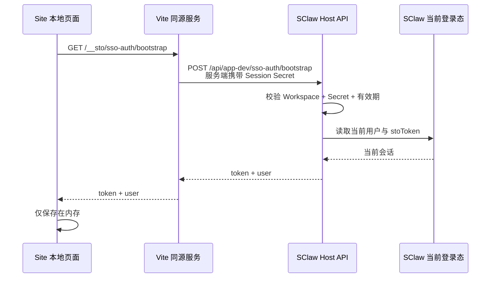
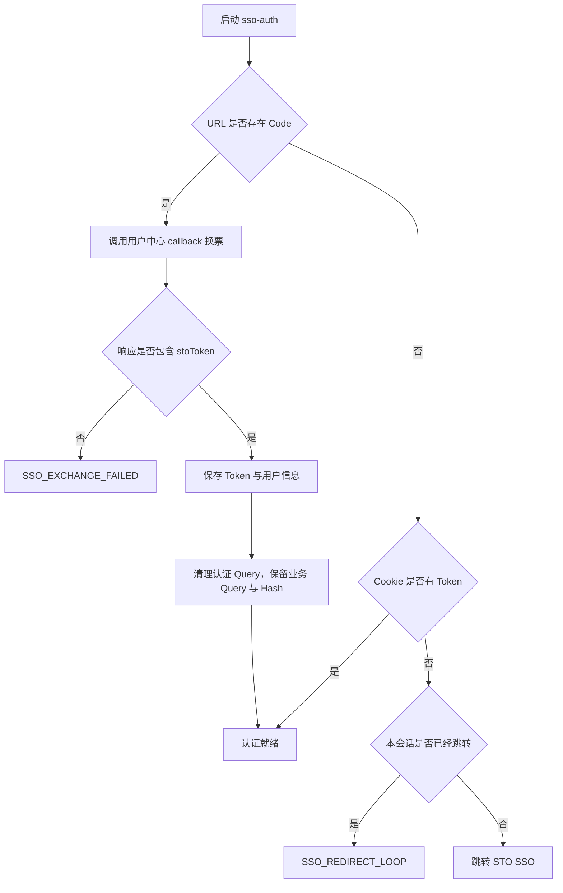

# SClaw Site SSO Auth 插件设计

**状态：** 已确认  
**日期：** 2026-08-27  
**正式包名：** `@sto/sclaw-plugin-sso-auth`

## 1. 背景

Site 应用发布后需要自行判断当前浏览器是否已经持有 `stoToken`。没有 Token 时，应用跳转到 STO SSO；回跳获得 Code 后，调用用户中心回调接口换取 Token，并保存当前用户会话。

这套逻辑当前复制在应用模板的 `sso.ts`、`sso-config.ts`、`sso-api.ts`、`auth-token.ts` 和 `session.ts` 中。模板复制会造成认证逻辑重复、环境规则不一致、旧应用难以升级，也会让 AI 误改基础认证代码。

此前曾使用一个通用 Runtime 包名描述该能力。该命名和职责现已废止：正式实现只保留 Site SSO 能力，并统一命名为 `@sto/sclaw-plugin-sso-auth`。

## 2. 目标

1. 将 Site SSO 从模板代码抽离为公司内部 npm 插件包。
2. 本地 Site 预览直接使用当前登录 SClaw 的用户身份，不触发 SSO 跳转。
3. 发布 Site 自动完成登录跳转、Code 换票、Token 保存、URL 清理和未授权恢复。
4. 新建 Site 应用默认安装并静态导入该插件。
5. Assets 应用不安装、不导入、不启动该插件。
6. 插件携带 Manifest、AI Skill 和配置 Schema，并跟随应用锁定版本发布。

## 3. 非目标

- 不实现通用应用 Runtime 内核 npm 包。
- 不实现 Policy Ontology Client 或 Operation。
- 不实现 Assets Host Bridge。
- 不实现插件市场 UI、插件升级或卸载。
- 不允许浏览器配置任意 SSO Origin、Path 或认证 Header。
- 不在本计划中修改公司 code-deploy 仓库。

## 4. 包位置与结构

插件源码与 `sto-policy-ontology-sdk` 一样，作为独立 npm 包维护在 SClaw 仓库的 `packages/` 目录中：

```text
packages/sclaw-plugin-sso-auth/
├── src/
│   ├── index.ts
│   ├── runtime.ts
│   └── vite.ts
├── sclaw/
│   ├── plugin.json
│   ├── schemas/config.schema.json
│   └── skills/sso-auth/SKILL.md
├── tests/
├── package.json
├── tsconfig.json
└── README.md
```

仓库目录名固定为 `sclaw-plugin-sso-auth`，`package.json` 中的正式包名固定为 `@sto/sclaw-plugin-sso-auth`。构建与发布方式对齐 `packages/sto-policy-ontology-sdk`：使用 TypeScript 开发、通过 `tsup` 生成 ESM、CJS 和类型声明，并发布到公司 npm Registry。应用模板消费已发布的固定版本，不使用 `file:`、开发机绝对路径或运行时直接引用仓库源码。

发布后的 npm 包结构如下：

```text
@sto/sclaw-plugin-sso-auth@0.1.0
├── package.json
├── README.md
├── dist/
│   ├── index.js
│   ├── index.d.ts
│   ├── runtime.js
│   ├── runtime.d.ts
│   ├── vite.js
│   └── vite.d.ts
└── sclaw/
    ├── plugin.json
    ├── schemas/config.schema.json
    └── skills/sso-auth/SKILL.md
```

入口职责：

| 入口 | 使用方 | 职责 |
|---|---|---|
| `@sto/sclaw-plugin-sso-auth` | Site 业务基础设施 | 启动认证、读取当前用户、读取 Token、登出 |
| `@sto/sclaw-plugin-sso-auth/runtime` | SClaw 生成的插件注册文件 | 以插件形式启动 SSO Auth |
| `@sto/sclaw-plugin-sso-auth/vite` | Site 模板的 Vite 配置 | 注入本地公开配置并提供同源身份 Bootstrap |

同一个 npm 版本同时包含浏览器 Runtime、Vite 开发适配、Manifest、Skill 和 Schema。npm 版本是插件版本的唯一权威来源。

## 5. 公共 API

```ts
export type StoSsoAuth = {
  bootstrap(): Promise<void>;
  getToken(): string | null;
  getUser(): StoSsoUser | null;
  logout(): Promise<void>;
  handleUnauthorized(): Promise<void>;
};

export function bootstrapSsoAuth(
  options?: BootstrapSsoAuthOptions,
): Promise<StoSsoAuth>;

export function getSsoAuth(): StoSsoAuth;
```

`bootstrapSsoAuth()` 必须 Single-flight：同一页面并发或重复启动只执行一次。只有启动失败后才允许下一次调用重试。

业务代码如果需要当前身份，只能通过 `getSsoAuth()` 读取，不能读取 Cookie、拼接 SSO URL 或直接调用换票接口。

## 6. 插件 Manifest

```json
{
  "schemaVersion": 1,
  "id": "sto.sso-auth",
  "displayName": "STO Site SSO",
  "description": "为独立站点提供本地 SClaw 身份和发布态 STO 单点登录。",
  "pageTypes": ["site"],
  "runtime": {
    "entry": "./runtime",
    "activation": "bootstrap"
  },
  "provides": {
    "hostCapabilities": ["auth.sto-token"]
  },
  "ai": {
    "skills": [
      {
        "id": "sso-auth",
        "path": "./skills/sso-auth"
      }
    ],
    "schemas": "./schemas"
  }
}
```

`pageTypes` 固定为 `site`。即使安装编排器出现错误，插件 Runtime 在 Assets 中也必须拒绝启动。

## 7. Runtime 配置

```ts
export type StoSsoAuthConfig = {
  protocolVersion: 'sto-sso-auth/v1';
  applicationId: string;
  pageType: 'site';
  runtimeMode: 'local' | 'published';
  deployEnv: 'daily' | 'stage' | 'online';
  sso?: {
    environment: 'daily' | 'pre' | 'prod';
    systemCode: string;
    loginOrigin: string;
    apiOrigin: string;
  };
};
```

本地配置由 Vite 插件生成；发布配置由 code-deploy 在构建或 HTML 生成阶段注入到：

```js
window.__STO_SSO_AUTH_CONFIG__ = { /* public config */ };
```

公开配置不能包含 Token、Cookie、Code、Runtime Session Secret 或 npm 凭证。

### 环境矩阵

| 发布环境 | SSO 环境 | Login Origin | API Origin |
|---|---|---|---|
| `daily` | `daily` | `https://baseinfo-usercenterserviceapi-hq-test.sto.cn` | `https://baseinfo-usercenterapi-test.sto.cn` |
| `stage` | `pre` | `https://pre-baseinfo-usercenterservice-api-hq.sto.cn` | `https://pre-baseinfo-usercenterapi.sto.cn` |
| `online` | `prod` | `https://baseinfo-usercenterserviceapi.sto.cn` | `https://baseinfo-usercenterapi.sto.cn` |

发布环境注入是权威来源。Hostname 推断和 `VITE_SSO_ENV` 只用于旧应用兼容，不能覆盖有效的发布配置。

## 8. 本地 Site 身份流程



SClaw 为每个正在运行的预览创建 32 字节随机 Session Secret，并只通过 Vite 子进程环境变量传递。Vite 注入 HTML 的公开配置不能包含 Secret 或 Host API 地址。

本地身份 Provider：

- 不检查 Site Cookie。
- 不写 Cookie 或 localStorage。
- 不调用用户中心接口。
- 不触发浏览器 SSO 跳转。
- Preview、刷新和 HMR 都通过同源 Bootstrap 恢复当前 SClaw 身份。

## 9. 发布 Site SSO 流程



固定启动顺序：

1. 先领取 `code` 或 `authorizationCode`。
2. 使用配置中的 `apiOrigin` 调用 `/sso/login/callback?code=<encoded>`。
3. 校验响应并要求非空 `stoToken`。
4. 写入当前 Site 域的 host-only Cookie。
5. 将非敏感用户展示信息写入版本化 localStorage Key。
6. 清理认证 Query，保留业务 Query 和 Hash Route。
7. 无 Code、无 Token 时构造登录地址并跳转。
8. 首次 401 清理会话并重新登录；会话级 Guard 阻止无限跳转。

## 10. 会话存储

| 数据 | 存储位置 | 规则 |
|---|---|---|
| `stoToken` | host-only Cookie + Provider 内存 | `Path=/; SameSite=Lax`，HTTPS 增加 `Secure`，禁止 `Domain` |
| 当前用户展示信息 | `localStorage` | Key 固定为 `sto.sso-auth.user.v1`，不得包含 Token |
| Redirect Guard | `sessionStorage` | Key 固定为 `sto.sso-auth.redirect.v1` |
| 401 Guard | `sessionStorage` | Key 固定为 `sto.sso-auth.unauthorized.v1` |
| Callback Code Claim | `sessionStorage` | Key 固定为 `sto.sso-auth.callback-code.v1`，只保存 Code 的 SHA-256 摘要，失败后也不释放 |
| 本地 Runtime Session Secret | Electron/Vite 服务端内存 | 禁止进入浏览器 |

登出时清理 Token、用户信息和 Guard，然后使用当前环境的 SSO 登录地址重新认证。

## 11. Site 模板接入

`site-minimal` 默认依赖固定版本：

```json
{
  "dependencies": {
    "@sto/sclaw-plugin-sso-auth": "0.1.0"
  }
}
```

模板保留两段平台基础代码：

```text
src/sclaw/plugins.generated.ts
  → 静态导入 @sto/sclaw-plugin-sso-auth/runtime

src/sclaw/bootstrap.ts
  → 启动生成的插件列表，认证完成后再挂载 App
```

模板不再包含 SSO URL、换票、Cookie、环境判断和 Token Query 注入实现。通用 Loading/Error UI 可以留在模板，但不得包含 SSO 业务分支。

`assets-minimal` 不添加该依赖，不生成该静态 import，也不包含 Site SSO 代理。

## 12. 与其他插件的关系

`sso-auth` 提供逻辑能力 `auth.sto-token`。未来 SClaw 插件宿主可以把该能力提供给其他 Site 插件。

Policy Ontology 插件不能直接把 `sso-auth` 作为 npm 依赖，因为 Assets 应用使用 Host Bridge 获取身份。跨 Site/Assets 的统一身份能力属于插件系统契约，不属于本插件实现范围。

## 13. AI Skill 边界

插件携带的 `SKILL.md` 必须要求：

- 页面和业务组件不得重新实现登录流程。
- 不得直接读取或写入 `stoToken` Cookie。
- 不得构造 SSO Login URL 或 Callback URL。
- 不得将 Token 输出到日志、页面、源码或 URL。
- Assets 应用禁止导入该插件。
- 修改认证基础设施必须由平台团队确认。

## 14. 错误模型

- `SSO_AUTH_CONFIG_MISSING`
- `SSO_AUTH_CONFIG_INVALID`
- `SSO_AUTH_PAGE_TYPE_UNSUPPORTED`
- `AUTH_REQUIRED`
- `LOCAL_AUTH_SESSION_DENIED`
- `LOCAL_AUTH_UNAVAILABLE`
- `SSO_EXCHANGE_FAILED`
- `SSO_RESPONSE_INVALID`
- `SSO_REDIRECT_LOOP`
- `SSO_STORAGE_FAILED`

错误可以包含安全的 HTTP Status、上游错误码和 `traceId`，但不能包含 Token、Cookie、Code、完整回跳 URL、请求 Header 或原始换票响应。

## 15. 安全不变量

- SSO Origin 和 Callback Path 只能来自已校验配置。
- 浏览器不能覆盖环境、Origin、Path、Method、System Code 或认证 Header。
- Runtime Session Secret 不能注入浏览器。
- Token 不能出现在 Preview URL、生成源码、日志、埋点或构建产物中。
- Site Cookie 禁止设置 `Domain=.sto.cn`。
- Assets 中检测到插件启动时必须立即失败，不能跳转登录。
- 同一个回跳 Code 只能换票一次。
- 首次 401 之后最多触发一次重新登录。

## 16. 验收标准

1. npm tarball 同时包含三个编译入口、Manifest、Schema 和 Skill。
2. 新建 Site 应用默认静态导入插件，新建 Assets 应用没有该依赖。
3. 本地 Site 使用当前 SClaw 身份，URL 不包含 Token，不触发 SSO。
4. 发布 Site 无 Token 时跳转登录，回跳后换票并清理 URL。
5. Cookie、用户信息、Callback Code Claim 和 Redirect Guard 遵守固定存储规则。
6. 重复 Bootstrap、重复 Code 和重复 401 不产生并发换票或跳转循环。
7. 全新 Git Checkout 可以通过锁文件安装依赖并构建。
8. 构建产物不包含 Skill、Schema、Token、Code、Runtime Session Secret 或开发机绝对路径。
9. 插件源码固定维护在 `packages/sclaw-plugin-sso-auth`，其构建与发布约定和 `packages/sto-policy-ontology-sdk` 保持一致。
