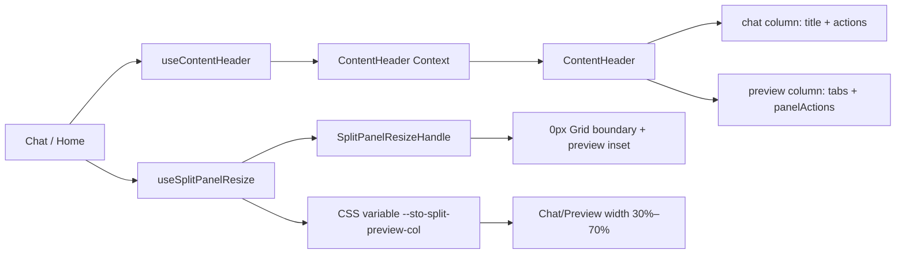

# 三栏工具区与拖拽边界 Code Review

> 评审日期：2026-07-22  
> 评审范围：三栏 Header 工具归属、标题截断、预览宽度拖拽、提示线与 OpenSpec 同步  
> 风险等级：Tier 2 主改造 + Tier 1 标题约束修正  
> 评审结论：**有条件通过（Changes Requested）**

## 1. 评审摘要

当前方案没有继续堆叠页面级补丁，而是在现有统一 Grid 上完成了局部结构收敛：

- `ContentHeader` 将会话级 `actions` 与预览面板级 `panelActions` 分槽，三栏工具归属清晰；
- Grid 中间轨道由占宽 `4px` 调整为 `0px`，拖拽命中区改为覆盖式实现；
- Chat 与 Home 共用 `SplitPanelResizeHandle` 和 `useSplitPanelResize`；
- 拖拽切换为 Pointer Events，并补充 `pointercancel`、卸载清理和键盘微调；
- 提示线与预览框共享 inset，规格为 `#FFD6BA / 2px`，默认隐藏，在 hover、dragging、focus-visible 时显示；
- 两栏与三栏标题恢复相同的最大宽度约束，三栏仅允许继续收缩；
- OpenSpec 已从旧的固定像素 resizer 方案更新到百分比 Grid 方案。

整体方向合理，不建议回退到页面内重复 resizer、绝对定位 icon 或占布局宽度的拖拽列。合并前仍有 1 项交互阻断风险和若干验证缺口需要处理。

## 2. 技术 CR 会议建议议程

建议会议控制在 30 分钟：

1. **5 分钟：需求和边界**  
   确认三个会话工具、预览开关、标题截断、拖拽热区和提示线的最终语义。
2. **8 分钟：代码调用链**  
   从页面 Header 注入、统一 Grid、共享 Handle 到 Pointer cleanup 逐层过代码。
3. **7 分钟：Diff 与补丁评估**  
   解释为什么采用局部结构重构，以及当前保留了哪些 deprecated 兼容残留。
4. **7 分钟：Review Findings**  
   重点讨论 Header 菜单 hit-test 冲突和 Pointer 事件级测试。
5. **3 分钟：合并决策**  
   明确阻断项、负责人和回归范围。

会议需要形成以下决定：

- 拖拽热区是否只覆盖 body，还是 Header 也必须支持拖拽；
- CR-01 是否作为合并阻断项；
- Pointer 生命周期事件级测试是否必须同 PR 补齐；
- deprecated resizer/action wrapper 本次删除还是后续清理；
- 仓库 TypeScript/ESLint 基线问题由谁处理，如何记录豁免；
- OpenSpec tasks 在哪一步统一收口。

## 3. 改动规模

以下统计以当前工作区相对 `HEAD` 为准；未跟踪的新文件按完整文件行数计入。无关 PPT 文档与本 CR 文档不计入实现行数。

### 3.1 汇总

| 类别 | 新增 | 删除 | 净增 |
| --- | ---: | ---: | ---: |
| 生产代码（11 个文件，含 1 个新文件） | 438 | 196 | 242 |
| 定向测试（1 个新文件） | 158 | 0 | 158 |
| OpenSpec（4 个文件） | 111 | 56 | 55 |
| Cursor 开发文档（1 个新文件） | 585 | 0 | 585 |
| 生产代码 + 测试 | 596 | 196 | 400 |

“新增 438 行生产代码”是 additions；考虑同时删除的 196 行旧实现后，生产代码实际净增 242 行。

### 3.2 逐文件 Diff

| 文件 | + / - | 修改内容 |
| --- | ---: | --- |
| `ContentHeader.tsx` | +21 / -9 | 分离 `actions/panelActions`；三栏工具落到各自列；标题保留统一 max-width |
| `content-header-context.tsx` | +11 / -5 | Header slot 新增 `panelActions` 并接入注册、比较和 display |
| `split-panel-resize-handle.tsx` | +80 / -0 | 新增共享 separator、aria、键盘微调、`data-resizing` 和提示线 DOM |
| `use-split-panel-resize.ts` | +107 / -68 | Mouse Events 改 Pointer Events；增加 overlay/RAF/cancel/unmount cleanup；支持键盘比例调整 |
| `surfaces.ts` | +69 / -21 | Grid 中间列 4px→0px；共享 inset；12px 热区；2px 提示线；标题/Header surface 调整 |
| `ChatSearchBar.tsx` | +81 / -37 | 将复合工具拆为会话工具与预览面板工具；保留 deprecated 兼容 wrapper |
| `Chat/index.tsx` | +33 / -28 | 分别注入两个 Header slot；接入共享 resize Handle 与 `isResizing` |
| `HomeMainConversation.tsx` | +33 / -28 | 与 Chat 同步接入 Header slot 和共享 resize Handle |
| `zh/en/ja chat.json` | 各 +1 | 新增 separator 无障碍文案 |
| `split-panel-layout.test.tsx` | +158 / -0 | 新增 Grid、标题、inset、提示线、aria 与两个页面接线的定向测试 |
| OpenSpec 4 个文件 | +111 / -56 | 将旧固定像素 resizer 规格同步为百分比 Grid、共享 Handle 和新 Header slot |

## 4. 代码调用链

### 4.1 Header 路径

1. Chat/Home 构造 `ChatConversationHeaderActions` 和 `ChatPreviewPanelActions`；
2. `useContentHeader` 分别注入 `actions`、`panelActions`、`previewTabs` 和 `isSplitLayout`；
3. 双栏按 `title → spacer → actions → panelActions` 排列；
4. 三栏中，`actions` 落到 chat Grid 第一列尾部，`previewTabs + panelActions` 落到 preview Grid 第三列；
5. 标题基础上限仍为 `min(34vw, 280px)`，三栏只增加收缩能力。

### 4.2 Resize 路径

1. `useSettingsStore.previewSplitPercent` 提供持久化比例；
2. `useSplitPanelResize` 将比例写入 main 的 `--sto-split-preview-col`；
3. `SplitPanelResizeHandle` 覆盖 0px Grid 边界，不占布局宽度；
4. Handle 与预览左描边共享 10px inset，提示线纵向共享 8px body inset；
5. Pointer 拖动期间通过 RAF 写 px，松手后提交 30%–70% 百分比；
6. `isResizing` 通过 `data-resizing` 保证全屏 overlay 下提示线不消失。

## 5. 是否属于“套补丁”

### 5.1 结论

**核心主路径不是套补丁，而是一次可控的局部结构重构。**

判断依据：

- 没有用负 margin、translate 搬运三个 icon；
- 没有在 Chat/Home 分别复制两套拖拽逻辑；
- 没有继续保留占宽 4px 列再叠加视觉补偿；
- Header 工具通过语义 slot 拆分，不依赖页面 DOM 偶然顺序；
- 拖拽状态集中在共享 Hook/Handle，Grid 比例仍只有一个真值；
- 标题问题只修正宽度约束，没有引入字符数判断或 JS 测量。

### 5.2 当前仍存在的补丁残留

1. `stoSplitGridHeaderResizerClass`、`stoSplitResizerClass`、`stoSplitResizerActiveClass`、`stoSplitGridBodyResizerClass` 已无生产消费者，但仍以 deprecated 形式保留；
2. `ChatContentHeaderActions` 已无生产消费者，但仍保留 deprecated 兼容 wrapper；
3. `ContentHeader` 三栏额外添加的 `overflow-hidden` 与标题基础 surface 已有值重复；
4. 部分测试通过 `readFileSync + 正则` 检查源码，属于防回退补丁式测试，不是行为测试；
5. 样式规格同时存在导出常量、CSS variable 和 Tailwind 字面量，需要后续明确唯一真值；
6. OpenSpec task 勾选状态未随代码完全更新。

这些残留目前没有形成新的业务分支或第二套运行逻辑，但应在本次合并前或明确的后续清理任务中收口，避免下一次迭代继续叠加。

## 6. 变更范围

### 6.1 核心实现

- `src/components/layout/ContentHeader.tsx`
- `src/components/layout/content-header-context.tsx`
- `src/components/layout/split-panel-resize-handle.tsx`
- `src/hooks/use-split-panel-resize.ts`
- `src/lib/surfaces.ts`
- `src/pages/Chat/ChatSearchBar.tsx`
- `src/pages/Chat/index.tsx`
- `src/pages/Home/HomeMainConversation.tsx`
- `src/i18n/locales/{zh,en,ja}/chat.json`

### 6.2 规格与测试

- `openspec/changes/chat-file-preview-enhancement/`
- `tests/unit/split-panel-layout.test.tsx`
- `docs/三栏工具区与无痕拖拽边界-Cursor开发文档.md`

### 6.3 不在本次 CR 范围

- `docs/PPT生成工作流-Cursor开发文档.md`
- 消息发送、预览文件解析、Gateway、IPC、Store schema 与构建配置

## 7. Review Findings

### CR-01 · P1 · 拖拽命中区可能覆盖预览 Header 左侧菜单按钮

**证据**

- `stoSplitPanelResizeHandleClass` 使用 `row-start-1 row-span-2`、`z-20`、`w-3`，并向右平移 `--sto-split-preview-inset-x`；
- `stoSplitGridHeaderPreviewClass` 同样使用该 inset 作为左 padding；
- `ChatPreviewHeaderTabs` 的第一个交互控件就是左侧菜单按钮。

因此命中区中心与预览框左描边重合后，12px 热区会跨描边左右各约 6px，并在 Header 行覆盖菜单按钮左侧的一部分。由于 handle 为 `z-20` 且接管 `pointerdown`，这部分区域可能显示 `col-resize` 或开始拖拽，而不是触发菜单。

**影响**

- 预览区菜单的有效点击面积缩小；
- Header 左缘出现“看起来是按钮、实际触发拖拽”的命中歧义；
- 当前静态测试无法发现真实 hit-test 冲突。

**建议**

优先将可交互拖拽热区限制在 body/预览卡片高度内，使其与可见提示线范围一致；如果产品要求 Header 也能拖拽，则必须显式为 Header 左侧控件预留不重叠空间，并用浏览器 hit-test 验证。不要只降低 `z-index`，否则 iframe/预览内容可能反向截断拖拽。

### CR-02 · P2 · Pointer 拖拽生命周期缺少事件级测试

现有 10 个定向测试主要验证 class 字符串、SSR 标记和源码正则，能够防止规格值回退，但没有实际执行：

- `pointerdown → pointermove → pointerup`；
- `pointercancel`；
- 拖拽中卸载/关闭预览；
- overlay 创建与移除；
- RAF 取消；
- `document.body.userSelect/cursor` 恢复；
- 30%/70% 拖拽边界提交；
- `isResizing` 从 true 恢复 false。

本次 Hook 从 Mouse Events 改成 Pointer Events，并重写了 cleanup，是风险最高的功能变化。建议增加一个针对 `useSplitPanelResize` 的 jsdom 事件级测试，而不是继续增加读取源码字符串的断言。

### CR-03 · P2 · OpenSpec tasks 状态与实际实现不一致

以下代码已经存在，但 `tasks.md` 仍标记为未完成：

- 3.3：0px Grid 与移除双 gap；
- 3.5：Pointer Events 与 cleanup；
- 3.7：共享 pane inset；
- 4.1–4.3：`panelActions` 插槽、Header 分栏、Chat/Home 接线；
- 5.6：定向单元测试。

这会使 proposal/design/spec 与执行清单产生审计漂移。完成 CR-01、CR-02 和手动验证后，应统一更新任务状态；未验证项保持未勾选。

### CR-04 · P3 · 样式规格存在“导出常量 + Tailwind 字面量”双份真值

`STO_SPLIT_PREVIEW_INSET_*`、`STO_SPLIT_RESIZE_EDGE_*` 被导出供测试读取，但实际 Tailwind class 仍使用 `10px / 8px / #FFD6BA / 2px` 字面量。当前测试能够在常量变化时发现不一致，因此不是运行时缺陷，但命名容易让维护者误以为样式在运行时消费这些常量。

建议后续选择一种明确策略：CSS variable 作为运行时唯一真值，测试直接断言变量；或将这些导出常量改为仅供测试/规格校验的命名，避免误导。本项不阻断合并。

## 8. 正向评价

### 8.1 Header 职责拆分合理

`actions` 与 `panelActions` 的语义比通过 Fragment 顺序和 CSS 位移控制位置更稳定。双栏仍按 `actions → panelActions` 展示，三栏则分别落入 chat/preview Grid 列，没有复制工具组件。

### 8.2 拖拽布局模型合理

`0px` 逻辑轨道、覆盖式热区、百分比持久化和统一 CSS Grid 能避免固定 resizer 列偷占宽度，也让 Header 与 Body 共用同一列宽来源。Chat/Home 共用组件和 Hook，符合局部重构目标。

### 8.3 状态表达比纯 hover 完整

使用 `data-resizing` 保持全屏 overlay 下的提示线可见是必要的。默认隐藏、hover/dragging/focus-visible 显示的状态矩阵与最新人工确认一致。

### 8.4 标题修正保持最小化

三栏仅移除 `max-w-none`，继续沿用两栏的 `max-w-[min(34vw,280px)]`，同时保留 `min-w-0 shrink`。该修正没有引入字符截断逻辑或 JS 宽度测量。

## 9. 验证记录

| 检查 | 结果 | 说明 |
| --- | --- | --- |
| `git diff --check` | 通过 | 未发现空白错误 |
| 定向 Vitest | 通过 | `tests/unit/split-panel-layout.test.tsx`，10/10 通过 |
| TypeScript | 阻塞 | 仓库缺少 `dist-electron/shared/*.d.ts` 生成结果，并缺少 `reactflow` 类型/模块；未出现指向本次新增 Handle API 的单独错误 |
| 定向 ESLint（只读） | 未通过 | `Chat/index.tsx` 现有 `set-state-in-effect` 3 个错误；`content-header-context.tsx` 现有 Fast Refresh 2 个 warning |
| 全量单测 | 基线不可用 | 仓库存在多组与本任务无关的既有失败；本次仅采用定向测试结果 |
| 交互手测 | 待补 | 需要补 Header 菜单 hit-test、hover/dragging、pointercancel、路由卸载、30/50/70 和暗色模式 |

说明：项目 `pnpm run lint` 自带 `--fix`，本次 CR 为避免改写用户工作区，使用本地 ESLint 二进制执行只读检查。

## 10. 合并前检查清单

- [ ] 解决或实测排除 CR-01 的 Header 菜单命中区冲突。
- [ ] 增加 Pointer 生命周期事件级测试，至少覆盖 pointerup、pointercancel、unmount cleanup。
- [ ] Chat 与 Home 都完成 30% / 50% / 70% 拖拽验证。
- [ ] 默认不显示提示线；hover、拖拽、focus-visible 显示 `#FFD6BA / 2px`。
- [ ] 拖拽结束后 overlay、cursor、userSelect 和 `isResizing` 全部恢复。
- [ ] 长标题在三栏中不比两栏展示更多文字，且不挤走三个工具。
- [ ] 亮色/暗色均无旧短灰线和异常 focus 残影。
- [ ] Workflow Editor、TaskDetail 等非 split Header 消费者完成回归。
- [ ] 根据实际完成情况更新 OpenSpec tasks 勾选状态。
- [ ] 确认 README 三语无需更新，或在同一提交中补齐。
- [ ] 新增的 Handle、测试和开发文档文件纳入提交，排除无关 PPT 文档。

## 11. 最终结论

当前实现选择“在现有架构上做局部结构收敛”是正确的，不需要整体重写三栏布局。建议在解决 Header 命中冲突并补齐 Pointer 生命周期测试后合并；其余问题属于规格清理和仓库基线验证，不应通过继续堆叠 UI 补丁解决。
