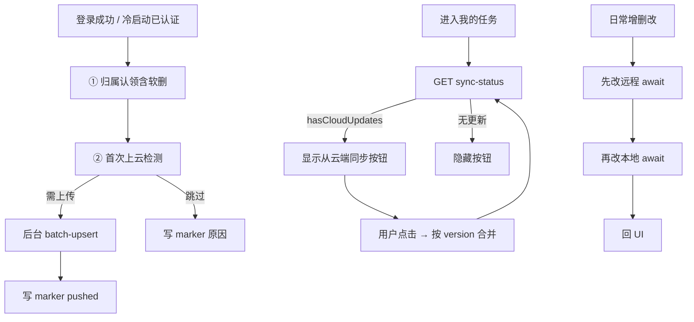

# 定时任务云端同步与历史归属

> 状态：方案已定，待编码  
> 日期：2026-08-17  
> 关联：[`docs/Task接入抽离Composer与云端同步.md`](./Task接入抽离Composer与云端同步.md)（阶段三云端 schema / 路由）、[`docs/sqlite/schedule-tasks.md`](./sqlite/schedule-tasks.md)、`electron/api/routes/auth.ts`、`electron/scheduled-tasks/`、`memory-center/`

---

## 一、目标

1. **历史归属**：升级后本机所有本地定时任务（含软删）统一归属「新版本后第一个登录的人」，补齐早期 `created_by` 为空的问题。
2. **换机不丢**：本机历史任务在满足条件时**自动全量上云一次**；新电脑通过「我的任务」页**手动拉取**恢复。
3. **日常一致**：之后增删改查同时改远程与本地；全量上云只做一次，不再依赖登录后反复全量 push。

---

## 二、总体分工

| 动作 | 触发时机 | 是否挡 UI |
|------|----------|-----------|
| 历史归属认领 | 登录后后台（含冷启动已登录） | 否 |
| 首次全量上云（bootstrap push） | 登录后检测通过再后台执行 | 否（不挡登录进首页） |
| 从云端拉取 | 「我的任务」页同步按钮（**仅当检测到云端有更新时显示**） | 是（用户主动等待） |
| 日常 CRUD 双写 | 每次增删改 | 是（先远程 await，再本地 await） |



---

## 三、历史归属认领

### 3.1 策略

- **范围**：本地 `schedule_tasks` **全部行**（含 `deleted_at` 非空的软删行），不只 `created_by IS NULL`。
- **归属人**：新版本上线后，本机**第一个**拿到有效身份的用户（`user.code`）。
- **写入字段**：`created_by`、`updated_by` 均写成该用户；`updated_at` 可刷新为认领时间（便于审计）。
- **时机**：必须在**有用户身份之后**，不能放在主进程 `initialize()` 登录前迁移流水线（彼时 `getAuthState()` 常为空）。

### 3.2 幂等

- Marker：`~/.stoclaw/schedule-tasks-ownership-claim.done`
- 有 marker → 跳过；切号不再重认领。
- Marker 内容建议：`claimedBy`、`count`、`completedAt`。

### 3.3 调用点

| 入口 | 原因 |
|------|------|
| `schedulePostLoginBackgroundWork`（`electron/api/routes/auth.ts`） | 显式登录 / session commit / 切号后的后台路径 |
| 冷启动已认证路径（`runAuthenticatedSetup({ source: 'startup' })` 同级或其后） | 升级后带着旧登录态开机、不重新点登录时也能认领 |

两者调同一函数 + 同一 marker，避免漏跑或双跑。

### 3.4 与启动期迁移的关系

`runScheduledTasksMigration`（引擎 `definitions.json` / `jobs.json` → SQLite）仍在登录前执行；其中 `actor = user?.code ?? null` 仅作可选标注，**不承担**本方案的归属认领。认领是独立 Step 0，在登录后、首次上云之前完成。

---

## 四、首次全量上云（登录后检测）

### 4.1 目的

解决「本机已有历史任务、云端该用户还是空」时的一次性备份。  
**不**负责新电脑恢复（恢复见 §五手动拉取）。

### 4.2 检测顺序（全部满足才 push）

```
① 本机该用户 bootstrap marker 已存在？ → 跳过
② 无 userCode / 未登录？ → 跳过
③ 若归属尚未认领 → 先执行 §三
④ 本地任务数（含软删）== 0？ → 跳过，marker 记 skipped_empty_local
⑤ GET 云端 list（当前用户）
   - 云端已有数据？ → 跳过自动上云，marker 记 skipped_cloud_not_empty
     （防止重装/旧本地覆盖云端真源）
   - 云端为空 且 本地有数据？ → batch-upsert 全量（含软删）→ 成功后 marker 记 pushed
```

一句话：**本机未做过首次上云 + 本地有数据 + 云端该用户为空 → 才自动 push。**

### 4.3 Marker

- 路径：`~/.stoclaw/schedule-tasks-cloud-bootstrap.{userCode}.done`
- 按 **userCode** 分文件：同机多账号互不影响。
- 内容建议：`status: pushed | skipped_empty_local | skipped_cloud_not_empty`、`count`、`completedAt`。

### 4.4 体验（卡顿相关）

- 检测与 batch-upsert 放在登录后**后台**（对齐 `schedulePostLoginBackgroundWork`），**不**在登录 API / 进首页前 `await` 全量上传。
- 可选：角落 toast「正在备份定时任务」；失败不阻断使用，可下次登录重试（无成功 marker 时）或由手动「同步到云端」兜底。

### 4.5 空库保护

本地 0 条时**禁止**用空集当「全量真源」去覆盖云端；跳过并记 marker。恢复只走手动拉取。

---

## 五、从云端拉取（手动）

### 5.1 入口

「我的任务」页（`TaskToolbar`）提供拉取能力（与 [`Task接入抽离Composer与云端同步.md`](./Task接入抽离Composer与云端同步.md) §3.3 一致）：

- 「从云端同步 / 拉取」：`GET .../cloud/list` → 本地按条合并（§七）
- 「同步到云端」：本地全量 → `POST .../cloud/batch-upsert`（手动兜底 / 排障；正常路径依赖 §四自动一次 + §六日常双写；**不**受 §5.3 显隐条件约束，可另做入口或仅开发/排障暴露）

### 5.2 不在登录后自动 pull

避免登录后偷偷改本地列表；换机恢复由用户进入「我的任务」后主动触发。

### 5.3 「从云端同步」按钮显隐（条件出现）

**规则：仅当检测到「云端比本地新」时显示该按钮；无更新则隐藏。**

#### 检测方式

进入「我的任务」定时任务 section 时（以及窗口重新 focus / 从其它页返回时可选再检；**不**在登录后全局预检）调用一次轻量接口，**不要**对每条任务单独打 HTTP：

```
GET /api/scheduled-tasks/cloud/sync-status
→ {
  hasCloudUpdates: boolean,
  cloudNewerCount: number,   // 同 id 且云端 version 更大
  missingLocalCount: number, // 云端有、本地无
  sampleIds?: string[]
}
```

主进程内：一次 `list` 云端（当前用户）+ 一次 `list` 本地（当前用户作用域）→ 按 `id` 内存比对 → 返回上述结果。

#### 「云端比本地新」判定（任一条满足 → `hasCloudUpdates = true`）

| 情况 | 是否算云端更新 |
|------|----------------|
| 云端有 `id`，本地没有 | ✅ |
| 同 `id`，云端 `version` > 本地 | ✅ |
| 同 `id`，`version` 相同但云端 `updated_at` 更新（可选） | ✅ |
| 本地 `version` > 云端 | ❌ 不因此显示拉取按钮（靠日常双写；本地更新无需靠该按钮「拉下来」） |
| 两边都空 / 完全一致 | ❌ |

UI：`hasCloudUpdates === true` 才渲染按钮；可选展示数量，如「从云端同步 (3)」。

#### 拉取后

成功合并后**立刻再调一次 sync-status**（或根据本次合并结果清零），无剩余云端更新则按钮消失。

#### 其它约束

- 未登录：不请求、不显示。
- 比对范围：仅当前 `userCode`（云端 `owner_user_id` ↔ 本地 `created_by`）。
- 检测失败：隐藏按钮或灰显「同步状态未知」，避免因网络错误常驻误导。

---

## 六、日常 CRUD 双写

### 6.1 顺序（已定）

```
先改远程（await）→ 成功后再改本地（await）→ 再回 UI
```

- 远程失败 → 本地不动，UI 报错。
- 弱网下单次保存变慢是刻意取舍（强一致优先于本地先行）。
- **与 §四首次全量上云无关**：首次全量在后台；日常是单条路径上的 await。

### 6.2 挂载点

`ScheduledTaskService`（或 Host API 路由层）的 create / update / delete / setEnabled：在既有本地逻辑外，按上述顺序接入 cloud upsert / 逻辑删除。  
鉴权用户 = 当前登录 `user.code` → 云端 `owner_user_id`。

---

## 七、版本与冲突

本地与云端均有 `version`（本地每次变更 `version + 1`）。合并以 **同 `id`** 为键：

| 情况 | 拉取时建议 |
|------|------------|
| 本地无此 `id` | 插入云端行 |
| 云端 `version` > 本地 | 用云端覆盖本地 |
| 本地 `version` > 云端 | **保留本地**（手动同步可 toast 冲突明细，勿默默盖掉） |
| `version` 相同 | 可再比 `updated_at`；仍相同则跳过 |
| 仅一边软删 | 以 `deleted_at` + 较高 `version` / 较新 `updated_at` 为准 |

换机连续编辑示例：A 建任务 push → B 拉取 → B 改到 v2 并双写云端 → A 再点拉取发现云端 v2 > 本地 → 覆盖 A 本地。

云端 upsert（日常双写 / batch）：按 `(owner_user_id, id)`；version 冲突策略与上表对齐，详见 memory-center 实现时补充。

---

## 八、账号隔离

### 8.1 云端

- 表：`schedule_tasks_cloud`（计划见 Composer 文档阶段三），唯一约束 `(owner_user_id, id)`。
- list / upsert / delete **只认** token 解析出的当前用户；禁止客户端伪造他人 `owner_user_id`。
- **不会**因本机操作改写其他账号的云端数据。

### 8.2 本地

- 当前 `schedule_tasks` 为本机单表，无分库。
- 拉取 / 列表写回时必须限定当前用户作用域：
  - **只 upsert** `owner` / `created_by === 当前 userCode` 的行（认领后历史行已是该用户）；
  - **绝不删改** 其他 `created_by` 的行（同机多账号场景）。
- 与「首登认领全部本地任务」策略一致：升级后本机历史先集中到第一个人，再按该用户上云。

---

## 九、云端 API 依赖（memory-center）

与 Composer 文档阶段三对齐，本方案消费侧约定：

| 接口 | 用途 |
|------|------|
| `POST /scheduled-tasks/cloud/batch-upsert` | 首次上云 / 手动「同步到云端」 |
| `GET /scheduled-tasks/cloud/list` | 首次检测是否空云端；手动拉取；sync-status 比对 |
| `GET /api/scheduled-tasks/cloud/sync-status`（Host API） | 「我的任务」按钮显隐：是否存在云端更新 |
| `POST /scheduled-tasks/cloud/delete`（或 upsert 带 `deleted_at`） | 日常删除 / 软删镜像 |

字段与本地 `schedule_tasks` 同构 + `owner_user_id`；`extra_json` 原样镜像（含 composerSegments / composerAttachments）。

客户端经 Host API 代理（`electron/api/routes/scheduled-tasks.ts` + `host-api-proxy`），不在 renderer 直打 memory-center。

---

## 十、实现清单（编码时）

**客户端**

1. `ScheduleTaskRepository.claimAllOwnership(userCode)`（含软删）
2. `electron/scripts/claim-schedule-tasks-ownership.ts` + marker
3. `electron/scripts/` 或 service：`detectAndBootstrapCloudPush(userCode)`（§4.2）
4. 登录后 / 冷启动已认证调用：认领 → 检测上云（后台）
5. `ScheduledTaskService` CRUD：远程 → 本地 await
6. Host API `GET /api/scheduled-tasks/cloud/sync-status`（§5.3）+ 「我的任务」`TaskToolbar` 条件渲染「从云端同步」
7. 拉取成功后刷新 sync-status；pull / 手动 push + version 合并与冲突提示
8. 单测：marker 幂等、空库不推、云端非空不推、version 合并、软删随全量上云、sync-status 显隐边界
**memory-center**

1. `schedule_tasks_cloud` 表与 alembic
2. batch-upsert / list / delete + `owner_user_id` 鉴权
3. 与客户端约定 version 冲突响应格式

**文档**

- 本文件为产品/客户端策略真源；表结构细节仍以 Composer 文档阶段三 + `docs/sqlite/schedule-tasks.md` 为准。
- 编码完成后可补 `docs/定时任务云端同步.md` 实现说明（接口样例 / 错误码），或直接扩写本文件「实现附录」。

---

## 十一、非目标

- 登录后自动从云端拉取覆盖本地。
- 启动期（登录前）做身份绑定归属或上云。
- 用空本地全量覆盖非空云端。
- 跨用户共享同一云端任务行。
- 运行记录 `schedule_task_runs` 的云端镜像（本方案仅任务定义表；runs 另议）。
